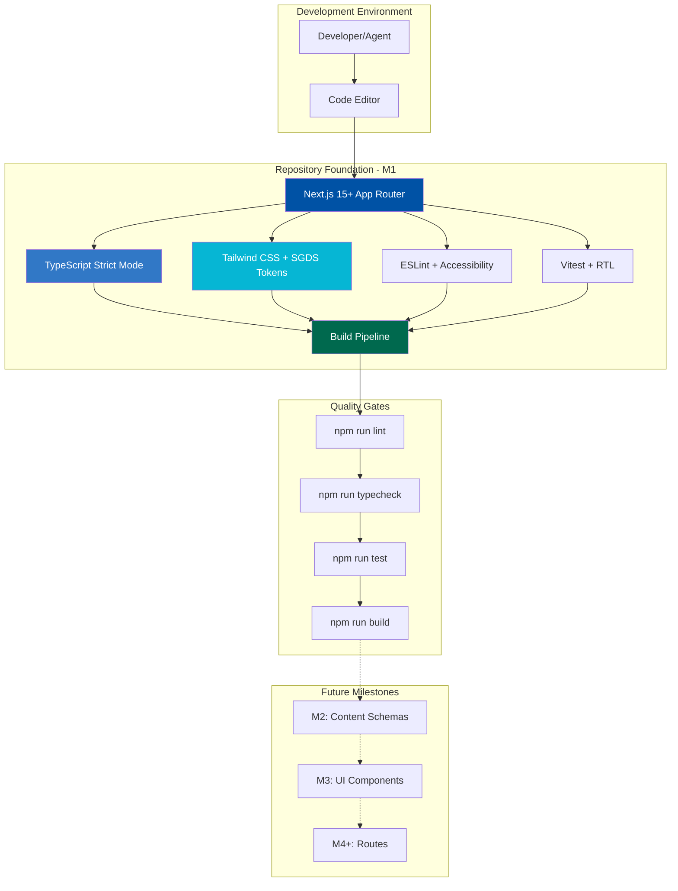
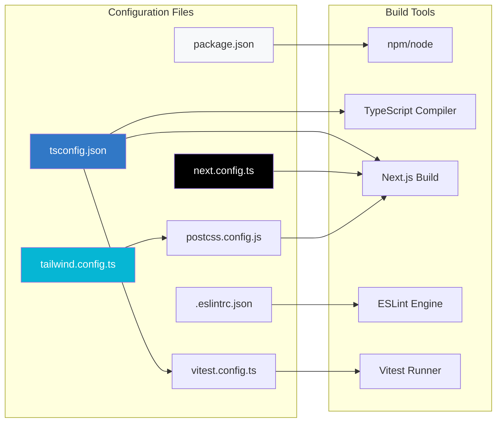
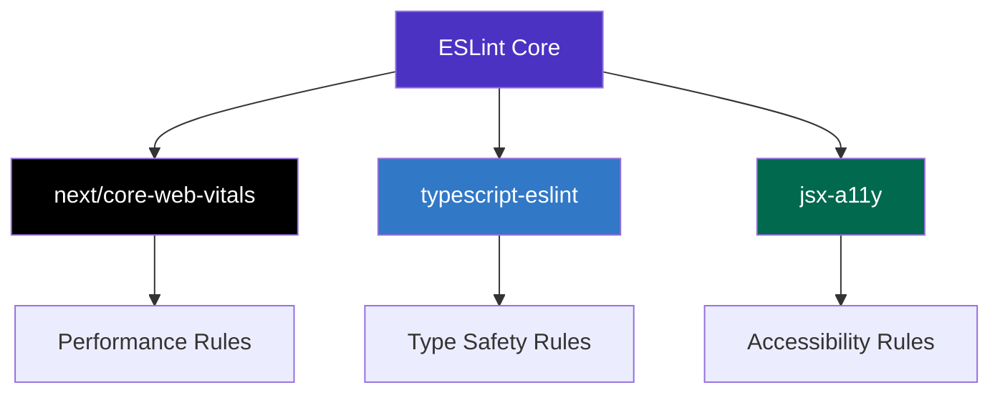
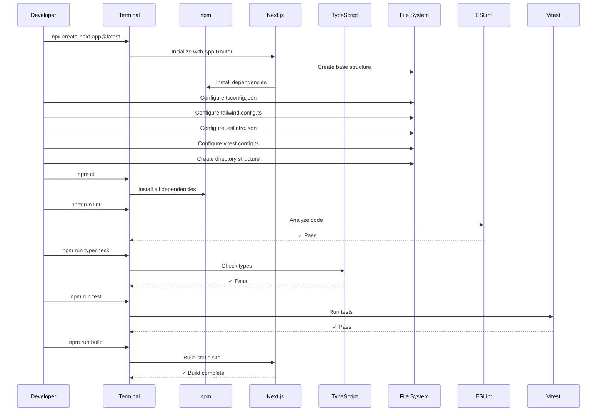
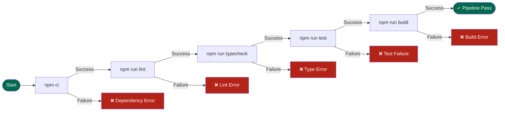

# Technical Design Document: M1 Repository Foundation & Toolchain

> **Document Status:** Draft  
> **Last Updated:** 2026-10-20  
> **Lead Architect:** Angelo Andres  
> **Requirements Reference:** `requirements.md`  
> **Master Specifications:** `PRD.md`, `TRD.md`, `AGENTS.md`, `design.md`

---

## Overview

### Purpose

This document specifies the technical design for Milestone 1 (M1): Repository Foundation & Toolchain. M1 establishes the complete development infrastructure for `personal-website-portfolio-v2`, including Next.js 15+ App Router initialization, TypeScript strict mode configuration, Tailwind CSS with SGDS-inspired semantic tokens, comprehensive linting and testing infrastructure, and a verified build pipeline.

### Scope

**In Scope:**
- Next.js 15+ project initialization with App Router architecture
- TypeScript strict mode configuration with path aliases
- Tailwind CSS configuration with complete SGDS-inspired token system
- ESLint with TypeScript and accessibility plugins
- Test framework setup (Vitest) with React Testing Library
- Complete directory structure creation
- Package script configuration for verification pipeline
- Zod schema validator installation
- Repository documentation (README.md)
- Git configuration (.gitignore)
- PostCSS and Autoprefixer configuration
- Next.js type definitions
- Verification pipeline execution and validation

**Out of Scope:**
- Content schema implementation (M2)
- UI component library (M3)
- Route implementations (M4-M8)
- Content loading logic (M2)
- Markdown rendering configuration (M2)

### Design Principles

1. **Zero Unsafe Patterns:** No `any`, implicit `any`, non-null assertions, or unsafe type casts
2. **Token-Based Design:** All design values use semantic tokens from `design.md`
3. **Static-First Architecture:** Configuration optimized for static generation
4. **Quality Gates:** Every change must pass lint, typecheck, test, and build
5. **Specification-Driven:** All decisions traceable to master specification documents

---

## Architecture

### System Context Diagram



### Technology Stack

| Layer | Technology | Version | Purpose |
|-------|------------|---------|---------|
| **Framework** | Next.js | ^15.0.0 | App Router, static generation, build optimization |
| **Language** | TypeScript | ^5.0.0 | Type safety, strict mode enforcement |
| **Styling** | Tailwind CSS | ^3.4.0 | Utility-first CSS with semantic tokens |
| **Linting** | ESLint | ^9.0.0 | Code quality and accessibility checks |
| **Testing** | Vitest | ^2.0.0 | Fast unit test execution |
| **Testing Library** | React Testing Library | ^16.0.0 | Component testing utilities |
| **Schema Validation** | Zod | ^3.23.0 | Runtime type validation (for M2+) |
| **CSS Processing** | PostCSS | ^8.4.0 | CSS transformation pipeline |
| **Autoprefixing** | Autoprefixer | ^10.4.0 | Cross-browser CSS compatibility |

### Directory Structure Design

```
personal-website-portfolio-v2/
├── .kiro/                          # Kiro specification artifacts
│   └── specs/
│       └── m1-repository-foundation-toolchain/
│           ├── .config.kiro
│           ├── requirements.md
│           └── design.md
│
├── content/                        # Local content files (M2+)
│   ├── site.json                   # Global site configuration
│   ├── projects/                   # Project case studies
│   ├── certifications/             # Certifications and badges
│   └── blog/                       # Blog posts and participation log
│
├── public/                         # Static assets
│   ├── images/
│   │   ├── projects/
│   │   ├── certifications/
│   │   └── blog/
│   └── files/
│       └── resume.pdf
│
├── src/                            # Application source code
│   ├── app/                        # Next.js App Router
│   │   ├── layout.tsx              # Root layout
│   │   ├── page.tsx                # Homepage route
│   │   ├── not-found.tsx           # 404 page
│   │   ├── globals.css             # Global styles
│   │   ├── projects/               # Projects routes (M4+)
│   │   ├── certifications/         # Certifications routes (M5+)
│   │   └── blog/                   # Blog routes (M6+)
│   │
│   ├── components/                 # React components
│   │   ├── layout/                 # Header, footer, navigation
│   │   ├── home/                   # Homepage-specific components
│   │   ├── projects/               # Project components
│   │   ├── certifications/         # Certification components
│   │   ├── blog/                   # Blog components
│   │   └── ui/                     # Reusable UI primitives
│   │
│   ├── content/                    # Content layer (M2+)
│   │   ├── loaders/                # Content file readers
│   │   ├── markdown/               # Markdown rendering
│   │   └── schemas/                # Zod schema definitions
│   │
│   ├── lib/                        # Shared utilities
│   │   └── utils.ts                # Helper functions
│   │
│   └── types/                      # TypeScript type definitions
│       └── index.ts                # Re-exported types
│
├── tests/                          # Test files
│   ├── setup.ts                    # Test environment setup
│   └── example.test.ts             # Example test
│
├── .eslintrc.json                  # ESLint configuration
├── .gitignore                      # Git ignore patterns
├── next.config.ts                  # Next.js configuration
├── next-env.d.ts                   # Next.js type definitions (auto-generated)
├── package.json                    # Package configuration
├── package-lock.json               # Dependency lock file
├── postcss.config.js               # PostCSS configuration
├── README.md                       # Repository documentation
├── tailwind.config.ts              # Tailwind configuration
├── tsconfig.json                   # TypeScript configuration
└── vitest.config.ts                # Vitest configuration
```

---

## Components and Interfaces

### Configuration File Architecture



### TypeScript Configuration Design

**File:** `tsconfig.json`

**Design Rationale:**
- Enable all strict mode options to catch type errors at compile time
- Configure path aliases for clean imports (`@/` → `./src/`)
- Set modern ES target for optimal performance
- Disable `skipLibCheck: false` for maximum type safety
- Configure App Router and React-specific settings

**Key Options:**

| Option | Value | Rationale |
|--------|-------|-----------|
| `strict` | `true` | Enable all strict type-checking options |
| `noUncheckedIndexedAccess` | `true` | Prevent unsafe array/object indexing |
| `target` | `ES2022` | Modern JavaScript features |
| `module` | `ESNext` | Native ES modules support |
| `moduleResolution` | `bundler` | Optimized for bundlers like webpack |
| `jsx` | `preserve` | Let Next.js transform JSX |
| `skipLibCheck` | `false` | Check all type definitions |
| `esModuleInterop` | `true` | CommonJS/ESM compatibility |
| `resolveJsonModule` | `true` | Import JSON as modules |

**Path Aliases:**
```json
{
  "paths": {
    "@/*": ["./src/*"]
  }
}
```

### Tailwind CSS Token System Design

**File:** `tailwind.config.ts`

**Design Approach:**
Map all SGDS-inspired semantic tokens from `design.md` Section 3 to Tailwind theme extensions. Use CSS custom properties for light/dark mode support.

**Token Architecture:**

```typescript
// Token mapping strategy
const tokens = {
  colors: {
    // Background tokens
    page: 'var(--color-bg-page)',
    surface: 'var(--color-bg-surface)',
    inverse: 'var(--color-bg-inverse)',
    
    // Text tokens
    'text-primary': 'var(--color-text-primary)',
    'text-secondary': 'var(--color-text-secondary)',
    'text-disabled': 'var(--color-text-disabled)',
    
    // Border tokens
    'border-default': 'var(--color-border-default)',
    'border-strong': 'var(--color-border-strong)',
    
    // Brand tokens
    'brand-primary': 'var(--color-brand-primary)',
    'brand-secondary': 'var(--color-brand-secondary)',
    
    // Feedback tokens
    'feedback-success': 'var(--color-feedback-success)',
    'feedback-warning': 'var(--color-feedback-warning)',
    'feedback-danger': 'var(--color-feedback-danger)',
    
    // Focus token
    'focus-ring': 'var(--color-focus-ring)',
  },
  
  spacing: {
    '1': '0.25rem',  // 4px
    '2': '0.5rem',   // 8px
    '3': '0.75rem',  // 12px
    '4': '1rem',     // 16px
    '6': '1.5rem',   // 24px
    '8': '2rem',     // 32px
    '12': '3rem',    // 48px
    '16': '4rem',    // 64px
    '24': '6rem',    // 96px
  },
  
  fontSize: {
    'caption': ['0.75rem', '1rem'],      // 12px/16px
    'small': ['0.875rem', '1.25rem'],    // 14px/20px
    'body': ['1rem', '1.5rem'],          // 16px/24px
    'lead': ['1.125rem', '1.75rem'],     // 18px/28px
    'heading-4': ['1.25rem', '1.75rem'], // 20px/28px
    'heading-3': ['1.5rem', '2rem'],     // 24px/32px
    'heading-2': ['1.875rem', '2.375rem'], // 30px/38px
    'heading-1': ['2.375rem', '2.875rem'], // 38px/46px
  },
  
  borderRadius: {
    'sm': '0.25rem',   // 4px
    'md': '0.5rem',    // 8px
    'lg': '0.75rem',   // 12px
    'full': '9999px',
  },
  
  boxShadow: {
    'elevation-0': 'none',
    'elevation-1': '0 1px 2px rgba(11, 15, 20, 0.06)',
    'elevation-2': '0 4px 12px rgba(11, 15, 20, 0.10)',
  },
  
  transitionDuration: {
    'fast': '150ms',
    'standard': '250ms',
  },
};
```

**CSS Custom Properties Strategy:**

Define light and dark mode values in `src/app/globals.css`:

```css
:root {
  /* Light mode (default) */
  --color-bg-page: #FFFFFF;
  --color-bg-surface: #F7F9FA;
  --color-bg-inverse: #0B0F14;
  --color-text-primary: #17202A;
  --color-text-secondary: #4A5A68;
  --color-text-disabled: #7A8894;
  --color-border-default: #D7DEE4;
  --color-border-strong: #17202A;
  --color-brand-primary: #0052A5;
  --color-brand-secondary: #00694E;
  --color-feedback-success: #00694E;
  --color-feedback-warning: #8A6100;
  --color-feedback-danger: #B42318;
  --color-focus-ring: #0052A5;
}

@media (prefers-color-scheme: dark) {
  :root {
    /* Dark mode */
    --color-bg-page: #0B0F14;
    --color-bg-surface: #131A21;
    --color-bg-inverse: #F7F9FA;
    --color-text-primary: #F4F7F9;
    --color-text-secondary: #B8C4CE;
    --color-text-disabled: #7A8894;
    --color-border-default: #2A3540;
    --color-border-strong: #F4F7F9;
    --color-brand-primary: #4FA3E3;
    --color-brand-secondary: #4FC49B;
    --color-feedback-success: #4FC49B;
    --color-feedback-warning: #E8B339;
    --color-feedback-danger: #F97066;
    --color-focus-ring: #4FA3E3;
  }
}
```

### ESLint Configuration Design

**File:** `.eslintrc.json`

**Plugin Architecture:**



**Rule Configuration Strategy:**

| Rule Category | Example Rules | Severity |
|--------------|---------------|----------|
| **Type Safety** | `@typescript-eslint/no-explicit-any` | error |
| | `@typescript-eslint/no-non-null-assertion` | warn |
| | `@typescript-eslint/no-unsafe-assignment` | error |
| **Accessibility** | `jsx-a11y/alt-text` | error |
| | `jsx-a11y/anchor-is-valid` | error |
| | `jsx-a11y/label-has-associated-control` | error |
| **Next.js** | `@next/next/no-html-link-for-pages` | error |
| | `@next/next/no-img-element` | error |

### Test Framework Architecture

**Choice: Vitest over Jest**

**Rationale:**
- Native ESM support (aligns with Next.js 15+)
- Faster test execution (Vite-powered)
- Better TypeScript integration
- Compatible with React Testing Library
- Simpler configuration for modern tooling

**File:** `vitest.config.ts`

```typescript
import { defineConfig } from 'vitest/config';
import react from '@vitejs/plugin-react';
import path from 'path';

export default defineConfig({
  plugins: [react()],
  test: {
    environment: 'jsdom',
    globals: true,
    setupFiles: ['./tests/setup.ts'],
  },
  resolve: {
    alias: {
      '@': path.resolve(__dirname, './src'),
    },
  },
});
```

**Test Organization:**

```
tests/
├── setup.ts                    # Global test setup
├── unit/                       # Unit tests (M2+)
│   ├── lib/                    # Utility function tests
│   └── content/                # Content loader tests
├── integration/                # Integration tests (M3+)
│   └── components/             # Component integration tests
└── e2e/                        # End-to-end tests (future)
```

---

## Data Models

### Package.json Structure

**Required Scripts:**

```json
{
  "scripts": {
    "dev": "next dev",
    "build": "next build",
    "start": "next start",
    "lint": "eslint src --ext .ts,.tsx,.js,.jsx",
    "typecheck": "tsc --noEmit",
    "test": "vitest run"
  }
}
```

### Dependency Graph

```mermaid
graph TB
    subgraph "Production Dependencies"
        NEXT[next ^15.0.0]
        REACT[react ^19.0.0]
        REACTDOM[react-dom ^19.0.0]
        ZOD[zod ^3.23.0]
    end
    
    subgraph "Development Dependencies"
        TS[typescript ^5.0.0]
        TW[tailwindcss ^3.4.0]
        POST[postcss ^8.4.0]
        AUTO[autoprefixer ^10.4.0]
        ESL[eslint ^9.0.0]
        TSLINT[@typescript-eslint/eslint-plugin]
        JSXA11Y[eslint-plugin-jsx-a11y]
        VIT[vitest ^2.0.0]
        RTL[@testing-library/react]
        JSDOM[jsdom]
        TYPES[@types/node, @types/react]
    end
    
    NEXT --> REACT
    NEXT --> REACTDOM
    NEXT --> POST
    
    TW --> POST
    POST --> AUTO
    
    ESL --> TSLINT
    ESL --> JSXA11Y
    
    VIT --> RTL
    VIT --> JSDOM
    
    style NEXT fill:#000,color:#fff
    style REACT fill:#61DAFB
    style TS fill:#3178C6,color:#fff
    style TW fill:#06B6D4,color:#fff
```

---

## Error Handling

### Build-Time Validation Strategy

**Validation Layers:**

1. **TypeScript Compilation** (`npm run typecheck`)
   - Catches type errors before runtime
   - Enforces strict mode constraints
   - Validates import paths and module resolution

2. **ESLint Analysis** (`npm run lint`)
   - Enforces code quality rules
   - Catches accessibility violations
   - Identifies unsafe TypeScript patterns

3. **Test Execution** (`npm run test`)
   - Validates utility functions
   - Tests component behavior (M3+)
   - Ensures configuration correctness

4. **Next.js Build** (`npm run build`)
   - Static generation validation
   - Asset optimization
   - Route generation (M4+)

### Error Reporting Standards

**Compiler Errors:**
```
src/app/page.tsx:10:5 - error TS2322: Type 'string' is not assignable to type 'number'.

10     const value: number = "invalid";
       ~~~~~
```

**ESLint Errors:**
```
src/components/Button.tsx
  12:9  error  Unexpected any. Specify a different type  @typescript-eslint/no-explicit-any
  24:15 error  img elements must have an alt prop       jsx-a11y/alt-text
```

**Test Failures:**
```
FAIL tests/example.test.ts
  ✕ should render without crashing (25ms)
  
  Expected: toBeDefined()
  Received: undefined
```

---

## Testing Strategy

### M1 Testing Scope

**Unit Tests:**
1. **Configuration Validation**
   - TypeScript configuration is valid
   - Tailwind configuration compiles
   - Path aliases resolve correctly

2. **Utility Functions** (when added in M2+)
   - Helper functions
   - Format functions
   - Validation utilities

**Integration Tests:** (M3+)
- Component rendering
- Layout composition
- Navigation behavior

**Example Test Structure:**

```typescript
// tests/example.test.ts
import { describe, it, expect } from 'vitest';

describe('Example Test Suite', () => {
  it('should pass basic assertion', () => {
    expect(true).toBe(true);
  });

  it('should validate configuration', () => {
    // Test that critical paths exist
    expect(process.env.NODE_ENV).toBeDefined();
  });
});
```

### Test Coverage Goals

**M1 Coverage:**
- 100% of configuration files validated
- Example test passes
- Test framework operational

**Future Coverage (M2+):**
- 80%+ line coverage for utility functions
- 70%+ line coverage for components
- 100% coverage of content loaders
- 100% coverage of schema validators

---

## Implementation Guidance

### Initialization Sequence



### Verification Pipeline Flow

**Command:** `npm ci && npm run lint && npm run typecheck && npm run test && npm run build`



### Configuration File Generation Order

1. **Initialize Next.js Project**
   ```bash
   npx create-next-app@latest personal-website-portfolio-v2 \
     --typescript \
     --tailwind \
     --eslint \
     --app \
     --src-dir \
     --import-alias "@/*"
   ```

2. **Configure TypeScript** (`tsconfig.json`)
   - Add strict mode options
   - Configure path aliases
   - Set target and module options

3. **Configure Tailwind** (`tailwind.config.ts`)
   - Extend theme with SGDS tokens
   - Configure content paths
   - Add custom utilities

4. **Configure PostCSS** (`postcss.config.js`)
   - Add Tailwind plugin
   - Add Autoprefixer plugin

5. **Configure ESLint** (`.eslintrc.json`)
   - Extend recommended configs
   - Add TypeScript rules
   - Add accessibility rules

6. **Configure Vitest** (`vitest.config.ts`)
   - Setup jsdom environment
   - Configure path aliases
   - Add React plugin

7. **Create Directory Structure**
   - Create all required directories
   - Add `.gitkeep` files for empty directories

8. **Install Additional Dependencies**
   ```bash
   npm install zod
   npm install -D vitest @testing-library/react @testing-library/jest-dom jsdom @vitejs/plugin-react
   ```

9. **Configure Git** (`.gitignore`)
   - Add Next.js build outputs
   - Add node_modules
   - Add environment files
   - Add IDE files

10. **Create Documentation** (`README.md`)
    - Project overview
    - Installation instructions
    - Script documentation
    - Architecture overview

### Next.js Configuration

**File:** `next.config.ts`

```typescript
import type { NextConfig } from 'next';

const nextConfig: NextConfig = {
  // Enable strict mode for development
  reactStrictMode: true,
  
  // Static export: build output is written to out/
  output: 'export',
  
  // Disable server-only features for MVP
  // (API routes will not be used in P0)
  // Note: headers(), redirects(), rewrites() are unsupported with output: 'export'.
  // Security headers are provided by vercel.json (M10).
  
  // Image optimization is unavailable in static export
  images: {
    unoptimized: true,
  },
  
  // TypeScript configuration
  typescript: {
    // Fail build on type errors
    ignoreBuildErrors: false,
  },
  
  // ESLint configuration
  eslint: {
    // Fail build on lint errors
    ignoreDuringBuilds: false,
  },
};

export default nextConfig;
```

**Note:** `npm run build` emits the static site to `out/`, which is consumed by M9 audits and M10 deployment.

### Root Layout Structure

**File:** `src/app/layout.tsx`

```typescript
import type { Metadata } from 'next';
import { Inter } from 'next/font/google';
import './globals.css';

const inter = Inter({
  subsets: ['latin'],
  display: 'swap',
  variable: '--font-inter',
});

export const metadata: Metadata = {
  title: {
    default: 'Angelo Andres - Portfolio',
    template: '%s | Angelo Andres',
  },
  description: 'Engineering work, build documentation, and verified credentials.',
};

export default function RootLayout({
  children,
}: {
  children: React.ReactNode;
}) {
  return (
    <html lang="en" className={inter.variable}>
      <body className="bg-page text-text-primary antialiased">
        {children}
      </body>
    </html>
  );
}
```

### Global Styles Structure

**File:** `src/app/globals.css`

```css
@tailwind base;
@tailwind components;
@tailwind utilities;

:root {
  /* SGDS-Inspired Semantic Tokens - Light Mode */
  --color-bg-page: #FFFFFF;
  --color-bg-surface: #F7F9FA;
  --color-bg-inverse: #0B0F14;
  --color-text-primary: #17202A;
  --color-text-secondary: #4A5A68;
  --color-text-disabled: #7A8894;
  --color-border-default: #D7DEE4;
  --color-border-strong: #17202A;
  --color-brand-primary: #0052A5;
  --color-brand-secondary: #00694E;
  --color-feedback-success: #00694E;
  --color-feedback-warning: #8A6100;
  --color-feedback-danger: #B42318;
  --color-focus-ring: #0052A5;
  
  /* Font variables */
  --font-sans: var(--font-inter), system-ui, -apple-system, 'Segoe UI', sans-serif;
}

@media (prefers-color-scheme: dark) {
  :root {
    /* SGDS-Inspired Semantic Tokens - Dark Mode */
    --color-bg-page: #0B0F14;
    --color-bg-surface: #131A21;
    --color-bg-inverse: #F7F9FA;
    --color-text-primary: #F4F7F9;
    --color-text-secondary: #B8C4CE;
    --color-text-disabled: #7A8894;
    --color-border-default: #2A3540;
    --color-border-strong: #F4F7F9;
    --color-brand-primary: #4FA3E3;
    --color-brand-secondary: #4FC49B;
    --color-feedback-success: #4FC49B;
    --color-feedback-warning: #E8B339;
    --color-feedback-danger: #F97066;
    --color-focus-ring: #4FA3E3;
  }
}

@layer base {
  * {
    @apply border-border-default;
  }
  
  body {
    @apply font-sans;
  }
  
  /* Focus visible styles */
  *:focus-visible {
    @apply outline-none ring-2 ring-focus-ring ring-offset-2;
  }
}
```

### README Documentation Structure

**File:** `README.md`

**Required Sections:**
1. Project Name and Description
2. Prerequisites (Node.js version, npm version)
3. Getting Started (install and run instructions)
4. Directory Structure
5. Verification Pipeline
6. npm Scripts Documentation
7. Architectural Constraints
8. Master Specification References

**Example Structure:**

```markdown
# personal-website-portfolio-v2

A specification-driven, statically generated developer portfolio built with Next.js 15+, TypeScript, and Tailwind CSS.

## Prerequisites

- Node.js 18.x or later
- npm 9.x or later

## Getting Started

### Installation

\`\`\`bash
git clone <repository-url>
cd personal-website-portfolio-v2
npm ci
\`\`\`

### Development

\`\`\`bash
npm run dev
\`\`\`

Open [http://localhost:3000](http://localhost:3000) to view the site.

## Verification Pipeline

Run the complete quality gate sequence:

\`\`\`bash
npm ci && npm run lint && npm run typecheck && npm run test && npm run build
\`\`\`

### npm Scripts

| Script | Command | Purpose |
|--------|---------|---------|
| `dev` | `next dev` | Start development server |
| `build` | `next build` | Build production static site |
| `start` | `next start` | Start production server |
| `lint` | `eslint src` | Run ESLint on source files |
| `typecheck` | `tsc --noEmit` | Check TypeScript types |
| `test` | `vitest run` | Run test suite |

## Directory Structure

[Detailed structure from AGENTS.md Section 3]

## Architectural Constraints

**MVP Boundaries:**
- ❌ No runtime database
- ❌ No authentication system
- ❌ No custom API routes
- ❌ No visitor tracking or analytics
- ✅ All content from local Markdown and JSON files
- ✅ TypeScript strict mode required
- ✅ SGDS-inspired semantic tokens only

## Master Specifications

- **Product Requirements:** `Artifacts/master-files/PRD.md`
- **Technical Requirements:** `Artifacts/master-files/TRD.md`
- **Content Schemas & Repository Context:** `Artifacts/master-files/AGENTS.md`
- **Design System:** `Artifacts/master-files/design.md`

See `AGENTS.md` Section 6.1 for complete engineering rules.
```

---

## Configuration Examples

### Complete TypeScript Configuration

**File:** `tsconfig.json`

```json
{
  "compilerOptions": {
    // Language and Environment
    "target": "ES2022",
    "lib": ["ES2022", "DOM", "DOM.Iterable"],
    "jsx": "preserve",
    
    // Modules
    "module": "ESNext",
    "moduleResolution": "bundler",
    "resolveJsonModule": true,
    "allowJs": true,
    
    // Emit
    "noEmit": true,
    "incremental": true,
    
    // Interop Constraints
    "esModuleInterop": true,
    "allowSyntheticDefaultImports": true,
    "forceConsistentCasingInFileNames": true,
    "isolatedModules": true,
    
    // Type Checking - Strict Mode
    "strict": true,
    "noImplicitAny": true,
    "strictNullChecks": true,
    "strictFunctionTypes": true,
    "strictBindCallApply": true,
    "strictPropertyInitialization": true,
    "noImplicitThis": true,
    "alwaysStrict": true,
    "noUnusedLocals": true,
    "noUnusedParameters": true,
    "noImplicitReturns": true,
    "noFallthroughCasesInSwitch": true,
    "noUncheckedIndexedAccess": true,
    
    // Library Checking
    "skipLibCheck": false,
    "skipDefaultLibCheck": false,
    
    // Path Mapping
    "baseUrl": ".",
    "paths": {
      "@/*": ["./src/*"]
    },
    
    // Next.js Specific
    "plugins": [
      {
        "name": "next"
      }
    ]
  },
  "include": [
    "next-env.d.ts",
    "**/*.ts",
    "**/*.tsx",
    ".next/types/**/*.ts"
  ],
  "exclude": [
    "node_modules"
  ]
}
```

### Complete Tailwind Configuration

**File:** `tailwind.config.ts`

```typescript
import type { Config } from 'tailwindcss';

const config: Config = {
  content: [
    './src/**/*.{js,ts,jsx,tsx,mdx}',
  ],
  theme: {
    extend: {
      colors: {
        // Background tokens
        page: 'var(--color-bg-page)',
        surface: 'var(--color-bg-surface)',
        inverse: 'var(--color-bg-inverse)',
        
        // Text tokens
        'text-primary': 'var(--color-text-primary)',
        'text-secondary': 'var(--color-text-secondary)',
        'text-disabled': 'var(--color-text-disabled)',
        
        // Border tokens
        'border-default': 'var(--color-border-default)',
        'border-strong': 'var(--color-border-strong)',
        
        // Brand tokens
        'brand-primary': 'var(--color-brand-primary)',
        'brand-secondary': 'var(--color-brand-secondary)',
        
        // Feedback tokens
        'feedback-success': 'var(--color-feedback-success)',
        'feedback-warning': 'var(--color-feedback-warning)',
        'feedback-danger': 'var(--color-feedback-danger)',
        
        // Focus token
        'focus-ring': 'var(--color-focus-ring)',
      },
      
      spacing: {
        '1': '0.25rem',   // 4px
        '2': '0.5rem',    // 8px
        '3': '0.75rem',   // 12px
        '4': '1rem',      // 16px
        '6': '1.5rem',    // 24px
        '8': '2rem',      // 32px
        '12': '3rem',     // 48px
        '16': '4rem',     // 64px
        '24': '6rem',     // 96px
      },
      
      fontSize: {
        'caption': ['0.75rem', { lineHeight: '1rem' }],        // 12px/16px
        'small': ['0.875rem', { lineHeight: '1.25rem' }],      // 14px/20px
        'body': ['1rem', { lineHeight: '1.5rem' }],            // 16px/24px
        'lead': ['1.125rem', { lineHeight: '1.75rem' }],       // 18px/28px
        'heading-4': ['1.25rem', { lineHeight: '1.75rem' }],   // 20px/28px
        'heading-3': ['1.5rem', { lineHeight: '2rem' }],       // 24px/32px
        'heading-2': ['1.875rem', { lineHeight: '2.375rem' }], // 30px/38px
        'heading-1': ['2.375rem', { lineHeight: '2.875rem' }], // 38px/46px
      },
      
      borderRadius: {
        'sm': '0.25rem',   // 4px
        'md': '0.5rem',    // 8px
        'lg': '0.75rem',   // 12px
        'full': '9999px',
      },
      
      boxShadow: {
        'elevation-0': 'none',
        'elevation-1': '0 1px 2px rgba(11, 15, 20, 0.06)',
        'elevation-2': '0 4px 12px rgba(11, 15, 20, 0.10)',
      },
      
      transitionDuration: {
        'fast': '150ms',
        'standard': '250ms',
      },
      
      transitionTimingFunction: {
        'ease-out': 'cubic-bezier(0, 0, 0.2, 1)',
      },
      
      fontFamily: {
        sans: ['var(--font-inter)', 'system-ui', '-apple-system', 'Segoe UI', 'sans-serif'],
        mono: ['JetBrains Mono', 'SFMono-Regular', 'Menlo', 'Consolas', 'monospace'],
      },
    },
  },
  plugins: [],
};

export default config;
```

### Complete ESLint Configuration

**File:** `.eslintrc.json`

```json
{
  "root": true,
  "extends": [
    "next/core-web-vitals",
    "plugin:@typescript-eslint/recommended",
    "plugin:jsx-a11y/recommended"
  ],
  "parser": "@typescript-eslint/parser",
  "parserOptions": {
    "ecmaVersion": "latest",
    "sourceType": "module",
    "ecmaFeatures": {
      "jsx": true
    }
  },
  "plugins": [
    "@typescript-eslint",
    "jsx-a11y"
  ],
  "rules": {
    "@typescript-eslint/no-explicit-any": "error",
    "@typescript-eslint/no-non-null-assertion": "warn",
    "@typescript-eslint/no-unsafe-assignment": "error",
    "@typescript-eslint/no-unsafe-member-access": "error",
    "@typescript-eslint/no-unsafe-call": "error",
    "@typescript-eslint/no-unsafe-return": "error",
    "@typescript-eslint/explicit-module-boundary-types": "off",
    "jsx-a11y/anchor-is-valid": [
      "error",
      {
        "components": ["Link"],
        "specialLink": ["hrefLeft", "hrefRight"],
        "aspects": ["invalidHref", "preferButton"]
      }
    ]
  }
}
```

### Complete Vitest Configuration

**File:** `vitest.config.ts`

```typescript
import { defineConfig } from 'vitest/config';
import react from '@vitejs/plugin-react';
import path from 'path';

export default defineConfig({
  plugins: [react()],
  test: {
    environment: 'jsdom',
    globals: true,
    setupFiles: ['./tests/setup.ts'],
    include: ['**/*.{test,spec}.{ts,tsx}'],
    coverage: {
      provider: 'v8',
      reporter: ['text', 'json', 'html'],
      exclude: [
        'node_modules/',
        'tests/',
        '**/*.d.ts',
        '**/*.config.*',
        '**/dist/**',
        '.next/**',
      ],
    },
  },
  resolve: {
    alias: {
      '@': path.resolve(__dirname, './src'),
    },
  },
});
```

**File:** `tests/setup.ts`

```typescript
import { expect, afterEach } from 'vitest';
import { cleanup } from '@testing-library/react';
import '@testing-library/jest-dom/vitest';

// Cleanup after each test
afterEach(() => {
  cleanup();
});
```

### Complete PostCSS Configuration

**File:** `postcss.config.js`

```javascript
module.exports = {
  plugins: {
    tailwindcss: {},
    autoprefixer: {},
  },
};
```

### Complete .gitignore

**File:** `.gitignore`

```gitignore
# Dependencies
node_modules/
package-lock.json
pnpm-lock.yaml
yarn.lock

# Next.js build outputs
.next/
out/
build/
dist/

# Environment variables
.env
.env*.local
.env.production

# Testing
coverage/
.nyc_output/

# Logs
*.log
npm-debug.log*
yarn-debug.log*
yarn-error.log*
pnpm-debug.log*

# IDE and editors
.vscode/
.idea/
*.swp
*.swo
*~
.DS_Store

# Vercel
.vercel/

# TypeScript
*.tsbuildinfo
next-env.d.ts

# Temporary files
.temp/
.cache/
tmp/
```

---

## Acceptance Criteria Validation

### Requirements Traceability Matrix

| Requirement | Design Element | Validation Method |
|-------------|----------------|-------------------|
| Req 1: Next.js 15+ App Router | Next.js initialization, `next.config.ts` | `npm run build` success |
| Req 2: TypeScript Strict Mode | `tsconfig.json` with strict options | `npm run typecheck` pass |
| Req 3: Tailwind SGDS Tokens | `tailwind.config.ts`, `globals.css` | Token usage in components (M3+) |
| Req 4: ESLint + Accessibility | `.eslintrc.json`, plugins | `npm run lint` pass |
| Req 5: Test Framework | `vitest.config.ts`, React Testing Library | `npm run test` pass |
| Req 6: Directory Structure | File system creation | Directory verification script |
| Req 7: Package Scripts | `package.json` scripts section | Script execution test |
| Req 8: Zod Installation | `package.json` dependencies | Import test (M2+) |
| Req 9: README Documentation | `README.md` | Documentation review |
| Req 10: Git Configuration | `.gitignore` | Git status test |
| Req 11: Verification Pipeline | All scripts | Full pipeline execution |
| Req 12: Dependency Management | `package-lock.json`, versions | Audit and version check |
| Req 13: PostCSS Configuration | `postcss.config.js` | CSS build test |
| Req 14: Type Definitions | `next-env.d.ts`, type resolution | TypeScript compilation |
| Req 15: Constraints Documentation | `README.md` architectural section | Documentation review |

---

## Migration and Deployment Notes

### Local Development Setup

1. **Clone Repository**
   ```bash
   git clone <repository-url>
   cd personal-website-portfolio-v2
   ```

2. **Install Dependencies**
   ```bash
   npm ci
   ```

3. **Run Verification Pipeline**
   ```bash
   npm run lint && npm run typecheck && npm run test && npm run build
   ```

4. **Start Development Server**
   ```bash
   npm run dev
   ```

### Vercel Deployment Configuration

**Build Settings:**
- Framework Preset: Next.js
- Build Command: `npm run build`
- Output Directory: `.next`
- Install Command: `npm ci`

**Environment Variables:** (None required for M1)

**Ignored Build Step:** (None for M1)

---

## Future Considerations

### M2 Integration Points

**Content Loaders:**
- Will use Zod schemas defined in `src/content/schemas/`
- Will read files from `content/` directory
- Will validate at build time using `npm run build`

**Schema Definitions:**
- TypeScript interfaces from AGENTS.md will be implemented as Zod schemas
- Validation errors will fail the build with descriptive messages

### M3 Integration Points

**UI Components:**
- Will use Tailwind semantic tokens exclusively
- Will follow SGDS-inspired design patterns from `design.md`
- Will be tested with React Testing Library

**Component Structure:**
- All components in `src/components/` subdirectories
- Unit tests in `tests/unit/components/`

### Performance Optimization Opportunities

1. **Bundle Analysis**
   - Add `@next/bundle-analyzer` in post-M1 phase
   - Monitor JavaScript bundle sizes
   - Optimize imports and code splitting

2. **Image Optimization**
   - Use Next.js Image component for all images (M3+)
   - Configure responsive image sizes
   - Pre-optimize assets as WebP/AVIF (runtime optimization is disabled: `images.unoptimized: true`)

3. **Font Optimization**
   - Use `next/font` for automatic font optimization
   - Subset fonts to required character ranges
   - Implement font display strategies

---

## Appendix

### Reference Documents

1. **Requirements Document:** `.kiro/specs/m1-repository-foundation-toolchain/requirements.md`
2. **Product Requirements:** `Artifacts/master-files/PRD.md`
3. **Technical Requirements:** `Artifacts/master-files/TRD.md`
4. **Content Schemas:** `Artifacts/master-files/AGENTS.md`
5. **Design System:** `Artifacts/master-files/design.md`

### External Resources

- [Next.js 15 Documentation](https://nextjs.org/docs)
- [TypeScript Handbook](https://www.typescriptlang.org/docs/)
- [Tailwind CSS Documentation](https://tailwindcss.com/docs)
- [Vitest Documentation](https://vitest.dev/)
- [React Testing Library](https://testing-library.com/react)
- [SGDS Design System](https://www.designsystem.tech.gov.sg/)
- [WCAG 2.1 Guidelines](https://www.w3.org/WAI/WCAG21/quickref/)

### Glossary

- **App Router:** Next.js routing system using the `app/` directory
- **SGDS:** Singapore Government Design System
- **Semantic Token:** Named design value (color, spacing, etc.) with semantic meaning
- **Strict Mode:** TypeScript configuration with all type-checking options enabled
- **Quality Gate:** Verification checkpoint that must pass before proceeding
- **Static Generation:** Pre-rendering pages at build time as static HTML
- **Path Alias:** TypeScript import path shortcut (`@/` instead of `../../`)

---

## Document History

| Date | Version | Author | Changes |
|------|---------|--------|---------|
| 2026-10-20 | 1.0 | Angelo Andres | Initial technical design document |
