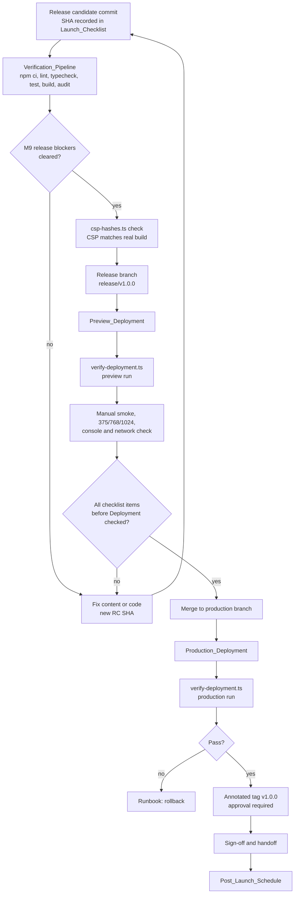
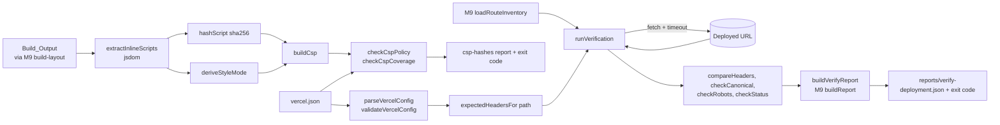

# Design Document

> **Spec:** M10 Deployment & Launch  
> **Document Status:** Draft  
> **Feature Name:** m10-deployment-launch  
> **Last Updated:** 2026-10-22  
> **Lead Architect:** Angelo Andres  
> **Requirements Reference:** `requirements.md`  
> **Master Specifications:** `AGENTS.md` (Sections 5, 6.1, 6.2, 7.2, 7.3), `PRD.md` (Sections 10 to 16, Success Metrics, Detailed Success Metrics), `TRD.md` (Sections 6.1, 6.3, 6.4, 8), `implementation_plan.md` (Phase 6, Tasks 6.1 and 6.2), `APP_FLOW.md` (route inventory)  
> **Upstream Specs:** M1 (toolchain, Vitest, jsdom, `next.config.ts`), M2 (loaders, schemas), M9 (audits, `reports/`, `docs/quality/`, Lighthouse, release-blocker findings)

---

## Overview

### Purpose

Milestone 10 (M10) moves the verified release candidate to a live, documented, recoverable production site. Most of the work is human-performed (Vercel dashboard, DNS, tagging, sign-off). The design therefore has two halves:

1. **Documents with evidence records.** Seven operations documents under `docs/operations/`, plus `CHANGELOG.md` and README sections. Each document has a fixed section outline and an Evidence_Record template, so a reviewer can tell at a glance what was done, by whom, and with what result.
2. **A small amount of tooling.** One `vercel.json`, a CSP builder and checker (`scripts/launch/csp-hashes.ts`), a deployed-URL smoke script (`scripts/launch/verify-deployment.ts`), a docs-structure linter, and an optional CI workflow.

The tooling keeps the M9 split between **pure decision functions** (data in, findings out, no file system, no network) and **thin I/O shells** (fetch, read the build, write a report). Every Correctness Property in this document targets a pure function, so the properties run in milliseconds and need no build, no network, and no Vercel account.

### Scope

**In Scope:**
- `docs/operations/{launch-checklist,deployment,monitoring,rollback-and-incidents,content-publishing,known-issues,post-launch-plan}.md`
- `vercel.json` (approval-gated)
- `scripts/launch/csp-hashes.ts`, `scripts/launch/verify-deployment.ts`, and `scripts/launch/lib/*`
- `tests/launch/*` (vitest and fast-check suites, fixture responses, fixture HTML)
- `.github/workflows/verify.yml` (approval-gated, optional)
- `CHANGELOG.md`, README sections, `content/site.json` value changes
- Approval records (2026-10-22) for `vercel.json`, `package.json` script entries (the version bump is declined), `next.config.ts` (pre-approved only if verification fails), CI, and `.gitignore`; the `v1.0.0` tag stays manual with approval requested at launch time

**Out of Scope (Requirement 1):** any change to `src/`, any edit to existing files under `tests/` or `scripts/audit/`, any new dependency, analytics or tracking of any kind, cookies, API routes, middleware, environment variables, P1 features and P1/AI scaffolding (search, resume download, AI assistant), dark mode.

### Design Principles

1. **Verify the artifact that ships.** The CSP is derived from the real Build_Output, not assumed (Req 6.1). The verifier checks the deployed URL, not the source.
2. **Pure core, thin shell.** Header comparison, canonical and robots checks, CSP build and parse, argument parsing, report building, and docs-structure linting are pure. `fetch`, file reads, and `process.exit` live in shells (Req 7.15).
3. **Reuse M9, read-only.** Types, report builders, build-layout resolution, route inventory, and `expectedCanonical` are imported from `scripts/audit/lib/*`. M10 never edits them (Req 1.2).
4. **Network tools stay out of automation.** `verify-deployment.ts` is never part of `npm test`, `npm run audit`, or CI (Req 7.13, 15.3).
5. **No quiet exemptions.** A check is downgraded only by a named, reported rule (for example `noindex` on a Preview_Deployment becomes an `info` finding with `details.reason`). Nothing is silently skipped.
6. **Approval-gated changes degrade gracefully.** Every Approval_Item has a documented fallback that still delivers value (Req 1.6).
7. **Human steps are first-class.** A Human_Procedure is written as numbered steps, an expected result, and an Evidence_Record field. Nothing relies on memory.
8. **Strict TypeScript.** No `any`, no non-null assertions, no unjustified assertions. Parsed data crosses module boundaries as typed values.

### Research Findings and Decisions

Vercel facts were checked against the live documentation on the design date. Where a fact could not be read, the table says so.

| Topic | Finding | Decision |
|-------|---------|----------|
| `vercel.json` headers | The `headers` property is an array of objects. Each has a `source` path pattern (query string excluded) and a non-empty `headers` array of `{ key, value }` pairs. Optional `has` and `missing` conditions exist. Source: [vercel.json reference](https://vercel.com/docs/project-configuration/vercel-json). | Use two `headers` entries: `/(.*)` for security headers and `/_next/static/(.*)` for immutable caching. Use no `has` or `missing`. The verifier supports only these two source shapes and rejects any other (Decision 9). |
| `vercel.json` other keys | The same reference lists `redirects`, `rewrites`, `routes`, `functions`, `crons`, `cleanUrls`, `trailingSlash`, `outputDirectory`, `buildCommand`, and more. | `vercel.json` contains the `headers` key only (plus the optional `$schema`). Req 5.9 is checked by an allow-list of top-level keys, which is stricter than a deny-list. |
| Static export on Vercel | Next.js `output: 'export'` writes static HTML, CSS, and JS to `out/` and can be hosted on any server that serves static assets ([Next.js static exports guide](https://nextjs.org/docs/app/guides/static-exports)). Vercel's Next.js preset deploys a static export with zero configuration. A community answer and the Next.js guide agree that export works on Vercel; I did not find an official Vercel page that states it in one sentence. M1's `next.config.ts` is now a static export (`output: 'export'`, `out/`). | Document `out` as the output directory and record a one-line verification of the M1 `next.config.ts` (Req 4.4). The Vercel project setting `Output Directory` is left on the Next.js preset default unless the preset fails to find `out/`; if it does, set it to `out` in the dashboard. Do not use `outputDirectory` in `vercel.json` (it would add a second key). |
| Headers and static export | Next.js documents that `headers()` in `next.config.ts` is not supported with `output: 'export'`, because there is no Next.js server. The headers therefore have to come from the host. | `vercel.json` is the correct place for the headers (Req 5.1). Fallback is the dashboard (Req 5.11). |
| Instant rollback | Vercel Instant Rollback repoints production domains to an earlier production deployment with no rebuild. On the Hobby plan, rollback is limited to the **previous** production deployment; Pro and Enterprise can pick any eligible one. Sources: [Instant Rollback](https://examples.vercel.com/docs/instant-rollback), [vercel rollback CLI](https://vercel.com/docs/cli/rollback), [changelog](https://vercel.com/changelog/instant-rollback-is-now-available-to-revert-deployments). | The Runbook states the Hobby limit. When the target is older than the previous production deployment, the procedure is `git revert` plus a new Production_Deployment, or redeploying the older deployment from the Deployments list (Req 12.1, 12.2). |
| HSTS | Vercel documents that `vercel.app` domains and subdomains support HSTS by default and are preloaded, and that custom domains also use HSTS. The header can be modified in the project's response headers configuration. Source: [CDN security](https://vercel.com/docs/cdn-security). | `vercel.json` does not declare `Strict-Transport-Security`. The Deployment_Guide records a header check on the deployed URL. If the header is absent on a custom domain, the manual header (`max-age=63072000; includeSubDomains`) is added (Req 5.8). Whether the header appears on a custom domain at launch is checked on the live site, not assumed. |
| Preview indexing | Vercel adds `X-Robots-Tag: noindex` to Preview Deployments automatically. Source: [response headers](https://vercel.com/docs/edge-network/headers/response-headers), [duplicate-content guide](https://vercel.com/kb/guide/avoiding-duplicate-content-with-vercel-app-urls). | **Conflict with Req 7.9.** The verifier treats `X-Robots-Tag: noindex` on a non-production base URL as an expected `info` finding and as an `error` on the Production_URL run (Decision 10). |
| Hobby limits | The Hobby plan page ([plans/hobby](https://vercel.com/docs/plans/hobby)) says exceeding usage limits blocks the feature for 30 days. The limits page ([platform/limits](https://vercel.com/docs/platform/limits)) lists per-plan limits, but the deployment-size and file-count rows could not be extracted at design time. The 250 MB figure found is for Vercel Functions, which P0 does not use. | **Not verified.** The M9 25 MB total budget stays the working limit. The Deployment_Guide carries a dated "re-check limits page" evidence field, and a task re-reads both pages before launch (Req 4.8). |
| `x-powered-by` | Next.js sends `X-Powered-By: Next.js` from its server; with a static export on Vercel's CDN the header is not expected. | Verifier reports it as a finding if present (Req 7.8). If it appears, the documented fix is `poweredByHeader: false`, which is a `next.config.ts` edit and therefore an Approval_Item. |
| Running TypeScript scripts | M9 Decision 3 runs scripts with `vite-node --config vitest.config.ts`. | M10 reuses it: no `tsx`, no new dependency (Req 1.3, 7.2). |
| HTML parsing | `jsdom` is already installed for Vitest and is a spec-compliant parser. | Used for script extraction (`csp-hashes.ts`) and for canonical and robots extraction (`verify-deployment.ts`). No regex over HTML (Decision 4). |
| Env-var references | Req 1.4 and the Req 1 verification step grep added lines for `process.env`. M9's `resolveBuildLayout(env, cwd)` takes an env object. | M10 passes a literal empty object `{}`, so it never writes `process.env` and never reads `AUDIT_BUILD_DIR`. The layout falls back to `out/` detection, which is what a launch run needs. |

### Resolved Values

| Item | Value | Source or rationale |
|------|-------|---------------------|
| Node.js version | Read from `.nvmrc` if present, else `package.json` `engines.node` (the M1 value). The design records no number. | Req 4.3. The value is copied into the Deployment_Guide, the Vercel project setting, and the CI workflow from one source, and a docs lint checks they agree (Decision 11). |
| Production branch | `main` | Repository default; recorded in Evidence_Record. The owner may change it, and the Deployment_Guide field records the actual value. |
| Release branch | `release/v1.0.0` | Req 9.1 |
| Verifier request timeout | **10 000 ms** per request, **4** requests in flight | Same as the M9 online link check |
| Verifier bogus path | `/this-route-does-not-exist-m10` | Req 7.5 |
| Script exit codes | `0` all checks pass; `1` at least one `error` finding; `2` usage or environment error | Matches M9 Decision 10 |
| HSTS manual value (only if needed) | `max-age=63072000; includeSubDomains` | Two years, no `preload` (preload is a separate, hard-to-undo step; out of scope) |
| Static asset cache | `public, max-age=31536000, immutable` on `/_next/static/(.*)` | Req 5.6 |
| Availability goal | 99.5 percent, not an SLA | Req 10.7, `TRD.md` 6.3 |
| Uptime monitor | URLs `Production_URL` and `Production_URL/projects`; 5-minute interval; alert by email | Free-tier monitors commonly allow a 5-minute interval. Not verified for any named product; the owner picks the product (Req 10.5). |
| Incident response targets | SEV1: acknowledge within 4 hours, restore within 24 hours. SEV2: fix within 3 days. SEV3: next content release. | Engineering judgment for a single-owner portfolio; no SLA. |
| Post-launch dates | Week 1 = launch + 7 days; Week 4 = launch + 28 days; Week 12 = launch + 84 days | `PRD.md` Section 15; computed by `computeCheckInDates` |

### Resolved Decisions

**Decision 1: CSP script policy.** Approved 2026-10-22 (approval A1): `script-src 'self' 'unsafe-inline'` with every other directive strict and no third-party origin. See [CSP Policy Analysis](#csp-policy-analysis) for the reasoning. The hash-based policy is implemented and tested, kept as a documented stricter alternative, and selected with one tool flag. The decision is recorded as a tradeoff in the Deployment_Guide (Req 6.2).

**Decision 2: Style policy is derived, not assumed.** `style-src` is chosen from an inventory of the real build: `'self'` if no inline style exists, `'self'` plus `style-src-attr 'unsafe-inline'` if only `style=""` attributes exist, `'self' 'unsafe-inline'` if `<style>` elements exist.

**Decision 3: Where the CSP lives.** The CSP is one header value in `vercel.json` under the `/(.*)` source. `csp-hashes.ts` can print it, check it, or (with `--write`) replace that one value in `vercel.json`. `--write` is a human-run action and works only after `vercel.json` is approved.

**Decision 4: No regex over HTML.** Script and meta extraction use jsdom. Regular expressions appear only for non-HTML text (CSP strings, header values).

**Decision 5: Verifier executes through `vite-node`.** `verify:deployment` is `vite-node --config vitest.config.ts scripts/launch/verify-deployment.ts`. The route inventory comes from the M9 `loadRouteInventory()` (M2 loaders). If M9 Approval Item A1 (the `vite-node` bin) was not granted, the fallback is `npx vite-node ...` documented in the Deployment_Guide.

**Decision 6: Verifier report reuses M9 types.** The report is an M9 `AuditReport<VerifyData>` with `audit: 'verify-deployment'`, built by the M9 `buildReport`, checked by the M9 `validateReport`, and written by the M9 `writeReport` to `reports/verify-deployment.json`. Per-route pass and fail counts live in `data`, and failures are `Finding`s.

**Decision 7: Expected headers come from `vercel.json`.** The verifier parses `vercel.json`, computes the headers that should apply to each requested path, and compares. There is no second list of header values to keep in sync (Req 7.7).

**Decision 8: Not-found content check.** The verifier reads the local `404.html` (through the M9 build layout) and extracts the `title` text and the first `h1` text. The bogus-path response body must contain both. If no local build exists, the check is reduced to the 404 status, and a `warning` finding records the reduced check.

**Decision 9: Limited source patterns.** `matchHeaderSource(source, path)` supports exactly `/(.*)` and `<literal-prefix>/(.*)`. Any other `source` makes `validateVercelConfig` fail with `unsupported-source`. This keeps matching a few lines of pure code and keeps `vercel.json` simple.

**Decision 10: Preview versus production.** A run is a **production run** when the base URL origin equals the origin of `siteUrl`. Otherwise it is a **preview run**.
- Canonical, production run: must equal `expectedCanonical(base, path, style)`; mismatch is an `error`.
- Canonical, preview run: the build embeds `siteUrl`, so the canonical must equal `expectedCanonical(siteUrl, path, style)`; mismatch is an `error`. A single `info` finding `base-differs-from-siteUrl` records the difference (Req 7.10).
- `noindex` in the robots `meta`: `error` in both runs, except on the not-found route, where it is required.
- `X-Robots-Tag: noindex`: `error` on a production run; `info` (`reason: expected-on-preview`) on a preview run.

**Decision 11: Documents are linted.** `DOC_SPECS` lists every required document with its required H2 headings and Evidence_Record field labels. `checkDocStructure` is a pure function; one vitest suite runs it over the real files in `docs/operations/` and one cross-document check compares the Node.js version string in the Deployment_Guide with `.nvmrc` or `engines`.

**Decision 12: Version bump is declined.** The `package.json` `version` bump was Declined 2026-10-22 (approval A3). `CHANGELOG.md` and the `v1.0.0` tag carry `1.0.0`, and the README states it (Req 11.1).

### Requirements Clarifications

**Status: RESOLVED 2026-10-22 (amended in requirements.md).** These were conflicts or gaps found while designing. The human confirmed each interpretation and `requirements.md` was amended to agree: C1/C2 in Req 1.1 and 1.2, C3/C4 in Req 7.9, 7.10, 9.3, and 9.8, C5 in Req 12.1, C7 in Req 7.9, and C8 in the Introduction, Req 7.14, and Req 11.1. C6 is addressed by Decision 1.

| ID | Observation | Interpretation used (all RESOLVED) |
|----|-------------|---------------------|
| C1 | Req 1.2 says M10 SHALL NOT modify files under `tests/` or `scripts/audit/`, but Req 7.15 requires offline unit tests, and Req 1.1 does not list `tests/launch/` or `scripts/launch/lib/` or `csp-hashes.ts`. | "Modify" means editing existing files. New files under `tests/launch/` and `scripts/launch/` are allowed. Req 1.1 should list them. |
| C2 | Req 6.3 says "launch tooling" extracts hashes, but no deliverable is named for it. | `scripts/launch/csp-hashes.ts` is added as a deliverable. |
| C3 | Req 7.9 requires no `X-Robots-Tag: noindex`, but Vercel sets it on every Preview_Deployment, and Req 9.3 requires the verifier to exit 0 on a preview. | Decision 10. |
| C4 | Req 7.9 says the canonical equals "the requested base URL plus the route path". On a preview, the page canonical points at `siteUrl` by design. | Decision 10. |
| C5 | Req 12.1 says rollback to the "last known-good" deployment. On Hobby, Instant Rollback reaches only the previous production deployment. | Runbook states the limit and gives the git-based path. |
| C6 | Req 13.3 says a content-only change modifies no root configuration. A hash-based CSP would require editing `vercel.json` on nearly every content change. | This is the main reason for Decision 1. |
| C7 | The not-found route is a P0_Route in M9 and carries `noindex` by design. Req 7.9 says no `noindex` on responses. | The `noindex` rule applies to the Route_Inventory routes only; on the bogus path, `noindex` is expected and checked as present (M9 Decision 8). |
| C8 | Req 7.14 and Req 11.1 both change `package.json`. | They are two Approval_Items (A2 and A3 below) and can be approved separately. |

---

## Architecture

### Directory Layout

```text
docs/
  operations/
    launch-checklist.md
    deployment.md
    monitoring.md
    rollback-and-incidents.md
    content-publishing.md
    known-issues.md
    post-launch-plan.md
  quality/                       # M9, read-only for M10
scripts/
  audit/lib/                     # M9, imported read-only
  launch/
    csp-hashes.ts                # CLI: print | check | --write
    verify-deployment.ts         # CLI: deployed-URL smoke checks
    lib/
      csp.ts                     # buildCsp, serializeCsp, parseCsp, normalizeCsp
      csp-inventory.ts           # isExecutableScriptType, extractInlineScripts, hashScript, deriveStyleMode
      csp-check.ts               # checkCspCoverage, checkCspPolicy
      vercel-config.ts           # parseVercelConfig, validateVercelConfig, matchHeaderSource, expectedHeadersFor
      headers.ts                 # normalizeHeaderValue, compareHeaders, checkCacheControl, findPoweredBy
      page-signals.ts            # extractPageSignals (jsdom): canonical, robots, title, h1, assets
      checks.ts                  # checkCanonical, checkRobots, checkStatus, checkNotFound
      args.ts                    # parseArgs, classifyRun
      verify-report.ts           # buildVerifyReport, summarizeRoutes, VerifyData
      verify-run.ts              # runVerification (orchestrates I/O), fetchWithTimeout
      docs-structure.ts          # DOC_SPECS, checkDocStructure, extractEvidenceFields
      check-in-dates.ts          # computeCheckInDates
tests/
  launch/
    *.test.ts                    # example and integration-with-fixtures suites
    *.property.test.ts           # fast-check suites
    fixtures/
      responses/                 # recorded header and body fixtures (JSON)
      html/                      # small HTML pages and build trees
      vercel/                    # valid and invalid vercel.json variants
vercel.json                      # approval-gated
CHANGELOG.md
.github/workflows/verify.yml     # approval-gated
reports/                         # git-ignored (M9 approval A4), receives verify-deployment.json
```

There are no `index.ts` barrel files. Every import names its module (`AGENTS.md` 7.2). Files stay under 300 lines.

### Launch Flow



### Tooling Data Flow



### Execution Model

- `csp-hashes.ts` and `verify-deployment.ts` are short CLI files. Each parses arguments with `parseArgs`, calls one `run*` function from `lib/`, prints one summary line per route or per rule, writes the JSON report, and sets `process.exitCode`. They never call `process.exit()` inside library code.
- `runVerification` is the only function that touches the network. It receives a `Fetcher` (`(url, init) => Promise<FetchedResponse>`), so tests pass a fake. The CLI passes `fetchWithTimeout`, which wraps global `fetch` with an `AbortController` timer.
- All pure functions are synchronous. Concurrency (4 requests) is handled in `runVerification` with a small worker pool over a sorted route list; results are sorted before reporting, so output order never depends on completion order.
- Neither tool reads `process.env`, writes cookies, or sends a body. Requests carry no custom headers other than `user-agent: m10-verify-deployment` and `accept: text/html,*/*`.

### Approval Items (AGENTS.md 6.2)

| ID | Change | Purpose | Fallback if not granted |
|----|--------|---------|-------------------------|
| A1 **Approved 2026-10-22 (approval A1)** | New root file `vercel.json` (`headers` key only), CSP `script-src 'self' 'unsafe-inline'` | Version-controlled Security_Headers and cache rules (Req 5, 6) | Recovery only: headers are configured in the Vercel dashboard as a Human_Procedure. The Deployment_Guide records that header config is not version controlled (Req 5.11). `csp-hashes.ts print` still produces the CSP value to paste. `verify-deployment.ts` takes the expected headers from `--expect-headers <file>` (a JSON copy kept in `docs/operations/`), or skips header checks with a `warning`. |
| A2 **Approved 2026-10-22 (approval A2)** | `package.json` script `verify:deployment` | Short invocation (Req 7.14) | Run `npx vite-node --config vitest.config.ts scripts/launch/verify-deployment.ts -- <url>`; documented in the Deployment_Guide. |
| A3 **Declined 2026-10-22 (approval A3)** | `package.json` `version` set to `1.0.0` (not made) | Release identity (Req 11.1) | Applied: version lives in `CHANGELOG.md` and the `v1.0.0` tag only. |
| A4 **Approved 2026-10-22 (approval A4)** | `package.json` script `launch:csp` | Short CSP invocation | Run `npx vite-node ... scripts/launch/csp-hashes.ts`. |
| A5 **Pre-approved 2026-10-22 (approval A5), applies only if verification fails** | `next.config.ts` edit, **only** if the one-line verification finds the M1 file lacks `output: 'export'` (Req 4.5; M1 is expected to be a static export to `out`) or the `x-powered-by` header is observed | Static export or `poweredByHeader: false` | Static export: Production_Deployment is blocked, because the whole design assumes `out/`. `x-powered-by`: recorded in the Known_Issues_Document. |
| A6 **Approved 2026-10-22 (approval A6)** | New file `.github/workflows/verify.yml` (offline checks only; never `verify-deployment`) | Automated Verification_Pipeline on PRs (Req 15) | Manual local procedure with an Evidence_Record field (Req 15.7). |
| A7 **Manual, at launch** | Create and push annotated tag `v1.0.0`, and merge to the production branch | Release_Tag (Req 11.2) | Both stay manual. Explicit approval is requested at launch time, not before. If withheld, the Production_Deployment is recorded by commit SHA in the Launch_Checklist and `CHANGELOG.md`. |
| A8 **Approved 2026-10-22 (approval A8)** | `.gitignore` entry `reports/` | Keep the verifier report out of git | Skip the edit if M9 A4 already added it; otherwise the Deployment_Guide warns not to commit `reports/`. |

Each request carries the exact diff, the purpose, and the fallback. A1, A2, A4 (scripts), and A6 are independent of each other. The decisions were recorded on 2026-10-22, so G1 records them rather than waiting. All devDependencies are approved (approval 1a) and are pinned to exact versions at implementation.

---

## Components and Interfaces

### `vercel.json` (A1) — Req 5, 6

Exact file when the script policy is `inline-allowed` and the build has inline `style` attributes only (the expected result; Decision 2). The `Content-Security-Policy` value is the output of `buildCsp`, not hand-written.

```json
{
  "$schema": "https://openapi.vercel.sh/vercel.json",
  "headers": [
    {
      "source": "/(.*)",
      "headers": [
        { "key": "X-Content-Type-Options", "value": "nosniff" },
        { "key": "Referrer-Policy", "value": "strict-origin-when-cross-origin" },
        { "key": "X-Frame-Options", "value": "DENY" },
        {
          "key": "Permissions-Policy",
          "value": "camera=(), microphone=(), geolocation=(), payment=(), usb=()"
        },
        {
          "key": "Content-Security-Policy",
          "value": "default-src 'self'; script-src 'self' 'unsafe-inline'; style-src 'self'; style-src-attr 'unsafe-inline'; img-src 'self' data:; font-src 'self'; connect-src 'self'; object-src 'none'; base-uri 'self'; form-action 'self'; frame-ancestors 'none'"
        }
      ]
    },
    {
      "source": "/_next/static/(.*)",
      "headers": [
        { "key": "Cache-Control", "value": "public, max-age=31536000, immutable" }
      ]
    }
  ]
}
```

Header rationale:

| Header | Value | Why |
|--------|-------|-----|
| `X-Content-Type-Options` | `nosniff` | Stops MIME sniffing (Req 5.2) |
| `Referrer-Policy` | `strict-origin-when-cross-origin` | Full path leaves the site only to same-origin requests (Req 5.3) |
| `X-Frame-Options` | `DENY` | Legacy framing protection alongside `frame-ancestors 'none'` (Req 5.5) |
| `Permissions-Policy` | `camera=(), microphone=(), geolocation=(), payment=(), usb=()` | Disables the five features in Req 5.4 |
| `Content-Security-Policy` | see CSP Policy Analysis | Req 6 |
| `Cache-Control` on `/_next/static/` | `public, max-age=31536000, immutable` | These files are fingerprinted, so a changed file gets a new URL (Req 5.6) |

HTML routes get no `Cache-Control` rule from `vercel.json`. Vercel's default for static HTML is revalidating, which is what a content site needs (Req 5.7). The verifier checks that HTML responses do not carry `immutable`.

The file has the `headers` key only, apart from `$schema` (Req 5.9). The `$schema` URL is the one the Vercel reference documents for autocomplete; it is an editor hint, not a runtime request. Strictly, Req 5.9 forbids only redirects, rewrites, functions, and crons, so `$schema` is permitted. If the human would rather have no external URL string in the file, delete the line. `validateVercelConfig` allows `$schema` and `headers` and nothing else.

`Strict-Transport-Security` is deliberately absent (Research table). `Cross-Origin-Opener-Policy` and `Cross-Origin-Resource-Policy` are not in Req 5 and are not added.

### CSP Policy Analysis

**What a Next.js static export emits.** The App Router export writes each route as HTML. Based on how Next.js App Router works, each page contains:
- `<script src="/_next/static/chunks/....js" async>` tags (same origin, covered by `'self'`).
- Several **inline** `<script>` elements that carry `self.__next_f.push([1,"..."])`, which stream React Server Component flight data to the client for hydration. There is typically a bootstrap call `self.__next_f.push([0])` followed by one call per payload chunk. The chunk text includes the rendered page's data, so the script body differs on every page and changes whenever content changes.
- Possibly a small inline script for the `noModule` polyfill or theme/bootstrap code, depending on the Next.js version.
- `<script type="application/ld+json">` blocks if M9's JSON-LD integration (A5 in M9) is approved. These are data blocks, not executable, and CSP does not check them.
- CSS as `<link rel="stylesheet" href="/_next/static/css/....css">` (same origin). Tailwind in this project compiles to such a file.
- Inline `style` attributes from React (`style={{...}}`) or Next.js components. `<style>` elements appear if a component or `next/font` injects one.

I derived this from how the framework works and did not inspect a real `out/` tree, because no build exists in the repository yet. **The first implementation task is to run the build and read the real output**, then compare it with this list. The tool does that comparison automatically (it counts inline scripts and style usage), so the decision does not rest on this description.

**Options.**

| Option | Strength | Weakness |
|--------|----------|----------|
| A. Hash-based: `script-src 'self' 'sha256-...' ...` | Blocks all injected inline scripts | The flight-data script text includes page content, so the hash set changes with **every content edit**, not just code changes. One header covers all routes (a single `/(.*)` source), so the header must contain the union of every inline-script hash across every page: one hash per distinct inline script, roughly 40 to 50 characters each. With about 6 fixed routes plus one per project and post, and several inline scripts per page, expect hundreds of tokens and a multi-kilobyte header. Vercel's header size limit was not verified. A content-only change then requires editing `vercel.json`, which breaks Req 13.3 and needs human approval each time. A stale hash produces a page that fails to hydrate in production. |
| B. Nonce-based | Strongest in dynamic apps | Needs a per-request value. A static export has no server to generate it. Not possible here. |
| C. `script-src 'self' 'unsafe-inline'` | Stable across builds; content edits never touch `vercel.json`; hydration cannot be broken by a stale hash | Does not block injected inline scripts. |
| D. Per-route headers with per-route hashes | Smaller headers | Requires one `headers` entry per route; every new post or project needs a `vercel.json` edit. Same problem as A. |

**Decision: Option C (Approved 2026-10-22, approval A1)**, with every other directive strict. Hash mode stays as an optional documented alternative only. Reasoning:
1. Req 13 (content-only publishing) and the PRD Maintainability metric depend on content edits not touching root config. Options A and D conflict with that.
2. The risk that `'unsafe-inline'` leaves open is inline-script injection. The site has no forms, no input fields, no cookies, no user-generated content, no query-string rendering, no third-party scripts, and no backend. The only HTML sources are the owner's own MDX files, rendered at build time. The remaining injection path is a compromised content file or dependency, and a hash CSP would not stop that either, since the hashes are computed from the built output.
3. `default-src 'self'`, `object-src 'none'`, `base-uri 'self'`, `form-action 'self'`, `frame-ancestors 'none'`, `connect-src 'self'`, `img-src 'self' data:`, and no third-party origin still block exfiltration to other hosts, plugin content, base-tag hijacking, and framing.
4. When any hash or nonce appears in `script-src`, browsers ignore `'unsafe-inline'`. The two must never be mixed. `buildCsp` makes that impossible by construction (Property 3).

**Hash mode stays available.** `csp-hashes.ts check --policy hashes` and `print --policy hashes` build and verify the hash form. The Deployment_Guide documents when to choose it: if the owner accepts editing `vercel.json` on every release, or if a later change makes the flight scripts stable. Hash mode is regenerated for each release candidate that changes any file in `src/`, dependencies, or content (Req 6.10, 6.11).

**Hash-set volatility (hash mode).** Because the flight payload contains rendered content, the set of hashes changes whenever any page's data changes. `check` therefore reports both missing hashes (a script on some page has no matching hash: the page would break) and extra hashes (a hash matches no script: stale, a `warning`). The remedy for both is `--write`.

**`style-src` handling.** Next.js and React can emit `style=""` attributes on elements. `style-src 'self'` blocks inline `<style>` elements and, in browsers that implement CSP Level 3 `style-src-attr`, controls attributes separately. The derivation in `deriveStyleMode(inventory)`:

| Inventory | `StylePolicy` | Emitted directives |
|-----------|---------------|--------------------|
| No `<style>` element, no `[style]` attribute | `self` | `style-src 'self'` |
| `[style]` attributes only | `self-inline-attr` | `style-src 'self'; style-src-attr 'unsafe-inline'` |
| At least one `<style>` element | `self-inline` | `style-src 'self' 'unsafe-inline'` |

This keeps `<style>` injection blocked whenever the build allows it. Browsers without `style-src-attr` support fall back to `style-src`, which would then block attribute styles. That is a rendering risk, caught by the browser check in Req 6.8; I did not verify the exact browser support matrix, and the Deployment_Guide records the browsers used for that check. If the browser check shows broken styling, the fallback is `self-inline`.

`img-src 'self' data:` allows `data:` for small inline images such as those some Next.js image placeholders and CSS use. `font-src 'self'` assumes `next/font` self-hosts fonts, which it does by design.

### CSP Module (`scripts/launch/lib/csp.ts`) — Req 6.5, 6.6

```typescript
export type ScriptPolicy =
  | { readonly kind: 'inline-allowed' }
  | { readonly kind: 'hashes'; readonly hashes: readonly string[] };   // each 'sha256-<base64>' without quotes

export type StylePolicy = 'self' | 'self-inline-attr' | 'self-inline';

export interface CspOptions {
  readonly script: ScriptPolicy;
  readonly style: StylePolicy;
}

/** Ordered directive list. Names are lowercase; values keep their original tokens (including quotes). */
export interface CspDirective {
  readonly name: string;
  readonly values: readonly string[];
}
export type CspDirectives = readonly CspDirective[];

export function buildCsp(options: CspOptions): CspDirectives;
export function serializeCsp(directives: CspDirectives): string;      // "name v1 v2; name2 v3"
export function parseCsp(header: string): CspDirectives;              // trims, lowercases names, drops empty segments
export function normalizeCsp(header: string): string;                 // canonical form for comparison
```

`buildCsp` emits directives in this fixed order: `default-src`, `script-src`, `style-src`, `style-src-attr` (only for `self-inline-attr`), `img-src`, `font-src`, `connect-src`, `object-src`, `base-uri`, `form-action`, `frame-ancestors`. Values:

- `script-src`: `'self' 'unsafe-inline'` for `inline-allowed`; `'self' 'sha256-<h>' ...` for `hashes`, with the hashes de-duplicated and sorted by code-unit order. An empty hash list yields `'self'` only.
- All other directives are constants from Req 6.5.

`parseCsp` splits on `;`, trims, skips empty segments, lowercases the directive name, and splits values on ASCII whitespace. If a directive name repeats, the first occurrence wins (CSP processing rule) and later ones are dropped by `parseCsp`; `checkCspPolicy` detects duplicates from the raw string and reports `csp-duplicate-directive`.

`normalizeCsp(header)` is `serializeCsp` of `parseCsp(header)` with directives sorted by name and values sorted within each directive (source-list order is not significant). It is what comparisons use.

**Third-party check.** `findThirdPartySources(directives)` returns each value that contains `://`, equals `*`, starts with `*.`, or is a scheme source other than `data:` in `img-src`. For `buildCsp` output it is always empty.

### Script and Style Inventory (`csp-inventory.ts`) — Req 6.3, 6.7

```typescript
export interface InlineScript {
  readonly file: string;          // URL-style path of the HTML file
  readonly index: number;         // position among script elements in the file
  readonly text: string;          // exact text content
  readonly hash: string;          // 'sha256-<base64>'
}

export interface StyleInventory {
  readonly styleElements: number;
  readonly styleAttributes: number;
}

export interface PageInventory {
  readonly file: string;
  readonly inlineScripts: readonly InlineScript[];     // executable only
  readonly externalScriptSrcs: readonly string[];      // values of script[src], as written
  readonly style: StyleInventory;
}

export function isExecutableScriptType(type: string | null): boolean;
export function hashScript(text: string): string;
export function extractPageInventory(file: string, html: string): PageInventory;
export function deriveStyleMode(pages: readonly PageInventory[]): StylePolicy;
export function collectHashes(pages: readonly PageInventory[]): readonly string[];   // unique, sorted
```

`isExecutableScriptType(type)` treats `null`, `''`, `module`, `importmap` (conservative, because CSP governs inline import maps), and any JavaScript MIME essence (`text/javascript`, `application/javascript`, `application/ecmascript`, `text/ecmascript`, `text/jscript`, `text/livescript`, `text/x-javascript`, `application/x-javascript`, `application/x-ecmascript`, `text/x-ecmascript`, and the other entries of the HTML standard's JavaScript MIME type list) as executable, compared case-insensitively after trimming and after dropping any `;` parameters. Everything else, including `application/ld+json` and `application/json`, is a Data_Block (Req 6.7).

`extractPageInventory` parses with jsdom (`new JSDOM(html)`, no `runScripts`, so nothing runs), iterates `document.querySelectorAll('script')`, and for each script:
- With a `src` attribute: record the `src` in `externalScriptSrcs`. If it also has text content, the text is ignored by browsers and by the tool.
- Without `src` and with an executable type: record an `InlineScript` using `script.textContent` (jsdom applies the same newline normalization the HTML parser does, so the hash matches what a browser hashes).
- Without `src` and with a data type: skip.

`hashScript(text)` returns `'sha256-' + base64(sha256(utf8(text)))` using `node:crypto`. The tool does not trim or alter the text; CSP hashes cover the exact text, whitespace included.

`style.styleAttributes` counts every element with a `style` attribute; `styleElements` counts `<style>` elements.

### CSP Checks (`csp-check.ts`) — Req 6.3, 6.4, 6.6

```typescript
export interface CspFinding { readonly rule: string; readonly severity: 'error' | 'warning' | 'info'; readonly message: string; readonly file?: string; }

export function checkCspCoverage(csp: string, pages: readonly PageInventory[]): readonly CspFinding[];
export function checkCspPolicy(csp: string, expected: CspOptions): readonly CspFinding[];
```

`checkCspCoverage` parses the CSP and reads `script-src` (falling back to `default-src` when absent), then:
1. If the source list contains `'unsafe-inline'` and no hash or nonce token, coverage is complete. Return no `csp-missing-hash` findings.
2. If the list contains `'unsafe-inline'` **and** a hash or nonce token, emit `csp-unsafe-inline-ignored` (`error`): browsers ignore `'unsafe-inline'` in that case, so inline scripts without a hash will be blocked.
3. Otherwise every `InlineScript` must have its `hash` as a quoted token in the list. Each miss is a `csp-missing-hash` `error`, with `file` and the script index. This is Req 6.4.
4. Every `sha256-` token in the list that matches no inline script is a `csp-stale-hash` `warning`.
5. Every external `script[src]` must be a same-origin path (starts with `/` and not `//`); otherwise `csp-external-script` `error` (Req 6.6).

`checkCspPolicy(csp, expected)` compares `normalizeCsp(csp)` with `normalizeCsp(serializeCsp(buildCsp(expected)))`. A difference gives `csp-differs` (`error`) with the differing directive names in the message. It also emits `csp-third-party` for each item from `findThirdPartySources` and `csp-duplicate-directive` for repeats.

### `csp-hashes.ts` CLI

```text
vite-node --config vitest.config.ts scripts/launch/csp-hashes.ts -- [print|check] [--policy inline|hashes] [--write] [--vercel-json <path>]
```

| Mode | Behavior | Exit |
|------|----------|------|
| `print` | Reads Build_Output, derives the style policy and (hash mode) the hash list, prints the CSP value and an inventory summary: pages, inline scripts per page, unique hashes, `<style>` count, `[style]` count | 0 |
| `check` (default) | Reads Build_Output and `vercel.json`, extracts the CSP value from the `/(.*)` entry, runs `checkCspPolicy` and `checkCspCoverage`, prints findings, writes `reports/csp-hashes.json` | 0 if no `error`; 1 otherwise; 2 on usage or missing input |
| `--write` | With `print` or `check`: replaces only the `Content-Security-Policy` value inside `vercel.json` with the built value, preserving other entries, and re-serializes with two-space indentation and a trailing newline. Refuses to run if `vercel.json` is absent (A1 not approved) | same as the mode |

The default `--policy` is `inline` (Decision 1). Build_Output is found with the M9 `resolveBuildLayout({}, process.cwd())` and `listFiles`; the tool reads every `.html` file. If no build exists it exits 2 with the M9 message "Build output not found. Run `npm run build` first." (Req 1.3 of M9).

`--write` is run by the human during CSP finalization (Req 6.8) and the resulting diff is reviewed before commit.

### Vercel Config Module (`vercel-config.ts`) — Req 5, 7.7

```typescript
export interface HeaderPair { readonly key: string; readonly value: string; }
export interface HeaderRule { readonly source: string; readonly headers: readonly HeaderPair[]; }
export interface VercelConfig { readonly headers: readonly HeaderRule[]; }

export type ConfigIssue = { readonly rule: string; readonly message: string };

export function parseVercelConfig(text: string): { ok: true; config: VercelConfig } | { ok: false; issues: readonly ConfigIssue[] };
export function validateVercelConfig(value: unknown): readonly ConfigIssue[];
export function matchHeaderSource(source: string, path: string): boolean;
export function expectedHeadersFor(config: VercelConfig, path: string): readonly HeaderPair[];
export const REQUIRED_SECURITY_HEADERS: readonly string[];   // lowercased names from Req 5.2 to 5.5
```

`validateVercelConfig` rules (Req 5.1 to 5.10):

| Rule id | Check |
|---------|-------|
| `config-not-object` | Top level is a plain object |
| `config-key-forbidden` | Top-level keys are a subset of `$schema` and `headers`; `redirects`, `rewrites`, `routes`, `functions`, `crons`, and everything else are rejected by name |
| `headers-missing` | `headers` is a non-empty array |
| `source-unsupported` | Each `source` is `/(.*)` or `<prefix>/(.*)` with a literal prefix of safe path characters (Decision 9) |
| `headers-empty` | Each rule has a non-empty `headers` array of `{ key, value }` strings |
| `header-duplicate` | The same (lowercase key, source) appears twice |
| `required-header-missing` | The `/(.*)` rule has `x-content-type-options: nosniff`, `referrer-policy: strict-origin-when-cross-origin`, `x-frame-options: DENY`, a `permissions-policy` that disables `camera`, `microphone`, `geolocation`, `payment`, and `usb`, and a `content-security-policy` containing `frame-ancestors 'none'` |
| `static-cache-missing` | A rule for `/_next/static/(.*)` has `cache-control: public, max-age=31536000, immutable` |
| `html-immutable` | No rule whose source can match an HTML route (the `/(.*)` rule or any prefix other than `/_next/static`) sets `cache-control` with `immutable` |
| `csp-third-party` | The CSP has no third-party source (via `findThirdPartySources`) |

`matchHeaderSource('/(.*)', path)` is true for every path beginning with `/`. `matchHeaderSource('<prefix>/(.*)', path)` is true when `path` starts with `<prefix>/`. Any other source returns false (and `validateVercelConfig` has already flagged it). `expectedHeadersFor` concatenates matching rules' headers in file order; for a repeated key, the later rule wins.

### Headers Module (`headers.ts`) — Req 7.7, 7.8

```typescript
export type HeaderBag = Readonly<Record<string, string>>;   // keys lowercase; repeated headers joined with ', '

export interface HeaderMismatch {
  readonly key: string;                       // lowercase
  readonly kind: 'missing' | 'different';
  readonly expected: string;
  readonly actual: string | null;
}

export function toHeaderBag(entries: Iterable<readonly [string, string]>): HeaderBag;
export function normalizeHeaderValue(key: string, value: string): string;
export function compareHeaders(expected: readonly HeaderPair[], actual: HeaderBag): readonly HeaderMismatch[];
export function findPoweredBy(actual: HeaderBag): string | null;
export function hasImmutableCache(actual: HeaderBag): boolean;
```

`normalizeHeaderValue` trims, collapses runs of whitespace to one space, and lowercases the value for case-insensitive headers (`x-content-type-options`, `x-frame-options`, `referrer-policy`). For `content-security-policy` it applies `normalizeCsp`. For `permissions-policy` and `cache-control` it splits on `,`, trims each part, sorts them, and rejoins, because the order of those items is not significant. All other headers compare after trim and whitespace collapse only.

`compareHeaders` returns one mismatch per expected header, in the order of `expected`, sorted by `key` afterwards for determinism. An empty result means every expected header is present and equal. Extra headers in `actual` are never a mismatch.

### Page Signals (`page-signals.ts`) — Req 7.9

```typescript
export interface PageSignals {
  readonly title: string | null;
  readonly h1: string | null;
  readonly canonical: string | null;
  readonly robotsMeta: string | null;       // content of meta[name=robots], lowercased, or null
  readonly staticAssetPaths: readonly string[];   // /_next/static/... paths from script[src] and link[href]
}
export function extractPageSignals(html: string): PageSignals;
```

Uses jsdom. `canonical` is the `href` of the first `link[rel~="canonical"]`.

### Checks (`checks.ts`) — Req 7.4 to 7.9

```typescript
export type RunKind = 'production' | 'preview';

export interface CheckResult {
  readonly id: string;                       // 'status', 'canonical', 'robots-meta', 'robots-header', 'headers', 'powered-by', 'cache-html', ...
  readonly severity: 'error' | 'warning' | 'info';
  readonly passed: boolean;
  readonly message: string;
  readonly details?: Readonly<Record<string, string | number | boolean | null>>;
}

export function checkStatus(actual: number, expected: number): CheckResult;
export function checkCanonical(input: {
  readonly actual: string | null; readonly path: string; readonly base: string; readonly siteUrl: string;
  readonly run: RunKind; readonly style: 'flat' | 'directory';
}): readonly CheckResult[];
export function checkRobots(input: {
  readonly robotsMeta: string | null; readonly xRobotsTag: string | null;
  readonly run: RunKind; readonly expectNoindex: boolean;
}): readonly CheckResult[];
export function checkNotFoundBody(body: string, signals: { readonly title: string | null; readonly h1: string | null }): CheckResult;
```

- `checkCanonical`: `run === 'production'` expects `expectedCanonical(base, path, style)`; `run === 'preview'` expects `expectedCanonical(siteUrl, path, style)` and adds one `info` result `base-differs-from-siteUrl`. A `null` canonical is an `error`.
- `checkRobots`: a `noindex` token in `robotsMeta` is an `error` unless `expectNoindex` (the not-found route), where a missing `noindex` is the `error`. `xRobotsTag` containing `noindex` is an `error` for `production`, an `info` with `details.reason = 'expected-on-preview'` for `preview`.
- `checkNotFoundBody`: body must include the local 404 `title` and `h1` text when they are non-null; otherwise `error` (Req 7.5).

### Arguments and Run Classification (`args.ts`) — Req 7.1, 7.10

```typescript
export interface VerifyArgs {
  readonly baseUrl: string;            // normalized: origin only, no trailing slash
  readonly timeoutMs: number;          // default 10000
  readonly concurrency: number;        // default 4
  readonly vercelJsonPath: string;     // default 'vercel.json'
  readonly expectHeadersPath: string | null;
}
export type ParseArgsResult =
  | { readonly ok: true; readonly args: VerifyArgs }
  | { readonly ok: false; readonly usage: string };

export function parseArgs(argv: readonly string[]): ParseArgsResult;
export function classifyRun(baseUrl: string, siteUrl: string): RunKind;
```

`parseArgs` accepts one positional absolute `https://` URL and the flags `--timeout <ms>`, `--concurrency <n>`, `--vercel-json <path>`, `--expect-headers <path>`. It rejects: no positional, more than one positional, a non-`https:` scheme, a URL with credentials, a URL whose path is anything but `/` (a base URL has no path, Req 8.5 uses the same rule for `siteUrl`), a query or fragment, a non-integer or non-positive number, unknown flags. The base URL is normalized to `url.origin`. Every failure returns the same usage string.

`classifyRun` compares `new URL(baseUrl).origin` with `new URL(siteUrl).origin` and returns `production` when equal.

### Verification Orchestrator (`verify-run.ts`)

```typescript
export interface FetchedResponse {
  readonly status: number;
  readonly headers: HeaderBag;
  readonly body: string;                      // text; empty for non-text
}
export type Fetcher = (url: string) => Promise<FetchedResponse>;     // rejects with Error whose name is 'TimeoutError' on timeout

export interface VerifyContext {
  readonly args: VerifyArgs;
  readonly siteUrl: string;
  readonly style: 'flat' | 'directory';
  readonly routes: readonly RouteEntry[];            // M9 type, includes '/404' entry
  readonly draftSlugs: readonly string[];
  readonly config: VercelConfig | null;              // null when vercel.json absent and no --expect-headers
  readonly notFoundSignals: { readonly title: string | null; readonly h1: string | null } | null;
}

export function runVerification(ctx: VerifyContext, fetcher: Fetcher, now: string): Promise<AuditReport<VerifyData>>;
export function fetchWithTimeout(timeoutMs: number): Fetcher;
```

Algorithm:
1. For each Route_Inventory route except `/404`: `GET base + path`. Checks: status 200; expected headers from `expectedHeadersFor(config, path)` via `compareHeaders`; `findPoweredBy`; HTML `cache-control` not immutable; `extractPageSignals`; `checkCanonical`; `checkRobots` (`expectNoindex: false`).
2. Bogus path `/this-route-does-not-exist-m10`: status 404; `checkNotFoundBody`; expected headers; `checkRobots` with `expectNoindex: true`. A 200 here is the error `bogus-path-not-404` (Req 7.5).
3. For each draft slug `s`: `GET base + '/blog/' + s`; status 404 (Req 7.6). If there are no drafts, record an `info` result `no-drafts`.
4. One static asset: the first `staticAssetPaths` entry from the home page. `GET` it; headers from `expectedHeadersFor(config, assetPath)` must match, which covers the immutable `Cache-Control` (Req 5.6). If the home page has no static asset path, `error` `no-static-asset-found`.
5. A fetch rejection becomes an `error` result `timeout` (name `TimeoutError`) or `network-error`; the remaining checks for that route are not run, and the route is marked failed.
6. Results are collected per route, sorted by route, converted to `Finding`s (every non-passed result, plus `info` results), and passed to `buildVerifyReport`.

If `config` is `null`, header checks are replaced by one `warning` finding `headers-not-checked`.

### Report (`verify-report.ts`) — Req 7.12

```typescript
export interface RouteResult {
  readonly route: string;
  readonly url: string;
  readonly status: number | null;
  readonly passed: number;
  readonly failed: number;
  readonly checks: readonly { readonly id: string; readonly passed: boolean; readonly severity: Severity }[];
}
export interface VerifyData {
  readonly baseUrl: string;
  readonly siteUrl: string;
  readonly run: RunKind;
  readonly totals: { readonly passed: number; readonly failed: number };
  readonly routes: readonly RouteResult[];
}
export function buildVerifyReport(input: {
  readonly ctx: Pick<VerifyContext, 'args' | 'siteUrl'>;
  readonly results: readonly { readonly route: string; readonly url: string; readonly status: number | null; readonly checks: readonly CheckResult[] }[];
  readonly now: string;
}): AuditReport<VerifyData>;
export function formatSummary(report: AuditReport<VerifyData>): string;      // one line per route: "/projects  PASS  9/9"
```

`buildVerifyReport` sorts routes by `route`, sorts each route's checks by `id`, converts failing results to `Finding`s (`route`, `rule` = check id, `message`, `severity`), and calls the M9 `buildReport({ audit: 'verify-deployment', findings, routesChecked, skipped: [], data, now })`. `totals.passed` and `totals.failed` equal the sums over `routes`. A check counts as failed when `passed === false && severity === 'error'`; `warning` and `info` results never count as failures and never change the exit code. The result passes the M9 `validateReport`.

### Docs-Structure Lint (`docs-structure.ts`) — Req 2, 4, 10, 12, 13, 14, 16

```typescript
export interface DocSpec {
  readonly path: string;                           // 'docs/operations/launch-checklist.md'
  readonly title: string;                          // required H1
  readonly sections: readonly string[];            // required H2 headings, in order
  readonly evidenceFields: readonly string[];      // required "Evidence" labels, see Data Models
  readonly noPlaceholderHosts: boolean;            // true for README-style docs (Req 11.8)
}
export const DOC_SPECS: readonly DocSpec[];

export interface DocIssue { readonly path: string; readonly rule: string; readonly message: string; }
export function extractHeadings(markdown: string): readonly { level: number; text: string }[];
export function extractEvidenceFields(markdown: string): readonly string[];
export function checkDocStructure(markdown: string, spec: DocSpec): readonly DocIssue[];
```

`extractHeadings` ignores lines inside fenced code blocks. `checkDocStructure` reports `title-missing`, `section-missing`, `section-order` (required sections must appear in the listed order, other sections may sit between them), `section-duplicate`, and `evidence-field-missing`. It also reports `placeholder-url` for `example.com` or `example.vercel.app` outside fenced code when `spec.noPlaceholderHosts` is true (Req 11.8). `DOC_SPECS` sets it to `false` for the seven operations documents, because they may name those hosts when describing the check; a separate `README_SPEC` entry sets it to `true`.

### Check-In Dates (`check-in-dates.ts`) — Req 14.4

```typescript
export function computeCheckInDates(launchDate: string): { week1: string; week4: string; week12: string };
```

Parses `YYYY-MM-DD` as a UTC calendar date and adds 7, 28, and 84 days. It throws `RangeError` for an invalid date string. Using UTC arithmetic keeps the result independent of the machine's time zone.

### Documentation Set (`docs/operations/`)

Every document starts with an H1, a status block (`Status`, `Owner`, `Last reviewed`), and the H2 sections below, in order. Each Human_Procedure is a numbered list followed by an Evidence_Record table.

**Evidence_Record template** (used verbatim wherever a document asks for evidence):

```markdown
| Field | Value |
|-------|-------|
| Evidence ID | EV-<doc>-<nn> |
| Step | <the procedure step this proves> |
| Performed by | <name> |
| Date (UTC) | YYYY-MM-DD |
| Commit SHA | <40-hex or n/a> |
| Outcome | PASS / FAIL / N/A |
| Reference | <command output summary, deployment URL, or screenshot path under docs/operations/evidence/> |
```

Screenshots, if kept, go under `docs/operations/evidence/`. The folder is optional; the lint does not require it.

**1. `launch-checklist.md`** (Req 2, 3, 16, 9)
Sections: `Release Candidate`, `Content`, `Configuration`, `Verification Pipeline`, `Accessibility and Performance`, `Security`, `Deployment`, `Sign-off`, `Traceability Matrix`, `Stakeholder Approvals`, `Handoff Summary`.
- `Release Candidate`: field for the commit SHA, the statement "Production_Deployment is not permitted while any item above Deployment is unchecked" (Req 2.7).
- `Content`: minimum 3 complete P0 projects; certifications verifiable or removed; `siteUrl` real; contacts real; no `example` files in `content/`; draft not reachable; the four PRD open questions with the answers (P0 project list, certifications with verifiable URLs, contact channels, theme = light only, no dark toggle in P0) (Req 3.6, 3.7); external links resolved (`npm run audit:links:online`).
- `Configuration`: `siteUrl` set (Req 8.4), SEO audit clean of `site-url-placeholder`, `vercel.json` valid.
- `Verification Pipeline`: one row per command with exit code and evidence (Req 2.3); M9 reports show no release-blocker finding (Req 2.4).
- `Accessibility and Performance`: signed M9 manual checklist; `audit:lighthouse` result per route (Req 2.5); `Task 6.2` steps: route checks, external links, drafts, 375/768/1024 rendering, console and network (Req 2.8).
- `Security`: CSP browser check zero violations (Req 6.8); header check from the verifier; no secrets in the repo.
- `Deployment`: preview URL, preview SHA equals RC SHA (Req 9.6), verifier result (preview), manual smoke, merge, production verifier result, six post-deploy routes (Req 9.9), tag (A7), share only after passing (Req 9.11).
- `Sign-off`: launch complete only when all Evidence_Records are filled, production verified, tag exists, three approvals recorded (Req 16.8). Includes the note that `docs/deployment.md` and `docs/launch-checklist.md` in `implementation_plan.md` are superseded by `docs/operations/` and the Task 6.1 and 6.2 final status (Req 16.6).
- `Stakeholder Approvals`: table with Product Lead, Engineering Lead, Design Lead; each with name, date, decision (`Approved` / `Withheld`), reason when withheld (Req 16.4, 16.7).
- `Handoff Summary`: Production_URL, Release_Tag, Vercel project name, monitoring setup, links to the six other operations documents (Req 16.5).

**2. `deployment.md`** (Req 4, 5, 6, 8, 9, 15)
Sections: `Vercel Project Setup`, `Build Settings`, `Environment`, `Platform Limits`, `Domain and Site URL`, `Security Headers`, `Content Security Policy`, `Preview Deployment`, `Production Deployment`, `Verification Pipeline Without CI`, `Verifier Usage`.
- `Build Settings`: framework Next.js, install `npm ci`, build `npm run build`, output `out` (after the recorded `next.config.ts` check, Req 4.4), Node.js version from `.nvmrc`/`engines`, production branch, Preview Deployments for non-production branches.
- `Environment`: no environment variables for P0, grep result for `process.env` in `src/` and `next.config.ts`, no `.env` committed (Req 4.7).
- `Platform Limits`: Hobby limits with link and the dated re-check field; the M9 total deploy size; the note that the Hobby page and limits page were read on the design date and the deployment-size row was not extractable.
- `Domain and Site URL`: default versus custom domain decision with date (Req 8.1); custom domain steps: add in Vercel, DNS records at the registrar, HTTPS certificate issuance check, apex versus `www` and the redirect of the other host (Req 8.2, 8.3); set `siteUrl`, rebuild, SEO audit (Req 8.4 to 8.7); the reversal note (Req 8.8).
- `Security Headers`: the header table from this design, the HSTS check result (Req 5.8), the dashboard fallback (Req 5.11).
- `Content Security Policy`: the Decision 1 tradeoff text, the `csp-hashes.ts` commands, regeneration rule (Req 6.10, 6.11), the browser check procedure and Evidence_Record (Req 6.8, 6.9).
- `Preview Deployment`: release branch creation, preview URL and status, SHA equality, verifier run, manual checks at 375/768/1024 (Req 9.1 to 9.6).
- `Production Deployment`: merge as the only trigger, production verifier, six post-deploy routes, rollback pointer (Req 9.7 to 9.11).
- `Verification Pipeline Without CI`: the manual procedure with an Evidence_Record when A6 is not granted; the sentence "Vercel build success does not replace the Verification_Pipeline" (Req 15.7, 15.8).
- `Verifier Usage`: invocation command(s), the exit codes, how to read `reports/verify-deployment.json`, preview versus production behavior (Decision 10).

**3. `monitoring.md`** (Req 10)
Sections: `Policy`, `Passive Monitoring Options`, `Uptime Monitor`, `Severity Levels`, `Availability Goal`, `Reading PageSpeed Insights`.
- `Policy`: no analytics; states that the earlier plan listing Vercel Analytics and Speed Insights is superseded by `PRD.md` Section 10 (Req 10.2).
- `Passive Monitoring Options`: Vercel deployment notifications, an external uptime monitor, manual PageSpeed Insights and CrUX checks (Req 10.3, 10.4).
- `Uptime Monitor`: URLs, interval, alert channel, Evidence_Record (Req 10.5).
- `Severity Levels`: SEV1/SEV2/SEV3 table with targets from Resolved Values (Req 10.6).
- `Availability Goal`: 99.5 percent, not an SLA (Req 10.7).
- `Reading PageSpeed Insights`: LCP < 2.5 s, INP < 200 ms, CLS < 0.1, FCP < 1.8 s, TBT < 200 ms, with a note that INP is field data and TBT its lab proxy (Req 10.8).

**4. `rollback-and-incidents.md`** (Req 12)
Sections: `Principles`, `Decision Tree`, `Instant Rollback`, `Content Rollback`, `After a Rollback`, `Rollback Drill`, `Post-Incident Note Template`.
- `Principles`: no runtime patching (Req 12.4); rollback does not change git history (Req 12.8).
- `Decision Tree`: a mermaid flowchart plus a table; triggers from `TRD.md` 8.4 map as below.

| Trigger | Procedure |
|---------|-----------|
| Build validation failure | Stop; fix the content file or schema use; rerun `npm run build`; no deployment happened, so no rollback |
| Production regression | Instant Rollback to the previous production deployment (Hobby limit stated); then fix forward on a branch |
| Broken external link | Content Rollback or content fix: edit the URL, preview, merge |
| Wrong content | Content Rollback: `git revert` the content commit, new Production_Deployment |
| Accessibility defect | Block release; fix semantics; rerun checks. If already live: Instant Rollback if SEV1, else fix forward |
| Performance regression | Block release; profile; fix. If already live: Instant Rollback if SEV1, else fix forward |
| Domain or certificate failure | Check DNS records and Vercel domain status; re-verify the domain; if the custom domain cannot be restored, serve the `*.vercel.app` URL and reverse the `siteUrl` change (Deployment_Guide, Req 8.8) |

- `Instant Rollback`: dashboard steps, CLI alternative `vercel rollback`, Hobby limit, redeploy-older-deployment alternative (Req 12.1).
- `Content Rollback`: `git revert <sha>`, push a branch, preview, merge (Req 12.2).
- `After a Rollback`: run the verifier against the Production_URL and record the result (Req 12.5); reconcile the production branch with the rolled-back state (Req 12.8).
- `Rollback Drill`: perform once against a Preview_Deployment or Production before sign-off, with an Evidence_Record (Req 12.7). Hobby note: a drill on production uses the previous production deployment, so run it after the first deployment has a predecessor; if none exists, run the drill as a redeploy of a Preview_Deployment and record that limit.
- `Post-Incident Note Template`: the eight fields of Req 12.6.

**5. `content-publishing.md`** (Req 13)
Sections: `Branch Naming`, `Content-Only Change Flow`, `Project QA Checklist`, `Certification QA Checklist`, `Blog QA Checklist`, `Draft Handling`, `Post-Deploy Verification`, `Schema Reference`.
`Schema Reference` links to `AGENTS.md` sections 5.1 to 5.4 and contains no field tables (Req 13.10).

**6. `known-issues.md`** (Req 11)
Sections: `Summary`, `Known Issues`, `Accepted M9 Baseline Exceptions`, `Deferred to P1`. A table with `ID`, `Description`, `Severity`, `Affected route`, `Workaround`, `Planned resolution`. When empty, the line `No known issues. Verified YYYY-MM-DD.` (Req 11.7). `Deferred to P1` lists search, resume download, and AI assistant (Req 11.6).

**7. `post-launch-plan.md`** (Req 14)
Sections: `Check-in Schedule`, `Week 1`, `Week 4`, `Week 12`, `Feedback Intake`, `Issue Template`, `Shipping Cadence`, `Learning Goals`, `Measurement Policy`.
Check-in dates are written from `computeCheckInDates(launchDate)`. `Measurement Policy` says no visitor analytics are used. `Week 12` contains the decision-record template: question, options (search, resume download, AI assistant, none), evidence considered, decision, date. `Learning Goals` carries the three PRD goals as questions. The 3-minute recruiter task (PRD usability metric) is scheduled here as a Human_Procedure.

### Release Management — Req 11

**`CHANGELOG.md`** (Keep a Changelog layout):

The file has an H1 `Changelog`, a one-line intro, and one H2 per release in the form `[1.0.0] - YYYY-MM-DD`. The `1.0.0` entry has two H3 groups:

- `Added`: one bullet per milestone, M1 repository foundation and toolchain; M2 content schemas and loaders; M3 design system primitives and M4 global layout and navigation; M5 homepage, M6 projects, M7 certifications, M8 blog; M9 offline quality, accessibility, and performance audits; M10 deployment configuration, security headers, deployed-URL verifier, and operations documents.
- `Release links`: links to `docs/operations/launch-checklist.md` and `docs/operations/known-issues.md` (Req 11.3).

**Tag procedure** (manual; approval A7 is requested at launch time, not before):
1. Confirm the Production_Deployment commit SHA from the Vercel deployment and the Launch_Checklist.
2. `git tag -a v1.0.0 <sha> -m "Release v1.0.0"`
3. `git show v1.0.0` and confirm the tag type is annotated and the SHA matches.
4. `git push origin v1.0.0` after approval.

**README sections** (Req 11.4, 11.8): `Live site` (Production_URL, launch date), `Verification pipeline` (six commands), `Operations documents` (links to all seven), `Quality documents` (links to `docs/quality/`), `Content publishing` (link). No placeholder host and no secret. The docs lint checks the README for `example.com` and `example.vercel.app`.

### CI Workflow Design (A6) — Req 15

Approved 2026-10-22 (approval A6). Offline checks only; the workflow never runs `verify-deployment`.

```yaml
name: verify
on:
  pull_request:
  push:
    branches: [main]
permissions:
  contents: read
jobs:
  verify:
    runs-on: ubuntu-latest
    timeout-minutes: 15
    steps:
      - uses: actions/checkout@<full-commit-sha>   # pinned at approval time
      - uses: actions/setup-node@<full-commit-sha> # pinned at approval time
        with:
          node-version-file: .nvmrc                # or node-version: <engines value>
          cache: npm
      - run: npm ci
      - run: npm run lint
      - run: npm run typecheck
      - run: npm test
      - run: npm run build
      - run: npm run audit
```

Notes:
- The branch name follows the production branch recorded in the Deployment_Guide.
- Third-party actions are pinned to a full commit SHA, looked up at approval time (Req 15.6). I did not look up SHAs now, because they would be stale by implementation.
- `node-version-file: .nvmrc` is used when `.nvmrc` exists; otherwise the literal Node version from `engines`. The docs lint compares them (Decision 11).
- No `secrets.` reference, no `audit:links:online`, no `audit:lighthouse`, no `verify:deployment` (Req 15.3, 15.5).
- `npm run audit` needs a build, which the previous step provides. If M9's `axe-core` approval was not granted, `audit` reports that audit as `skipped` and does not fail (M9 A2 fallback).
- Req 15.2's `npm run audit` assumes M9 shipped the script. If it did not, the step is removed and the Deployment_Guide notes it.

### Traceability Matrix — Req 16.1 to 16.3

| PRD metric | Target | Evidence source | Kind |
|------------|--------|-----------------|------|
| Portfolio usability | 90% of tested recruiters find a project case study, a certification, and a contact link within 3 minutes | Personal usability pass before launch; recruiter task at Week 4 and Week 12 in `post-launch-plan.md` | Human_Procedure |
| Technical credibility | Every P0 project exposes a repository link, a technology list, and build documentation | M9 Content_Gate tests; Launch_Checklist `Content` section (3 complete P0 projects) | automated + manual |
| Accessibility | All P0 pages pass automated WCAG 2.1 AA checks; Lighthouse accessibility 95+ | M9 `audit:a11y`; M9 `audit:lighthouse`; signed M9 manual checklist | automated + manual |
| Performance | Core Web Vitals per `TRD.md` 6.1 | M9 `audit:lighthouse`; M9 `audit:perf`; PageSpeed Insights check recorded in `monitoring.md` after launch | automated + manual |
| Maintainability | New entries by editing content only | `content-publishing.md`; sample draft post run (Req 13 verification step 2); `known-issues.md` | manual |
| P0 route availability | 100% | `verify-deployment.ts` report on the preview and production runs | automated |
| Contact-action discoverability | Present in header and footer | M9 manual checklist and Launch_Checklist smoke test | manual |

---

## Data Models

### Report Schema (`reports/verify-deployment.json`)

Conforms to the M9 `AuditReport<TData>` with `audit: 'verify-deployment'`.

```json
{
  "audit": "verify-deployment",
  "generatedAt": "2026-10-20T00:00:00.000Z",
  "status": "pass",
  "summary": {
    "routesChecked": 7,
    "errors": 0,
    "warnings": 0,
    "infos": 1,
    "skipped": []
  },
  "findings": [
    {
      "route": "*",
      "rule": "base-differs-from-siteUrl",
      "message": "Base URL origin differs from siteUrl; canonical compared with siteUrl.",
      "severity": "info",
      "details": { "baseUrl": "https://preview.example-deployment.vercel.app", "siteUrl": "https://production.example" }
    }
  ],
  "data": {
    "baseUrl": "https://preview.example-deployment.vercel.app",
    "siteUrl": "https://production.example",
    "run": "preview",
    "totals": { "passed": 62, "failed": 0 },
    "routes": [
      {
        "route": "/",
        "url": "https://preview.example-deployment.vercel.app/",
        "status": 200,
        "passed": 9,
        "failed": 0,
        "checks": [
          { "id": "canonical", "passed": true, "severity": "error" }
        ]
      }
    ]
  }
}
```

The URLs in the sample are illustrative values only. Exit code: `0` when `summary.errors === 0`; `1` otherwise; `2` for a usage error (bad arguments) or an environment error (the M9 route inventory cannot be loaded, or `vercel.json` is unreadable or invalid while headers are expected). A missing `vercel.json` with no `--expect-headers` is not an environment error; it produces the `headers-not-checked` warning.

### CSP Report (`reports/csp-hashes.json`)

```typescript
export interface CspReportData {
  readonly policy: 'inline' | 'hashes';
  readonly style: StylePolicy;
  readonly pages: number;
  readonly inlineScriptCount: number;
  readonly uniqueHashCount: number;
  readonly styleElements: number;
  readonly styleAttributes: number;
  readonly csp: string;
}
```

Wrapped in the same M9 `AuditReport<CspReportData>` with `audit: 'csp-hashes'`. Findings use `route` = HTML file path.

### Document Specification Table (`DOC_SPECS`)

| Path | Required H1 | Required H2 sections (in order) | Required evidence labels |
|------|-------------|--------------------------------|--------------------------|
| `docs/operations/launch-checklist.md` | `Launch Checklist` | Release Candidate, Content, Configuration, Verification Pipeline, Accessibility and Performance, Security, Deployment, Sign-off, Traceability Matrix, Stakeholder Approvals, Handoff Summary | `Commit SHA`, `Evidence ID` |
| `docs/operations/deployment.md` | `Deployment Guide` | Vercel Project Setup, Build Settings, Environment, Platform Limits, Domain and Site URL, Security Headers, Content Security Policy, Preview Deployment, Production Deployment, Verification Pipeline Without CI, Verifier Usage | `Evidence ID`, `Outcome` |
| `docs/operations/monitoring.md` | `Operations Guide` | Policy, Passive Monitoring Options, Uptime Monitor, Severity Levels, Availability Goal, Reading PageSpeed Insights | `Evidence ID` |
| `docs/operations/rollback-and-incidents.md` | `Rollback and Incident Runbook` | Principles, Decision Tree, Instant Rollback, Content Rollback, After a Rollback, Rollback Drill, Post-Incident Note Template | `Evidence ID`, `Outcome` |
| `docs/operations/content-publishing.md` | `Content Publishing Guide` | Branch Naming, Content-Only Change Flow, Project QA Checklist, Certification QA Checklist, Blog QA Checklist, Draft Handling, Post-Deploy Verification, Schema Reference | none |
| `docs/operations/known-issues.md` | `Known Issues` | Summary, Known Issues, Accepted M9 Baseline Exceptions, Deferred to P1 | none |
| `docs/operations/post-launch-plan.md` | `Post-Launch Plan` | Check-in Schedule, Week 1, Week 4, Week 12, Feedback Intake, Issue Template, Shipping Cadence, Learning Goals, Measurement Policy | none |

Evidence labels are table-row labels in the first column of an Evidence_Record table. `extractEvidenceFields` returns the first-column labels of every Markdown table that has the header `| Field | Value |`.

### Header Rule Table (`REQUIRED_SECURITY_HEADERS`)

| Header (lowercase) | Required value or condition | Req |
|--------------------|-----------------------------|-----|
| `x-content-type-options` | equals `nosniff` | 5.2 |
| `referrer-policy` | equals `strict-origin-when-cross-origin` | 5.3 |
| `permissions-policy` | disables `camera`, `microphone`, `geolocation`, `payment`, `usb` (each `name=()`) | 5.4 |
| `x-frame-options` | equals `deny` (case-insensitive) | 5.5 |
| `content-security-policy` | contains `frame-ancestors 'none'` | 5.5 |
| `cache-control` on `/_next/static/(.*)` | equals `public, max-age=31536000, immutable` | 5.6 |

### Evidence Record Types

Evidence is Markdown only. No code reads an Evidence_Record except `extractEvidenceFields`, which checks that the template labels exist, not that the values are filled in. A filled-in check is a manual part of sign-off (Req 16.8).

---

## Correctness Properties

*A property is a characteristic or behavior that should hold true across all valid executions of a system-essentially, a formal statement about what the system should do. Properties serve as the bridge between human-readable specifications and machine-verifiable correctness guarantees.*

Randomized testing applies to the M10 tooling because it is made of pure functions over structured input (CSP strings, HTML text, header maps, URLs, JSON, Markdown, dates). It does **not** apply to the Vercel setup, DNS, tagging, rollback, sign-off, or any other Human_Procedure. Those are covered by Evidence_Records, smoke checks, and the integration runs in the Testing Strategy.

### Reflection

The prework produced about 25 testable criteria. After review:

- The CSP round trip (6.5) and the CSP normalization invariance are kept apart. Round trip protects the parser and serializer. Normalization invariance protects the header comparison that depends on them.
- "CSP contains the required directives" (6.5), "hashes are never mixed with `'unsafe-inline'`", and "hash order does not change the output" are all statements about `buildCsp`, so they are one property (3).
- "No third-party origin" (6.6) stays separate (4). It must hold for all inputs, including hostile hash text, and a failure there has a different consequence.
- Hash extraction (6.3, 6.7) and the coverage check (6.3, 6.4) are separate: one is about what is read from HTML, the other about comparing against a CSP.
- Req 5.2 to 5.7 (required headers, static cache, no immutable HTML) all go through `validateVercelConfig` and form one property (8). Req 5.9 and 5.10 (allowed keys, JSON validity) are a second property (9). Source matching (10) is separate because the verifier depends on it independently of validation.
- `findPoweredBy` (7.8) is folded into the header comparison property (11) as a metamorphic check.
- `checkStatus` and `checkNotFoundBody` (7.4 to 7.6) are one property (16).
- Report validity, count consistency, exit-code mapping, and input-order independence (7.12) are one property (17), because they all describe `buildVerifyReport`.
- The docs-structure lint (2.1 and all other documents) is one property (18). The placeholder-host scan (11.8) is a separate property (19) because it depends on fenced-code handling, not on headings.
- Dates (14.4) are property 20.
- Criteria about repository diffs, dashboard steps, DNS, tagging, rollback drills, sign-off, and the CI file are SMOKE, INTEGRATION, or EXAMPLE and are not properties.
- No property was dropped as redundant. Properties 12 and 13 look similar but test different pure functions with different decision tables.

### Property 1: CSP serialize and parse round trip

*For any* well-formed list of CSP directives (unique lowercase names of letters and hyphens, each with zero or more non-empty source tokens that contain no whitespace or semicolon), `parseCsp(serializeCsp(d))` should equal `d`, and for any CSP string `s` made of such directives, `serializeCsp(parseCsp(s))` should equal `s` after whitespace normalization.

**Validates: Requirements 6.5**

### Property 2: CSP normalization ignores order and spacing

*For any* directive list `d`, any permutation of its directives, any permutation of the values inside each directive, and any extra ASCII whitespace around separators, `normalizeCsp` of the serialized result should be the same string, and `normalizeCsp(normalizeCsp(s))` should equal `normalizeCsp(s)`.

**Validates: Requirements 5.5, 7.7**

### Property 3: `buildCsp` output has the required shape and is deterministic

*For any* `CspOptions` (a script policy that is either `inline-allowed` or `hashes` with any list of valid `sha256-` tokens including duplicates and any order, and any style policy), the built CSP should contain `default-src 'self'`, `img-src 'self' data:`, `font-src 'self'`, `connect-src 'self'`, `object-src 'none'`, `base-uri 'self'`, `form-action 'self'`, and `frame-ancestors 'none'`; its `script-src` should contain `'self'`; `'unsafe-inline'` should appear in `script-src` if and only if the policy is `inline-allowed`; every hash token should appear in `script-src` and nowhere else; and building twice with the hash list shuffled should give the identical string.

**Validates: Requirements 6.2, 6.5**

### Property 4: `buildCsp` never admits a third-party origin

*For any* `CspOptions`, the serialized CSP should contain no source token that includes `://`, equals `*`, starts with `*.`, or is a scheme source other than `data:` in `img-src`, and `findThirdPartySources` should return an empty list. Conversely, *for any* CSP string with a token containing `https://` followed by a host, `findThirdPartySources` should return that token.

**Validates: Requirements 6.6**

### Property 5: Inline script extraction keeps only executable inline scripts, with exact hashes

*For any* HTML page built from a random sequence of script elements (inline with an executable type, inline with `application/ld+json` or `application/json`, external with `src`, and inline with random text including newlines, quotes, `</` sequences escaped as the HTML parser requires, and non-ASCII characters), `extractPageInventory` should return exactly the inline executable scripts in document order; none of the data blocks and none of the external scripts should appear; each returned `hash` should equal `'sha256-'` plus the base64 SHA-256 of the script's exact text computed independently with `node:crypto`; and `externalScriptSrcs` should list the external `src` values in order.

**Validates: Requirements 6.3, 6.7**

### Property 6: CSP coverage reports exactly the missing hashes

*For any* set of page inventories, a CSP built with `hashes` policy from `collectHashes(pages)` should produce no `csp-missing-hash` finding; removing any non-empty subset of the distinct hashes from the CSP should produce one `csp-missing-hash` finding for each inline script whose hash was removed, no more and no fewer; adding a hash that matches no script should produce exactly one `csp-stale-hash` warning for it; an `inline-allowed` CSP should produce no `csp-missing-hash` finding; and a CSP with both `'unsafe-inline'` and any hash token should produce `csp-unsafe-inline-ignored`.

**Validates: Requirements 6.3, 6.4**

### Property 7: Style policy derivation follows the inventory

*For any* list of page inventories, `deriveStyleMode` should return `self-inline` if any page has a `<style>` element, otherwise `self-inline-attr` if any page has a `style` attribute, otherwise `self`; and the result should not change if the page list is reordered or duplicated.

**Validates: Requirements 6.1, 6.5**

### Property 8: `vercel.json` validation requires the security headers and the static cache rule

*For any* configuration that contains the required security headers on the `/(.*)` source (with any extra non-conflicting headers and any additional supported rules) and the immutable cache rule on `/_next/static/(.*)`, `validateVercelConfig` should return no issues. *For any* such configuration with one required header removed or its value altered, with the cache rule removed or altered, or with `cache-control` containing `immutable` on a rule whose source can match an HTML route, `validateVercelConfig` should return an issue whose `rule` identifies that defect (`required-header-missing`, `static-cache-missing`, or `html-immutable`).

**Validates: Requirements 5.1, 5.2, 5.3, 5.4, 5.5, 5.6, 5.7**

### Property 9: `vercel.json` allows only the `headers` key and valid JSON

*For any* JSON object, `validateVercelConfig` should report `config-key-forbidden` for each top-level key other than `$schema` and `headers` (including `redirects`, `rewrites`, `routes`, `functions`, `crons`, and any random key), and no `config-key-forbidden` issue when the keys are a subset of those two. *For any* string that is not valid JSON, `parseVercelConfig` should return `ok: false`. *For any* `source` value that is neither `/(.*)` nor a literal-prefix form `<prefix>/(.*)`, validation should report `source-unsupported`.

**Validates: Requirements 5.9, 5.10, 7.7**

### Property 10: Header source matching selects the right rules

*For any* configuration of supported sources and any request path, `expectedHeadersFor` should include the headers of exactly those rules whose source matches (the `/(.*)` source matches every path; `<prefix>/(.*)` matches paths starting with `<prefix>/`), in file order with later values replacing earlier values for the same lowercase key; and *for any* valid configuration that satisfies Property 8, the expected headers for a path outside `/_next/static/` should not include a `cache-control` value containing `immutable`.

**Validates: Requirements 5.6, 5.7, 7.7**

### Property 11: Header comparison reports exactly the missing or different headers

*For any* list of expected header pairs and any actual header bag, `compareHeaders` should return a mismatch for a header if and only if the actual bag lacks that header (names compared case-insensitively) or its normalized value differs from the normalized expected value; extra headers in the actual bag should never create a mismatch; re-ordering `Permissions-Policy` items, `Cache-Control` items, or CSP directives should never create a mismatch; and `findPoweredBy` should return the value of an `x-powered-by` header in any letter case and `null` when it is absent.

**Validates: Requirements 7.7, 7.8**

### Property 12: Canonical check follows the run kind

*For any* base URL, `siteUrl`, route path, run kind, and URL style, `checkCanonical` should pass when the page canonical equals `expectedCanonical(base, path, style)` for a production run, or `expectedCanonical(siteUrl, path, style)` for a preview run, and should fail otherwise (including a `null` canonical); a preview run whose base origin differs from the `siteUrl` origin should additionally include exactly one `info` result `base-differs-from-siteUrl`, and a production run should include none.

**Validates: Requirements 7.9, 7.10**

### Property 13: Robots check follows the run kind and route type

*For any* robots `meta` content, `X-Robots-Tag` value, run kind, and `expectNoindex` flag, `checkRobots` should fail the meta check if and only if the presence of a `noindex` token (case-insensitive, among comma-separated tokens) differs from `expectNoindex`; it should fail the header check if and only if the header contains `noindex` and the run is a production run; and a `noindex` header on a preview run should produce an `info` result with `details.reason` equal to `expected-on-preview`.

**Validates: Requirements 7.9**

### Property 14: Argument parsing accepts only a bare `https://` origin

*For any* argument list, `parseArgs` should return `ok: true` if and only if it has exactly one positional argument that is an absolute `https:` URL with a host, no credentials, an empty or `/` path, no query, and no fragment, and all flags are known with positive integer values; the returned `baseUrl` should equal the URL's origin; every other input should return `ok: false` with the usage text.

**Validates: Requirements 7.1**

### Property 15: Run classification compares origins

*For any* two absolute `https:` URLs, `classifyRun(base, siteUrl)` should return `production` if and only if their origins are equal, regardless of the path, query, or trailing slash on either value.

**Validates: Requirements 7.10**

### Property 16: Status and body expectations

*For any* actual status code and expected status code, `checkStatus` should pass if and only if they are equal; and *for any* response body, local not-found title, and local not-found heading, `checkNotFoundBody` should pass if and only if the body contains each non-null signal text.

**Validates: Requirements 7.4, 7.5, 7.6**

### Property 17: Verification reports are valid, consistent, and order independent

*For any* list of per-route check results, `buildVerifyReport` should produce a report that the M9 `validateReport` accepts; `data.totals.failed` should equal the number of results with `passed === false` and severity `error`; each route's `passed + failed` should equal the number of its checks that are counted; `status` should be `fail` if and only if `summary.errors > 0`; the mapped exit code should be `1` if and only if `status` is `fail`; warning and info results should never change the status; and permuting the input routes or checks should produce a byte-identical report apart from `generatedAt`.

**Validates: Requirements 7.12**

### Property 18: Documentation structure lint

*For any* Markdown document built from a random selection and order of H2 headings (some from a `DocSpec`, some unrelated), a required H1, and fenced code blocks that contain heading-like lines, `checkDocStructure` should report `section-missing` for exactly the required headings that are absent outside code fences, `section-order` if and only if the present required headings are out of the listed order, `section-duplicate` for any required heading present more than once, and `title-missing` if and only if the required H1 is absent.

**Validates: Requirements 2.1, 4.2, 10.2, 11.5, 12.1, 13.1, 14.1, 16.5**

### Property 19: Placeholder hosts are flagged only outside code fences

*For any* Markdown text that mixes prose and fenced code blocks and contains `example.com` or `example.vercel.app` at random positions, `checkDocStructure` with `noPlaceholderHosts` set should report `placeholder-url` if and only if at least one occurrence lies outside a fenced code block, and should report none when the option is off.

**Validates: Requirements 11.8**

### Property 20: Check-in dates are fixed offsets from the launch date

*For any* valid calendar date `YYYY-MM-DD`, `computeCheckInDates` should return dates exactly 7, 28, and 84 days later in UTC calendar arithmetic (including across month, year, and leap-day boundaries), in strictly increasing order, each formatted as `YYYY-MM-DD`; and *for any* string that is not a valid calendar date it should throw `RangeError`.

**Validates: Requirements 14.4**

---

## Error Handling

### Tool Errors

| Condition | Component | Behavior | Exit |
|-----------|-----------|----------|------|
| No argument, wrong scheme, extra path, or unknown flag | `parseArgs` | Print usage text; no network access | 2 |
| `vercel.json` unreadable or invalid JSON when headers are expected | `verify-deployment.ts`, `csp-hashes.ts` | Print the first `ConfigIssue`s; no requests | 2 |
| `vercel.json` absent and no `--expect-headers` | `verify-deployment.ts` | `warning` finding `headers-not-checked`; other checks run | per other checks |
| M9 route inventory cannot load (loader import fails under `vite-node`) | `verify-deployment.ts` | Print the error and the M9 Decision 3 fallback (stub alias config); no requests | 2 |
| Build_Output missing | `csp-hashes.ts`, status-only 404 body check | `csp-hashes`: M9 message "Build output not found. Run `npm run build` first."; verifier: `warning` `not-found-body-unchecked` and the 404 status check only | 2 / continue |
| Request timeout | `fetchWithTimeout` | `AbortController` aborts after `timeoutMs`; check `timeout` fails with `error` and the route is marked failed | 1 |
| DNS failure, connection reset, TLS error | `fetchWithTimeout` | Check `network-error` with `error.name` in `details`; no retry | 1 |
| Non-text response where text is expected (for example a binary asset) | `runVerification` | Body is not read; header checks still run | continue |
| Redirect response (3xx) on a Route_Inventory route | `runVerification` | Redirects are not followed (`redirect: 'manual'`); a status other than 200 fails `status` and the `Location` header is recorded in `details` | 1 |
| `--write` without `vercel.json` | `csp-hashes.ts` | Refuse with a message pointing to approval A1 | 2 |
| `--write` finds no `Content-Security-Policy` entry | `csp-hashes.ts` | Refuse; never create new header entries silently | 2 |
| Check fails after `--write` | `csp-hashes.ts` | Not possible by construction; if the re-read check fails, print both strings and exit 1 | 1 |

All tools collect every finding before choosing the exit code. A single failing route does not stop the run.

### Operational Risks

| Risk | Likelihood | Effect | Mitigation |
|------|------------|--------|------------|
| Build does not use `output: 'export'` (M1 is now a static export to `out/`; this is a regression guard) | Low | No `out/`; Vercel preset may differ | One-line Req 4.4 verification is the first launch task; the A5 edit is pre-approved only if it fails; `csp-hashes.ts` fails with the M9 build-missing message instead of guessing |
| CSP blocks hydration in production | Low with Decision 1, medium with hash mode | Pages render but are not interactive | Browser check on the preview (Req 6.8); `check` runs against the real build; rollback procedure |
| `style-src-attr` unsupported in a tester's browser | Low | Inline-style elements unstyled | Browser check records the browsers; fall back to `self-inline` |
| `X-Robots-Tag: noindex` leaks to production (for example the production domain is attached to a non-production branch) | Low | Site is dropped from search | Verifier treats it as an `error` on the production run |
| Preview canonical points to production URL | Certain by design | Confusing manual check | Decision 10 and the `base-differs-from-siteUrl` info finding explain it |
| Hobby plan only rolls back one deployment | Certain | A bad deployment two releases back cannot be restored in one click | Runbook gives `git revert` plus redeploy; the drill checks the procedure |
| Vercel limits changed since the design date | Low | Upload rejected | Dated re-check field in the Deployment_Guide; M9 total budget is far below any known limit |
| `vite-node` cannot load M2 loaders (server-only imports) | Low | Verifier cannot build the inventory | M9 Decision 3 fallback config; the verifier has no second inventory source |
| Owner forgets to regenerate the CSP (hash mode only) | Medium | Broken page | `check` is in the Launch_Checklist `Security` section; Decision 1 avoids the situation by default |
| HSTS absent on the custom domain | Low | No transport-security pinning | Header check on the deployed URL (Req 5.8); manual header documented |
| Header size limit with a large hash set (hash mode) | Unknown | Header rejected | Not verified. Decision 1 avoids it. If hash mode is chosen, check the size with `print` and test on a preview |
| Evidence Records left blank | Medium | Launch marked complete without proof | Req 16.8 makes completion depend on filled records; sign-off review is manual |

### Failure Handling in Documents

Every Human_Procedure ends with an `If this fails` line that names the next document or section (usually the Runbook decision tree). The docs lint does not check that line; the review checklist for `docs/operations/` does.

---

## Testing Strategy

### Approach

M10 uses two kinds of tests plus manual verification.

- **Randomized tests (fast-check)** cover the 20 properties above. They run offline, take milliseconds, and need no build, network, or Vercel account.
- **Example tests (Vitest)** cover specific fixtures, orchestrator behavior with a fake `Fetcher`, CLI exit codes, and real-file checks on the documents and `vercel.json`.
- **Manual and integration verification** covers everything the tests cannot: the Vercel dashboard, DNS, headers on the live site, browser console, rollback drill, tag, sign-off. Each has an Evidence_Record.

Property-based testing is not used for the Vercel setup, DNS, documents' prose, the CI YAML, or tagging. Those are either one-time configuration checks (smoke), external service behavior (integration), or documentation content (example-based lint). Running them 100 times would find nothing a single run does not.

`npm test` never starts a network request and never runs `verify-deployment.ts` or `audit:*` network tools (Req 7.13).

### Randomized Tests (fast-check)

- Library: `fast-check`, already approved under M3 and reused through M9. No generator engine is written by hand and no new dependency is added (Req 1.3). If the library is missing at implementation time, add it as a devDependency pinned to an exact version (all devDependencies Approved 2026-10-22, approval 1a).
- Each of Properties 1 to 20 is implemented by exactly one `fc.assert(fc.property(...))` test.
- Every test runs at least 100 iterations (`{ numRuns: 100 }` minimum). Properties 5, 6, 11, and 17 use 200 because they combine several generated structures.
- Each test carries a comment in this format: `Feature: m10-deployment-launch, Property {number}: {property text}`.
- Files: `tests/launch/csp.property.test.ts` (1 to 4), `tests/launch/csp-inventory.property.test.ts` (5 to 7), `tests/launch/vercel-config.property.test.ts` (8 to 10), `tests/launch/verify-checks.property.test.ts` (11 to 16), `tests/launch/verify-report.property.test.ts` (17), `tests/launch/docs.property.test.ts` (18 to 20).
- Generators live in `tests/launch/arbitraries.ts`: `cspDirectiveList`, `sha256Token`, `scriptSequence` (inline executable, data block, external, with HTML-safe random text), `headerPairs`, `headerBag`, `httpsUrl`, `invalidUrl`, `vercelConfig`, `markdownWithHeadings`, and `calendarDate`.
- Reference models used by property assertions (the independent SHA-256 computation for Property 5, the day arithmetic for Property 20, and the expected-canonical rule for Property 12) are written inside the test files, from the specification, not copied from the implementation.
- Properties that use jsdom (5 and 7) keep generated HTML small (at most 8 scripts per page) so 200 runs stay under a few seconds.

### Example Tests

| Suite | Content | Location |
|-------|---------|----------|
| Verifier fixtures | Recorded responses (JSON with status, headers, body) for a healthy production run; a missing header; a wrong canonical; a `noindex` meta; a 200 on the bogus path; a 200 on a draft slug; a timeout; `x-powered-by` present; an HTML response with `immutable`; a preview run with `X-Robots-Tag: noindex` and a canonical pointing at `siteUrl`. Each produces the one expected finding (Req 7 verification step 2). | `tests/launch/verify-run.test.ts`, `tests/launch/fixtures/responses/` |
| CLI behavior | `parseArgs` with no argument gives usage and exit 2; report file is written under `reports/` in a temp directory; exit code 1 when a fixture fails (Req 7 verification step 1) | `tests/launch/verify-cli.test.ts` |
| CSP tool | A small fixture build tree (three HTML files) with flight-style inline scripts, an `application/ld+json` block, an external chunk, inline `style` attributes; expected hash list, expected style mode, `check` pass with a matching `vercel.json`, `check` fail after an inline script is added (Req 6 verification steps 1 and 2) | `tests/launch/csp-tool.test.ts`, `tests/launch/fixtures/html/` |
| `--write` | Replaces only the CSP value in a fixture `vercel.json`; other entries byte-identical; second run is a no-op | `tests/launch/csp-write.test.ts`, `tests/launch/fixtures/vercel/` |
| Real `vercel.json` | When the file exists: valid JSON, `validateVercelConfig` returns no issues, CSP has no `http://` or `https://` (Req 6 verification step 4). A1 is Approved 2026-10-22, so the file is expected to exist. | `tests/launch/vercel-json.test.ts` |
| Real documents | For each `DOC_SPECS` entry: file exists, `checkDocStructure` returns no issues; README has no placeholder host; Node.js version in the Deployment_Guide equals `.nvmrc` or `engines.node`; every link in `Handoff Summary` resolves to a committed file (Req 16 verification step 3) | `tests/launch/docs.test.ts` |
| CI file | When `.github/workflows/verify.yml` exists: step order, `permissions: contents: read`, no `secrets.`, no `audit:lighthouse`, no `audit:links:online`, no `verify:deployment`, actions pinned to a 40-hex SHA or a major tag | `tests/launch/workflow.test.ts` |
| Boundary grep | No `process.env`, `analytics`, `speed-insights`, `gtag` in `scripts/launch/` and `tests/launch/` added code (Req 1 verification step 3) | `tests/launch/boundaries.test.ts` |

The real-document tests are expected to **fail until the documents are written**. That is deliberate: they act as the completeness gate for the documentation deliverables. If a document is not yet drafted, the implementer writes it to the structure in `DOC_SPECS` instead of weakening the test.

### Manual and Integration Verification

| Verification | When | Evidence |
|--------------|------|----------|
| `next.config.ts` static export check; `npm run build` produces `out/index.html` (Req 4.4) | First M10 task | Deployment_Guide `Build Settings` Evidence_Record |
| `csp-hashes.ts check` against the real build; inventory reviewed against the Research description | After the first real build | Report summary in Deployment_Guide |
| CSP browser check on every route and the not-found page, zero violations (Req 6.8) | Each release candidate that changes `src/` or dependencies | Launch_Checklist `Security` |
| `verify-deployment.ts` preview run, exit 0 | After preview deployment | Launch_Checklist `Deployment` |
| Manual route smoke at 375, 768, and 1024 px; console and network check (Req 9.4, 9.5) | After preview deployment | Launch_Checklist `Deployment` |
| HSTS header check on the deployed URL (Req 5.8) | After production deployment | Deployment_Guide `Security Headers` |
| `verify-deployment.ts` production run, exit 0; six TRD 8.2 routes (Req 9.8, 9.9) | After production deployment | Launch_Checklist `Deployment` |
| Rollback drill (Req 12.7) | Before sign-off | Runbook `Rollback Drill` |
| Sample draft post on a branch: pipeline passes, draft slug absent from Build_Output, 404 on the preview (Req 13 verification step 2) | Before sign-off | Publishing_Guide |
| Re-read the Vercel limits and Hobby pages for deployment size and file count | Before freezing the budget | Deployment_Guide `Platform Limits` |
| Tag verification `git show v1.0.0` (Req 11) | After production deployment, with approval | Launch_Checklist `Sign-off` |

### Verification Commands

Run in this order before reporting the tooling complete (`AGENTS.md` 7.3):

1. `npm run lint`
2. `npm run typecheck`
3. `npm test`
4. `npm run build`
5. `npm run audit`

The tooling files under `scripts/launch/` are type-checked by the project `tsconfig.json` if it includes `scripts/`. If it does not (M9 risk), a `scripts/launch/tsconfig.json` is not added, because that is a config file; the implementer instead imports the launch modules from the Vitest suites, which Vitest type-checks through `npm run typecheck` when `tests/` is included.
