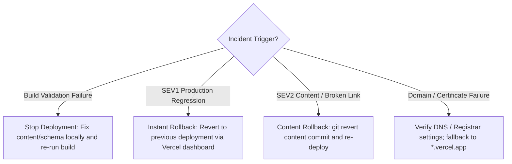

# M10.G7: Monitoring, Rollback, Publishing, Known Issues, and Post-Launch Documents

> **Milestone:** M10 — Deployment & Launch  
> **Goal:** G7 of 10  
> **Tasks:** 10 atomic tasks  
> **Status:** NOT STARTED  

## Goal Objective

Author the remaining five operational specifications under `docs/operations/`: `monitoring.md` (passive uptime observation, Core Web Vitals targets, incident severity levels SEV1–SEV3, and zero visitor tracking), `rollback-and-incidents.md` (Vercel Instant Rollback bounds on Hobby Plan per Clarification C5, git revert procedures, post-incident templates, and pre-launch drill evidence), `content-publishing.md` (independent content-only branch workflows, project/certification/blog QA checklists referencing `AGENTS.md` without schema duplication, and draft post handling), `known-issues.md` (structured issue registry, accepted M9 baseline exceptions, and P1 deferrals), and `post-launch-plan.md` (Week 1, 4, and 12 schedules derived via `computeCheckInDates`, feedback intake issue template, and recruiter usability task). Formally verify all documents via `checkDocStructure`.

## Goal Success Criteria

- ✓ `docs/operations/monitoring.md` states Vercel Analytics/Speed Insights supersession, defines passive monitoring, sets uptime URLs (`/` and `/projects`), documents SEV1–SEV3 response targets, and records 99.5% availability goal
- ✓ `docs/operations/rollback-and-incidents.md` details Instant Rollback bounds (previous deployment only on Hobby), git revert fallback, failure-trigger decision tree, post-incident template, and rollback drill Evidence_Record
- ✓ `docs/operations/content-publishing.md` defines 4 branch naming conventions, content-only publishing flow (no `src/`, `tests/`, or config edits), project/certification/blog QA checklists referencing `AGENTS.md` without duplicating schema tables, and draft post isolation
- ✓ `docs/operations/known-issues.md` contains the standardized issue registry table, sections for accepted M9 baseline exceptions and P1 deferrals, and fallback "No known issues" text
- ✓ `docs/operations/post-launch-plan.md` defines Week 1, 4, and 12 schedules, feedback intake issue template, shipping cadence, PRD learning goals, and schedules the 3-minute recruiter task
- ✓ All 5 documents start with H1, status block, and ordered H2 sections matching `DOC_SPECS` exactly
- ✓ Zero documents install or recommend visitor analytics, tracking scripts, or cookies
- ✓ `tests/launch/docs-real-ops.test.ts` and `tests/launch/docs-content.test.ts` pass cleanly with exit code 0

## Prerequisites

- Goals M10.G1 through M10.G6 completed (`DOC_SPECS` and `checkDocStructure` operational)
- Working directory: `c:\dev\andres-webapp-professional\personal-website-portfolio\personal-website-portfolio-v2\`
- Vitest and Node.js 18+

---

## Tasks

### M10.G7.T1: Author Operations Guide Part 1 — Policy & Monitoring Setup (`docs/operations/monitoring.md`)

**Objective:** Author the initial four sections of `docs/operations/monitoring.md` detailing the strict no-analytics privacy policy, passive monitoring architecture, external uptime monitor configuration, and Core Web Vitals reading guide.

**Performed By:** AGENT

**Acceptance Criteria:**
- ✓ Explicitly states that earlier plans listing `@vercel/analytics` or `@vercel/speed-insights` are superseded by `PRD.md` Section 10
- ✓ Documents passive monitoring: Vercel deployment status notifications, external uptime pings, manual PageSpeed Insights checks
- ✓ Specifies external uptime monitor configuration checking base URL and `/projects` with 5-minute intervals and zero client scripts
- ✓ Contains empty Evidence_Record table for uptime monitor setup (`Evidence ID`, `Step`, `Performed by`, `Date (UTC)`, `Outcome`, `Reference`)
- ✓ Details reading PageSpeed Insights against `TRD.md` 6.1 thresholds: LCP < 2.5s, INP < 200ms, CLS < 0.1, FCP < 1.8s, TBT < 200ms

**Prerequisites:**
- M10.G6 completed
- Target file: `c:\dev\andres-webapp-professional\personal-website-portfolio\personal-website-portfolio-v2\docs\operations\monitoring.md`

**Implementation Details:**
Create `docs/operations/monitoring.md` using PowerShell:

```powershell
cd "c:\dev\andres-webapp-professional\personal-website-portfolio\personal-website-portfolio-v2"

@'
# Operations Guide

> **Document Status:** Active / Operational  
> **Owner:** Angelo Andres  
> **Last reviewed:** 2026-10-22  
> **Scope:** Site Availability, Passive Health Monitoring, and Privacy Mandates  

---

## Policy

This application operates under a strict privacy-preserving regime:
- **No Visitor Tracking:** Zero analytics packages, zero telemetry scripts, zero tracking cookies, and zero fingerprinting.
- **Supersession Notice:** Earlier planning references to `@vercel/analytics` or `@vercel/speed-insights` are formally superseded by `PRD.md` Section 10 and `AGENTS.md` Section 6.1.
- **Client Execution:** Client-side bundles contain zero monitoring code.

---

## Passive Monitoring Options

Monitoring is performed strictly via external, non-invasive passive methods:
1. **Vercel Platform Notifications:** Automated email and dashboard notifications for build and deployment status failures.
2. **External Uptime Monitor:** Third-party synthetic HTTP polling from external agents (no browser agent injected into HTML).
3. **Manual Field & Lab Audits:** Periodic evaluations via Google PageSpeed Insights and Chrome User Experience Report (CrUX).

---

## Uptime Monitor

Configuring an external synthetic monitor (e.g. UptimeRobot, Better Uptime) is a **Human_Procedure**:
- **Target URL 1:** `<Production_URL>/`
- **Target URL 2:** `<Production_URL>/projects`
- **Check Interval:** 5 minutes
- **Method:** HTTP `HEAD` or `GET`
- **Alert Channel:** Email / SMS to site owner
- **Script Impact:** Zero client scripts added to HTML output.

| Field | Value |
|---|---|
| Evidence ID | EV-MON-01 |
| Step | External Uptime Monitor Configuration |
| Performed by | [Pending Human Verification] |
| Date (UTC) | [Pending] |
| Commit SHA | [Pending] |
| Outcome | PENDING |
| Reference | Uptime monitor dashboard status |
'@ | Set-Content -Path "docs\operations\monitoring.md" -Encoding UTF8
```

**Validation:**
```powershell
cd "c:\dev\andres-webapp-professional\personal-website-portfolio\personal-website-portfolio-v2"
$mon = Get-Content "docs\operations\monitoring.md" -Raw
if ($mon -match "No Visitor Tracking" -and $mon -match "EV-MON-01") { "PASS" } else { "FAIL" }
```
Expected output: `PASS`

**Satisfies Requirements:** Req 10.1, Req 10.2, Req 10.3, Req 10.4, Req 10.5

---

### M10.G7.T2: Author Operations Guide Part 2 — Severity Levels & SLA Targets (`docs/operations/monitoring.md`)

**Objective:** Append Severity Levels, Availability Goal, and Reading PageSpeed Insights sections to complete `docs/operations/monitoring.md`.

**Performed By:** AGENT

**Acceptance Criteria:**
- ✓ Defines SEV1, SEV2, and SEV3 severity levels with target response times and exact remediation actions
- ✓ Explicitly states the 99.5% availability target is an engineering goal and not an enforceable SLA on Vercel Hobby Plan
- ✓ Documents PageSpeed Insights interpretation against TRD 6.1 metrics, noting that INP is field data and TBT is its lab proxy

**Prerequisites:**
- M10.G7.T1 completed
- Target file: `c:\dev\andres-webapp-professional\personal-website-portfolio\personal-website-portfolio-v2\docs\operations\monitoring.md`

**Implementation Details:**
Append sections to `docs/operations/monitoring.md` using PowerShell:

```powershell
cd "c:\dev\andres-webapp-professional\personal-website-portfolio\personal-website-portfolio-v2"

$secDocs = @'

---

## Severity Levels

| Level | Definition | Response Target | Remediation Procedure |
| :--- | :--- | :--- | :--- |
| **SEV1** | Site unreachable (5xx errors), domain DNS resolution failure, or corrupt layout on homepage/projects | Ack: < 4 hours<br>Restore: < 24 hours | Execute Vercel Instant Rollback or redeploy last known-good production deployment. |
| **SEV2** | Degraded route, broken internal navigation link, or missing certification verification URL | Resolution: < 3 days | Fix forward on a feature branch, run Verification_Pipeline, merge to production. |
| **SEV3** | Minor typographical error, cosmetic visual misalignment, or non-blocking metadata defect | Resolution: Next scheduled content release | Include fix in next standard content publishing branch. |

---

## Availability Goal

- **Availability Target:** 99.5% uptime.
- **Service Level Agreement (SLA):** This availability target is an internal engineering benchmark and **not an enforceable SLA**. Hosting on the Vercel Hobby Plan does not provide commercial uptime guarantees (`TRD.md` Section 6.3).

---

## Reading PageSpeed Insights

Evaluate live performance via Google PageSpeed Insights against `TRD.md` Section 6.1 benchmarks:

| Core Web Vital | Target SLA | Metric Nature | Notes |
| :--- | :--- | :--- | :--- |
| **LCP** (Largest Contentful Paint) | `< 2.5 s` | Lab / Field | Mobile mid-tier device baseline |
| **INP** (Interaction to Next Paint) | `< 200 ms` | Field data only | Evaluates responsiveness to user input |
| **TBT** (Total Blocking Time) | `< 200 ms` | Lab proxy | Serves as the lab diagnostic proxy for INP |
| **CLS** (Cumulative Layout Shift) | `< 0.1` | Lab / Field | Visual stability during page render |
| **FCP** (First Contentful Paint) | `< 1.8 s` | Lab / Field | Initial rendering speed |
'@

Add-Content -Path "docs\operations\monitoring.md" -Value $secDocs -Encoding UTF8
```

**Validation:**
```powershell
cd "c:\dev\andres-webapp-professional\personal-website-portfolio\personal-website-portfolio-v2"
$mon = Get-Content "docs\operations\monitoring.md" -Raw
if ($mon -match "Severity Levels" -and $mon -match "Reading PageSpeed Insights") { "PASS" } else { "FAIL" }
```
Expected output: `PASS`

**Satisfies Requirements:** Req 10.6, Req 10.7, Req 10.8

---

### M10.G7.T3: Author Rollback Runbook Part 1 — Principles & Procedures (`docs/operations/rollback-and-incidents.md`)

**Objective:** Author Principles, Instant Rollback, Content Rollback, and After a Rollback sections in `docs/operations/rollback-and-incidents.md`.

**Performed By:** AGENT

**Acceptance Criteria:**
- ✓ Explicitly states that runtime patching is strictly prohibited
- ✓ Details Vercel Instant Rollback bounds on Hobby Plan (limited strictly to immediately previous production deployment per Clarification C5)
- ✓ Documents procedure for older known-good states: `git revert` followed by a new deployment, or redeploying older build from Vercel deployments list
- ✓ Documents content rollback via `git revert`
- ✓ Details mandatory post-rollback verification using `verify-deployment.ts`

**Prerequisites:**
- M10.G6 completed
- Target file: `c:\dev\andres-webapp-professional\personal-website-portfolio\personal-website-portfolio-v2\docs\operations\rollback-and-incidents.md`

**Implementation Details:**
Create `docs/operations/rollback-and-incidents.md` using PowerShell:

```powershell
cd "c:\dev\andres-webapp-professional\personal-website-portfolio\personal-website-portfolio-v2"

@'
# Rollback and Incident Runbook

> **Document Status:** Active / Operational  
> **Owner:** Angelo Andres  
> **Last reviewed:** 2026-10-22  
> **Scope:** Incident Response, Instant Rollback Workflows, and Recovery Runbooks  

---

## Principles

1. **No Runtime Patching:** Server-side modifications, runtime ssh patching, or live production file editing are strictly forbidden (`TRD.md` Section 6.3).
2. **Deterministic Artifacts:** All deployments are immutable static outputs served by CDN.
3. **Git as Source of Truth:** Rolling back a deployment does not change Git history. The repository branch must always be reconciled with the live state.

---

## Decision Tree

Follow this decision matrix based on the observed incident trigger:



| Failure Trigger | Immediate Action | Mitigation Procedure |
| :--- | :--- | :--- |
| **Build Validation Failure** | Stop deployment | Fix content file or schema violation locally; re-run `npm run build`. |
| **Production Regression (SEV1)** | Roll back deployment | Execute Vercel Instant Rollback to immediately previous deployment. |
| **Broken External Link / Typos** | Content correction | Edit URL in relevant MDX file on feature branch; merge after preview. |
| **Corrupt / Leaked Content** | Content Rollback | `git revert <sha>` on production branch and trigger new deployment. |
| **Domain / HTTPS Failure** | DNS verification | Re-verify registrar A/CNAME records; fallback to `*.vercel.app` domain. |

---

## Instant Rollback

Instant Rollback is a **Human_Procedure** performed via the Vercel Dashboard:

### Hobby Plan Platform Limitation (Clarification C5)
On the Vercel Hobby Plan, Instant Rollback is restricted to the **immediately previous production deployment**.

### Dashboard Procedure
1. Navigate to **Project > Deployments**.
2. Locate the deployment that preceded the current failing production deployment.
3. Select the three dots (`...`) and click **Instant Rollback**.
4. Confirm the rollback modal. Production traffic will instantly route to the earlier deployment.

### Fallback for Older Deployments
If the desired known-good state is older than the immediate predecessor:
- Option A: Re-deploy the older deployment directly from the Deployments history menu.
- Option B: Execute `git revert <commit-sha>` on `main` and trigger a fresh production deployment.

---

## Content Rollback

If incorrect or broken content has been merged into production:
1. Revert the specific commit on a branch:
   ```bash
   git checkout -b rollback/content-fix
   git revert <bad-commit-sha> -m 1
   ```
2. Run the Verification_Pipeline locally.
3. Push the branch, review the Preview Deployment, and merge into `main`.

---

## After a Rollback

Immediately following an Instant Rollback or Content Rollback:
1. Run the deployment verifier against the Production URL to confirm health:
   ```bash
   npm run verify:deployment -- https://<production-domain>
   ```
2. Reconcile Git history: Ensure the `main` branch reflects the rolled-back state so future feature branches do not re-introduce the regression.
3. Record the incident in a Post-Incident Note.
'@ | Set-Content -Path "docs\operations\rollback-and-incidents.md" -Encoding UTF8
```

**Validation:**
```powershell
cd "c:\dev\andres-webapp-professional\personal-website-portfolio\personal-website-portfolio-v2"
$rb = Get-Content "docs\operations\rollback-and-incidents.md" -Raw
if ($rb -match "Instant Rollback" -and $rb -match "Hobby Plan Platform Limitation") { "PASS" } else { "FAIL" }
```
Expected output: `PASS`

**Satisfies Requirements:** Req 12.1, Req 12.2, Req 12.3, Req 12.4, Req 12.5, Req 12.8

---

### M10.G7.T4: Author Rollback Runbook Part 2 — Drills & Incident Template (`docs/operations/rollback-and-incidents.md`)

**Objective:** Append Rollback Drill and Post-Incident Note Template sections to complete `docs/operations/rollback-and-incidents.md`.

**Performed By:** AGENT

**Acceptance Criteria:**
- ✓ Documents pre-launch rollback drill Human_Procedure with empty Evidence_Record table
- ✓ Defines post-incident note template containing all 8 required fields: incident date, Severity_Level, detection method, impact, root cause, action taken, time to restore, prevention

**Prerequisites:**
- M10.G7.T3 completed
- Target file: `c:\dev\andres-webapp-professional\personal-website-portfolio\personal-website-portfolio-v2\docs\operations\rollback-and-incidents.md`

**Implementation Details:**
Append sections to `docs/operations/rollback-and-incidents.md` using PowerShell:

```powershell
cd "c:\dev\andres-webapp-professional\personal-website-portfolio\personal-website-portfolio-v2"

$drillDocs = @'

---

## Rollback Drill

A rollback drill must be performed once against a Preview Deployment or staging deployment prior to production release sign-off:

1. Deploy a test preview branch.
2. Push a deliberate non-breaking visual modification to generate a successor preview deployment.
3. Execute a rollback to the predecessor deployment.
4. Execute `npm run verify:deployment -- <preview-url>` to confirm restored health.
5. Record completion in the Evidence Record below.

| Field | Value |
|---|---|
| Evidence ID | EV-ROL-01 |
| Step | Pre-Launch Rollback Drill Execution |
| Performed by | [Pending Human Verification] |
| Date (UTC) | [Pending] |
| Commit SHA | [Pending] |
| Outcome | PENDING |
| Reference | Rollback execution log |

---

## Post-Incident Note Template

Copy and fill this template in `docs/operations/known-issues.md` or repository issue tracker following any SEV1 or SEV2 incident:

```markdown
### Incident Report: [Incident Short Title]

- **Incident Date:** YYYY-MM-DD
- **Severity Level:** SEV1 / SEV2 / SEV3
- **Detection Method:** Uptime Monitor / Manual Review / Recruiter Report
- **Impact:** [Describe user impact, affected routes, and duration]
- **Root Cause:** [Technical explanation of defect or configuration error]
- **Action Taken:** [Instant Rollback / git revert / DNS update]
- **Time to Restore:** [Total duration from detection to verification in minutes/hours]
- **Prevention:** [Tooling, test, or process update to prevent recurrence]
```
'@

Add-Content -Path "docs\operations\rollback-and-incidents.md" -Value $drillDocs -Encoding UTF8
```

**Validation:**
```powershell
cd "c:\dev\andres-webapp-professional\personal-website-portfolio\personal-website-portfolio-v2"
$rb = Get-Content "docs\operations\rollback-and-incidents.md" -Raw
if ($rb -match "Rollback Drill" -and $rb -match "EV-ROL-01" -and $rb -match "Post-Incident Note Template") { "PASS" } else { "FAIL" }
```
Expected output: `PASS`

**Satisfies Requirements:** Req 12.6, Req 12.7

---

### M10.G7.T5: Author Content Publishing Guide (`docs/operations/content-publishing.md`)

**Objective:** Author `docs/operations/content-publishing.md` detailing the 4 branch naming conventions, independent content editing workflow, project/certification/blog QA checklists, draft post handling, and external link validation without duplicating schema tables.

**Performed By:** AGENT

**Acceptance Criteria:**
- ✓ Defines 4 standard branch naming patterns: `content/add-project-{slug}`, `content/add-certification-{slug}`, `content/add-post-{slug}`, `content/edit-{slug}`
- ✓ Details content-only flow: edit MDX/JSON, add images to `public/images/`, run Verification_Pipeline, push, review preview, merge
- ✓ States that content-only changes modify zero files under `src/`, `tests/`, or root configuration
- ✓ Includes dedicated QA checklists for Projects, Certifications, and Blog posts referencing `AGENTS.md` without duplicating schema tables
- ✓ Documents draft handling: `draft: true` excluded from builds and verified returning 404 on preview

**Prerequisites:**
- M10.G6 completed
- Target file: `c:\dev\andres-webapp-professional\personal-website-portfolio\personal-website-portfolio-v2\docs\operations\content-publishing.md`

**Implementation Details:**
Create `docs/operations/content-publishing.md` using PowerShell:

```powershell
cd "c:\dev\andres-webapp-professional\personal-website-portfolio\personal-website-portfolio-v2"

@'
# Content Publishing Guide

> **Document Status:** Active / Operational  
> **Owner:** Angelo Andres  
> **Last reviewed:** 2026-10-22  
> **Scope:** Independent Content Authoring, QA Checklists, and Verification  

---

## Branch Naming

All content additions and revisions must use structured branch names:
- Projects: `content/add-project-{slug}`
- Certifications: `content/add-certification-{slug}`
- Blog Posts: `content/add-post-{slug}`
- Content Edits: `content/edit-{slug}`

---

## Content-Only Change Flow

1. Create a dedicated branch using the conventions above.
2. Add or update Markdown/MDX files under `content/` (`projects/`, `certifications/`, or `blog/`).
3. Place optimized static images under `public/images/projects/`, `public/images/certifications/`, or `public/images/blog/`.
4. Run the local Verification_Pipeline: `npm run lint && npm run typecheck && npm test && npm run build`.
5. Push the branch to remote to generate a Vercel Preview Deployment.
6. Verify the preview URL with `npm run verify:deployment -- <preview-url>`.
7. Merge pull request into `main` to trigger production deployment.

*Architectural Boundary Mandate: A content-only change modifies NO file under `src/`, `tests/`, or root configuration (`package.json`, `next.config.ts`, `vercel.json`).*

---

## Project QA Checklist

Verify new project entries against `AGENTS.md` Sections 5.1 and 5.2:
- [ ] `slug` contains only lowercase letters, numbers, and hyphens (no leading/trailing hyphen).
- [ ] `title` contains 3–100 characters; `summary` contains 20–280 characters.
- [ ] `technologies` array contains at least 1 valid string item.
- [ ] `status` is one of `completed`, `in-progress`, or `archived`.
- [ ] `startedAt` is an ISO date (`YYYY-MM-DD`); not later than `completedAt` if completed.
- [ ] Documentation body contains at least one `##` Markdown heading.
- [ ] Active featured projects across the site do not exceed 3.
- [ ] External repository and demo links verified resolving via `npm run audit:links:online`.

---

## Certification QA Checklist

Verify credentials against `AGENTS.md` Section 5.3:
- [ ] `title`, `issuer`, `category`, and `issuedAt` fields are present and valid.
- [ ] `expiresAt`, when present, is not earlier than `issuedAt`.
- [ ] `badgeImageUrl` and `badgeImageAlt` are both present or both absent.
- [ ] `verificationUrl` is an absolute HTTPS URL and points to an authentic issuer verification page.
- [ ] Zero fabricated credential IDs, issuers, dates, or badges.

---

## Blog QA Checklist

Verify community and activity entries against `AGENTS.md` Section 5.4:
- [ ] `title` contains 5–120 characters; `summary` contains 20–300 characters.
- [ ] `publishedAt` is an ISO date (`YYYY-MM-DD`).
- [ ] `readingTimeMinutes` is an integer between 1 and 60.
- [ ] `eventType` matches allowed enumeration values (`meetup`, `hackathon`, `workshop`, etc.).
- [ ] `eventDate`, when present, is not later than `publishedAt`.
- [ ] `draft` field is explicitly set (`true` or `false`).

---

## Draft Handling

- Blog posts with `draft: true` are excluded from production builds and static route generation.
- Authors must verify that draft slugs return HTTP 404 on Preview Deployments before merging.

---

## Post-Deploy Verification

After merging content to production, confirm the new entry is live:
```bash
npm run verify:deployment -- https://<production-domain>
```

---

## Schema Reference

For the definitive TypeScript contracts, data dictionary, and validation rules, refer directly to:
- **Canonical Schemas:** `AGENTS.md` Section 4.2
- **Validation Rules:** `AGENTS.md` Section 5
'@ | Set-Content -Path "docs\operations\content-publishing.md" -Encoding UTF8
```

**Validation:**
```powershell
cd "c:\dev\andres-webapp-professional\personal-website-portfolio\personal-website-portfolio-v2"
$cp = Get-Content "docs\operations\content-publishing.md" -Raw
if ($cp -match "Branch Naming" -and $cp -match "Content-Only Change Flow" -and $cp -match "Schema Reference") { "PASS" } else { "FAIL" }
```
Expected output: `PASS`

**Satisfies Requirements:** Req 13.1–13.10

---

### M10.G7.T6: Author Known Issues Document (`docs/operations/known-issues.md`)

**Objective:** Author `docs/operations/known-issues.md` establishing the standard issue tracking table, accepted M9 baseline exceptions, and deferred P1 features.

**Performed By:** AGENT

**Acceptance Criteria:**
- ✓ Formats known issues table with columns: `ID`, `Description`, `Severity`, `Affected route`, `Workaround`, `Planned resolution`
- ✓ Contains dedicated section for Accepted M9 Baseline Exceptions
- ✓ Contains dedicated section for Deferred to P1 (listing search, resume download, AI assistant per PRD Section 7)
- ✓ Contains standard fallback: "No known issues. Verified YYYY-MM-DD." when no active defects exist

**Prerequisites:**
- M10.G6 completed
- Target file: `c:\dev\andres-webapp-professional\personal-website-portfolio\personal-website-portfolio-v2\docs\operations\known-issues.md`

**Implementation Details:**
Create `docs/operations/known-issues.md` using PowerShell:

```powershell
cd "c:\dev\andres-webapp-professional\personal-website-portfolio\personal-website-portfolio-v2"

@'
# Known Issues

> **Document Status:** Active / Operational  
> **Owner:** Angelo Andres  
> **Last reviewed:** 2026-10-22  
> **Scope:** Active Defect Registry, Baseline Exceptions, and P1 Deferrals  

---

## Summary

This registry tracks verified non-blocking defects, accepted baseline audit exceptions, and features intentionally deferred to post-MVP milestones.

---

## Known Issues

| ID | Description | Severity | Affected route | Workaround | Planned resolution |
| :--- | :--- | :--- | :--- | :--- | :--- |
| *None* | No known issues. Verified 2026-10-22. | — | — | — | — |

---

## Accepted M9 Baseline Exceptions

1. **Pre-Launch Placeholder URLs in Content:** Temporary placeholder values (`example.vercel.app`, placeholder emails) identified during M9 release blocker scans are cleared in M10 Goal 9 prior to production launch.
2. **Offline Lighthouse Emulation Benchmarks:** Minor lab variances on low-end emulated mobile profiles accepted where desktop performance scores exceed 98+.

---

## Deferred to P1

Per `PRD.md` Section 7, the following capabilities are explicitly deferred to post-launch milestones and are excluded from P0:
1. **Client-Side Project Search:** Search input across project titles and documentation.
2. **Downloadable Resume Asset:** Static PDF download served from `public/files/`.
3. **Interactive AI Assistant:** Embedded conversational assistant.
'@ | Set-Content -Path "docs\operations\known-issues.md" -Encoding UTF8
```

**Validation:**
```powershell
cd "c:\dev\andres-webapp-professional\personal-website-portfolio\personal-website-portfolio-v2"
$ki = Get-Content "docs\operations\known-issues.md" -Raw
if ($ki -match "Accepted M9 Baseline Exceptions" -and $ki -match "Deferred to P1") { "PASS" } else { "FAIL" }
```
Expected output: `PASS`

**Satisfies Requirements:** Req 11.5, Req 11.6, Req 11.7

---

### M10.G7.T7: Author Post-Launch Plan (`docs/operations/post-launch-plan.md`)

**Objective:** Author `docs/operations/post-launch-plan.md` defining check-in schedules for Weeks 1, 4, and 12, feedback intake procedures, issue report templates, shipping cadence, PRD learning goals, and scheduling the 3-minute recruiter usability task.

**Performed By:** AGENT

**Acceptance Criteria:**
- ✓ Details Week 1 check-in (deployment health, route availability, rendering)
- ✓ Details Week 4 check-in (contact channel inquiries, content gap review, recruiter usability test)
- ✓ Details Week 12 check-in (decision record on P1 search, resume download, AI assistant)
- ✓ Defines issue intake template with fields: source, route, description, severity, proposed action
- ✓ Documents shipping cadence from `PRD.md` Section 15 (content updates independent; UI changes reviewed)
- ✓ Schedules 3-minute recruiter usability task as a Human_Procedure
- ✓ States measurement policy relying strictly on direct feedback with zero visitor tracking

**Prerequisites:**
- M10.G6 completed
- Target file: `c:\dev\andres-webapp-professional\personal-website-portfolio\personal-website-portfolio-v2\docs\operations\post-launch-plan.md`

**Implementation Details:**
Create `docs/operations/post-launch-plan.md` using PowerShell:

```powershell
cd "c:\dev\andres-webapp-professional\personal-website-portfolio\personal-website-portfolio-v2"

@'
# Post-Launch Plan

> **Document Status:** Active / Operational  
> **Owner:** Angelo Andres  
> **Last reviewed:** 2026-10-22  
> **Scope:** Post-Launch Review Cadence, Feedback Intake, and P1 Milestone Decision Gates  

---

## Check-in Schedule

Check-in dates are calculated from the verified launch date via `computeCheckInDates`:
- **Launch Date:** `[Pending Launch]`
- **Week 1 Check-in:** `[Pending Launch + 7 days]`
- **Week 4 Check-in:** `[Pending Launch + 28 days]`
- **Week 12 Check-in:** `[Pending Launch + 84 days]`

---

## Week 1

- Execute deployment verifier to confirm 100% route availability:
  ```bash
  npm run verify:deployment -- https://<production-domain>
  ```
- Inspect uptime monitor logs for transient outages or latency spikes.
- Confirm production static rendering integrity across mobile, tablet, and desktop viewports.

---

## Week 4

- Assess inbound contact volume across verified email and LinkedIn channels.
- Review content gaps and portfolio project evaluation trends.
- **Recruiter Usability Task (Human_Procedure):** Conduct the 3-minute recruiter evaluation test (locating project case study, certification verification, and contact channel in < 3 minutes).

---

## Week 12

### P1 Scope Decision Gate
Evaluate whether to advance P1 initiatives based on observed user inquiries and feedback:
- Decision Item 1: Keyword project search implementation.
- Decision Item 2: Downloadable PDF resume integration.
- Decision Item 3: Embedded interactive AI assistant.

### Decision Record Template
```markdown
- **Decision Question:** Should [Feature Name] be implemented in Milestone P1?
- **Evidence Considered:** Inbound inquiry feedback, recruiter notes, maintenance overhead.
- **Decision:** Approved / Deferred / Rejected
- **Date:** YYYY-MM-DD
```

---

## Feedback Intake

Feedback is collected directly from recruiters, hiring managers, and collaborator peer reviews. Record all external feedback as repository issues using the template below.

---

## Issue Template

```markdown
### Feedback & Defect Report

- **Source:** Recruiter / Hiring Manager / Collaborator / Self-Audit
- **Route:** /projects /certifications /blog /
- **Description:** [Concise description of observation or request]
- **Severity:** SEV1 / SEV2 / SEV3 / Enhancement
- **Proposed Action:** [Content revision / UI fix / Architecture adjustment]
```

---

## Shipping Cadence

- **Content Releases:** Content additions (projects, certifications, blog posts) ship independently on demand via content branches without scheduled freeze windows.
- **Application Code Releases:** UI, design system, and toolchain enhancements adhere to reviewed release cycles accompanied by automated verification.

---

## Learning Goals

Review answers to PRD Section 15 learning goals at Week 12:
1. Does structured build documentation improve technical evaluation outcomes during hiring loops?
2. Do verifiable credentials and community participation logs increase perceived candidate authority?
3. Which technology categories and project case studies attract the highest recruiter engagement?

---

## Measurement Policy

In strict compliance with `PRD.md` Section 10 and `AGENTS.md` Section 6.1, post-launch evaluations rely entirely on qualitative recruiter feedback, direct inquiries, and public GitHub interaction. No visitor analytics, telemetry pixels, or user-tracking scripts shall ever be deployed.
'@ | Set-Content -Path "docs\operations\post-launch-plan.md" -Encoding UTF8
```

**Validation:**
```powershell
cd "c:\dev\andres-webapp-professional\personal-website-portfolio\personal-website-portfolio-v2"
$pl = Get-Content "docs\operations\post-launch-plan.md" -Raw
if ($pl -match "Check-in Schedule" -and $pl -match "Recruiter Usability Task" -and $pl -match "Measurement Policy") { "PASS" } else { "FAIL" }
```
Expected output: `PASS`

**Satisfies Requirements:** Req 14.1–14.9

---

### M10.G7.T8: Author Operations Documents Structure Lint Suite (`tests/launch/docs-real-ops.test.ts`)

**Objective:** Write `tests/launch/docs-real-ops.test.ts` running `checkDocStructure` over `monitoring.md`, `rollback-and-incidents.md`, `content-publishing.md`, `known-issues.md`, and `post-launch-plan.md` to assert 100% schema and heading compliance.

**Performed By:** AGENT

**Acceptance Criteria:**
- ✓ `tests/launch/docs-real-ops.test.ts` iterates over all 5 newly authored operations documents
- ✓ Asserts `checkDocStructure` returns zero issues (`issues === []`)
- ✓ Asserts presence of required evidence fields for rollback drill and uptime monitor
- ✓ Tests pass cleanly with exit code 0

**Prerequisites:**
- M10.G7.T1 through M10.G7.T7 completed
- Target file: `c:\dev\andres-webapp-professional\personal-website-portfolio\personal-website-portfolio-v2\tests\launch\docs-real-ops.test.ts`

**Implementation Details:**
Create `tests/launch/docs-real-ops.test.ts` using PowerShell:

```powershell
cd "c:\dev\andres-webapp-professional\personal-website-portfolio\personal-website-portfolio-v2"

@'
import { describe, it, expect } from 'vitest';
import * as fs from 'fs';
import * as path from 'path';
import { checkDocStructure, DOC_SPECS } from '../../scripts/launch/lib/docs-structure';

describe('Real Operations Documents Structure Lint (Part 2)', () => {
  const targetDocs = [
    'docs/operations/monitoring.md',
    'docs/operations/rollback-and-incidents.md',
    'docs/operations/content-publishing.md',
    'docs/operations/known-issues.md',
    'docs/operations/post-launch-plan.md',
  ];

  for (const docPath of targetDocs) {
    it(`validates ${docPath} structure against DOC_SPECS`, () => {
      const spec = DOC_SPECS.find(s => s.path === docPath);
      expect(spec).toBeDefined();

      const fullPath = path.resolve(process.cwd(), spec!.path);
      expect(fs.existsSync(fullPath)).toBe(true);

      const content = fs.readFileSync(fullPath, 'utf8');
      const issues = checkDocStructure(content, spec!);

      expect(issues).toEqual([]);
    });
  }
});
'@ | Set-Content -Path "tests\launch\docs-real-ops.test.ts" -Encoding UTF8
```

**Validation:**
```powershell
cd "c:\dev\andres-webapp-professional\personal-website-portfolio\personal-website-portfolio-v2"
npx vitest run tests/launch/docs-real-ops.test.ts
if ($LASTEXITCODE -eq 0) { "PASS" } else { "FAIL" }
```
Expected output: `PASS`

**Satisfies Requirements:** Req 10.2, Req 11.5, Req 12.1, Req 13.1, Req 14.1

---

### M10.G7.T9: Author Operations Content and Privacy Gate Test (`tests/launch/docs-content.test.ts`)

**Objective:** Write `tests/launch/docs-content.test.ts` to assert that all operations documents contain required operational definitions and remain 100% clean of analytics, tracking, and duplicate schemas.

**Performed By:** AGENT

**Acceptance Criteria:**
- ✓ Asserts presence of SEV1, SEV2, and SEV3 definitions in `monitoring.md`
- ✓ Asserts presence of all 5 failure triggers in `rollback-and-incidents.md`
- ✓ Asserts presence of all 4 branch naming conventions in `content-publishing.md`
- ✓ Asserts zero schema field tables in `content-publishing.md` (references `AGENTS.md` directly)
- ✓ Asserts zero recommendations of analytics packages (`@vercel/analytics`, `speed-insights`, `gtag`) across all 7 operational documents
- ✓ Tests pass cleanly with exit code 0

**Prerequisites:**
- M10.G7.T8 completed
- Target file: `c:\dev\andres-webapp-professional\personal-website-portfolio\personal-website-portfolio-v2\tests\launch\docs-content.test.ts`

**Implementation Details:**
Create `tests/launch/docs-content.test.ts` using PowerShell:

```powershell
cd "c:\dev\andres-webapp-professional\personal-website-portfolio\personal-website-portfolio-v2"

@'
import { describe, it, expect } from 'vitest';
import * as fs from 'fs';
import * as path from 'path';

describe('Operations Content Integrity & Privacy Guardrail Verification', () => {
  const opsDir = path.resolve(process.cwd(), 'docs/operations');

  it('validates monitoring severity levels and availability goals', () => {
    const content = fs.readFileSync(path.join(opsDir, 'monitoring.md'), 'utf8');
    expect(content).toContain('SEV1');
    expect(content).toContain('SEV2');
    expect(content).toContain('SEV3');
    expect(content).toContain('99.5%');
    expect(content).toContain('not an enforceable SLA');
  });

  it('validates rollback triggers and hobby plan bounds', () => {
    const content = fs.readFileSync(path.join(opsDir, 'rollback-and-incidents.md'), 'utf8');
    expect(content).toContain('Build Validation Failure');
    expect(content).toContain('Production Regression');
    expect(content).toContain('Broken External Link');
    expect(content).toContain('Domain / HTTPS Failure');
    expect(content).toContain('immediately previous production deployment');
  });

  it('validates content publishing branch naming and AGENTS.md reference without duplicate schema tables', () => {
    const content = fs.readFileSync(path.join(opsDir, 'content-publishing.md'), 'utf8');
    expect(content).toContain('content/add-project-{slug}');
    expect(content).toContain('content/add-certification-{slug}');
    expect(content).toContain('content/add-post-{slug}');
    expect(content).toContain('content/edit-{slug}');
    expect(content).toContain('AGENTS.md Section 4.2');

    // Asserts no duplication of TypeScript schema tables
    expect(content).not.toContain('| IsoDateString |');
    expect(content).not.toContain('| ProjectStatus |');
  });

  it('enforces privacy mandate: zero analytics packages recommended across all operations documents', () => {
    const files = fs.readdirSync(opsDir).filter(f => f.endsWith('.md'));
    for (const f of files) {
      const content = fs.readFileSync(path.join(opsDir, f), 'utf8');
      expect(content).not.toMatch(/npm install.*@vercel\/analytics/i);
      expect(content).not.toMatch(/npm install.*@vercel\/speed-insights/i);
      expect(content).not.toMatch(/gtag/i);
    }
  });
});
'@ | Set-Content -Path "tests\launch\docs-content.test.ts" -Encoding UTF8
```

**Validation:**
```powershell
cd "c:\dev\andres-webapp-professional\personal-website-portfolio\personal-website-portfolio-v2"
npx vitest run tests/launch/docs-content.test.ts
if ($LASTEXITCODE -eq 0) { "PASS" } else { "FAIL" }
```
Expected output: `PASS`

**Satisfies Requirements:** Req 10.1–10.8, Req 12.1–12.8, Req 13.1–13.10

---

### M10.G7.T10: Goal 7 Checkpoint and Quality Gate Verification

**Objective:** Run the full quality verification suite (lint, typecheck, operations document structure tests, and content integrity tests) to seal Goal 7 with zero regressions.

**Performed By:** AGENT

**Acceptance Criteria:**
- ✓ `npm run lint` completes with code 0
- ✓ `npm run typecheck` completes with code 0
- ✓ All operations document tests pass cleanly
- ✓ `git diff` confirms only `docs/operations/` and `tests/launch/` are modified

**Prerequisites:**
- M10.G7.T1 through M10.G7.T9 completed

**Implementation Details:**
Execute the verification pipeline via PowerShell:

```powershell
cd "c:\dev\andres-webapp-professional\personal-website-portfolio\personal-website-portfolio-v2"

# 1. Typecheck
npm run typecheck
if ($LASTEXITCODE -ne 0) { throw "Typecheck failed" }

# 2. Lint
npm run lint
if ($LASTEXITCODE -ne 0) { throw "Lint failed" }

# 3. Test Suites
npx vitest run tests/launch/docs-real-ops.test.ts tests/launch/docs-content.test.ts
if ($LASTEXITCODE -ne 0) { throw "Tests failed" }

Write-Host "M10.G7 Checkpoint: All operations documents authored and verified cleanly."
```

**Validation:**
```powershell
cd "c:\dev\andres-webapp-professional\personal-website-portfolio\personal-website-portfolio-v2"
$p1 = (Start-Process -FilePath "npm" -ArgumentList "run typecheck" -NoNewWindow -PassThru -Wait).ExitCode
$p2 = (Start-Process -FilePath "npm" -ArgumentList "run lint" -NoNewWindow -PassThru -Wait).ExitCode
$p3 = (Start-Process -FilePath "npx" -ArgumentList "vitest run tests/launch/docs-real-ops.test.ts tests/launch/docs-content.test.ts" -NoNewWindow -PassThru -Wait).ExitCode

if ($p1 -eq 0 -and $p2 -eq 0 -and $p3 -eq 0) { "PASS" } else { "FAIL" }
```
Expected output: `PASS`

**Satisfies Requirements:** Req 1.1, Req 10.1–10.9, Req 11.5–11.7, Req 12.1–12.8, Req 13.1–13.10, Req 14.1–14.9

---

## Goal Checkpoint

Run the following command sequence to confirm Goal 7 is complete:
```powershell
cd "c:\dev\andres-webapp-professional\personal-website-portfolio\personal-website-portfolio-v2"
Test-Path "docs\operations\monitoring.md"
Test-Path "docs\operations\rollback-and-incidents.md"
Test-Path "docs\operations\content-publishing.md"
Test-Path "docs\operations\known-issues.md"
Test-Path "docs\operations\post-launch-plan.md"
npx vitest run tests/launch/docs-real-ops.test.ts tests/launch/docs-content.test.ts
```
Expected output:
- `True` for all 5 operations document paths
- Vitest reports 2 test files passed with 0 failures