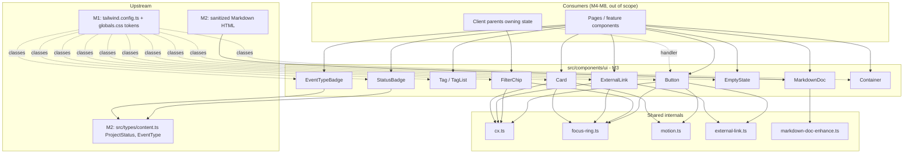
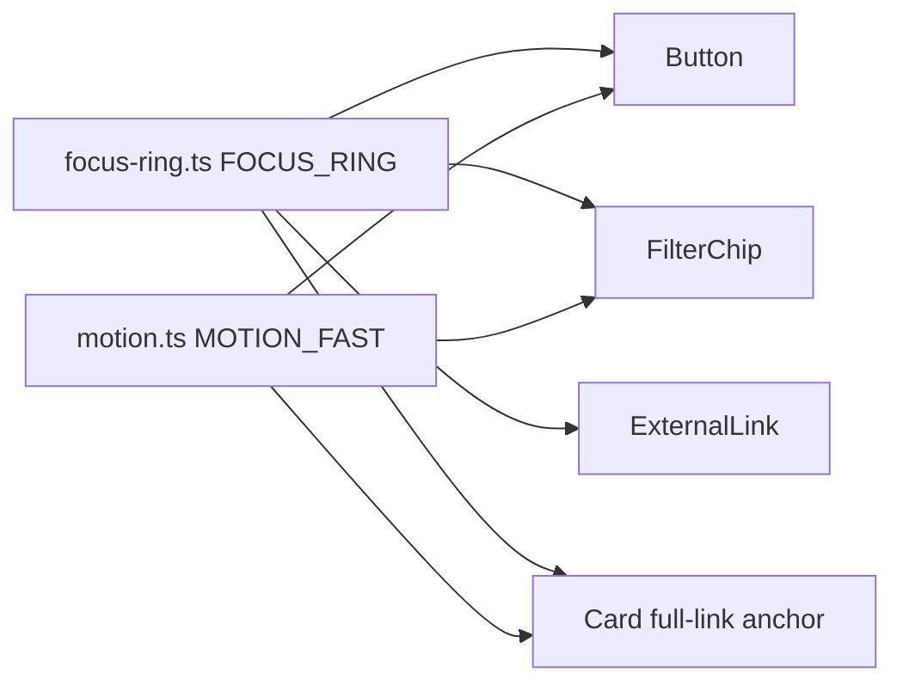

# Design Document

> **Spec:** M3 Design System Implementation  
> **Document Status:** Draft  
> **Feature Name:** m3-design-system-implementation  
> **Last Updated:** 2026-10-20  
> **Lead Architect:** Angelo Andres  
> **Requirements Reference:** `requirements.md`  
> **Master Specifications:** `AGENTS.md`, `design.md` (Sections 3–5, 7), `PRD.md`, `TRD.md`  
> **Upstream Specs:** M1 (`.kiro/specs/m1-repository-foundation-toolchain/design.md`), M2 (content schemas)

---

## Overview

### Purpose

Milestone 3 (M3) delivers the SGDS-inspired UI primitives for `personal-website-portfolio-v2` in `src/components/ui/`. The primitives consume the semantic tokens that M1 already exposes through `tailwind.config.ts` and `globals.css`. M3 does not add, change, or remove any token.

### Scope

**In Scope:**
- Primitives: `Button`, `Card`, `Tag` / `TagList`, `StatusBadge`, `EventTypeBadge`, `FilterChip`, `ExternalLink`, `EmptyState`, `MarkdownDoc`, `Container`
- Shared styling modules: focus ring, motion, class joiner
- Pure helper: `enhanceDocumentHtml` (adds accessibility attributes to sanitized Markdown HTML)
- Vitest + React Testing Library tests, axe accessibility tests, and a source-hygiene scan test

**Out of Scope (see Requirement 16):**
- Header, footer, navigation (M4), page routes (M5–M8), quality/build/deploy work (M9–M10)
- API routes, server actions, forms, analytics, cookies
- Dark-mode styling (M1 dark values stay unused by components)
- Redefining `ProjectStatus` or `EventType` (imported from `src/types/content.ts`, owned by M2; canonical shape in `AGENTS.md` Section 6.3)

### Design Principles

1. **Tokens only:** No hex, `rgb(`, arbitrary-value Tailwind classes, or `dark:` utilities in `src/components/ui/`.
2. **Server by default:** No primitive declares `'use client'`. Interactive primitives receive handlers from client parents.
3. **Presentational:** No hardcoded content and no content loading. Copy comes from consumers.
4. **One shared source for cross-cutting styles:** focus ring and motion are defined once and composed.
5. **Exhaustive by construction:** Enum-to-label/token maps use `Record<Enum, ...>` so new enum values fail compilation.
6. **Scope guarded:** Gaps in M1 configuration are recorded and escalated, not patched (`AGENTS.md` 6.2).

### Research Findings and Decisions

| Topic | Finding | Decision |
|-------|---------|----------|
| Class composition | Req 16.5 forbids new class-composition dependencies without approval. | Local `cx()` helper (about 5 lines) in `src/components/ui/cx.ts`. No `clsx` or `tailwind-merge`. |
| Markdown styling | Tailwind arbitrary variants (`[&_h2]:...`) contain `[`, which would fail the Req 1 verification scan. `@tailwindcss/typography` is a new dependency. | Use one co-located CSS Module (`markdown-doc.module.css`) with `@apply` of M1 tokens. The only raw value is the `ch` measure required by Req 10.1. |
| Accessibility attributes on Markdown HTML | `MarkdownDoc` receives sanitized HTML and must not parse Markdown (Req 10.8). Scrollable `pre` and tables need `tabindex`, labels, and `scope` (Req 10.5, 10.6). | Pure string transform `enhanceDocumentHtml` applied before `dangerouslySetInnerHTML`. Input is sanitized by M2 so the transform only adds attributes. |
| Motion | M1 `globals.css` has no global `prefers-reduced-motion` rule (see M1 design). | Req 12.5 applies: every transition pairs with `motion-reduce:transition-none`. |
| Focus | M1 `globals.css` applies a global `*:focus-visible` ring. | Primitives still compose an explicit `FOCUS_RING` constant so it is testable and survives CSS changes (Req 11.1, 11.4). |
| Axe in tests | Req 15.3 requires a documented, version-pinned axe helper with human approval. | Approved 2026-10-22 (approval 1a); pin exact version and document purpose/maintenance status before adding. `vitest-axe` or equivalent wrapper over `axe-core`. |
| Property testing library | PBT must not be hand-rolled. | `fast-check`: Approved 2026-10-22 (approval 1a) under `AGENTS.md` 6.2; pin exact version and document purpose/maintenance status before adding. |

### Configuration Gaps Recorded for Human Approval (Req 1.4, 13.6)

| Gap | Detail | Interim approach |
|-----|--------|------------------|
| Button `md` height | `design.md`/Req 2.2 require 40px. M1 `spacing` extension lists `1,2,3,4,6,8,12,16,24`; there is no `10`. | Use Tailwind's built-in `h-10` (2.5rem, default scale, not a hardcoded value). Record in task notes; request approval if a strict token is wanted. |
| Wide-desktop breakpoint | M1 config defines no custom `screens`; Tailwind defaults are 640/768/1024/1280/1536. 1440px is not a screen. | `Container` needs only `md:`/`lg:` padding steps plus a `max-w-screen-xl` cap, so no 1440 screen is required. Record gap; do not edit `tailwind.config.ts`. |
| Max readable width token | No size token for a content cap. | `max-w-screen-xl` (derived from the default screens). Record for approval. |
| Dark mode | M1 `globals.css` flips tokens under `prefers-color-scheme: dark`. `design.md` 7.7 says dark mode is off by default. | M3 adds no `dark:` styling and does not change CSS. Flag to M1 owner. |

---

## Architecture

### Layering



### File Layout

```
src/components/ui/
├── button.tsx                  # Button (button | anchor), variants, sizes
├── card.tsx                    # Card (static | full-card link)
├── tag.tsx                     # Tag, TagList
├── status-badge.tsx            # StatusBadge
├── event-type-badge.tsx        # EventTypeBadge
├── filter-chip.tsx             # FilterChip
├── external-link.tsx           # ExternalLink
├── empty-state.tsx             # EmptyState
├── markdown-doc.tsx            # MarkdownDoc (Markdown_Doc_Layout)
├── markdown-doc.module.css     # Token-based prose styles via @apply
├── markdown-doc-enhance.ts     # enhanceDocumentHtml (pure)
├── container.tsx               # Container
├── external-link-attrs.ts      # resolveExternalHref + shared anchor attrs
├── heading-level.ts            # HeadingLevel type (2 | 3 | 4)
├── focus-ring.ts               # FOCUS_RING constant
├── motion.ts                   # MOTION_FAST / MOTION_STANDARD constants
└── cx.ts                       # Class joiner

tests/unit/components/ui/
├── button.test.tsx
├── card.test.tsx
├── tag.test.tsx
├── status-badge.test.tsx
├── event-type-badge.test.tsx
├── filter-chip.test.tsx
├── external-link.test.tsx
├── empty-state.test.tsx
├── markdown-doc.test.tsx
├── markdown-doc-enhance.test.ts
├── container.test.tsx
├── a11y.test.tsx               # axe matrix for every primitive/variant/state
└── source-hygiene.test.ts      # token/motion/focus/client-directive scan
```

No `index.ts` barrel files (`AGENTS.md` 7.2). Consumers import each file directly via `@/components/ui/<file>`. Each file stays under 300 lines.

### Server vs Client Decisions (Req 7.7, 16.2, 16.3)

| Primitive | Directive | Rationale |
|-----------|-----------|-----------|
| Button | Server | Receives `onClick` only when a client parent renders it; the component itself holds no state. |
| Card | Server | Static markup; hover is CSS. |
| Tag / TagList | Server | Non-interactive. |
| StatusBadge / EventTypeBadge | Server | Pure mapping. |
| FilterChip | Server-compatible | Consumer owns `selected`; `onToggle` comes from a client parent. File carries a comment documenting this decision. |
| ExternalLink | Server | Pure render; dev-time `console.error` runs on the server. |
| EmptyState | Server | Static; optional `role="status"`. |
| MarkdownDoc | Server | HTML transform at render time. |
| Container | Server | Layout only. |

No M3 file contains `'use client'`. If a later change adds one, it must include the comment required by Req 16.3 and the hygiene test will enforce it.

### Shared Focus-Ring and Reduced-Motion Approach



```typescript
// focus-ring.ts
// Appears on keyboard focus only (:focus-visible). 2px ring, 2px offset, focus-ring token.
export const FOCUS_RING =
  'focus-visible:outline-none focus-visible:ring-2 focus-visible:ring-focus-ring focus-visible:ring-offset-2';

// motion.ts
// Every transition uses a duration token and is disabled under prefers-reduced-motion.
export const MOTION_FAST = 'transition-colors duration-fast motion-reduce:transition-none';
export const MOTION_SHADOW_FAST = 'transition-shadow duration-fast motion-reduce:transition-none';
```

`outline-none` appears only inside `FOCUS_RING`, paired with the ring (Req 11.5). Ring width (`ring-2` = 2px) and offset (`ring-offset-2` = 2px) satisfy Req 11.2. The ring color is `focus-ring` (`#0052A5` in light mode) and is expected to exceed 3:1 on `bg-page` and `bg-surface`; the actual measurement is manual (Req 11.3, 15.5). No `@keyframes`, `animate-`, or parallax is used (Req 12.4).

---

## Components and Interfaces

All props are strict TypeScript. No `any`, no non-null assertions, no unjustified `as`.

### Shared Types and Helpers

```typescript
// cx.ts
export type ClassValue = string | false | null | undefined;
export function cx(...values: ClassValue[]): string {
  return values.filter((v): v is string => typeof v === 'string' && v.length > 0).join(' ');
}

// external-link-attrs.ts
export type HttpsUrl = `https://${string}`;

/** Returns the href if it is a non-empty absolute https URL string, otherwise null. */
export function resolveExternalHref(href: string | null | undefined): HttpsUrl | null {
  if (typeof href !== 'string') return null;
  return href.startsWith('https://') && href.length > 'https://'.length
    ? (href as HttpsUrl) // narrowing after runtime check
    : null;
}

export const EXTERNAL_LINK_ATTRS = {
  target: '_blank',
  rel: 'noopener noreferrer',
} as const;

export const NEW_TAB_TEXT = '(opens in a new tab)';
```

### Button (Req 2, 8.8, 11, 12)

```typescript
import type { ReactNode, ButtonHTMLAttributes, AnchorHTMLAttributes } from 'react';
import type { HttpsUrl } from './external-link-attrs';

export type ButtonVariant = 'primary' | 'secondary' | 'ghost' | 'external-link';
export type ButtonSize = 'sm' | 'md' | 'lg';

interface ButtonBaseProps {
  variant?: ButtonVariant;   // default 'primary'
  size?: ButtonSize;         // default 'md'
  className?: string;
}

/** Icon-only content must supply an accessible name (Req 2.7). */
type ButtonContentProps =
  | { iconOnly?: false; 'aria-label'?: string; children: ReactNode }
  | { iconOnly: true; 'aria-label': string; children: ReactNode };

export type ButtonAsButtonProps = ButtonBaseProps &
  ButtonContentProps &
  Omit<ButtonHTMLAttributes<HTMLButtonElement>, 'children' | 'className' | 'aria-label'> & {
    href?: undefined;
    type?: 'button' | 'submit' | 'reset'; // default 'button'
  };

export type ButtonAsLinkProps = ButtonBaseProps &
  ButtonContentProps &
  Omit<AnchorHTMLAttributes<HTMLAnchorElement>, 'children' | 'className' | 'aria-label' | 'href'> & {
    href: string;
    disabled?: never; // anchors cannot be disabled; use a Button instead
  };

export type ButtonProps = ButtonAsButtonProps | ButtonAsLinkProps;
export function Button(props: ButtonProps): JSX.Element | null;
```

Behavior notes:
- Native `button` renders `type="button"` unless overridden (Req 2.8). Disabled sets the `disabled` attribute, so click events are not delivered (Req 2.5).
- The `external-link` variant with `href` renders the anchor with `EXTERNAL_LINK_ATTRS`, hidden `NEW_TAB_TEXT`, and an `aria-hidden` icon. A non-https `href` renders `null` (Req 8.8, 8.6), reusing `resolveExternalHref`.
- `submit`/`reset` types are allowed by the HTML type only; M3 creates no forms (Req 16.6).

**Size mapping (Req 2.2):**

| Size | Height | Classes |
|------|--------|---------|
| `sm` | 32px | `h-8 px-3 text-small` |
| `md` | 40px | `h-10 px-4 text-body` (see Configuration Gaps) |
| `lg` | 48px | `h-12 px-6 text-body` |

**Variant and state mapping (Req 2.4):**

| Variant | Default | Hover | Active | Disabled |
|---------|---------|-------|--------|----------|
| `primary` | `bg-brand-primary text-page` | `hover:opacity-90` | `active:opacity-80` | `disabled:bg-surface disabled:text-text-disabled` |
| `secondary` | `bg-page text-brand-primary border border-brand-primary` | `hover:bg-surface` | `active:bg-surface active:opacity-80` | `disabled:border-border-default disabled:text-text-disabled` |
| `ghost` | `bg-transparent text-brand-primary` | `hover:bg-surface` | `active:opacity-80` | `disabled:text-text-disabled` |
| `external-link` | `bg-transparent text-brand-primary underline` | `hover:opacity-90` | `active:opacity-80` | `disabled:text-text-disabled` |

Common classes on every variant: `inline-flex items-center justify-center gap-2 rounded-md font-medium disabled:cursor-not-allowed` + `FOCUS_RING` + `MOTION_FAST`.

### Card (Req 3)

```typescript
import type { ReactNode } from 'react';
import type { HeadingLevel } from './heading-level';

interface CardBaseProps {
  /** Consumer controls heading hierarchy (Req 3.6). */
  headingLevel: HeadingLevel;
  title: ReactNode;
  className?: string;
  children?: ReactNode; // body content
}

export interface StaticCardProps extends CardBaseProps {
  href?: undefined;
}

/** Full-card link. `linkLabel` becomes the anchor's accessible name when the title alone is not descriptive. */
export interface LinkedCardProps extends CardBaseProps {
  href: string;
  linkLabel?: string;
}

export type CardProps = StaticCardProps | LinkedCardProps;
export function Card(props: CardProps): JSX.Element;
```

- Root: `<article>` with `relative rounded-lg border border-border-default bg-surface p-6 shadow-elevation-1`.
- Linked mode: the single anchor wraps the heading text and uses a stretched-link pseudo-element (`after:absolute after:inset-0`) so it covers the whole Card (Req 3.4). The hover transition is `hover:shadow-elevation-2` + `MOTION_SHADOW_FAST`, applied only in linked mode (Req 3.3). The anchor carries `FOCUS_RING`.
- Req 3.5 (no nested interactive in a full-card link): children are not placed inside the anchor, and TypeScript cannot forbid interactive `ReactNode`s. Enforcement is a test that fails if a linked Card's DOM contains more than one focusable element within the link, plus a JSDoc contract on `children`. This is allowed by the Req 3 verification step ("type level or in a test").
- External destinations on Cards are the consumer's job (use `ExternalLink` inside a static Card).

### Tag and TagList (Req 4)

```typescript
export interface TagProps { children: string; className?: string; }
export function Tag(props: TagProps): JSX.Element;      // <li><span>...</span></li> when inside TagList

export interface TagListProps {
  'aria-label': string;           // consumer-supplied accessible name (Req 4.5)
  tags: readonly string[];
  className?: string;
}
export function TagList(props: TagListProps): JSX.Element | null; // null for empty tags
```

`Tag` classes: `inline-block rounded-sm border border-border-default bg-surface px-2 py-1 text-caption text-text-secondary`. It sets no `role`, `tabindex`, or handlers (Req 4.3). `TagList` renders `<ul aria-label>` with `flex flex-wrap gap-2` and `<li>` wrappers. Keys use the tag string plus index to tolerate duplicates.

### StatusBadge (Req 5)

```typescript
import type { ProjectStatus } from '@/types/content';

export interface StatusBadgeProps { status: ProjectStatus; className?: string; }

const STATUS_LABELS: Record<ProjectStatus, string> = {
  completed: 'Completed',
  'in-progress': 'In Progress',
  archived: 'Archived',
};
const STATUS_TOKENS: Record<ProjectStatus, string> = {
  completed: 'text-feedback-success border-feedback-success',
  'in-progress': 'text-feedback-warning border-feedback-warning',
  archived: 'text-text-secondary border-border-default',
};
```

Base classes: `inline-flex items-center rounded-full border bg-surface px-3 py-1 text-caption font-medium`. The visible text carries the status; color is secondary (Req 5.4). Both maps are `Record<ProjectStatus, ...>`, so a new status fails compilation (Req 5.5).

### EventTypeBadge (Req 6)

```typescript
import type { EventType } from '@/types/content';

export interface EventTypeBadgeProps { eventType: EventType; className?: string; }

const EVENT_TYPE_LABELS: Record<EventType, string> = {
  meetup: 'Meetup',
  hackathon: 'Hackathon',
  workshop: 'Workshop',
  conference: 'Conference',
  learning: 'Learning',
  'project-update': 'Project Update',
};
```

Single neutral style for all six types: `inline-flex items-center rounded-sm border border-border-default bg-surface px-2 py-1 text-caption font-medium text-brand-secondary`. Meaning is carried by the text label (Req 6.3). Exhaustive map (Req 6.5).

### FilterChip (Req 7)

```typescript
export interface FilterChipProps {
  label: string;
  selected: boolean;                  // consumer-owned state (Req 7.7)
  onToggle: () => void;               // called exactly once per activation
  className?: string;
  disabled?: boolean;
}
export function FilterChip(props: FilterChipProps): JSX.Element;
```

- Renders `<button type="button" aria-pressed={selected}>`. Native buttons fire `click` for Enter and Space, so one handler (`onClick={onToggle}`) yields exactly one invocation per activation (Req 7.3).
- Unselected: `h-8 border border-border-default bg-surface text-text-primary`. Selected: `border-2 border-brand-primary text-brand-primary` plus a check glyph (`aria-hidden="true"`); border weight and the glyph differ from the unselected state beyond color (Req 7.4). `h-8` gives the 32px minimum target (Req 7.8).
- This is the only primitive carrying `cursor-pointer` (Req 7.6). Includes `FOCUS_RING` and `MOTION_FAST`.
- The file starts with a comment: "Server-compatible: consumer owns state; no 'use client' needed here."

### ExternalLink (Req 8)

```typescript
import type { ReactNode } from 'react';
import type { HttpsUrl } from './external-link-attrs';

export interface ExternalLinkProps {
  href: HttpsUrl | string | null | undefined; // runtime-validated; HttpsUrl documents intent
  children: ReactNode;
  className?: string;
}
export function ExternalLink(props: ExternalLinkProps): JSX.Element | null;
```

- `resolveExternalHref(href)` returns `null` for `null`, `undefined`, empty, or non-`https://` values; the component then returns `null` and, in development (`process.env.NODE_ENV !== 'production'`), calls `console.error` naming the category (`"missing"` or `"non-https"`), never echoing the full value (Req 8.5, 8.6).
- Valid output: `<a href target="_blank" rel="noopener noreferrer">{children}<span class="sr-only">(opens in a new tab)</span><svg aria-hidden="true" focusable="false" /></a>` with `text-brand-primary underline` + `FOCUS_RING` (Req 8.1–8.3, 8.7).
- The icon is a small inline SVG using `currentColor` (no hardcoded color).

### EmptyState (Req 9)

```typescript
import type { ReactNode } from 'react';
import type { HeadingLevel } from './heading-level';

export interface EmptyStateProps {
  heading: string;                    // consumer-supplied copy (Req 9.5)
  message: string;
  headingLevel: HeadingLevel;
  action?: ReactNode;                 // Button or link (Req 9.2)
  announce?: boolean;                 // true adds role="status" (Req 9.6)
  className?: string;
}
export function EmptyState(props: EmptyStateProps): JSX.Element;
```

Container classes: `rounded-lg border border-border-default bg-surface p-8 md:p-12 text-center`; message uses `text-text-secondary`. The action wrapper `<div class="mt-6">` is rendered only when `action` is provided (Req 9.4). `HeadingLevel` lives in `heading-level.ts` so `card` and `empty-state` stay decoupled.

### MarkdownDoc (Req 10)

```typescript
export interface MarkdownDocProps {
  /** Sanitized HTML produced by the M2 Markdown pipeline. Never raw Markdown. */
  html: string;
  /** Accessible-name prefix for generated labels, e.g. "Code example". Defaults supplied by caller. */
  codeBlockLabel: string;
  tableLabel: string;
  className?: string;
}
export function MarkdownDoc(props: MarkdownDocProps): JSX.Element;

// markdown-doc-enhance.ts
export interface EnhanceLabels { codeBlockLabel: string; tableLabel: string; }
export function enhanceDocumentHtml(html: string, labels: EnhanceLabels): string;
```

Labels are required props to keep copy out of the primitive (Req 9.5 spirit, `design.md` 7.6).

`enhanceDocumentHtml` rules, all additive and idempotent:
1. `<pre ...>` without `tabindex` gains `tabindex="0"`, and without `aria-label` gains `aria-label="{codeBlockLabel}"` (Req 10.5).
2. Each `<table ...>...</table>` not already inside a wrapper marked `data-doc-table` is wrapped in `<div data-doc-table role="region" tabindex="0" aria-label="{tableLabel}">` (Req 10.6).
3. Each `<th>` without a `scope` attribute gains `scope="col"` (Req 10.6). Header cells that already declare `scope="row"` are preserved.
4. No other markup is added, removed, or reordered, and text content is unchanged (Req 10.8).

Rendering: `<div className={styles.doc} dangerouslySetInnerHTML={{ __html: enhanced }} />`. The layout renders no `h1`; its internal heading hierarchy starts at `h2` (Req 10.9). The `dangerouslySetInnerHTML` use is acceptable only because input is sanitized upstream by M2; this is documented in a file comment, and `eslint-plugin-react`'s `no-danger` suppression is justified inline.

**`markdown-doc.module.css` (via `@apply`, no hex or arbitrary values except the `ch` measure):**

| Element | Tokens (Req 10.2, 10.3, 10.7) |
|---------|-------------------------------|
| `.doc` | `font-sans text-body text-text-primary`; `max-width: 70ch` (within 65–75ch, Req 10.1) |
| `h2` | `text-heading-3 mt-12 mb-4 font-semibold` |
| `h3` | `text-heading-4 mt-8 mb-3 font-semibold` |
| `h4` | `text-body mt-6 mb-2 font-semibold` |
| `p`, `ul`, `ol` | `mb-4`; lists `pl-6 list-disc` / `list-decimal` |
| `a` | `text-brand-primary underline`, `focus-visible` ring |
| `blockquote` | `border-l-4 border-border-strong pl-4 text-text-secondary` |
| `code` (inline) | `font-mono text-small bg-surface rounded-sm px-1` |
| `pre` | `font-mono text-small bg-surface border border-border-default rounded-md p-4 overflow-x-auto` |
| `[data-doc-table]` | `overflow-x-auto` + focus ring |
| `table`, `th`, `td` | `text-small border border-border-default p-2`; `th` `text-left bg-surface` |
| `img` | `max-w-full h-auto rounded-md` |

`pre` and the table wrapper scroll horizontally inside themselves, so the page does not scroll (Req 10.4).

### Container (Req 13)

```typescript
import type { ReactNode } from 'react';

export type ContainerElement = 'div' | 'section' | 'main' | 'article';

export interface ContainerProps {
  as?: ContainerElement;   // default 'div'
  className?: string;
  children: ReactNode;
}
export function Container(props: ContainerProps): JSX.Element;
```

Classes: `mx-auto w-full max-w-screen-xl px-4 md:px-6 lg:px-8`.

| Breakpoint | Range | Padding token | Behavior |
|------------|-------|---------------|----------|
| Mobile | 375–767px | `px-4` (16px) | Fluid; content wraps, no horizontal page scroll (Req 13.4) |
| Tablet | 768–1023px | `px-6` | Fluid |
| Desktop | 1024–1439px | `px-8` | Fluid up to cap |
| Wide Desktop | 1440px+ | `px-8` | Centered, capped at `max-w-screen-xl` (Req 13.3) |

Implementation uses `const Tag = as ?? 'div'` as a `ContainerElement` (a union of string literals), so no assertion is needed.

### Token-to-Class Mapping (consumed from M1)

| Semantic token | Tailwind class form | Used by |
|----------------|---------------------|---------|
| `bg-page` / `bg-surface` | `bg-page`, `bg-surface` | Button, Card, Tag, badges, chip, EmptyState, MarkdownDoc |
| `text-primary` / `text-secondary` / `text-disabled` | `text-text-primary`, `text-text-secondary`, `text-text-disabled` | all text |
| `border-default` / `border-strong` | `border-border-default`, `border-border-strong` | Card, Tag, chip, tables, blockquote |
| `brand-primary` / `brand-secondary` | `text-brand-primary`, `bg-brand-primary`, `border-brand-primary`, `text-brand-secondary` | Button, chip, links, EventTypeBadge |
| `feedback-success` / `-warning` | `text-feedback-success`, `border-feedback-success`, ... | StatusBadge |
| `focus-ring` | `ring-focus-ring` | `FOCUS_RING` |
| spacing `1,2,3,4,6,8,12` | `p-*`, `px-*`, `gap-*`, `mt-*`, `h-8`, `h-12` | all |
| radius `sm/md/lg/full` | `rounded-sm`, `rounded-md`, `rounded-lg`, `rounded-full` | Tag, Button, Card, badges |
| elevation `1/2` | `shadow-elevation-1`, `shadow-elevation-2` | Card |
| motion `fast/standard` | `duration-fast`, `duration-standard` | `MOTION_*` |
| type scale | `text-caption`, `text-small`, `text-body`, `text-heading-3`, `text-heading-4` | all |

Note on class names: M1 registered text colors as `text-primary` etc. inside `theme.extend.colors`, so Tailwind generates `text-text-primary`. `border-default` becomes `border-border-default`. The tests assert these names.

---

## Data Models

M3 introduces no persisted data and no content schemas.

### Imported Types (owned by M2)

```typescript
// src/types/content.ts (M2; canonical definitions in AGENTS.md Section 6.3)
import type { ProjectStatus, EventType } from '@/types/content';
```

M3 never redeclares these (Req 16.4).

### M3-Local Types

| Type | File | Definition |
|------|------|------------|
| `HeadingLevel` | `heading-level.ts` | `2 \| 3 \| 4` |
| `ButtonVariant`, `ButtonSize` | `button.tsx` | string-literal unions shown above |
| `ContainerElement` | `container.tsx` | `'div' \| 'section' \| 'main' \| 'article'` |
| `HttpsUrl` | `external-link-attrs.ts` | `` `https://${string}` `` |
| `ClassValue` | `cx.ts` | `string \| false \| null \| undefined` |
| `EnhanceLabels` | `markdown-doc-enhance.ts` | `{ codeBlockLabel: string; tableLabel: string }` |

### Enum-to-Presentation Maps

Both are typed `Record<Enum, string>` so omissions fail compilation:

| `ProjectStatus` | Label | Token classes |
|-----------------|-------|---------------|
| `completed` | Completed | `text-feedback-success border-feedback-success` |
| `in-progress` | In Progress | `text-feedback-warning border-feedback-warning` |
| `archived` | Archived | `text-text-secondary border-border-default` |

| `EventType` | Label |
|-------------|-------|
| `meetup` | Meetup |
| `hackathon` | Hackathon |
| `workshop` | Workshop |
| `conference` | Conference |
| `learning` | Learning |
| `project-update` | Project Update |

Expected contrast pairs (to be measured manually, Req 4.6, 5.6, 6.4): success `#00694E`, warning `#8A6100`, and secondary text `#4A5A68` against surface `#F7F9FA`, and `brand-secondary` `#00694E` against surface, per `design.md` 3.1.

---

## Correctness Properties

*A property is a characteristic or behavior that should hold true across all valid executions of a system-essentially, a formal statement about what the system should do. Properties serve as the bridge between human-readable specifications and machine-verifiable correctness guarantees.*

**Reflection:** Prework candidates were consolidated to remove redundancy. Button class-matrix, native `type`, and focus-ring checks are one property. The ExternalLink attribute checks (including the Button `external-link` variant) are one property, with its rejection counterpart separate. The heading-level criteria for Card and EmptyState are merged. Enum label totality for both badges is merged. Doc enhancer structure and idempotence are kept separate because they catch different bugs. Contrast, layout, and screen-reader criteria are not computable in jsdom and are excluded (manual list in Testing Strategy).

### Property 1: Source hygiene across UI primitives

*For any* source file under `src/components/ui/`, the file SHALL contain no hex color, `rgb(`/`rgba(`, arbitrary-value Tailwind class (`[`...`]`), or `dark:` utility, except the documented `ch` measure in `markdown-doc.module.css`; every `outline-none` / `outline-0` SHALL co-occur with the focus-ring ring utilities; every `transition` / `animate-` occurrence SHALL co-occur with `motion-reduce:`; every `'use client'` SHALL be accompanied by an explanatory comment; and only `filter-chip.tsx` SHALL contain `cursor-pointer`.

**Validates: Requirements 1.1, 1.2, 1.5, 7.6, 11.5, 12.1, 12.3, 12.5, 16.2, 16.3**

### Property 2: Button renders correctly for every variant and size

*For any* `variant` in {primary, secondary, ghost, external-link} and `size` in {sm, md, lg}, rendering a Button without `href` SHALL produce a native `button` with `type="button"`, the size's height class (`h-8`, `h-10`, `h-12`), the variant's token classes, and the shared focus-ring classes.

**Validates: Requirements 2.1, 2.2, 2.4, 2.8, 11.4**

### Property 3: Disabled Button is inert

*For any* variant and size, a disabled Button SHALL have the `disabled` attribute and the `text-disabled` token class, and a user click SHALL NOT invoke its `onClick` handler.

**Validates: Requirements 2.5**

### Property 4: Heading level fidelity

*For any* `headingLevel` in {2, 3, 4} and any title text, a Card and an EmptyState SHALL each render exactly one heading with that level containing the title text.

**Validates: Requirements 3.6, 9.3**

### Property 5: Tag is non-interactive and preserves its label

*For any* label string, a Tag SHALL render that string as text content and SHALL have no `role="button"`, no `tabindex`, and no click handler.

**Validates: Requirements 4.2, 4.3, 4.4**

### Property 6: Badges show a text label for every enum value

*For any* `ProjectStatus` value, StatusBadge SHALL render the mapped visible label and the mapped token classes; *for any* `EventType` value, EventTypeBadge SHALL render the mapped visible label, so the meaning does not depend on color alone.

**Validates: Requirements 5.2, 5.3, 5.4, 6.2, 6.3**

### Property 7: FilterChip reflects state and activates exactly once

*For any* `selected` boolean, FilterChip SHALL render a `button` with `type="button"` and `aria-pressed` equal to `selected`; and *for any* activation method in {click, Enter, Space}, `onToggle` SHALL be invoked exactly once.

**Validates: Requirements 7.1, 7.2, 7.3**

### Property 8: ExternalLink with a valid HTTPS URL is safe and announced

*For any* string beginning with `https://` followed by at least one character, and any link text, ExternalLink (and Button `external-link` with that `href`) SHALL render an anchor with `target="_blank"`, `rel="noopener noreferrer"`, the visually hidden text `(opens in a new tab)`, an `aria-hidden="true"` icon, and the `href` unchanged.

**Validates: Requirements 8.1, 8.2, 8.3, 8.7, 8.8**

### Property 9: ExternalLink rejects every non-HTTPS value

*For any* `href` that is `null`, `undefined`, empty, or a string not beginning with `https://`, ExternalLink SHALL render no anchor and no DOM output, and `resolveExternalHref` SHALL return `null`.

**Validates: Requirements 8.4, 8.5, 8.6**

### Property 10: EmptyState action container presence matches the action

*For any* heading, message, and `announce` value, EmptyState SHALL render the action container if and only if an `action` was provided, and SHALL set `role="status"` if and only if `announce` is true.

**Validates: Requirements 9.2, 9.4, 9.6**

### Property 11: Document enhancer adds required accessibility attributes

*For any* sanitized HTML containing any number of `pre`, `table`, and `th` elements, the output of `enhanceDocumentHtml` SHALL give every `pre` a `tabindex="0"` and an `aria-label`, wrap every `table` in a labelled focusable scroll region, and give every `th` a `scope` attribute.

**Validates: Requirements 10.5, 10.6**

### Property 12: Document enhancer is idempotent and content-preserving

*For any* sanitized HTML and labels, `enhanceDocumentHtml(enhanceDocumentHtml(x)) === enhanceDocumentHtml(x)`, and the text content of the output SHALL equal the text content of the input.

**Validates: Requirements 10.5, 10.6, 10.8**

### Property 13: Container renders the requested element

*For any* `as` in {div, section, main, article}, Container SHALL render an element with that tag name and the centering, padding, and max-width token classes.

**Validates: Requirements 13.1, 13.3, 13.5**

### Property 14: Interactive primitives expose an accessible name

*For any* non-empty label text, rendering Button, FilterChip, ExternalLink, or a linked Card SHALL yield an interactive element (`button` or `link` role) whose accessible name contains that text.

**Validates: Requirements 15.6, 3.4, 8.2**

---

## Error Handling

M3 primitives are presentational. Errors are handled at build time (types, lint) or by rendering safely.

| Condition | Component | Behavior | Requirement |
|-----------|-----------|----------|-------------|
| `href` is `null`, `undefined`, or empty | ExternalLink, Button `external-link` | Render `null`; no development error for the expected "optional link" case beyond the category log | 8.5 |
| `href` not `https://` | ExternalLink, Button `external-link` | Render `null`; dev-only `console.error` naming category `non-https`, not the value | 8.6 |
| `ProjectStatus` / `EventType` gains a value | StatusBadge, EventTypeBadge | `tsc` error from `Record<Enum, ...>` until maps are updated | 5.5, 6.5 |
| Icon-only Button without `aria-label` | Button | `tsc` error from the discriminated `ButtonContentProps` union | 2.7 |
| Disabled Button click | Button | Native `disabled` suppresses events | 2.5 |
| Linked Card contains a nested interactive element | Card | Hygiene/DOM test fails; documented in JSDoc | 3.5 |
| Empty `tags` array | TagList | Render `null` rather than an empty `ul` | 4.5 |
| Missing M1 token or breakpoint | Implementation process | Record in task notes; request approval before editing root config | 1.4, 13.6 |
| Dependency (axe helper, fast-check) | Implementation process | Approved 2026-10-22 (approval 1a); pin exact version and document purpose/maintenance status before adding | 15.3, 15.4, 16.5 |
| Malformed HTML input to `enhanceDocumentHtml` | MarkdownDoc | Transform only adds attributes to tags it recognizes; unrecognized input passes through unchanged. M2 sanitization is the trust boundary | 10.8 |

Verification pipeline order and failure behavior are inherited from M1: `npm run lint`, `npm run typecheck`, `npm test`, `npm run build` must all exit 0 (Req 16.9).

---

## Testing Strategy

### Approach

Dual testing, using the M1 toolchain (Vitest, jsdom, React Testing Library, `@testing-library/jest-dom`, `tests/setup.ts`):

- **Unit/example tests:** specific structures, defaults, token class assertions, and error paths.
- **Property tests:** the universal properties above, using **fast-check** (not hand-rolled).
- **Accessibility tests:** axe against every primitive, variant, and state.
- **Static checks:** `tsc` (exhaustive maps, icon-only `aria-label` with `@ts-expect-error`), ESLint (`jsx-a11y`, no-`any`).

### Property-Based Testing Configuration

PBT applies to the pure and finite-input logic: URL validation, HTML enhancement, enum/props matrices, and the source-hygiene scan. It does not apply to visual rendering, layout, contrast, or CSS behavior; those use example, axe, and manual checks.

- Library: `fast-check` at an exact pinned version (Approved 2026-10-22 (approval 1a); pin exact version and document purpose/maintenance status before adding; Req 15.3/16.5).
- Each property is implemented as a single test running **at least 100 iterations** (`fc.assert(..., { numRuns: 100 })`).
- Each test carries a tag comment: `Feature: m3-design-system-implementation, Property {n}: {property text}`.
- Property 1 is a deterministic scan over files (no randomization) but is still the single test for that property.
- Generators:
  - Properties 2, 3, 13: `fc.constantFrom` over the variant, size, and element unions.
  - Properties 4, 6, 7, 10: `fc.constantFrom` over `HeadingLevel`, enum values, `fc.boolean()`, activation kinds; titles from `fc.string({ minLength: 1 })` filtered to non-whitespace.
  - Properties 8, 9: `fc.webUrl({ validSchemes: ['https'] })` plus arbitrary strings, `fc.constantFrom(null, undefined, '')`, and `fc.string()` filtered to exclude the `https://` prefix; `http://`, `javascript:`, and protocol-relative values are included as explicit seeds.
  - Properties 11, 12: a small HTML generator composing `p`, `pre`, `code`, `table`, `thead`, `th`, `td` with random text, with and without pre-existing `tabindex`, `aria-label`, `scope`, and already-wrapped tables.

### Unit and Example Tests (kept deliberately small)

| Area | Examples |
|------|----------|
| Button | Defaults (`primary`, `md`); link rendering with `href`; Enter/Space keyboard activation; `@ts-expect-error` for icon-only without `aria-label` (Req 2.3, 2.6, 2.7, 14.5) |
| Card | Static vs linked: anchor count, token classes, `hover:shadow-elevation-2` only when linked; linked Card with a nested button flagged by the DOM check (Req 3.1–3.5) |
| TagList | `ul` with supplied `aria-label`, `li` per tag, `null` when empty (Req 4.5) |
| Badges | One assertion per enum value for label and class (Req 14.4) |
| FilterChip | Selected styling differs (border weight class + check glyph) from unselected; min height `h-8` (Req 7.4, 7.8) |
| EmptyState | With and without action; `role="status"` mode (Req 9.1, 9.6) |
| MarkdownDoc | Sample HTML with headings, code, table, lists, blockquote: wrapper classes, attributes, no `h1` emitted by the component (Req 10.1–10.3, 10.7, 10.9) |
| Container | Class tokens; `as` element variants (Req 13.1–13.3) |
| ExternalLink | `null`, `""`, `undefined`, `http://` rejection paths (also covered by Property 9) (Req 14.6) |

Tests query by role, label, or text; class assertions are limited to token utilities (Req 14.3). Tests contain no `any`, non-null assertions, or unjustified `as` (Req 14.8).

### Accessibility Tests (Req 15)

`a11y.test.tsx` renders every primitive in each documented variant and state (4 Button variants × 3 sizes plus disabled, linked and static Card, TagList, 3 status values, 6 event types, FilterChip selected/unselected, ExternalLink, EmptyState with/without action and live-region mode, MarkdownDoc sample including a wide table and code block, Container elements) and runs axe with WCAG 2.1 A/AA tags. Expected result: zero violations. `color-contrast` is unreliable in jsdom, so contrast is verified manually (below). The `scrollable-region-focusable` rule is relevant for MarkdownDoc (Req 10 verification).

The axe helper: Approved 2026-10-22 (approval 1a); pin exact version and document purpose/maintenance status before adding (Req 15.3, 15.4).

### Manual Verification List (record in task notes, Req 15.5)

- Contrast measurements for status colors, secondary text, `brand-secondary`, and the focus ring (4.5:1 text, 3:1 ring) against `design.md` 3.1 values
- Keyboard-only walkthrough of Button, FilterChip, ExternalLink, linked Card (order, visible focus, no traps)
- Screen-reader announcement of the "(opens in a new tab)" text, `aria-pressed` toggle, and `role="status"` EmptyState
- Reduced-motion check with the OS setting enabled
- Responsive check of `Container` and `MarkdownDoc` overflow at 375, 768, 1024, and 1440px
- `git diff` on `tailwind.config.ts` and `globals.css` shows no token changes

### Why No Further PBT

Rendering, CSS layout, token visuals, and contrast are not functions with checkable universal outputs in jsdom. They are covered by example tests, snapshot-free class assertions, axe, and the manual list above.

### Requirements Traceability

| Requirement | Design Element | Validation |
|-------------|----------------|------------|
| 1 Tokens only | Token mapping table, `cx`, hygiene scan | Property 1; `git diff` |
| 2 Button | `button.tsx`, variant/size tables | Properties 2, 3; type test |
| 3 Card | `card.tsx` | Property 4; examples; axe |
| 4 Tag | `tag.tsx` | Property 5; axe |
| 5 StatusBadge | `status-badge.tsx` maps | Property 6; `tsc` |
| 6 EventTypeBadge | `event-type-badge.tsx` maps | Property 6; `tsc` |
| 7 FilterChip | `filter-chip.tsx` | Properties 1, 7 |
| 8 ExternalLink | `external-link.tsx`, `external-link-attrs.ts` | Properties 8, 9 |
| 9 EmptyState | `empty-state.tsx` | Properties 4, 10 |
| 10 MarkdownDoc | `markdown-doc*.ts(x)`, CSS module | Properties 11, 12; axe |
| 11 Focus ring | `focus-ring.ts` | Properties 1, 2; manual contrast |
| 12 Reduced motion | `motion.ts` | Property 1; manual |
| 13 Container | `container.tsx` | Property 13; manual responsive |
| 14 Component tests | `tests/unit/components/ui/` | `npm test` |
| 15 Accessibility checks | `a11y.test.tsx`, manual list | axe run; Property 14 |
| 16 Guardrails | Server-by-default table, file layout | Property 1; pipeline |
