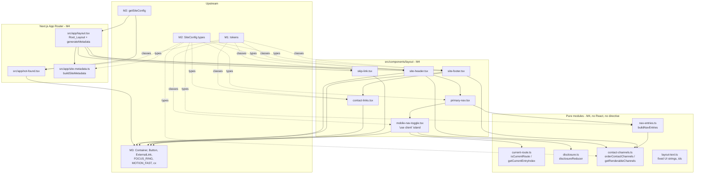
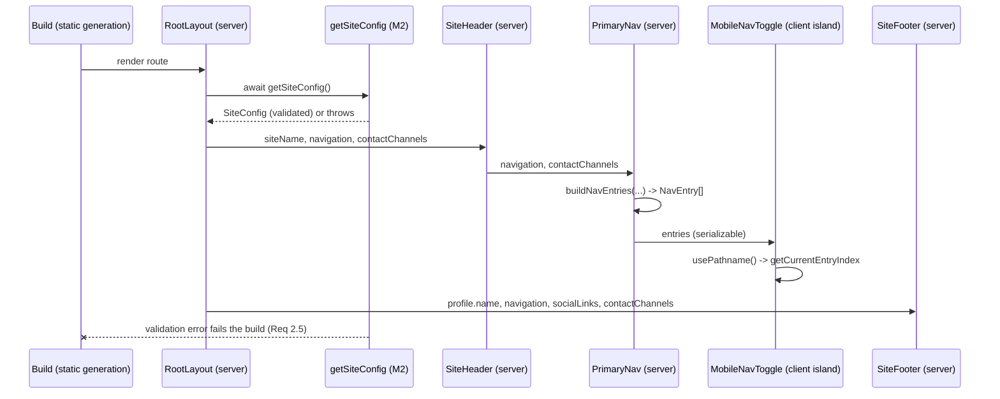
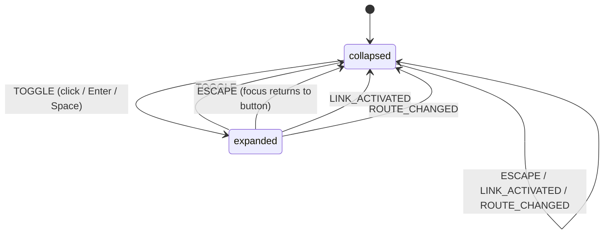

# Design Document

> **Spec:** M4 Global Layout & Navigation  
> **Document Status:** Draft  
> **Feature Name:** m4-global-layout-navigation  
> **Last Updated:** 2026-10-20  
> **Lead Architect:** Angelo Andres  
> **Requirements Reference:** `requirements.md`  
> **Master Specifications:** `AGENTS.md` (Sections 3, 4.2, 6), `TRD.md` (Sections 3.3, 4.3, 6.5), `design.md` (Sections 3–5, 7), `APP_FLOW.md` (`SCR-07`)  
> **Upstream Specs:** M1 (tokens, toolchain), M2 (`SiteConfig` schema and `getSiteConfig()` loader), M3 (UI primitives)

---

## Overview

### Purpose

Milestone 4 (M4) delivers the global shell for `personal-website-portfolio-v2`: the root layout (`src/app/layout.tsx`), site-wide metadata, the global not-found page (`src/app/not-found.tsx`), and the layout components in `src/components/layout/` (SiteHeader, PrimaryNav, MobileNavToggle, SkipLink, SiteFooter, ContactLinks). All site identity, navigation, social links, and contact channels come from `SiteConfig` through the M2 `getSiteConfig()` loader. M4 composes M3 primitives and the M1 tokens. It adds no token, no primitive, no dependency, and no route other than `not-found`.

### Scope

**In Scope:**
- Root layout, landmarks, `lang="en"`, skip link, `main#main-content`
- SiteHeader, PrimaryNav, MobileNavToggle (the single client island), current-route indication
- SiteFooter, ContactLinks, site-wide metadata defaults, global not-found page
- Pure helpers: `isCurrentRoute`, `getCurrentEntryIndex`, `buildNavEntries`, `disclosureReducer`, `orderContactChannels`, `buildSiteMetadata`
- Vitest, React Testing Library, axe, and fast-check tests

**Out of Scope (Requirements 13.7, 14):**
- Homepage content (M5), projects, certifications, blog routes (M6–M8), performance and deployment (M9–M10)
- Dark mode, API routes, server actions, forms, analytics, cookies
- Any change to `src/components/ui/`, `tailwind.config.ts`, `globals.css`, `package.json`, lockfiles, or CI

### Design Principles

1. **Server by default:** Exactly one module in `src/components/layout/` declares `'use client'`: `mobile-nav-toggle.tsx`.
2. **Data from `SiteConfig` only:** No site name, label, URL, or owner name is hardcoded. Fixed UI strings that are not site data (for example `Menu`, `Skip to main content`, section headings) live in one module, `layout-text.ts`.
3. **Logic is pure and separately testable:** Route matching, nav derivation, disclosure transitions, contact ordering, and metadata construction are plain functions with no React or Next imports.
4. **Compose, do not redefine:** `Container`, `Button`, `ExternalLink`, `FOCUS_RING`, `MOTION_FAST`, `cx` are imported from M3 as is.
5. **Static by construction:** No `headers()`, `cookies()`, `searchParams`, or middleware. Every M4 route stays statically generated (Req 14.8).
6. **Scope guarded:** Gaps in M1 or M3 are recorded and escalated, not patched (`AGENTS.md` 6.2, Req 13.8).

### Research Findings and Decisions

| Topic | Finding | Decision |
|-------|---------|----------|
| Current-route source | `usePathname()` from `next/navigation` is a client hook. Reading the pathname on the server needs `headers()` or middleware, which forces dynamic rendering and conflicts with Req 14.8 and the "no middleware" posture. | Resolve the pathname inside the one client island (see Client Boundary below). |
| Client surface | Req 6.10 and the Req 6 verification step allow only `MobileNavToggle` to carry `'use client'`. | The island owns both the disclosure state and the `aria-current` computation. All matching logic stays in a pure, directive-free module the island imports. |
| Server-rendered nav | Client components are still prerendered to HTML at build time. | The nav list is present in static HTML (Req 6.11). `PrimaryNav` (server) owns the landmark, label, and entry derivation. |
| Contact entry | `SiteConfig.navigation` (AGENTS.md 4.2 example) contains Home, Projects, Certifications, Blog only. Req 4.4 requires a Contact entry that points to the footer region. | **Resolved:** Contact is derived, never stored. See Resolved Assumptions. |
| Entry order | Req 4.2 fixes the order, Req 4.3 says labels and hrefs come from config. | `buildNavEntries` stable-sorts config entries by a canonical href rank, then appends Contact. Order is guaranteed even if `content/site.json` is reordered. |
| Mobile hiding | Req 6.9 needs collapsed links out of the tab order and accessibility tree. | Collapsed list uses `hidden` (display none) below `lg`, `lg:flex` at and above. No `visibility` or `aria-hidden` tricks. |
| Reduced motion | Req 6.12. | The disclosure swaps `display` with no transition, so no animation exists to reduce. Hover color transitions use `MOTION_FAST`, which already pairs `motion-reduce:transition-none`. |
| Breakpoints | M1 defines no custom `screens`. Tailwind defaults: `md` 768, `lg` 1024. Mobile/Tablet collapse and Desktop expand split at 1024 (Req 6.1, 6.2). | Use `lg:` for the nav switch and `md:` for footer columns (Req 12.6). No 1440 screen is needed; `Container` caps width. |
| Touch targets | Req 12.5 needs at least 44px. The M1 spacing extension has `12` (48px) but no `11`. | Use `min-h-12` on the toggle and nav links. No gap recorded. |
| Metadata | Next.js `generateMetadata` may be async and runs at build for static routes. | `generateMetadata` in `layout.tsx` calls `buildSiteMetadata(await getSiteConfig())`. |
| Test dependencies | Vitest, RTL, an axe wrapper, `fast-check`, and `@testing-library/user-event` are Approved 2026-10-22 (approval 1a); pin exact version and document purpose/maintenance status before adding. Req 14.3/14.4 forbid M4 from editing `package.json`. | M4 consumes the approved toolchain (historical note: earlier text said to stop and request approval if a tool was missing). `@testing-library/user-event` is used for Enter/Space tests. |

### Resolved Assumptions

| Assumption in requirements | Resolution |
|----------------------------|------------|
| Contact nav entry (Req 4.4, 4.5) | The entry is **derived**: `buildNavEntries(navigation, contactChannels)` appends `{ label: 'Contact', href: '#contact', kind: 'anchor' }` when at least one renderable contact channel exists. It is not added to `content/site.json` and does not require a schema change. The label `Contact` is a fixed UI string in `layout-text.ts`, not site data. |
| Contact link target | `#contact` (hash only). The footer is on every page, so a same-document hash resolves on all routes, including the not-found page. The footer region is `<section id="contact">`. |
| Contact is never "current" | `kind: 'anchor'` entries are excluded from route matching because a pathname never contains a hash. |
| Navigation order if config is reordered | Canonical rank (`/`, `/projects`, `/certifications`, `/blog`) wins. Unknown hrefs follow in config order, before Contact. No entry is dropped (Req 4.7 still holds). |
| "At least one contact channel" (Req 4.4, 8.6) | Evaluated on **renderable** channels (an `email` channel needs a `mailto:` URL; other channels need an `https://` URL). Under M2 validation this equals "non-empty". The check is shared so the nav anchor and footer region can never disagree or dangle. |
| Header contact action (Req 3.3) | First channel with `isPrimary: true` that is renderable. `email` uses `Button` (secondary) as a `mailto:` anchor. Other types use `Button` (`external-link` variant), which supplies the external-link attributes. |
| Not-found section links (Req 11.4) | All `SiteConfig.navigation` entries except `/`. No href is hardcoded. |
| Where `<main>` lives | Only in `layout.tsx`. `not-found.tsx` and future pages render a `section` or `div` inside it, so exactly one `main` exists (Req 1.3, 11.6). |
| Types import path | `SiteConfig`, `SiteNavigationItem`, `ContactChannel`, `SocialLink` come from `@/types/content` (the M2 re-export used by M3). M4 never redeclares them (Req 2.3). |
| Loader module path | `getSiteConfig` is imported from the M2 loader module under `src/content/loaders/`. The exact file name is confirmed against M2 at implementation time. It may be sync or async; M4 uses `await`, which is valid for both. |

### Client Boundary: Why `'use client'` Is Needed and How It Is Kept Minimal

The active route is only known at request or navigation time. In a statically generated App Router site the supported way to read it is `usePathname()`, a client hook. The alternatives were rejected:

| Alternative | Why rejected |
|-------------|--------------|
| Read `headers()` or add middleware to expose the path | Forces dynamic rendering; conflicts with Req 14.8 and `AGENTS.md` 6.1 (no server surface). |
| Each page passes `currentPath` to the layout | A layout cannot receive page props. Every M5–M8 page would need to wire it, which pushes M4 concerns into later milestones. |
| Make the whole `PrimaryNav` and `SiteHeader` client components | Larger client bundle and breaks Req 3.6 (SiteHeader is a server component). |
| CSS-only current-page styling | Cannot know the route; cannot set `aria-current`. |

**Chosen split:**

- `PrimaryNav` (server): owns the `<nav aria-label="Primary">` landmark and calls `buildNavEntries`. It passes plain serializable `entries` to the island.
- `MobileNavToggle` (client island, the only `'use client'` module): renders the toggle `button` and the `ul`. It holds one piece of client state (`DisclosureState`) and reads `usePathname()`. It imports `getCurrentEntryIndex` and `disclosureReducer` from directive-free modules, so no routing or state-machine logic is client-only code.
- Server prerender still emits the full `ul` with `aria-current` for the prerendered route (Req 6.11). On client navigation the layout persists and the island re-renders with the new pathname.

The file starts with the justification comment required by Req 6.10 (see the component section).

One behavior is not verified at design time: `usePathname()` during prerender of `/_not-found`. The design handles any value (`string | null`, no entry matches), and a build inspection step is part of the verification plan.

---

## Architecture

### Layering



### SiteConfig Prop Flow



Props are narrowed with `Pick<SiteConfig, ...>` so each component receives only what it renders. Nothing reads the network, `window`, or `document` at render time (Req 2.6). A loader error propagates unchanged and fails the build (Req 2.5); M4 adds no `try/catch` around it.

### File Layout

```
src/
├── app/
│   ├── layout.tsx                 # Root_Layout: html/body, SkipLink, header, main#main-content, footer, generateMetadata
│   ├── not-found.tsx              # NotFound_Page (SCR-07)
│   └── site-metadata.ts           # buildSiteMetadata (pure)
└── components/layout/
    ├── site-header.tsx            # SiteHeader (server)
    ├── primary-nav.tsx            # PrimaryNav (server): landmark + entry derivation
    ├── mobile-nav-toggle.tsx      # MobileNavToggle (CLIENT): disclosure + aria-current
    ├── skip-link.tsx              # SkipLink (server)
    ├── site-footer.tsx            # SiteFooter (server)
    ├── contact-links.tsx          # ContactLinks (server)
    ├── current-route.ts           # isCurrentRoute, getCurrentEntryIndex (pure)
    ├── nav-entries.ts             # NavEntry, buildNavEntries (pure)
    ├── disclosure.ts              # DisclosureState, DisclosureEvent, disclosureReducer (pure)
    ├── contact-channels.ts        # getRenderableChannels, orderContactChannels (pure)
    └── layout-text.ts             # fixed UI strings and element ids

tests/
├── fixtures/
│   ├── site-config.ts             # typed SiteConfig fixtures
│   └── site-config-arbitraries.ts # fast-check arbitraries for SiteConfig parts
└── unit/
    ├── components/layout/
    │   ├── current-route.test.ts
    │   ├── nav-entries.test.ts
    │   ├── disclosure.test.ts
    │   ├── contact-channels.test.ts
    │   ├── site-header.test.tsx
    │   ├── primary-nav.test.tsx
    │   ├── mobile-nav-toggle.test.tsx
    │   ├── skip-link.test.tsx
    │   ├── site-footer.test.tsx
    │   ├── contact-links.test.tsx
    │   ├── a11y.test.tsx
    │   └── source-hygiene.test.ts
    └── app/
        ├── layout.test.tsx
        ├── not-found.test.tsx
        └── site-metadata.test.ts
```

No `index.ts` barrel files (`AGENTS.md` 7.2). Consumers import each file directly. Each file stays under 300 lines (Req 14.7). The only M4 file in `src/app/` besides the two special files is `site-metadata.ts`; Next.js only treats reserved filenames as routes, so it creates no route. All M4 changes stay inside `src/app/`, `src/components/layout/`, and `tests/` (Req 13.8).

### Server vs Client Decisions

| Module | Directive | Rationale |
|--------|-----------|-----------|
| `layout.tsx`, `not-found.tsx` | Server | Static markup, loader access. |
| `site-header.tsx`, `primary-nav.tsx`, `site-footer.tsx`, `contact-links.tsx`, `skip-link.tsx` | Server | No state, no browser APIs. |
| `mobile-nav-toggle.tsx` | **`'use client'`** | Needs `useReducer`, `useRef`, `useEffect`, and `usePathname`. Holds only the disclosure state. |
| `*.ts` pure modules | None | Imported by both server and client modules. |

### Responsive Behavior

| Breakpoint | Range | Header | Footer | Container |
|------------|-------|--------|--------|-----------|
| Mobile | 375–767px | Toggle visible, nav collapsed by default, header contact action hidden | 1 column (`grid-cols-1`) | `px-4` |
| Tablet | 768–1023px | Same as Mobile | 3 columns (`md:grid-cols-3`) | `px-6` |
| Desktop | 1024–1439px | Horizontal nav, toggle hidden (`lg:hidden`), header contact action shown | 3 columns | `px-8` |
| Wide Desktop | 1440px+ | Same as Desktop | Same | Centered, capped at `max-w-screen-xl` |

No arbitrary-value classes (`w-[`, `min-w-[`) are used (Req 12.6). Long labels wrap (`break-words`) so nothing forces horizontal scroll at 375px. Text resizing to 200% works because sizes use `rem`-based tokens and the header row wraps (`flex-wrap`).

---

## Components and Interfaces

All props are strict TypeScript. No `any`, no non-null assertions, no unjustified `as`.

### Fixed UI Strings and Ids

```typescript
// layout-text.ts
// Fixed UI strings that are NOT site data. Site data always comes from SiteConfig.
export const SKIP_LINK_TEXT = 'Skip to main content';
export const MAIN_CONTENT_ID = 'main-content';
export const CONTACT_REGION_ID = 'contact';
export const CONTACT_NAV_LABEL = 'Contact';
export const MENU_BUTTON_LABEL = 'Menu';
export const PRIMARY_NAV_LABEL = 'Primary';
export const PRIMARY_NAV_LIST_ID = 'primary-nav-list';
export const FOOTER_NAV_LABEL = 'Footer';
export const FOOTER_SITE_HEADING = 'Site';
export const FOOTER_SOCIAL_HEADING = 'Profiles';
export const FOOTER_CONTACT_HEADING = 'Contact';
export const NOT_FOUND_HEADING = 'Page not found';
export const NOT_FOUND_MESSAGE = 'The page you followed does not exist or has moved.';
export const NOT_FOUND_HOME_LABEL = 'Back to home';
export const NOT_FOUND_SECTIONS_LABEL = 'Browse a section';
```

### Current-Route Matching (Req 5)

```typescript
// current-route.ts - pure, no imports from React or Next.

/** Removes a trailing slash, except for the root path. */
function normalize(path: string): string {
  return path.length > 1 && path.endsWith('/') ? path.slice(0, -1) : path;
}

/**
 * True when `pathname` is the entry route or a descendant of it.
 * Segment-boundary aware: '/projectsfoo' does not match '/projects'.
 * '/' matches only the exact root path.
 */
export function isCurrentRoute(pathname: string | null, href: string): boolean {
  if (pathname === null) return false;
  const path = normalize(pathname);
  const target = normalize(href);
  if (target === '/') return path === '/';
  return path === target || path.startsWith(`${target}/`);
}

/**
 * Index of the single current entry, or null.
 * Among matching hrefs the longest wins (deepest route); on equal hrefs the first index wins.
 * Therefore at most one entry is ever current (Req 5.4).
 */
export function getCurrentEntryIndex(
  pathname: string | null,
  hrefs: readonly (string | null)[],
): number | null {
  let best: number | null = null;
  let bestLength = -1;
  hrefs.forEach((href, index) => {
    if (href === null || !isCurrentRoute(pathname, href)) return;
    if (href.length > bestLength) {
      best = index;
      bestLength = href.length;
    }
  });
  return best;
}
```

`hrefs` carries `null` for `kind: 'anchor'` entries (Contact), which are never current. Both functions are pure functions of `pathname` and the `href` values (Req 5.7).

### Navigation Entries (Req 4)

```typescript
// nav-entries.ts
import type { ContactChannel, SiteNavigationItem } from '@/types/content';

export interface NavEntry {
  label: string;
  href: string;
  /** 'route' entries participate in current-route matching; 'anchor' entries never do. */
  kind: 'route' | 'anchor';
}

const CANONICAL_ORDER: readonly string[] = ['/', '/projects', '/certifications', '/blog'];

export function buildNavEntries(
  navigation: readonly SiteNavigationItem[],
  contactChannels: readonly ContactChannel[],
): NavEntry[];
```

Algorithm:
1. Map each `navigation` item to `{ label, href, kind: 'route' }`, keeping config values unchanged (Req 4.3).
2. Stable-sort by rank: index in `CANONICAL_ORDER`, or `CANONICAL_ORDER.length` for unknown hrefs (they keep config order after the known ones).
3. If `getRenderableChannels(contactChannels).length > 0`, append `{ label: CONTACT_NAV_LABEL, href: '#' + CONTACT_REGION_ID, kind: 'anchor' }` (Req 4.4). Otherwise omit it (Req 4.5).
4. Return entries. No other entry is created (Req 4.7).

### PrimaryNav (Req 1.5, 4, 5)

```typescript
import type { SiteConfig } from '@/types/content';

export interface PrimaryNavProps {
  navigation: SiteConfig['navigation'];
  contactChannels: SiteConfig['contactChannels'];
}
export function PrimaryNav(props: PrimaryNavProps): JSX.Element;
```

Renders `<nav aria-label="Primary">` containing `<MobileNavToggle entries={...} />`. The `aria-label` distinguishes it from the footer nav (Req 1.5). Entries are rendered as an unordered list of links (Req 4.1) inside the island.

### MobileNavToggle (Req 4.6, 5, 6, 12.5) - the client island

```typescript
'use client';
// Client component justification (AGENTS.md 6.2, Req 6.10):
// Needs useReducer/useRef/useEffect for the disclosure state and usePathname() for the
// current-route indicator. This is the only 'use client' module in components/layout.
// It holds only DisclosureState; entry derivation and matching live in pure modules.

import type { NavEntry } from './nav-entries';

export interface MobileNavToggleProps {
  entries: readonly NavEntry[];
}
export function MobileNavToggle(props: MobileNavToggleProps): JSX.Element;
```

**Disclosure state machine** (`disclosure.ts`, pure):

```typescript
export type DisclosureState = 'collapsed' | 'expanded';
export type DisclosureEvent = 'TOGGLE' | 'ESCAPE' | 'LINK_ACTIVATED' | 'ROUTE_CHANGED';

export function disclosureReducer(state: DisclosureState, event: DisclosureEvent): DisclosureState {
  switch (event) {
    case 'TOGGLE':
      return state === 'collapsed' ? 'expanded' : 'collapsed';
    case 'ESCAPE':
    case 'LINK_ACTIVATED':
    case 'ROUTE_CHANGED':
      return 'collapsed';
  }
}
```



The switch is exhaustive over `DisclosureEvent`, so adding an event without handling it fails compilation.

**Behavior:**

| Concern | Implementation | Req |
|---------|----------------|-----|
| Button | Native `<button type="button">` with visible text `Menu`, `aria-expanded={state === 'expanded'}`, `aria-controls="primary-nav-list"`; `lg:hidden`, `min-h-12 min-w-12`, `FOCUS_RING`, `MOTION_FAST` | 6.2, 6.3, 12.5 |
| Activation | Native button click covers mouse, Enter, and Space with one handler dispatching `TOGGLE` | 6.4, 6.8 |
| Escape | `onKeyDown` on both the button and the `ul` (events from links bubble to the `ul`). If `state === 'expanded'` and key is `Escape`: dispatch `ESCAPE`, then `buttonRef.current?.focus()` | 6.5 |
| Link activation | `onClick` on each link dispatches `LINK_ACTIVATED` (also covers the `#contact` anchor) | 6.6 |
| Route change | `useEffect(() => dispatch('ROUTE_CHANGED'), [pathname])`; harmless on first render because the initial state is `collapsed` | 6.7 |
| List visibility | `ul#primary-nav-list`: collapsed `hidden lg:flex`, expanded `flex flex-col lg:flex-row`. `display: none` removes the links from the tab order and accessibility tree below `lg` | 6.1, 6.2, 6.9 |
| Server HTML | Entries are always rendered in the DOM; only CSS hides them | 6.11 |
| Reduced motion | Disclosure is a `display` swap with no transition | 6.12 |
| Dropdown placement | Below `lg` the expanded list is `absolute inset-x-0 top-full border-b border-border-default bg-page shadow-elevation-2`; `SiteHeader` is `relative`. At `lg` it is `static` and inline | 12 |

**Link rendering and current-route indication:**

```tsx
const pathname = usePathname(); // string | null tolerated
const currentIndex = getCurrentEntryIndex(
  pathname,
  entries.map((e) => (e.kind === 'route' ? e.href : null)),
);
// per entry (route kind -> next/link Link; internal, Req 4.6)
<Link
  href={entry.href}
  aria-current={index === currentIndex ? 'page' : undefined}
  className={cx(NAV_LINK_BASE, FOCUS_RING, MOTION_FAST,
    index === currentIndex ? NAV_LINK_CURRENT : NAV_LINK_IDLE)}
  onClick={() => dispatch('LINK_ACTIVATED')}
>
  {entry.label}
</Link>
```

Link style tokens:

| State | Classes |
|-------|---------|
| Base | `inline-flex min-h-12 items-center border-b-2 px-3 text-body text-text-primary` |
| Idle | `border-transparent hover:border-border-strong` |
| Current | `border-brand-primary font-semibold text-brand-primary` |

The current entry differs by border thickness-color and font weight, not by color alone (Req 5.3). The `anchor` entry (Contact) renders a `Link` with `href="#contact"` and is never marked current.

### SiteHeader (Req 3)

```typescript
import type { SiteConfig } from '@/types/content';

export interface SiteHeaderProps {
  siteName: SiteConfig['siteName'];
  navigation: SiteConfig['navigation'];
  contactChannels: SiteConfig['contactChannels'];
}
export function SiteHeader(props: SiteHeaderProps): JSX.Element;
```

Structure:

```tsx
<header className="relative border-b border-border-default bg-page">
  <Container className="flex flex-wrap items-center justify-between gap-4 py-3">
    <Link href="/" className={cx('text-heading-4 font-semibold text-text-primary', FOCUS_RING, MOTION_FAST)}>
      {siteName}
    </Link>
    <div className="flex items-center gap-4">
      {primaryAction ? <div className="hidden lg:block">{/* Button */}</div> : null}
      <PrimaryNav navigation={navigation} contactChannels={contactChannels} />
    </div>
  </Container>
</header>
```

- Identity link: `Link href="/"` with `siteName` text (Req 3.1).
- Header contact action: `primaryAction = getRenderableChannels(contactChannels).find(c => c.isPrimary)`. Rendered only when present (Req 3.3, 3.4), and only from `lg` up through a wrapper `div` (`hidden lg:block`). The wrapper is used instead of a `hidden` class on `Button`, because the primitives have no class merger and `hidden` would conflict with the Button's own `inline-flex`. Below `lg`, the Contact nav entry gives mobile users the same destination.
- Action by channel type: `type === 'email'` renders `<Button variant="secondary" size="md" href={url}>{label}</Button>` (plain `mailto:` anchor, no `target`). Other types render `<Button variant="external-link" href={url}>{label}</Button>`, which applies the M3 external-link attributes (Req 13.2, 13.3).
- Width and padding come from `Container` (Req 3.5).

### SkipLink (Req 7)

```typescript
export function SkipLink(): JSX.Element;
```

```tsx
<a
  href={`#${MAIN_CONTENT_ID}`}
  className={cx(
    'sr-only focus:not-sr-only focus:absolute focus:left-4 focus:top-4 focus:z-50',
    'rounded-md bg-page px-4 py-2 text-body font-medium text-brand-primary',
    FOCUS_RING,
  )}
>
  {SKIP_LINK_TEXT}
</a>
```

- Rendered first in `<body>`, so it is the first focusable element (Req 7.1).
- A native anchor (not `Link`) because it targets the same document; `main` carries `id="main-content"` and `tabIndex={-1}`, so activation moves focus there (Req 7.3, 7.6).
- `sr-only` hides it visually but keeps it available to assistive technology; `focus:not-sr-only` reveals it (Req 7.4, 7.5). `z-50` is a Tailwind default stacking value and not a design token; it is recorded under Configuration Gaps.

### Root_Layout (Req 1, 2, 10)

```typescript
// src/app/layout.tsx (server)
import type { Metadata } from 'next';
import type { ReactNode } from 'react';
import './globals.css'; // M1 stylesheet, imported only (Req 1.6)

export async function generateMetadata(): Promise<Metadata>;
export default async function RootLayout(props: { children: ReactNode }): Promise<JSX.Element>;
```

```tsx
<html lang="en">
  <body className="flex min-h-screen flex-col bg-page text-text-primary">
    <SkipLink />
    <SiteHeader siteName={site.siteName} navigation={site.navigation} contactChannels={site.contactChannels} />
    <main id={MAIN_CONTENT_ID} tabIndex={-1} className="flex-1 focus:outline-none">{children}</main>
    <SiteFooter profileName={site.profile.name} navigation={site.navigation}
      socialLinks={site.socialLinks} contactChannels={site.contactChannels} />
  </body>
</html>
```

- Document order is SkipLink, header, main, footer (Req 1.1, 1.2). Exactly one `main` (Req 1.3).
- `focus:outline-none` on `main` is intentional: `main` is a non-interactive, programmatic focus target (`tabindex="-1"`), and a ring around the entire page body would be noise. The `FOCUS_RING` requirement (Req 13.4) applies to interactive elements; this exception is documented in a code comment.
- The import path of the global stylesheet follows M1's location. The layout adds no `<style>` or global CSS (Req 1.6).
- Both `RootLayout` and `generateMetadata` call `getSiteConfig()`. It reads a local file at build time, so the duplicate call is cheap; deduplication, if wanted, belongs to M2 (`React.cache`).

### SiteFooter (Req 8)

```typescript
import type { SiteConfig } from '@/types/content';

export interface SiteFooterProps {
  profileName: SiteConfig['profile']['name'];
  navigation: SiteConfig['navigation'];
  socialLinks: SiteConfig['socialLinks'];
  contactChannels: SiteConfig['contactChannels'];
  /** Defaults to the build-time year. Injectable for deterministic tests. */
  year?: number;
}
export function SiteFooter(props: SiteFooterProps): JSX.Element;
```

Structure:

```tsx
<footer className="border-t border-border-default bg-surface">
  <Container className="py-12">
    <div className="grid grid-cols-1 gap-8 md:grid-cols-3">
      <nav aria-label="Footer">          {/* h2 "Site" + ul of Link, from navigation (Req 8.4) */}
      {socialItems.length > 0 && <section aria-labelledby="footer-social-heading"> ... <ul> ExternalLink ... </ul></section>}
      {hasContact && <section id="contact" aria-labelledby="footer-contact-heading"> h2 + <ContactLinks /></section>}
    </div>
    <p className="mt-8 border-t border-border-default pt-6 text-small text-text-secondary">
      © {year} {profileName}
    </p>
  </Container>
</footer>
```

- Copyright: `© {year} {profileName}`, where `year = props.year ?? new Date().getFullYear()`. The footer is a server component on statically generated routes, so the year is fixed at build time with no client JavaScript (Req 8.1, 8.7).
- Social list: filter `socialLinks` with `resolveExternalHref(url) !== null` (M3 helper), then render each as `ExternalLink` in a `ul` named by its heading through `aria-labelledby` (Req 8.2). When no item remains, the list and its heading are omitted (Req 8.5).
- Contact region: `hasContact = getRenderableChannels(contactChannels).length > 0`. When false, the `id="contact"` section, heading, and `ContactLinks` are all omitted (Req 8.6).
- Footer secondary nav uses `Link` and a distinct `aria-label="Footer"`. It needs no current-route state and stays server-rendered; it is also the no-JavaScript path to every section on mobile, where the header list is collapsed until hydration.
- Headings are `h2`. Link classes: `text-brand-primary underline` + `FOCUS_RING` + `MOTION_FAST`.
- Footer layout: single column below `md` (Req 12.2), three columns from `md` (Req 12.3). Constrained by `Container` (Req 8.8).

### ContactLinks (Req 9)

```typescript
// contact-channels.ts (pure)
import type { ContactChannel } from '@/types/content';

/** Keeps channels that can be rendered without a placeholder:
 *  email -> url starts with 'mailto:' and has an address; others -> resolveExternalHref(url) !== null. */
export function getRenderableChannels(channels: readonly ContactChannel[]): ContactChannel[];

/** Primary channels first, otherwise config order (stable). Does not mutate input. */
export function orderContactChannels(channels: readonly ContactChannel[]): ContactChannel[];
```

```typescript
// contact-links.tsx
export interface ContactLinksProps {
  channels: readonly ContactChannel[];
  className?: string;
}
export function ContactLinks(props: ContactLinksProps): JSX.Element | null;
```

- `ordered = orderContactChannels(getRenderableChannels(channels))`. Empty `ordered` returns `null` (Req 9.5, 9.7). No `#` or placeholder link is ever emitted.
- Email: `<a href={url} className="text-brand-primary underline ..." >{label}</a>` with `FOCUS_RING`, no `target` (Req 9.1).
- Other types: `<ExternalLink href={url}>{label}</ExternalLink>` (Req 9.2). `label` is the visible text for each (Req 9.3).
- Renders a `ul` with `li` per channel; no `form`, `input`, `textarea`, or submit control (Req 9.6).

### NotFound_Page (Req 11)

```typescript
// src/app/not-found.tsx (server)
export default async function NotFound(): Promise<JSX.Element>;
```

```tsx
const site = await getSiteConfig();
const sectionLinks = site.navigation.filter((item) => item.href !== '/');
<Container as="section" className="py-16">
  <h1 className="text-heading-1 font-semibold text-text-primary">{NOT_FOUND_HEADING}</h1>
  <p className="mt-4 text-body text-text-secondary">{NOT_FOUND_MESSAGE}</p>
  <div className="mt-8"><Button variant="primary" href="/">{NOT_FOUND_HOME_LABEL}</Button></div>
  <ul aria-label={NOT_FOUND_SECTIONS_LABEL} className="mt-8 flex flex-wrap gap-4">
    {sectionLinks.map(item => <li key={item.href}><Link href={item.href} ...>{item.label}</Link></li>)}
  </ul>
</Container>
```

- Next.js renders `not-found.tsx` inside the Root_Layout, so the header and footer appear and the content sits in the single `main` (Req 11.1, 11.6).
- Exactly one `h1` (Req 11.2). The primary `Button` with `href="/"` renders an anchor (Req 11.3).
- `Button` in link mode renders a plain `<a>`, so the home action is a full-document navigation; that is acceptable on an error page and keeps M3 untouched.
- Section links come from `SiteConfig.navigation` minus `/` (Req 11.4).
- `notFound()` calls from M6–M8 slug routes render this boundary through the App Router (Req 11.5); that is verified after those routes exist.

### Site Metadata (Req 10)

```typescript
// src/app/site-metadata.ts (pure)
import type { Metadata } from 'next';
import type { SiteConfig } from '@/types/content';

export function buildSiteMetadata(
  site: Pick<SiteConfig, 'siteName' | 'siteUrl' | 'profile'>,
): Metadata;
```

Output:

```typescript
{
  metadataBase: new URL(site.siteUrl),                 // Req 10.2
  title: { default: site.siteName, template: `%s | ${site.siteName}` },   // Req 10.3
  description: site.profile.introduction,              // Req 10.4
  openGraph: {                                         // Req 10.5
    type: 'website',
    siteName: site.siteName,
    title: site.siteName,
    description: site.profile.introduction,
    url: metadataBase.href,
  },
  // no `images`, no `twitter` key                    // Req 10.6
}
```

- `new URL(site.siteUrl)` throws for relative or malformed values. The function catches that and throws a new `Error` whose message names `SiteConfig.siteUrl` and the failure category, not the full received value (Req 10.7). The build fails with that message.
- Every value derives from `SiteConfig`; no literal site text is present (Req 10.8).

### Token-to-Class Mapping (consumed from M1)

| Semantic token | Tailwind class form | Used by |
|----------------|---------------------|---------|
| `bg-page` / `bg-surface` | `bg-page`, `bg-surface` | body, header, dropdown, skip link, footer |
| `text-primary` / `text-secondary` | `text-text-primary`, `text-text-secondary` | nav links, copyright, messages |
| `border-default` / `border-strong` | `border-border-default`, `border-border-strong` | header, footer, dropdown, idle hover |
| `brand-primary` | `text-brand-primary`, `border-brand-primary` | links, current entry, skip link |
| `focus-ring` | via `FOCUS_RING` | every interactive element |
| spacing `1,2,3,4,6,8,12,16` | `p-*`, `px-*`, `py-*`, `gap-*`, `mt-*`, `min-h-12`, `min-w-12` | all |
| radius `md` | `rounded-md` | skip link |
| elevation `2` | `shadow-elevation-2` | mobile dropdown |
| motion `fast` | via `MOTION_FAST` | links, toggle |
| type scale | `text-body`, `text-small`, `text-heading-1`, `text-heading-4` | all |

No `dark:` utilities, hex values, `rgb(`, or arbitrary-value classes appear in M4 files (Req 13.5, 13.6, 13.9). The class names follow the M3 convention (for example `text-text-primary`); the hygiene test asserts them.

### Configuration Gaps Recorded for Human Approval (Req 13.8)

| Gap | Detail | Interim approach |
|-----|--------|------------------|
| Test tooling | axe wrapper, `fast-check`, and `@testing-library/user-event`: Approved 2026-10-22 (approval 1a); pin exact version and document purpose/maintenance status before adding. | Do not edit `package.json` in M4 beyond the approved set (historical note: previously stop and request approval if a tool was missing). |
| `z-50` | Skip link needs to sit above the header. No z-index token exists. | Use Tailwind's default `z-50`. Request a token if a strict one is wanted. |
| Global `*:focus-visible` | M1 applies a global ring; M4 still composes `FOCUS_RING` explicitly. | No change. |
| Dark mode | M1 flips tokens under `prefers-color-scheme: dark`; `design.md` 7.7 says off by default. | M4 adds no `dark:` styling and does not change CSS. Same flag as M3. |
| `usePathname()` on `/_not-found` prerender | Not verified at design time. | Inspect the build output; the design tolerates any value. |

---

## Data Models

M4 introduces no persisted data and no content schemas.

### Imported Types (owned by M2)

```typescript
import type {
  SiteConfig,
  SiteNavigationItem,
  ContactChannel,
  ContactChannelType,
  SocialLink,
} from '@/types/content';
```

Canonical shapes are in `AGENTS.md` 4.2. M4 never redeclares them (Req 2.3, `AGENTS.md` 6.3).

### Local Types

```typescript
// nav-entries.ts
export interface NavEntry {
  label: string;
  href: string;
  kind: 'route' | 'anchor';
}

// disclosure.ts
export type DisclosureState = 'collapsed' | 'expanded';
export type DisclosureEvent = 'TOGGLE' | 'ESCAPE' | 'LINK_ACTIVATED' | 'ROUTE_CHANGED';
```

`NavEntry` is a view model derived from `SiteNavigationItem[]`; it is not content and is not persisted. It contains only strings, so it crosses the server-to-client boundary as plain serializable props.

### Data Flow Summary

| Datum | Source | Consumers |
|-------|--------|-----------|
| `siteName` | `SiteConfig.siteName` | Header identity link, metadata |
| `navigation` | `SiteConfig.navigation` | PrimaryNav entries, footer nav, not-found links |
| `contactChannels` | `SiteConfig.contactChannels` | Header action, Contact nav entry, footer region, ContactLinks |
| `socialLinks` | `SiteConfig.socialLinks` | Footer social list |
| `profile.name` | `SiteConfig.profile.name` | Footer copyright |
| `profile.introduction` | `SiteConfig.profile.introduction` | Metadata description |
| `siteUrl` | `SiteConfig.siteUrl` | `metadataBase`, Open Graph `url` |

---

## Correctness Properties

*A property is a characteristic or behavior that should hold true across all valid executions of a system-essentially, a formal statement about what the system should do. Properties serve as the bridge between human-readable specifications and machine-verifiable correctness guarantees.*

M4 is mostly structural markup, which is covered by example, smoke, and integration tests (see Testing Strategy). Property-based testing applies to the pure logic (route matching, nav derivation, disclosure transitions, contact ordering, metadata) and to render checks that vary with generated `SiteConfig` data. Landmarks, `lang`, skip-link wiring, class-level token use, scope guardrails, and layout at 375/768/1024/1440px are not properties.

### Reflection

- Criteria 5.1, 5.2, 5.6, and 5.7 all describe the same predicate and merge into Property 1. Criteria 5.4 and 5.5 concern the selection of one entry and merge into Property 2.
- 4.2, 4.3, and 4.7 describe ordering and source of entries and merge into Property 3. 4.4 and 4.5 are the Contact condition and form Property 4.
- 6.4–6.7 are all transitions of one reducer and merge into Property 5. 6.3 and 6.9 describe what the DOM shows for a state and form Property 6.
- 9.1–9.3, 9.6, and 9.7 are rendering rules for a channel list and merge into Property 8. 9.4 is ordering and stays separate as Property 7. 9.5 is the empty case and is absorbed by Property 10.
- 8.3, 8.5, and 8.6 are one omission rule and merge into Property 10. 8.1, 8.2, and 8.4 form Property 9.
- 3.1, 3.3, and 3.4 form Property 11. 10.1–10.6 and 10.8 merge into Property 12. 10.7 is Property 13. 11.4 is Property 14.
- 2.4 (no hardcoded site data) is covered by Properties 3, 9, 11, 12, and 14: every rendered value is checked against the generated input.

### Property 1: Route matching respects segment boundaries

*For any* entry href starting with `/` other than `/`, and any non-empty path segment string, `isCurrentRoute(href, href)` and `isCurrentRoute(href + '/' + segment, href)` are true, `isCurrentRoute(href + c + rest, href)` is false for any non-`/` character `c`, and `isCurrentRoute(null, href)` is false. The result depends only on its two arguments, so repeated calls with the same inputs return the same value.

**Validates: Requirements 5.1, 5.2, 5.6, 5.7**

### Property 2: At most one current entry, and the root marks only Home

*For any* pathname and any list of hrefs (including duplicates and `null` anchor placeholders), `getCurrentEntryIndex` returns either `null` or one valid index, so the number of entries marked current is at most one. When the pathname is `/`, the returned index, if any, points to an entry whose href is `/`. When no href matches, the result is `null`.

**Validates: Requirements 5.4, 5.5, 5.6**

### Property 3: Navigation entries are ordered and sourced from config

*For any* `SiteConfig.navigation` array (in any order, with arbitrary extra hrefs), the route entries returned by `buildNavEntries` are exactly the config entries (same labels and hrefs, none added, none removed), and the known hrefs `/`, `/projects`, `/certifications`, `/blog` appear in that canonical order, before any unknown href, which keep their config order.

**Validates: Requirements 4.2, 4.3, 4.7**

### Property 4: Contact entry exists exactly when a renderable channel exists

*For any* `contactChannels` array, `buildNavEntries` appends a final entry with label `Contact`, href `#contact`, and kind `anchor` if and only if `getRenderableChannels(contactChannels)` is non-empty. When present, it is the last entry. When absent, every entry has kind `route`.

**Validates: Requirements 4.4, 4.5**

### Property 5: Disclosure reducer transitions

*For any* `DisclosureState`, `TOGGLE` yields the other state, and `ESCAPE`, `LINK_ACTIVATED`, and `ROUTE_CHANGED` each yield `collapsed`. *For any* sequence of events starting at `collapsed`, the final state equals `expanded` if and only if the number of `TOGGLE` events after the last collapsing event (or after the start, if there is none) is odd.

**Validates: Requirements 6.4, 6.5, 6.6, 6.7**

### Property 6: Rendered disclosure reflects state

*For any* sequence of toggle activations, the rendered `button` has `aria-expanded="true"` exactly when the number of activations is odd, `aria-controls` equals the `id` of the navigation list, and the list carries the `hidden` class (removed from the tab order and accessibility tree below `lg`) exactly when `aria-expanded` is `false`. All entries remain present in the markup in both states.

**Validates: Requirements 6.3, 6.4, 6.9, 6.11**

### Property 7: Contact ordering puts primary channels first

*For any* `contactChannels` array, `orderContactChannels` returns a permutation of the input in which every `isPrimary: true` channel precedes every non-primary channel, the relative order within each group matches the input, and the input array is not mutated.

**Validates: Requirements 9.4**

### Property 8: Contact links render correct, safe markup

*For any* `contactChannels` array, `ContactLinks` renders one list item per renderable channel, in `orderContactChannels` order, with the channel `label` as visible text. Each `email` channel renders an anchor whose `href` starts with `mailto:` and has no `target`. Each other channel renders an anchor with `target="_blank"` and `rel="noopener noreferrer"`. No anchor has `href="#"`, channels with unrenderable URLs produce no element, and the output contains no `form`, `input`, or `textarea`.

**Validates: Requirements 9.1, 9.2, 9.3, 9.6, 9.7**

### Property 9: Footer content derives from SiteConfig

*For any* `SiteConfig` and build year, the footer's copyright text contains the year and `profile.name`; the footer navigation contains one link per `navigation` entry with the same label and href; and the social list contains one external anchor (with `rel="noopener noreferrer"`) per `socialLinks` entry that has a valid `https://` URL, with the entry label as text.

**Validates: Requirements 8.1, 8.2, 8.4**

### Property 10: Empty data is omitted, not rendered empty

*For any* `SiteConfig`, the footer contains the social list and its heading if and only if at least one social link is renderable, and contains the `id="contact"` region, its heading, and the `ContactLinks` list if and only if `getRenderableChannels(contactChannels)` is non-empty. `ContactLinks` rendered with an empty or entirely unrenderable array renders nothing.

**Validates: Requirements 8.3, 8.5, 8.6, 9.5**

### Property 11: Header identity and contact action

*For any* `siteName`, `navigation`, and `contactChannels`, `SiteHeader` renders a link to `/` whose text equals `siteName`, and renders exactly one contact action if a renderable channel with `isPrimary: true` exists (using that channel's label and URL, the first such channel when several exist) and none otherwise.

**Validates: Requirements 3.1, 3.3, 3.4**

### Property 12: Site metadata is derived only from SiteConfig

*For any* `siteName`, `profile.introduction`, and valid absolute `siteUrl`, `buildSiteMetadata` returns `metadataBase.href` equal to the normalized `siteUrl`, `title.default` equal to `siteName`, `title.template` equal to `%s | ` followed by `siteName`, `description` equal to the introduction, and Open Graph `type`, `siteName`, `title`, `description`, and `url` populated from those values. The result has no `openGraph.images`, no `twitter` image, and changing one input field changes only the output fields derived from it.

**Validates: Requirements 10.1, 10.2, 10.3, 10.4, 10.5, 10.6, 10.8**

### Property 13: Invalid siteUrl is rejected with a descriptive error

*For any* string that is not a valid absolute URL, `buildSiteMetadata` throws an `Error` whose message names `SiteConfig.siteUrl`.

**Validates: Requirements 10.7**

### Property 14: Not-found section links come from navigation

*For any* `SiteConfig.navigation` array, the section links rendered by the not-found page equal the entries whose href is not `/`, with the same labels and hrefs, in config order.

**Validates: Requirements 11.4**

---

## Error Handling

M4 has no runtime error paths: it is statically generated and takes no user input. Failures are build-time or are handled by omission.

| Condition | Behavior | Req |
|-----------|----------|-----|
| `getSiteConfig()` throws (missing or invalid `content/site.json`) | Error propagates unchanged from the layout, metadata, and not-found modules. The build fails with the M2 message (file path, field, expected type). M4 adds no `try/catch`. | 2.5 |
| `siteUrl` is not a valid absolute URL | `buildSiteMetadata` throws `Error('Invalid SiteConfig.siteUrl: expected an absolute URL ...')`. The message states the category and does not echo the full value. The build fails. | 10.7 |
| `navigation` is empty | Header renders only the identity link and, when contacts exist, the Contact entry. Footer site nav renders an empty section only if `navigation` has items; otherwise it is omitted. Not-found shows no section links. | 4, 8, 11 |
| `contactChannels` empty or all unrenderable | Contact nav entry, header action, footer `#contact` region, and `ContactLinks` are all omitted. No placeholder or `#` link. | 3.4, 4.5, 8.6, 9.5, 9.7 |
| `socialLinks` empty or all invalid URLs | Social list and heading omitted. Invalid entries are skipped, never rendered as empty items. | 8.5 |
| `email` channel with a non-`mailto:` URL, or other channel with a non-`https://` URL | Channel is treated as unrenderable and skipped. M2 should reject these at build time (`AGENTS.md` 5.1); the skip is a second line of defense. | 9.7 |
| `usePathname()` returns `null` or an unmatched path | No entry is current; no error. | 5.6 |
| `ExternalLink` receives an invalid `href` | Handled by M3 (returns `null`, logs a development-only message). M4 pre-filters, so it never reaches that path. | 13.2 |
| Escape pressed while collapsed | Reducer returns `collapsed`; focus is not moved. | 6.5 |
| Unknown route requested | App Router renders `not-found.tsx` inside the layout. | 11.1, 11.5 |

No error UI is added at runtime, and no analytics, logging endpoint, or network call is introduced (Req 14.1, 14.2).

---

## Testing Strategy

### Approach

Dual testing: example-based tests cover structure, wiring, and accessibility; property tests cover the pure logic and the data-dependent render rules in the Correctness Properties section. No test uses the network or reads files outside the repository (Req 15.7). `npm test` must pass before M4 is marked complete (Req 15.8).

### Tooling and Approval

| Tool | Purpose | Status |
|------|---------|--------|
| Vitest + jsdom | Runner and DOM | M1 / M3 toolchain |
| `@testing-library/react`, `@testing-library/jest-dom` | Rendering and queries | M3 toolchain |
| axe wrapper (`vitest-axe` or `jest-axe`-compatible, version pinned) | `Axe_Check` | Approved 2026-10-22 (approval 1a); pin exact version and document purpose/maintenance status before adding |
| `fast-check` (pinned) | Property-based tests; no hand-rolled generators for the engine | Approved 2026-10-22 (approval 1a); pin exact version and document purpose/maintenance status before adding |
| `@testing-library/user-event` | Enter/Space keyboard activation (jsdom does not turn `keydown` into `click` on its own) | Approved 2026-10-22 (approval 1a); pin exact version and document purpose/maintenance status before adding |

M4 does not edit `package.json` or lockfiles beyond the approved set (Req 14.4). These tools are Approved 2026-10-22 (approval 1a; `AGENTS.md` 6.2); pin exact version and document purpose/maintenance status before adding.

Test doubles: `next/navigation` is mocked with `vi.mock` so `usePathname` returns a controllable value; `@/content/loaders/...` `getSiteConfig` is mocked with fixtures. `next/link` is rendered as is.

### Property-Based Tests

- Library: `fast-check`. Do not implement property testing from scratch.
- Each property is implemented by **one** property-based test, run with at least **100 iterations** (`{ numRuns: 100 }` or higher).
- Each test carries a tag comment in this format: `Feature: m4-global-layout-navigation, Property {number}: {property text}`.
- Arbitraries live in `tests/fixtures/site-config-arbitraries.ts`: nav items (shuffled canonical hrefs plus random `/segment` hrefs), contact channels (all types, mixed `isPrimary`, valid and malformed URLs), social links, absolute URLs, and non-URL strings (filtered with `URL.canParse` or try/catch).

| Property | Test file | Notes |
|----------|-----------|-------|
| 1, 2 | `current-route.test.ts` | Pure; includes generated segment-boundary suffixes |
| 3, 4 | `nav-entries.test.ts` | Pure; permutations and unknown hrefs |
| 5 | `disclosure.test.ts` | Pure; model-based comparison with a simple reference over event sequences |
| 6 | `mobile-nav-toggle.test.tsx` | RTL + `user-event`; generated click counts (bounded) |
| 7 | `contact-channels.test.ts` | Pure |
| 8, 10 (contact part) | `contact-links.test.tsx` | RTL |
| 9, 10 (footer part) | `site-footer.test.tsx` | RTL; injected `year` |
| 11 | `site-header.test.tsx` | RTL |
| 12, 13 | `site-metadata.test.ts` | Pure |
| 14 | `not-found.test.tsx` | RTL; loader mocked per run |

Render-based properties clean up between iterations (`cleanup()`), and use bounded array sizes to keep runtime low.

### Unit and Example Tests

Required by Req 15.1–15.5:

- **Current-route function (Req 15.2):** exact match, nested path (`/projects/example-project`), root (`/`), no match (`/unknown`), and shared prefix (`/projectsfoo` does not mark Projects).
- **MobileNavToggle keyboard (Req 15.4):** Enter and Space open and close; Escape collapses and `document.activeElement` is the button; link click collapses; pathname change collapses; collapsed links carry `hidden` (tab order verified in the browser check).
- **Empty data (Req 15.5):** empty `contactChannels` (no Contact entry, no header action, no `#contact`, `ContactLinks` empty) and empty `socialLinks` (no list, no heading).
- **Layout (Req 1, 7):** one `header`, one `main`, one `footer` in order; `html lang="en"`; SkipLink is the first focusable element with text `Skip to main content`, `href="#main-content"`, matching `main` `id` and `tabindex="-1"`, and its class list includes `FOCUS_RING` and `sr-only`.
- **Loader failure (Req 2.5):** mocked loader rejection propagates unchanged.
- **Not-found (Req 11):** one `h1`, one primary link to `/`, section links, content inside the layout `main`.
- **Server HTML (Req 6.11):** `renderToStaticMarkup` of the header contains every nav link.
- **Header:** primary-contact fixture shows `href="/"` identity link and one action; `email` uses `mailto:` without `target`; non-email has `rel="noopener noreferrer"`.

### Accessibility Tests (Req 15.3)

`a11y.test.tsx` runs the axe helper with zero allowed violations on: SiteHeader (collapsed), the expanded MobileNavToggle, SiteFooter, and NotFound_Page rendered inside the full shell (including the `landmark-*` and `region` rules). jsdom does not evaluate Tailwind, so axe cannot check hiding by CSS or color contrast; those are covered by the manual checks below.

### Source-Hygiene Test

`source-hygiene.test.ts` scans `src/components/layout/` and `src/app/` for:
- No `#[0-9A-Fa-f]{3,8}`, `rgb(`, `rgba(`, `dark:`, and no arbitrary-value classes (`\[[^\]]+\]` inside `className`) (Req 12.6, 13.5, 13.6, 13.9).
- `'use client'` appears only in `mobile-nav-toggle.tsx`, followed by the justification comment (Req 6.10).
- No `target="_blank"` on a raw `<a` in `layout/` (Req 13.2), no `any`, `!` non-null assertions, or `as` without a comment (Req 14.6).
- No `route.ts`, `'use server'`, `<form`, `<script`, `document.cookie`, or `localStorage` (Req 14.1, 14.2).
- No `interface SiteConfig`/`type SiteConfig` (and the related types) outside `src/content/schemas/` (Req 2.3).
- No string literal from the `content/site.json` fixture in `layout/` or `layout.tsx` (Req 2.4).
- Every file is under 300 lines (Req 14.7).
- No imports from `next/headers` (Req 14.8).

### Manual and Integration Verification

Not automatable in jsdom:
1. `npm run lint`, `npm run typecheck`, `npm test`, `npm run build` all exit 0; the build output lists `/` shell routes and `/_not-found` as static (Req 14.8, 15.8).
2. `git diff` shows no change to `src/components/ui/`, `tailwind.config.ts`, `globals.css`, `package.json`, lockfiles, `next.config.ts`, `tsconfig.json`, or CI files (Req 13.7, 14.4).
3. Browser check at 375, 768, 1024, and 1440px: `document.documentElement.scrollWidth <= window.innerWidth`; toggle visible below 1024px and hidden at and above; collapsed links are not reachable by Tab below 1024px (Req 6.9, 12.1).
4. Keyboard pass at 375px and 1440px: SkipLink, PrimaryNav, MobileNavToggle, footer links; activating the SkipLink moves focus to `main` (Req 7.6, 15 manual step).
5. 200% text zoom and touch-target (48px) check (Req 12.5, 12.7).
6. Focus-ring contrast of `focus-ring` on `bg-page`/`bg-surface` measured manually (inherited from M3).
7. Inspect the built HTML of `/_not-found` to confirm the nav renders and nothing is marked current (see Client Boundary).
8. After M6–M8 routes exist, request an invalid slug and confirm the NotFound_Page renders (Req 11.5).
9. Scratch-branch mutation check: remove `aria-expanded` from the toggle and confirm a test fails (Req 15 verification step 3).
