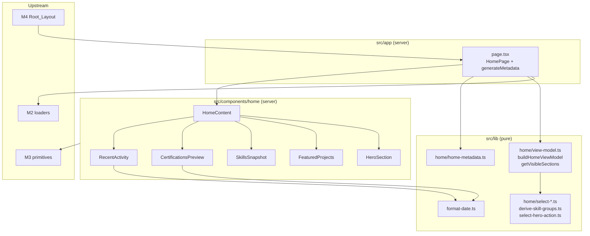
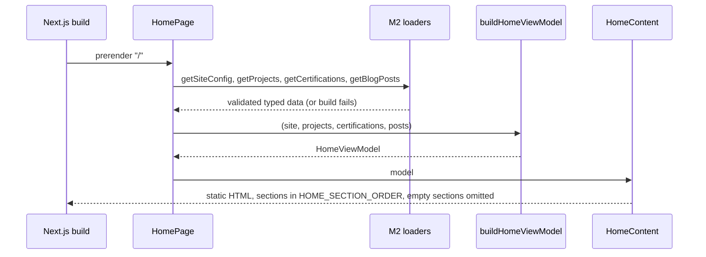
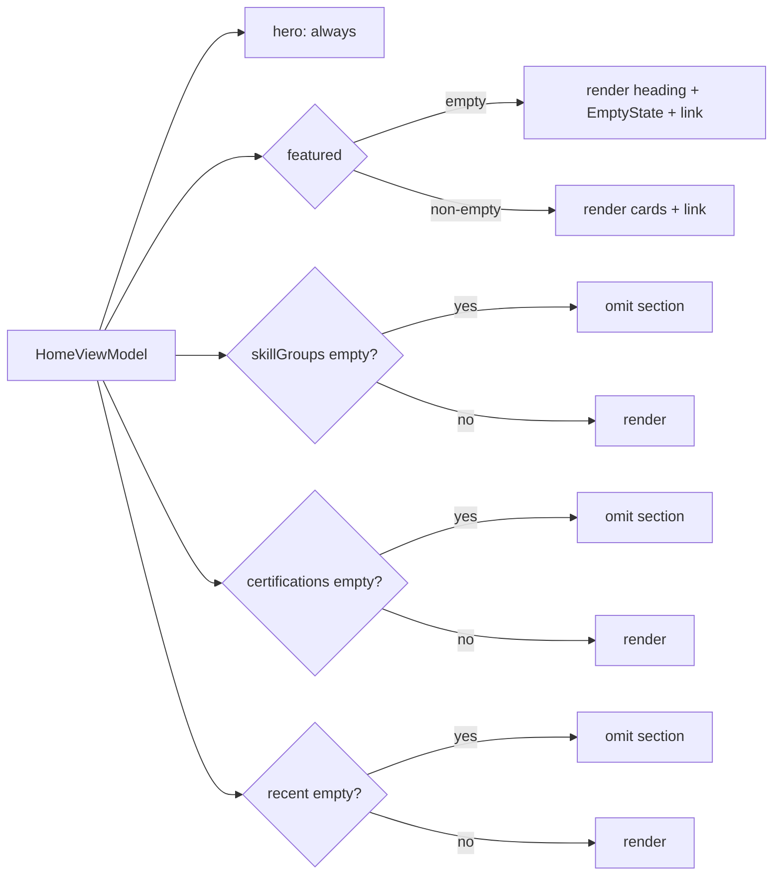

# Design Document

> **Spec:** M5 Homepage Experience  
> **Document Status:** Draft  
> **Feature Name:** m5-homepage-experience  
> **Last Updated:** 2026-10-20  
> **Lead Architect:** Angelo Andres  
> **Requirements Reference:** `requirements.md`  
> **Master Specifications:** `AGENTS.md` (Sections 3, 4.2, 5, 6), `PRD.md` (Homepage, P0), `design.md` (Sections 4, 5, 6.1), `APP_FLOW.md` (Flow 1.0, Story 1.1, `SCR-01`), `implementation_plan.md` (Task 4.1)  
> **Upstream Specs:** M1 (tokens, toolchain), M2 (schemas and loaders), M3 (UI primitives), M4 (shell, title template)

---

## Overview

### Purpose

Milestone 5 (M5) delivers the homepage (`SCR-01`) for `personal-website-portfolio-v2`: the static route `src/app/page.tsx`, five section components in `src/components/home/` (HeroSection, FeaturedProjects, SkillsSnapshot, CertificationsPreview, RecentActivity), the homepage metadata, and a set of pure helpers that select and derive the content each section shows. All content comes from the M2 loaders. M5 composes M3 primitives and the M4 shell. It adds no token, no primitive, no layout change, no dependency, and no route other than `/`.

### Scope

**In Scope:**
- `src/app/page.tsx` (async server component plus `generateMetadata`)
- Home_Components: `HeroSection`, `FeaturedProjects`, `SkillsSnapshot`, `CertificationsPreview`, `RecentActivity`, and a presentational `HomeContent` that composes them
- Pure helpers: `selectFeaturedProjects`, `selectRecentPosts`, `selectCertificationPreview`, `deriveSkillGroups`, `selectHeroContactAction`, `buildHomeViewModel`, `getVisibleSections`, `buildHomeMetadata`, `formatDisplayDate`
- Vitest, React Testing Library, axe, and fast-check tests

**Out of Scope (Requirement 16):**
- Projects, certifications, and blog routes (M6–M8). M5 only links to `/projects`, `/projects/{slug}`, `/certifications`, `/blog`, `/blog/{slug}`
- Filters, search, resume download, performance tuning, deployment (M9–M10)
- Dark mode, API routes, server actions, forms, analytics, cookies
- Any change to `src/components/ui/`, `src/components/layout/`, `src/content/`, tokens, `package.json`, lockfiles, or CI

### Design Principles

1. **Zero client components.** Every M5 module is a server component or a plain function. Nothing on the homepage needs state, effects, or browser APIs: responsive layout is Tailwind utilities (Req 15.6), dates are formatted at build time, and links are plain anchors. No `'use client'` appears anywhere in M5 (Req 1.2).
2. **Data from loaders only.** No name, title, introduction, location, or label that is site data is hardcoded. Fixed UI strings (`View Projects`, `View all projects`, section headings) live in one module, `home-text.ts`.
3. **Logic is pure and separate from rendering.** Every selection, derivation, and visibility decision is a function over plain data, importable without React (Req 16.6).
4. **Compose, do not redefine.** `Container`, `Card`, `TagList`, `StatusBadge`, `EventTypeBadge`, `EmptyState`, `Button`, `ExternalLink`, `FOCUS_RING`, and the motion helpers are imported from M3 as is.
5. **Deterministic output.** Selection ties break on `slug`. Dates format with a fixed locale in UTC. Identical input yields identical static HTML.
6. **Scope guarded.** Gaps in M1–M4 are recorded and escalated, not patched (`AGENTS.md` 6.2, Req 16.2).

### Research Findings and Decisions

| Topic | Finding | Decision |
|-------|---------|----------|
| Client surface | Nothing on the homepage depends on pathname, viewport JS, or user state. The M4 header already owns the only client island. | **No client components in M5.** Responsive columns use `sm`/`md`/`lg` utilities. Nothing imports `useState`, `useEffect`, or `matchMedia` (Req 15.3 verification). |
| Section order | Req 1.1 fixes Hero, Featured, Skills, Certifications, Recent. | `HomeContent` renders sections from one ordered list `HOME_SECTION_ORDER`, filtered by `getVisibleSections`. Order is a constant, not data. |
| Skill grouping | The M2 `Project` schema has `technologies: string[]` and no category field. Inventing categories (Frontend, Backend) would fabricate data (Req 9.5) or require a schema change (forbidden, Req 16.2). | **One group labeled `Technologies`**, ordered by number of projects listing each technology (descending), ties alphabetical (Req 8.3). `deriveSkillGroups` still returns `SkillGroup[]` so a later schema change can add groups without altering the component contract. |
| Technology identity | Projects may spell the same technology differently (`TypeScript`, `typescript`). | Compare on a lowercase key, keep the first-seen spelling (Req 8.2). A project that lists one technology twice counts once for that project. |
| Helper location | Req 16.6 allows `src/lib/` or `src/components/home/`. | Helpers live in `src/lib/home/` (no React imports). Components live in `src/components/home/`. Tests import helpers without rendering. |
| Tie-breaking | Req 5.4, 10.2, 11.4 require `slug` ascending. | One shared comparator `compareStrings(a, b)` using code-unit comparison (`a < b ? -1 : a > b ? 1 : 0`) instead of `localeCompare`, so order does not depend on the system locale (Req 12.2 spirit). |
| Date formatter reuse | Req 12.5 says reuse an existing formatter. The M2 and M3 designs define `IsoDateString` validation but no display formatter. | Create `src/lib/format-date.ts` (`formatDisplayDate`). At implementation time, search M2, M3, and M4 for an existing formatter first. If one exists, reuse it and drop this module. |
| Date formatting method | `new Date('2026-04-10')` parses as UTC, but `toLocaleDateString()` uses the system time zone. | Parse `YYYY-MM-DD` manually, build `Date.UTC(y, m - 1, d)`, validate round trip, and format with `Intl.DateTimeFormat('en-US', { timeZone: 'UTC', year: 'numeric', month: 'long', day: 'numeric' })`. |
| Metadata construction | M4 sets `title.template = '%s \| {siteName}'`. Req 13.4 forbids duplicating the site name in the rendered title. | `buildHomeMetadata` composes `"{name} \| {professionalTitle}"`. If the composed text contains `siteName` (case-insensitive), it returns `title: { absolute: composed }`; otherwise it returns the plain string so the M4 template applies. |
| Canonical URL | Req 13.3 derives canonical and Open Graph URL from `siteUrl`. | `alternates.canonical = '/'` resolves against M4's `metadataBase`. For a self-contained and testable value, the helper sets `alternates.canonical` and `openGraph.url` to `new URL('/', siteUrl).href`. |
| Contact CTA | Req 3.3 picks the `isPrimary` channel, else the first renderable one. | `selectHeroContactAction` returns a typed action `{ label, url, kind }` or `null`. `kind` decides the primitive: `external` renders `ExternalLink`, `mailto` and `internal` render `Button` (secondary). |
| Empty-section rule | Featured keeps its section (EmptyState). Skills, Certifications, Recent omit the whole section. Hero is always present. | `getVisibleSections` encodes this rule once. `HomeContent` and tests both use it. |
| Heading levels | Req 14.3: no skipped levels. | `h1` in Hero, `h2` per section, `h3` for project titles, certification titles, post titles, and the skill group label. |
| Test dependencies | M3 requested approval for Vitest, RTL, an axe wrapper, and `fast-check`. M5 may not edit `package.json` (Req 16.5). | M5 consumes that toolchain. If a tool is missing at implementation time, stop and request approval. |

### Resolved Assumptions

| Open point | Resolution |
|------------|------------|
| Section order | Hero, FeaturedProjects, SkillsSnapshot, CertificationsPreview, RecentActivity, fixed by `HOME_SECTION_ORDER` (Req 1.1). |
| Skills grouping | Single `Technologies` group, count-descending then alphabetical, derived from project data only (Req 8, 9). |
| Which projects feed skills | All projects returned by `getProjects()`, featured or not (Req 9.3). |
| Helper location | `src/lib/home/` for pure helpers, `src/lib/format-date.ts` for the formatter. |
| Tie-break | `slug` ascending by code-unit comparison (Req 5.4, 10.2, 11.4). |
| Date formatter | Reuse if one exists in M2–M4, otherwise add `formatDisplayDate` (Req 12.5). |
| Metadata | Built by pure `buildHomeMetadata`; title avoids a duplicated site name (Req 13.4). |
| Hero contact CTA | `isPrimary` renderable channel, else first renderable, else none (Req 3.3, 3.4). |
| Renderable channel | Non-empty trimmed `label` and non-empty trimmed `url` (Glossary). M5 defines this locally and does not modify M4 modules. |
| Preview limit | Constant `PREVIEW_LIMIT = 3` for Featured, Certifications, and Recent (Glossary). |
| Preview of "latest" certification order | `displayOrder` ascending, not date (Req 10.1). |
| Skills section when projects exist but all have empty `technologies` | Omitted (Req 9.4). M2 requires at least one technology, so this is defensive. |

---

## Architecture

### Layered View



### Render Flow



### Section Visibility



### File Layout

```
src/
├── app/
│   └── page.tsx                      # HomePage (server) + generateMetadata
├── components/home/
│   ├── home-content.tsx              # HomeContent: ordered composition
│   ├── hero-section.tsx
│   ├── featured-projects.tsx
│   ├── skills-snapshot.tsx
│   ├── certifications-preview.tsx
│   ├── recent-activity.tsx
│   └── home-text.ts                  # fixed UI strings + section ids
└── lib/
    ├── format-date.ts                # formatDisplayDate (unless one already exists)
    └── home/
        ├── compare.ts                # compareStrings
        ├── select-featured-projects.ts
        ├── select-recent-posts.ts
        ├── select-certification-preview.ts
        ├── derive-skill-groups.ts
        ├── select-hero-action.ts
        ├── view-model.ts             # buildHomeViewModel, getVisibleSections
        └── home-metadata.ts          # buildHomeMetadata
tests/
└── home/                             # unit, property, and axe tests
```

### Client Boundary

M5 has **no client components**. Justification: the homepage reads no pathname, no viewport, no input, and holds no state. The M4 `MobileNavToggle` remains the only client island in the shell. Each Home_Component is under 300 lines (Req 16.8).

---

## Components and Interfaces

All types (`SiteConfig`, `Project`, `Certification`, `BlogPost`, `ContactChannel`, `IsoDateString`) are imported from `@/types/content` (the M2 re-export). M5 never redeclares them (Req 1.5).

### Shared Constants (`home-text.ts`)

```typescript
export const PREVIEW_LIMIT = 3;

export const HOME_SECTION_ORDER = [
  'hero',
  'featured-projects',
  'skills',
  'certifications',
  'recent-activity',
] as const;

export type HomeSectionId = (typeof HOME_SECTION_ORDER)[number];

export const HOME_TEXT = {
  viewProjects: 'View Projects',
  viewAllProjects: 'View all projects',
  viewAllCertifications: 'View all certifications',
  viewAllPosts: 'View all posts',
  featuredHeading: 'Featured Projects',
  skillsHeading: 'Skills Snapshot',
  skillsGroupLabel: 'Technologies',
  certificationsHeading: 'Certifications',
  recentHeading: 'Recent Activity',
  featuredEmpty: 'No featured projects yet. Browse all projects instead.',
  availability: 'Available for opportunities',
} as const;
```

These are UI strings, not site data (Req 2.5 concerns owner identity values only).

### Comparator (`compare.ts`)

```typescript
export function compareStrings(a: string, b: string): number; // code-unit order, locale independent
```

### Selection Helpers (pure, no React)

```typescript
// select-featured-projects.ts
export function selectFeaturedProjects(
  projects: readonly Project[],
): Project[];
// filter featured === true → sort by displayOrder asc, then slug asc → slice(0, PREVIEW_LIMIT)
// Works on a copy; input never mutated. (Req 5.1–5.5)

// select-certification-preview.ts
export function selectCertificationPreview(
  certifications: readonly Certification[],
): Certification[];
// sort copy by displayOrder asc, then slug asc → slice(0, PREVIEW_LIMIT) (Req 10.1–10.3)

// select-recent-posts.ts
export function selectRecentPosts(
  posts: readonly BlogPost[],
): BlogPost[];
// filter draft === false → sort by publishedAt desc, then slug asc → slice(0, PREVIEW_LIMIT)
// IsoDateString sorts correctly as a string because the format is fixed width. (Req 11.1–11.5, 11.9)
```

### Skill Derivation (`derive-skill-groups.ts`)

```typescript
export interface SkillEntry {
  readonly name: string;   // first-seen spelling
  readonly count: number;  // number of projects listing it (≥ 1)
}

export interface SkillGroup {
  readonly label: string;               // 'Technologies'
  readonly technologies: readonly SkillEntry[];
}

export function deriveSkillGroups(
  projects: readonly Pick<Project, 'technologies'>[],
): SkillGroup[];
```

Algorithm:
1. Walk projects in input order. For each project, build a `Set` of lowercase-trimmed keys it lists, so a duplicate inside one project counts once.
2. Maintain `Map<key, { name, count }>`. On first sight of a key, store the spelling as given (trimmed). Increment `count` once per project.
3. Skip empty-after-trim names.
4. Sort entries by `count` descending, then by lowercase `name` ascending via `compareStrings`, then by `name` ascending as a last deterministic step.
5. Return `[]` if the map is empty, else `[{ label: HOME_TEXT.skillsGroupLabel, technologies }]`.

No technology name is introduced that is absent from the input (Req 8.5). The function takes `Pick<Project, 'technologies'>` so tests need not build full projects.

### Hero Contact Action (`select-hero-action.ts`)

```typescript
export interface HeroContactAction {
  readonly label: string;
  readonly url: string;
  readonly kind: 'external' | 'mailto' | 'internal';
}

export function isRenderableChannel(
  channel: Pick<ContactChannel, 'label' | 'url'>,
): boolean;   // label.trim() !== '' && url.trim() !== ''

export function selectHeroContactAction(
  channels: readonly ContactChannel[],
): HeroContactAction | null;
// renderable = channels.filter(isRenderableChannel)
// pick = renderable.find(c => c.isPrimary) ?? renderable[0] ?? null
// kind: url starts with 'https://' → 'external'; 'mailto:' → 'mailto'; otherwise 'internal'
```

### View Model (`view-model.ts`)

```typescript
export interface HomeViewModel {
  readonly profile: SiteConfig['profile'];
  readonly contactAction: HeroContactAction | null;
  readonly featuredProjects: readonly Project[];
  readonly skillGroups: readonly SkillGroup[];
  readonly certifications: readonly Certification[];
  readonly recentPosts: readonly BlogPost[];
}

export function buildHomeViewModel(input: {
  site: Pick<SiteConfig, 'profile' | 'contactChannels'>;
  projects: readonly Project[];
  certifications: readonly Certification[];
  posts: readonly BlogPost[];
}): HomeViewModel;

export function getVisibleSections(model: HomeViewModel): HomeSectionId[];
// Always: 'hero', 'featured-projects'
// 'skills' iff skillGroups.length > 0
// 'certifications' iff certifications.length > 0
// 'recent-activity' iff recentPosts.length > 0
// Returned in HOME_SECTION_ORDER order.
```

### Date Formatter (`format-date.ts`)

```typescript
export function formatDisplayDate(date: IsoDateString | string): string;
// "2026-04-10" → "April 10, 2026" (en-US, UTC)
// Throws Error(`Invalid date: "${received}". Expected YYYY-MM-DD.`) for malformed or impossible dates.
```

### Metadata (`home-metadata.ts`)

```typescript
import type { Metadata } from 'next';

export function buildHomeMetadata(
  site: Pick<SiteConfig, 'siteName' | 'siteUrl' | 'profile'>,
): Metadata;
```

Output:

```typescript
{
  title: composedTitleOrAbsolute,           // Req 13.2, 13.4
  description: site.profile.introduction,   // Req 13.2
  alternates: { canonical: rootUrl },       // Req 13.1, 13.3
  openGraph: {
    title: composedTitle,
    description: site.profile.introduction,
    url: rootUrl,                           // rootUrl = new URL('/', site.siteUrl).href
  },
}
```

`composedTitle = `${profile.name} | ${profile.professionalTitle}``. If it contains `siteName` case-insensitively, `title` is `{ absolute: composedTitle }`; otherwise it is the plain string and the M4 template appends the site name once. Open Graph `title` always uses `composedTitle` (Open Graph does not apply the template). A bad `siteUrl` is already rejected by M2 validation (Req 13.6), so the helper adds no catch.

### Home_Components (server)

| Component | Props | Output |
|-----------|-------|--------|
| `HomeContent` | `model: HomeViewModel` | Iterates `getVisibleSections(model)` and renders the matching section. Wrapped in a fragment, with no landmark of its own (Req 1.7). |
| `HeroSection` | `profile`, `contactAction` | `<section aria-labelledby="hero-heading">`. `h1#hero-heading` holds `profile.name`. Then title, introduction, location, availability indicator (only when `availableForOpportunities`), CTA group. |
| `FeaturedProjects` | `projects: readonly Project[]` | `<section aria-labelledby="featured-projects-heading">` with `h2`. Grid of `Card`s or `EmptyState`, then the "View all projects" link. |
| `SkillsSnapshot` | `groups: readonly SkillGroup[]` | `<section aria-labelledby="skills-heading">` with `h2`. Each group: `h3` label plus `TagList`. |
| `CertificationsPreview` | `certifications: readonly Certification[]` | `<section aria-labelledby="certifications-heading">` with `h2`, `Card` grid, "View all certifications" link. |
| `RecentActivity` | `posts: readonly BlogPost[]` | `<section aria-labelledby="recent-activity-heading">` with `h2`, compact `ul` of items, "View all posts" link. |

Details:

- **HeroSection.** The primary CTA is `<Button variant="primary" href="/projects">View Projects</Button>` (Req 3.1, 3.2). The secondary CTA by `contactAction.kind`: `external` renders `<ExternalLink href={url}>{label}</ExternalLink>` (Req 3.5); `mailto` and `internal` render `<Button variant="secondary" href={url}>{label}</Button>`. The block is omitted when `contactAction` is `null` (Req 3.4). The availability indicator is a `<p>` with a leading decorative dot (`aria-hidden="true"`) and visible text `HOME_TEXT.availability`, so meaning never depends on color (Req 4.3). If the contact label equals the primary label ignoring case, the secondary link receives `aria-label="{label} (contact)"` so names stay unique within the section (Req 3.6).
- **FeaturedProjects.** Each card: `h3` containing `<Link href={`/projects/${slug}`}>{title}</Link>`, summary, `StatusBadge status={status}`, `TagList items={technologies}`. No repository, demo, or documentation links (Req 6.7). Empty state uses `<EmptyState message={HOME_TEXT.featuredEmpty} />` as text inside the section (Req 7.1, 7.4), and the "View all projects" link stays (Req 7.2).
- **CertificationsPreview.** Each card: `h3` title, issuer, `<time dateTime={issuedAt}>{formatDisplayDate(issuedAt)}</time>`. No credential ID, verification link, or badge image (Req 10.5).
- **RecentActivity.** Each item: `h3` with `<Link href={`/blog/${slug}`}>{title}</Link>`, `<time dateTime={publishedAt}>`, `EventTypeBadge eventType={eventType}`, `summary` (Req 11.6).
- **Layout.** Each section wraps content in `Container`. Grids: Featured and Certifications use `grid grid-cols-1 gap-6 md:grid-cols-2 lg:grid-cols-3`; RecentActivity stays single column at all widths (Req 15.2–15.4). Spacing, color, and typography use Semantic_Tokens only. Interactive elements use `FOCUS_RING`; hover transitions use the M3 motion helpers, which carry `motion-reduce:transition-none` (Req 14.4, 14.6).

The exact M3 prop names (`Card`, `TagList`, `StatusBadge`, `EventTypeBadge`, `EmptyState`, `Button`, `ExternalLink`) are confirmed against the M3 modules at implementation time. M5 adapts to them and does not change them.

### Route (`page.tsx`)

```typescript
import type { Metadata } from 'next';

export async function generateMetadata(): Promise<Metadata> {
  return buildHomeMetadata(await getSiteConfig());
}

export default async function HomePage() {
  const [site, projects, certifications, posts] = await Promise.all([
    getSiteConfig(), getProjects(), getCertifications(), getBlogPosts(),
  ]);
  const model = buildHomeViewModel({ site, projects, certifications, posts });
  return <HomeContent model={model} />;
}
```

The page renders no `header`, `footer`, or `main` (Req 1.7). `await` is valid whether the M2 loaders are sync or async. The exact loader module paths are confirmed against M2 at implementation time. No `headers()`, `cookies()`, or `searchParams` are used, so the route stays statically generated.

---

## Data Models

M5 defines no new persisted data and no schema. It reads these M2 fields only:

| Source | Fields used | Used by |
|--------|-------------|---------|
| `SiteConfig.profile` | `name`, `professionalTitle`, `introduction`, `location`, `availableForOpportunities` | HeroSection, `buildHomeMetadata` |
| `SiteConfig.contactChannels` | `label`, `url`, `isPrimary` | `selectHeroContactAction` |
| `SiteConfig` | `siteName`, `siteUrl` | `buildHomeMetadata` |
| `Project` | `slug`, `title`, `summary`, `status`, `featured`, `displayOrder`, `technologies` | `selectFeaturedProjects`, `deriveSkillGroups`, FeaturedProjects |
| `Certification` | `slug`, `title`, `issuer`, `issuedAt`, `displayOrder` | `selectCertificationPreview`, CertificationsPreview |
| `BlogPost` | `slug`, `title`, `summary`, `publishedAt`, `eventType`, `draft` | `selectRecentPosts`, RecentActivity |

Derived (in-memory, build time) types: `SkillEntry`, `SkillGroup`, `HeroContactAction`, `HomeViewModel`, `HomeSectionId`, all defined in Components and Interfaces.

Notes:
- The Featured helper filters on `featured` and does not require `status`; any `ProjectStatus` can appear.
- `IsoDateString` values sort lexicographically in date order, so `publishedAt` comparison needs no `Date` parsing.
- No field outside this table is rendered. In particular credential ID, verification URL, repository URL, and demo URL are not read (Req 6.7, 10.5).

---

## Correctness Properties

*A property is a characteristic or behavior that should hold true across all valid executions of a system-essentially, a formal statement about what the system should do. Properties serve as the bridge between human-readable specifications and machine-verifiable correctness guarantees.*

Applicability: the selection, derivation, formatting, visibility, and metadata helpers are pure functions over large input spaces, so property-based testing applies. Component rendering properties run React Testing Library over generated view-model data. Static-structure requirements (no client directive, no hardcoded design values, responsive classes, scope boundaries) are not properties and are covered under Testing Strategy.

### Reflection

Prework produced about thirty testable criteria. Consolidation applied:

- Req 5.5, 8.7, 10.3, and 11.5 (no input mutation) and Req 5.6 and 11.x idempotence are one cross-helper property instead of four.
- Req 8.1, 8.2, 8.5, 8.6, and 9.5 all state that skill names come only from project data without fabrication or duplicates. They merge into one set-equality property. Req 8.3 (ordering) stays separate because it asserts a different invariant.
- Req 9.4, 10.6, 11.8, 7.1–7.3, and 1.1 merge into one section visibility and order property over `getVisibleSections`.
- Req 4.1 and 4.2 merge into one iff property.
- Req 3.3 and 3.4 merge into one contact action selection property.
- Req 12.1 and 12.2 merge into one determinism and format property. Req 12.4 stays separate (error condition).
- Req 14.1, 14.2, 14.3, and 2.1 merge into one heading and landmark structure property.
- Req 6, 10.4, and 11.6 stay as separate per-section rendering properties because each checks different fields and link targets.
- Req 13.1–13.4 merge into one metadata property.

### Property 1: Featured project selection

*For any* array of projects, `selectFeaturedProjects` returns at most 3 entries, every entry has `featured: true` and appears in the input, and the entries are ordered by `displayOrder` ascending with ties ordered by `slug` ascending. Its length equals `min(3, count of featured projects in the input)`.

**Validates: Requirements 5.1, 5.2, 5.3, 5.4**

### Property 2: Certification preview selection

*For any* array of certifications, `selectCertificationPreview` returns at most 3 entries, every entry appears in the input, and entries are ordered by `displayOrder` ascending with ties ordered by `slug` ascending. Its length equals `min(3, input length)`.

**Validates: Requirements 10.1, 10.2**

### Property 3: Recent post selection excludes drafts and orders newest first

*For any* array of blog posts, `selectRecentPosts` returns at most 3 entries, every entry has `draft: false` and appears in the input, entries are ordered by `publishedAt` descending with ties ordered by `slug` ascending, and no post with `draft: true` appears. Its length equals `min(3, count of published posts in the input)`.

**Validates: Requirements 11.1, 11.2, 11.3, 11.4, 11.9**

### Property 4: Selection helpers are pure and idempotent

*For any* input array, calling `selectFeaturedProjects`, `selectCertificationPreview`, `selectRecentPosts`, or `deriveSkillGroups` on a deeply frozen copy does not throw and leaves the input equal to a snapshot taken before the call. Applying `selectFeaturedProjects` or `selectRecentPosts` to its own result returns a result equal to the first result.

**Validates: Requirements 5.5, 5.6, 8.7, 10.3, 11.5**

### Property 5: Derived skills contain exactly the technologies in project data

*For any* array of projects, the set of technology names in `deriveSkillGroups(projects)`, compared case-insensitively after trimming, equals the set of technology names across all input projects. No name appears twice in the result (case-insensitive), each name uses the spelling of its first occurrence in input order, and the result is `[]` when the input contains no technologies.

**Validates: Requirements 8.1, 8.2, 8.4, 8.5, 8.6, 9.5**

### Property 6: Skill ordering by project count then name

*For any* array of projects, the technologies in each skill group are ordered by `count` descending, where `count` equals the number of input projects listing that technology (case-insensitive, once per project), and entries with equal counts are ordered alphabetically.

**Validates: Requirements 8.3**

### Property 7: Hero contact action selection

*For any* array of contact channels, `selectHeroContactAction` returns `null` when no channel has a non-empty label and non-empty url. Otherwise it returns the first renderable channel with `isPrimary: true` if one exists, else the first renderable channel. The `kind` is `external` for `https://` urls and `mailto` for `mailto:` urls.

**Validates: Requirements 3.3, 3.4, 3.5**

### Property 8: Hero renders profile data and availability exactly as configured

*For any* profile and contact action, rendering `HeroSection` produces exactly one `h1` whose text equals `profile.name`; the output contains `professionalTitle`, `introduction`, and `location`; it contains a link named "View Projects" with `href="/projects"`; it contains the secondary contact link if and only if the contact action is non-null; and it contains the availability indicator text if and only if `availableForOpportunities` is `true`.

**Validates: Requirements 2.1, 2.2, 2.3, 2.4, 3.1, 3.3, 3.4, 4.1, 4.2**

### Property 9: Section visibility and order

*For any* home view model, `getVisibleSections` always includes `hero` and `featured-projects`; includes `skills` if and only if there is at least one skill group, `certifications` if and only if there is at least one selected certification, and `recent-activity` if and only if there is at least one selected post; and returns the ids in the order hero, featured-projects, skills, certifications, recent-activity. Rendering `HomeContent` for that model produces `section` elements in exactly that order, and an omitted section leaves no heading behind.

**Validates: Requirements 1.1, 7.1, 7.2, 7.3, 9.4, 10.6, 11.8**

### Property 10: Featured project cards show required fields and links

*For any* non-empty array of up to three projects, rendering `FeaturedProjects` produces one card per project in the given order, each containing the title as a link with `href="/projects/{slug}"`, the summary, a status badge, and every technology as a tag, and contains a "View all projects" link with `href="/projects"`. The card contains no repository, demo, or documentation link.

**Validates: Requirements 6.2, 6.3, 6.4, 6.5, 6.7**

### Property 11: Certification and post items show required fields and links

*For any* array of up to three certifications, `CertificationsPreview` renders each title, issuer, and a `time` element whose `datetime` equals `issuedAt` and whose text equals `formatDisplayDate(issuedAt)`, plus a link to `/certifications`, and renders no credential ID or verification link. *For any* array of up to three published posts, `RecentActivity` renders each title as a link with `href="/blog/{slug}"`, a `time` element whose `datetime` equals `publishedAt`, an event type badge, the summary, and a link to `/blog`.

**Validates: Requirements 10.4, 10.5, 11.6, 11.7, 12.3**

### Property 12: Heading hierarchy and section labelling

*For any* view model, the rendered `HomeContent` contains exactly one `h1` (inside the hero section); every rendered `section` has an `aria-labelledby` that references an existing heading id inside that section; every section heading is an `h2`; no heading level is skipped in document order (each heading level is at most one deeper than the previous heading); and the output contains no `header`, `footer`, or `main` element.

**Validates: Requirements 1.7, 14.1, 14.2, 14.3, 6.1, 6.6**

### Property 13: Date formatting is deterministic and rejects invalid input

*For any* valid calendar date string `YYYY-MM-DD`, `formatDisplayDate` returns the same text on repeated calls and under different `TZ` values, and the text contains the four-digit year and the day of month. *For any* string that is not a valid `YYYY-MM-DD` calendar date, `formatDisplayDate` throws an `Error` whose message contains the received value.

**Validates: Requirements 12.1, 12.2, 12.4**

### Property 14: Homepage metadata derives from site configuration

*For any* `siteName`, `profile` (name, professionalTitle, introduction), and valid absolute `https://` `siteUrl`, `buildHomeMetadata` returns a description equal to `introduction`, a canonical URL and Open Graph URL equal to the root URL of `siteUrl`, an Open Graph title containing `name` and `professionalTitle`, and a title containing both `name` and `professionalTitle`. After applying the M4 template `%s | {siteName}` when the title is a plain string, `siteName` occurs in the final title text no more than once beyond what `name` and `professionalTitle` themselves contain.

**Validates: Requirements 13.1, 13.2, 13.3, 13.4**

---

## Error Handling

M5 introduces one thrown error (`formatDisplayDate`) and otherwise relies on M2 build-time validation. It adds no `try/catch` around loaders and no runtime fallback values.

| Condition | Behavior | Req |
|-----------|----------|-----|
| A loader throws (missing or invalid content file, missing `profile.introduction`) | Error propagates from `HomePage` and `generateMetadata`. The build fails with the M2 message. HeroSection never renders a fallback string. | 2.6, 1.3 |
| `siteUrl` is not an absolute `https://` URL | Rejected by M2 loader validation before M5 runs. `buildHomeMetadata` does not duplicate the check. | 13.6 |
| `formatDisplayDate` receives a malformed or impossible date (`2026-13-40`, `2026-02-30`, `abc`) | Throws `Error('Invalid date: "{received}". Expected YYYY-MM-DD.')`. The build fails. Under M2 validation this only occurs on a programming error. | 12.4 |
| No featured projects | FeaturedProjects keeps its heading, shows `EmptyState` text and the "View all projects" link. Other sections render normally. | 7.1–7.4 |
| No skills (no projects, or no technologies) | SkillsSnapshot omitted including heading. | 9.4 |
| No certifications | CertificationsPreview omitted including heading. | 10.6 |
| No published posts (none, or only drafts) | RecentActivity omitted including heading. | 11.8, 11.9 |
| `contactChannels` empty or all unrenderable | Secondary CTA omitted. "View Projects" remains. No placeholder or `#` link. | 3.4 |
| `availableForOpportunities` is `false` | Indicator omitted. | 4.2 |
| Contact label equals "View Projects" (case-insensitive) | Secondary link gets `aria-label="{label} (contact)"` to keep accessible names unique. | 3.6 |
| Fewer than 3 items for any preview | Render the items available. No padding or placeholder cards. | 5.3, 10.1, 11.3 |
| Duplicate `displayOrder` or `publishedAt` | Deterministic `slug` ascending tie-break. | 5.4, 10.2, 11.4 |
| Technology spelled in different cases across projects | Merged under the first-seen spelling. | 8.2 |
| Projects where a technology repeats within one project | Counted once for that project. | 8.3 |
| Draft post present in loader output | Filtered by `selectRecentPosts`. | 11.9 |

---

## Testing Strategy

### Dual Approach

- **Property tests** verify universal behavior of the pure helpers, formatter, metadata builder, and rendered structure across generated inputs.
- **Unit and example tests** cover concrete scenarios: the empty featured state, the CTA rendering for `https` versus `mailto`, tie-breaking examples, the `2026-04-10` date under `TZ=UTC` and `TZ=Asia/Manila`, and responsive class assertions.
- **Accessibility tests** run axe on each section and on the full homepage in populated and empty-data states.
- **Static checks** (grep and diff) cover structure that has no input to vary.

### Property-Based Testing Configuration

- Library: **fast-check** (the M3-approved toolchain). No property-testing code is written from scratch.
- Each property in this document is implemented by **one** property-based test, run with at least **100 iterations** (`{ numRuns: 100 }` or higher).
- Each test carries a tag comment in this format: `Feature: m5-homepage-experience, Property {number}: {property text}`.
- Generators live in `tests/home/generators.ts`: `arbProject` (small `displayOrder` range so ties are common, slugs from a small alphabet so slug ties are exercised, technology names drawn from a small pool with random casing), `arbCertification`, `arbBlogPost` (random `draft`, small date range to force equal `publishedAt`), `arbContactChannel` (mix of empty, `https://`, and `mailto:` urls), `arbProfile`, `arbIsoDate` (valid calendar dates including leap days), `arbInvalidDate`.
- Rendering properties (8–12) use bounded generators (at most 6 items) to keep render time low.
- Property 13 changes `process.env.TZ` between runs inside the test and restores it afterward.

### Test Matrix

| Area | Test type | Properties / Req |
|------|-----------|------------------|
| `select-featured-projects` | Property + example (tie on `displayOrder`) | 1, 4 / 5 |
| `select-certification-preview` | Property | 2, 4 / 10 |
| `select-recent-posts` | Property + example (drafts only) | 3, 4 / 11 |
| `derive-skill-groups` | Property + example (empty input, case variants) | 4, 5, 6 / 8 |
| `select-hero-action` | Property | 7 / 3 |
| `view-model` (`getVisibleSections`) | Property + example (zero projects, only drafts) | 9 / 1.1, 7, 9, 10, 11 |
| `HeroSection` | Property + example (https vs mailto CTA) + axe | 8 / 2, 3, 4 |
| `FeaturedProjects` | Property + example (empty state) + axe | 10 / 6, 7 |
| `SkillsSnapshot` | Example (fixture groups, one `h2`, one `h3`) + axe | 9 |
| `CertificationsPreview`, `RecentActivity` | Property + axe | 11 / 10, 11 |
| `HomeContent` | Property (structure) + axe populated and empty | 9, 12 / 14 |
| `format-date` | Property + example (TZ comparison) | 13 / 12 |
| `home-metadata` | Property + example (name contains `siteName`) | 14 / 13 |

### Static and Smoke Checks

| Check | Method | Req |
|-------|--------|-----|
| No `'use client'`, `fetch(`, `window`, `document`, `useState`, `useEffect`, `matchMedia` in `src/app/page.tsx`, `src/components/home/`, `src/lib/home/` | grep, expect zero matches | 1.2, 1.6, 15.3 |
| No redeclared `Project`, `SiteConfig`, `Certification`, `BlogPost` outside `src/content/schemas/` | grep | 1.5 |
| No owner name, title, introduction, or location literals in Home_Components | grep for values in `content/site.json` | 2.5, 13.5 |
| No hex colors, arbitrary Tailwind values (`[...]`), raw durations in `src/components/home/` | grep | 4.4, 9.6, 14.7, 14.8 |
| No technology-name literals in `skills-snapshot.tsx` | grep | 9.5 |
| Responsive column classes present on Featured and Certifications grids (`grid-cols-1 md:grid-cols-2 lg:grid-cols-3`) and single column in RecentActivity | RTL class assertions | 15.2–15.4 |
| Every Home_Component file under 300 lines | line count | 16.8 |
| No `any`, non-null assertions, or unjustified casts in M5 files | `npm run lint`, `npm run typecheck`, grep | 16.7 |
| Changes confined to `src/app/page.tsx`, `src/components/home/`, `src/lib/home/`, `src/lib/format-date.ts`, `tests/` | `git diff --stat` against M4 baseline | 16.1–16.5 |
| `package.json` and lockfiles unchanged | `git diff` | 16.4, 16.5 |
| Loader fixture missing `profile.introduction` fails the build with the M2 error | Integration test, one fixture | 2.6 |
| Horizontal overflow at 375, 768, 1024, 1440 px | Manual viewport inspection | 15.5 |
| Keyboard tab-through shows focus indicator on every interactive element | Manual check plus `FOCUS_RING` class assertion | 14.4 |
| Reduced motion suppresses non-essential motion | Class assertion (`motion-reduce:transition-none` via M3 helpers) | 14.6 |

### Final Gate

Run `npm run lint`, `npm run typecheck`, `npm test`, and `npm run build`; all must pass (`AGENTS.md` 7.3, Req 16).

### Dependencies and Escalation

M5 needs Vitest, React Testing Library, an axe wrapper, and `fast-check`, all requested in M3. If any is missing at implementation time, stop and request human approval rather than editing `package.json` (Req 16.5). If an M3 primitive lacks a prop this design assumes, record the gap and escalate; do not modify the primitive (Req 16.1, 16.2).
