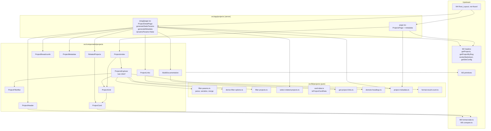
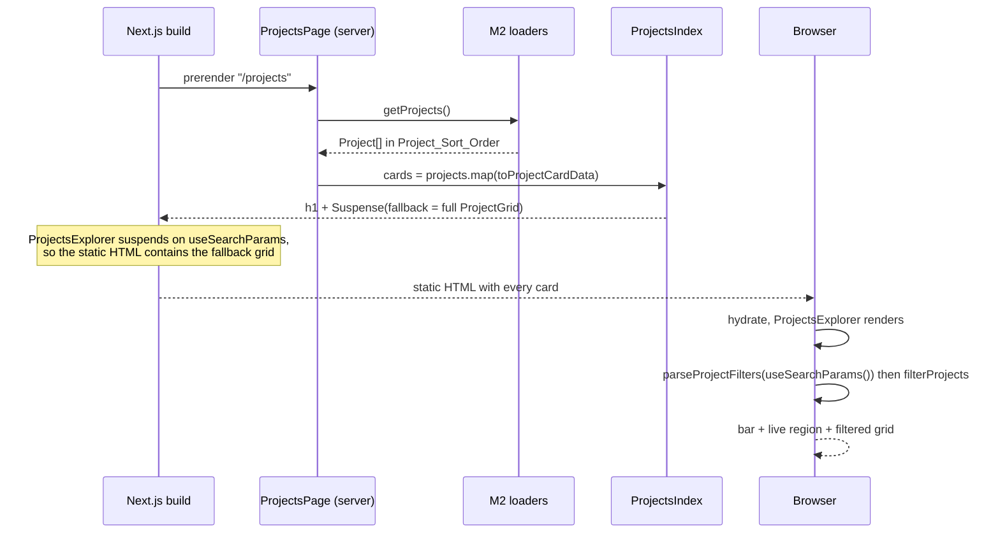
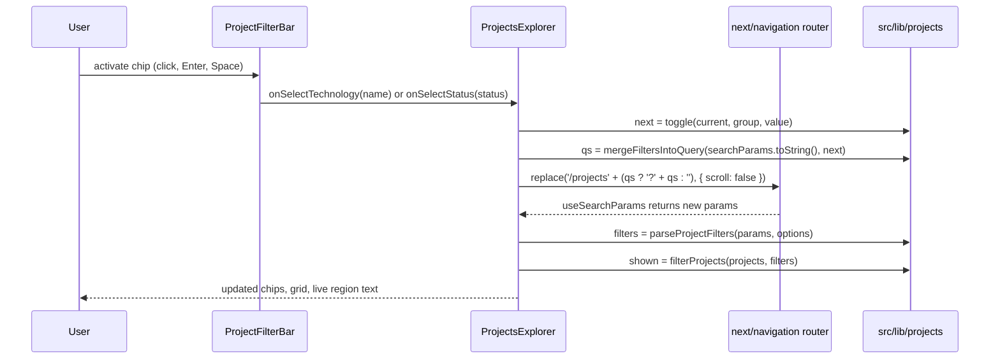
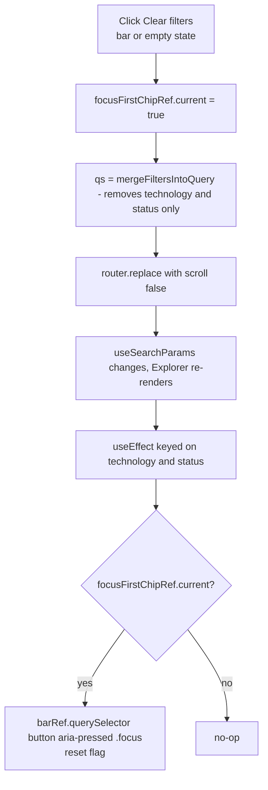
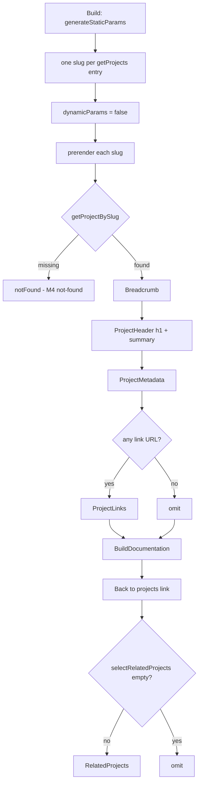

# Design Document

> **Spec:** M6 Projects Module  
> **Document Status:** Draft  
> **Feature Name:** m6-projects-module  
> **Last Updated:** 2026-10-20  
> **Lead Architect:** Angelo Andres  
> **Requirements Reference:** `requirements.md`  
> **Master Specifications:** `AGENTS.md` (Sections 3, 4.2, 5.2, 6), `PRD.md` (Projects Index, Project Detail, P0), `design.md` (Sections 4, 5, 6.2), `TRD.md` (Section 3.3), `APP_FLOW.md` (Flow 2.0, Stories 2.1, 2.2, `SCR-02`, `SCR-03`), `implementation_plan.md` (Projects tasks)  
> **Upstream Specs:** M1 (tokens, toolchain), M2 (schemas, loaders, `renderMarkdown`), M3 (UI primitives), M4 (shell, title template, `not-found`), M5 (`formatDisplayDate`, `compareStrings`, pure-helper pattern)

---

## Overview

### Purpose

Milestone 6 (M6) delivers the Projects module for `personal-website-portfolio-v2`: the index route `/projects` (`SCR-02`), the detail route `/projects/[slug]` (`SCR-03`), eleven presentational components in `src/components/projects/`, one client island (`ProjectsExplorer`), and a set of pure helpers in `src/lib/projects/` that parse filter state, filter projects, derive filter options, select related projects, demote Markdown headings, and build metadata. All data comes from the M2 loaders. M6 composes M3 primitives and the M4 shell. It adds no token, no primitive, no layout change, no dependency, and no route other than `/projects` and `/projects/{slug}`.

### Scope

**In Scope:**
- `src/app/projects/page.tsx` (server component plus `metadata` export)
- `src/app/projects/[slug]/page.tsx` (server component, `generateStaticParams`, `dynamicParams = false`, `generateMetadata`)
- Project_Components: `ProjectsIndex`, `ProjectsExplorer` (client), `ProjectFilterBar`, `ProjectGrid`, `ProjectCard`, `ProjectBreadcrumb`, `ProjectHeader`, `ProjectMetadata`, `ProjectLinks`, `BuildDocumentation`, `RelatedProjects`
- Pure helpers: `parseProjectFilters`, `serializeProjectFilters`, `mergeFiltersIntoQuery`, `deriveFilterOptions`, `filterProjects`, `selectRelatedProjects`, `toProjectCardData`, `getProjectLinks`, `formatResultCount`, `demoteHeadings`, `buildProjectsIndexMetadata`, `buildProjectDetailMetadata`
- Vitest, React Testing Library, axe, and fast-check tests

**Out of Scope (Requirement 17):**
- Certifications and blog routes (M7, M8), search (P1), performance tuning and deployment (M9, M10), project JSON-LD (M9 or later)
- Dark mode, API routes, route handlers, server actions, forms, analytics, cookies
- Any change to tokens, `src/components/ui/`, `src/components/layout/`, `src/components/home/`, M2 loaders, `package.json`, lockfiles, `next.config.ts`, or `tsconfig.json`

### Design Principles

1. **One client island, and it is small.** `ProjectsExplorer` is the only module with `'use client'` and the only caller of `useSearchParams` (Req 7.3). Every other component is a plain component with no directive: server components when imported by a page, and ordinary child components when imported by the Explorer.
2. **The URL is the single source of truth for filter state.** The Explorer derives `ProjectFilters` from `useSearchParams()` on every render and writes changes with `router.replace`. It keeps no duplicate filter state, so Back, reload, and shared links always agree with what is on screen (Req 3, 6.6).
3. **The static HTML is complete without JavaScript.** The `Suspense` fallback is the full unfiltered `ProjectGrid`, so `/projects` contains every card at build time (Req 7.2).
4. **Logic is pure and separate from rendering.** Parsing, serialization, filtering, option derivation, related selection, heading demotion, and metadata construction are functions over plain data with no React, Next.js, or DOM imports (Req 17.3).
5. **Compose, do not redefine.** `Card`, `TagList`, `StatusBadge`, `FilterChip`, `ExternalLink`, `EmptyState`, `MarkdownDoc`, `Container`, `Button`, and `FOCUS_RING` are imported from M3 as is. `Project`, `ProjectFrontmatter`, `ProjectStatus`, and `ProjectFilters` are imported from `@/types/content` and never redeclared (Req 1.5).
6. **Deterministic output.** Ordering ties break on `slug` with `compareStrings` (code-unit order). Dates format through the M5 `formatDisplayDate` (UTC, fixed locale). Identical input yields identical static HTML.
7. **Scope guarded.** Gaps in M1 to M5 are recorded and escalated, not patched (`AGENTS.md` 6.2, Req 17.7).

### Research Findings and Decisions

| Topic | Finding | Decision |
|-------|---------|----------|
| `useSearchParams` under static export | In the Next.js App Router, a client component that calls `useSearchParams` in a statically rendered route must sit under a `Suspense` boundary. Without one, the build fails with a "missing Suspense boundary" error. With one, the server renders the fallback into the static HTML and the client renders the real component after hydration. | `ProjectsIndex` wraps `ProjectsExplorer` in `Suspense` with the full static `ProjectGrid` as fallback (Req 7.1, 7.2, 7.5). |
| Filter writes | `router.replace(url, { scroll: false })` performs a client-side navigation to the same page with new search parameters. Under `output: 'export'` the page is one prerendered file and search parameters are read on the client only, so no server round trip occurs. `replace` (not `push`) avoids a history entry per chip click. | The Explorer calls `router.replace('/projects' + qs, { scroll: false })` (Req 6.6). The path is the constant `PROJECTS_PATH`, so `usePathname` is not needed and only `useRouter` and `useSearchParams` are mocked in tests. |
| Fallback markup and layout shift | The prerendered HTML has the grid but no filter bar, because the bar is interactive and belongs to the island. When the island hydrates, the bar and live region appear above the grid. | Accepted. Chips that do nothing before hydration would be a worse experience than a short shift. The Explorer renders the bar in a wrapper with a fixed minimum block size taken from a Semantic_Token spacing utility to limit the shift. Measuring layout shift is M9. |
| Canonical technology spelling | Projects may spell a technology differently (`TypeScript`, `typescript`). | A single key function `techKey(name) = name.trim().toLowerCase()` is used for deduplication, matching, and parsing. The displayed spelling is the first occurrence in `getProjects()` order (Req 4.1, Glossary). `toLowerCase()` is used, not `toLocaleLowerCase()`, so results do not depend on the system locale. |
| Sorting options | Req 4.1 asks for alphabetical case-insensitive order. | Sort by `techKey` with `compareStrings` from `src/lib/home/compare.ts` (M5, imported, not modified). Keys are unique after deduplication, so no tiebreak is needed. |
| Preserving unrelated query parameters | Req 6.8 requires "Clear filters" to keep unrelated parameters. `serializeProjectFilters` (Req 3.6) produces only the filter parameters. | A third helper, `mergeFiltersIntoQuery(currentQuery, filters)`, replaces or removes only `technology` and `status` in an existing query string. `serializeProjectFilters(f)` is defined as `mergeFiltersIntoQuery('', f)`, so there is one encoding path. `URLSearchParams` is a standard global, not a DOM import. |
| Focus after Clear | The "Clear filters" buttons (in the bar and in the empty state) disappear when the filters clear. Focus on a removed element falls back to `body`. | The Explorer sets a ref flag on click, and a `useEffect` keyed on the parsed filters focuses the first chip after the commit in which the filters changed. The first chip is found with `barRef.current.querySelector('button[aria-pressed]')`, so the design does not depend on `FilterChip` forwarding a ref. |
| Live region | Screen readers announce changes to a polite live region only if the region exists before the change. | The `<p aria-live="polite">` is part of the Explorer's first render and its text is visible (Req 8.3, 8.4). |
| Heading demotion | Req 13.3 and 13.4: documentation headings start at `h2` and an `h1` is demoted. The page's `h1` is the project title and the section heading "Build documentation" is an `h2`. | `demoteHeadings(html)` is pure string logic over the sanitized HTML returned by `renderMarkdown`. If the HTML contains any `h1`, every heading level `n` becomes `min(n + 1, 6)`. Otherwise the HTML is returned unchanged. |
| Card heading level | The index has `h1` then cards. The detail page has `h2` section headings then related cards. | `ProjectCard` takes `headingLevel: 2 \| 3`, wrapping the title link in `h2` on the index and `h3` in `RelatedProjects`. This avoids skipped levels on both pages (Req 16.7). |
| Metadata construction | M4 sets the title template. The M5 helper pattern builds metadata in a pure function. | `buildProjectsIndexMetadata(siteUrl)` and `buildProjectDetailMetadata(project, siteUrl)` return plain `Metadata`-shaped objects. The canonical URL is `new URL(path, siteUrl).href`, so it never carries a query string (Req 15.6). |
| `params` shape | In Next.js 15 route `params` is a `Promise`. In Next.js 14 it is a plain object. | The design writes `await params`, which also works on a plain object. The implementer confirms the pinned Next.js version from M1 and adjusts the type only. |
| Test dependencies | M3 requested approval for Vitest, RTL, an axe wrapper, and `fast-check`. M6 may not edit `package.json` (Req 17.7). | M6 consumes that toolchain. If a tool such as `@testing-library/user-event` is missing at implementation time, stop and request approval. |

### Resolved Assumptions

| Open point | Resolution |
|------------|------------|
| Date formatter (Req 10.6) | Import `formatDisplayDate` from `@/lib/format-date` (M5). M6 does not create another. If the file is absent at implementation time, stop and escalate, because M6 may not write outside its four directories. Req 10.7 is satisfied by the M5 formatter, which throws an `Error` naming the received value. |
| Where the filter bar appears in the static HTML (Req 1.3 vs Req 7.2) | The static fallback contains the grid only. The filter bar is rendered by the island. Under jsdom with a mocked `next/navigation` nothing suspends, so tests see `h1`, bar, and grid together. |
| Empty-state "Clear filters" and bar "Clear filters" | Both call the same `clearFilters` handler. Both may be in the DOM at once. |
| Technology and status comparison with whitespace | Parameters and project values are trimmed before comparison. Empty-after-trim technology names are ignored by `deriveFilterOptions`. |
| Status chip group with one status (Req 4.5) | Omitted. Technology chip group is rendered whenever there is at least one Technology_Option. With zero options the group is omitted. |
| Result count wording (Req 8.2) | `formatResultCount(1)` is `"1 project shown"`. Any other count `n` is `"{n} projects shown"`, including `0`. |
| Where breadcrumb sits in the order (Req 9.6, 15.1) | `ProjectBreadcrumb` is a `nav` rendered before `ProjectHeader`. Req 9.6's "ProjectHeader first" applies to the five listed content components. |
| Back link placement (Req 9.6, 14, 15.2) | Order is Breadcrumb, Header, summary, Metadata, Links, BuildDocumentation, "Back to projects" link, RelatedProjects. RelatedProjects is last. |
| Section headings inside Metadata (Req 11) | `ProjectMetadata` is a `section` with an `h2` "Project details" and `h3` labels "Technologies", "Tags", and "Metrics". |
| Heading for ProjectLinks (Req 12.5) | `h2` "Project links", rendered only when at least one link exists. |
| Empty-after-trim URLs (Req 12.1 to 12.5) | A URL that is `null`, `undefined`, or whitespace-only is treated as absent. |
| Empty documentation body | M2 requires a non-empty Markdown body, so M6 adds no special case. If M2 allows empty bodies, escalate. |
| `renderMarkdown` and `MarkdownDoc` contract | `renderMarkdown(source)` returns sanitized HTML (string or `Promise<string>`), and `MarkdownDoc` accepts that HTML. The implementer confirms exact names in M2 and M3 and awaits the result in the server component if it is async. M6 does not re-sanitize and adds no raw-HTML path (Req 13.5). |
| `EmptyState` contract | The M3 `EmptyState` accepts a message and an optional action slot. The implementer confirms the prop names. |
| Cross-module import of `compareStrings` | Imported from `@/lib/home/compare` as a read-only dependency. Not modified. |
| `getProjectBySlug` miss | Treated as any falsy return (`undefined` or `null`) and routes to `notFound()`. |
| Index metadata description (Req 15.4) | A constant of 142 characters, listed in the metadata section below. A test asserts the 50 to 160 range. |

---

## Architecture

### Layered View



### Index Render Flow (Build Time and Hydration)



### Filter Interaction Flow



### Clear Filters and Focus



### Detail Page Flow



### File Layout

```
src/
├── app/projects/
│   ├── page.tsx                      # ProjectsPage (server) + metadata
│   └── [slug]/
│       └── page.tsx                  # ProjectDetailPage + generateStaticParams
│                                     #   + generateMetadata + dynamicParams = false
├── components/projects/
│   ├── projects-index.tsx            # h1, Suspense, empty state
│   ├── projects-explorer.tsx         # 'use client' island
│   ├── project-filter-bar.tsx
│   ├── project-grid.tsx
│   ├── project-card.tsx
│   ├── project-breadcrumb.tsx
│   ├── project-header.tsx
│   ├── project-metadata.tsx
│   ├── project-links.tsx
│   ├── build-documentation.tsx
│   ├── related-projects.tsx
│   └── projects-text.ts              # fixed UI strings and constants
└── lib/projects/
    ├── filter-params.ts              # parseProjectFilters, serializeProjectFilters,
    │                                 #   mergeFiltersIntoQuery
    ├── derive-filter-options.ts
    ├── filter-projects.ts
    ├── select-related-projects.ts
    ├── card-data.ts                  # ProjectCardData, toProjectCardData
    ├── get-project-links.ts
    ├── demote-headings.ts
    ├── format-result-count.ts
    ├── tech-key.ts                   # techKey
    └── project-metadata.ts           # buildProjectsIndexMetadata, buildProjectDetailMetadata
tests/
└── projects/                         # unit, property, axe tests
    └── helpers/
        └── mock-navigation.ts        # store-backed next/navigation mock
```

### Client Boundary

Exactly one module under `src/components/projects/` carries `'use client'`: `projects-explorer.tsx` (Req 7.3). `ProjectFilterBar`, `ProjectGrid`, and `ProjectCard` have no directive. They are used on the server (the grid as the Suspense fallback and in `RelatedProjects`) and inside the Explorer, where they join the client bundle as ordinary children. The bar receives callbacks as props from the Explorer, so it never crosses a server-to-client boundary. Each Project_Component is under 300 lines (Req 17.4).

Justification under `AGENTS.md` 6.2: filtering needs state derived from the URL and navigation calls, which a server component cannot do. No other M6 behavior needs the client.

---

## Components and Interfaces

All shared types are imported from `@/types/content`: `Project`, `ProjectStatus`, `ProjectFilters`, `IsoDateString`. M6 never redeclares them (Req 1.5).

### Shared Constants (`projects-text.ts`)

```typescript
export const PROJECTS_PATH = '/projects';
export const MAX_CARD_TECHNOLOGIES = 4;
export const RELATED_LIMIT = 3;

export const STATUS_ORDER = ['completed', 'in-progress', 'archived'] as const satisfies readonly ProjectStatus[];

export const PROJECTS_TEXT = {
  pageHeading: 'Projects',
  emptyIndex: 'Projects are being prepared. Check back soon.',
  emptyFiltered: 'No projects match the selected filters.',
  filterTechnologyLabel: 'Filter by technology',
  filterStatusLabel: 'Filter by status',
  clearFilters: 'Clear filters',
  breadcrumbLabel: 'Breadcrumb',
  breadcrumbRoot: 'Projects',
  detailsHeading: 'Project details',
  technologiesLabel: 'Technologies',
  tagsLabel: 'Tags',
  metricsLabel: 'Metrics',
  linksHeading: 'Project links',
  repositoryLabel: 'Repository',
  liveDemoLabel: 'Live demo',
  documentationLabel: 'Documentation',
  buildDocsHeading: 'Build documentation',
  relatedHeading: 'Related projects',
  backToProjects: 'Back to projects',
  completedPrefix: 'Completed',
  startedPrefix: 'Started',
} as const;

export const PROJECTS_INDEX_DESCRIPTION =
  'Browse portfolio projects with build documentation, technologies, status, and outcomes. ' +
  'Filter by technology or status to find relevant work.'; // 142 characters
```

These are UI strings, not site data.

### Technology Key (`tech-key.ts`)

```typescript
export function techKey(name: string): string; // name.trim().toLowerCase()
```

### Serializable Card Data (`card-data.ts`)

```typescript
export type ProjectCardData = Pick<
  Project,
  | 'slug' | 'title' | 'summary' | 'status' | 'role'
  | 'technologies' | 'startedAt' | 'completedAt'
>;

export function toProjectCardData(project: Project): ProjectCardData;
// Copies exactly the eight fields above. `documentation`, `tags`, `metrics`,
// and every URL field are not copied. The technologies array is copied, not shared.
```

`ProjectCardData` is a derived `Pick`, not a redeclaration of `Project`. Every field is a string, a string array, or `null`, so the value is JSON-serializable and safe as a client prop (Req 7.4, 7.6).

### Filter Parameters (`filter-params.ts`)

```typescript
export interface FilterOptions {
  readonly technologies: readonly string[];   // canonical spellings
  readonly statuses: readonly ProjectStatus[];
}

export type SearchParamsReader = Pick<URLSearchParams, 'get'>;

export function parseProjectFilters(
  params: SearchParamsReader,
  options: FilterOptions,
): ProjectFilters;

export function serializeProjectFilters(filters: ProjectFilters): string;
// returns '' in the Unfiltered_State, else e.g. 'technology=React&status=completed'
// no leading '?'

export function mergeFiltersIntoQuery(
  currentQuery: string,
  filters: ProjectFilters,
): string;
```

`parseProjectFilters` algorithm:
1. `rawTech = params.get('technology')` and `rawStatus = params.get('status')`. `URLSearchParams.get` returns the first occurrence, which implements Req 3.5.
2. `technology`: if `rawTech` is non-null, find the option whose `techKey` equals `techKey(rawTech)` and return that option's canonical spelling. Otherwise `null` (Req 3.2, 3.3).
3. `status`: if `rawStatus` (trimmed) is an element of `options.statuses`, return it. Otherwise `null` (Req 3.4).
4. Read only. Never mutates `params` or `options`. Ignores every other key (Req 3.8).

`mergeFiltersIntoQuery` algorithm:
1. `const p = new URLSearchParams(currentQuery)`.
2. `p.delete('technology')`, `p.delete('status')`. `delete` removes all occurrences, so repeated parameters do not survive (Req 3.5 consistency).
3. If `filters.technology !== null`, `p.append('technology', filters.technology)`. Same for `status`.
4. Return `p.toString()`.

Unrelated parameters keep their relative order and values. Filter parameters come last, technology before status. `serializeProjectFilters(f)` is `mergeFiltersIntoQuery('', f)`.

### Filter Option Derivation (`derive-filter-options.ts`)

```typescript
export function deriveFilterOptions(
  projects: readonly Pick<Project, 'technologies' | 'status'>[],
): FilterOptions;
```

1. Walk projects in input order. For each technology, skip it if `techKey` is empty. If the key is new, store `{ key, name: trimmed first spelling }`.
2. Sort technologies by key with `compareStrings` (Req 4.1).
3. Collect the set of statuses present, then output them in `STATUS_ORDER` order (Req 4.2).
4. Empty input returns `{ technologies: [], statuses: [] }` (Req 4.6). Input is never mutated (Req 4.4).

### Project Filtering (`filter-projects.ts`)

```typescript
export function filterProjects<T extends Pick<Project, 'technologies' | 'status'>>(
  projects: readonly T[],
  filters: ProjectFilters,
): T[];
```

`projects.filter(p => techOk(p) && statusOk(p))`, where `techOk` is true when `filters.technology === null` or some `techKey(t)` in `p.technologies` equals `techKey(filters.technology)`, and `statusOk` is true when `filters.status === null` or `p.status === filters.status`. `Array.prototype.filter` preserves relative order and does not mutate. The function reads no `tags`, `title`, or `summary` (Req 5.7). The generic signature lets the Explorer filter `ProjectCardData` and tests filter full `Project` values.

### Related Projects (`select-related-projects.ts`)

```typescript
export function selectRelatedProjects(
  current: Project,
  all: readonly Project[],
): Project[];
```

1. `currentKeys` = set of `techKey` over `current.technologies`.
2. For each candidate with `slug !== current.slug`, `shared` = number of distinct candidate keys that are in `currentKeys`. Drop candidates with `shared === 0`.
3. Deduplicate by `slug` (first occurrence wins), so the result has no duplicates even when the input does.
4. Sort by `shared` descending, then `displayOrder` ascending, then `slug` ascending via `compareStrings` (Req 14.3).
5. `slice(0, RELATED_LIMIT)`.

### Project Links (`get-project-links.ts`)

```typescript
export interface ProjectLinkItem {
  readonly key: 'repository' | 'liveDemo' | 'documentation';
  readonly label: string;
  readonly href: string;
}

export function getProjectLinks(
  project: Pick<Project, 'repositoryUrl' | 'liveDemoUrl' | 'documentationUrl'>,
): ProjectLinkItem[];
// Order: Repository, Live demo, Documentation.
// A URL that is null, undefined, or whitespace-only is omitted.
// href is the trimmed URL. Labels are unique by construction.
```

### Heading Demotion (`demote-headings.ts`)

```typescript
export function demoteHeadings(html: string): string;
```

1. If `/<h1[\s>]/i` does not match, return `html` unchanged (Req 13.3).
2. Otherwise replace each heading tag with a single regex `/<(\/?)h([1-6])(?=[\s>])/gi` and a callback returning `<${slash}h${Math.min(Number(level) + 1, 6)}`. One pass, so a tag is never shifted twice. Attributes (including `id`) and text are untouched (Req 13.4).

`h6` stays `h6`, which is the only possible collision. The input is trusted HTML already sanitized by M2, and demotion neither adds nor removes any element or attribute (Req 13.5).

### Result Count Text (`format-result-count.ts`)

```typescript
export function formatResultCount(count: number): string;
// 1 → '1 project shown'; any other n → `${n} projects shown`
```

### Metadata Builders (`project-metadata.ts`)

```typescript
export interface ProjectsMetadata {
  readonly title: string;
  readonly description: string;
  readonly alternates: { readonly canonical: string };
  readonly openGraph: {
    readonly title: string;
    readonly description: string;
    readonly url: string;
    readonly type: 'website' | 'article';
  };
}

export function buildProjectsIndexMetadata(siteUrl: string): ProjectsMetadata;
// title 'Projects', description PROJECTS_INDEX_DESCRIPTION,
// canonical and og.url = new URL('/projects', siteUrl).href, og.type 'website'

export function buildProjectDetailMetadata(
  project: Pick<Project, 'slug' | 'title' | 'summary'>,
  siteUrl: string,
): ProjectsMetadata;
// title = project.title (the M4 template appends the site name)
// description = project.summary
// canonical and og.url = new URL(`/projects/${slug}`, siteUrl).href
// og.title = title, og.description = summary, og.type 'article'
```

The slug is passed through `encodeURIComponent` before URL construction. M2 slugs are already URL-safe, so this is a no-op in practice. The builders emit no JSON-LD (Req 15.7).

### Route Modules

```typescript
// src/app/projects/page.tsx (server, no 'use client')
export const metadata: Metadata; // built at module load from getSiteConfig().siteUrl
export default function ProjectsPage(): JSX.Element;
// const projects = await getProjects(); (async if loaders are async)
// return <ProjectsIndex projects={projects.map(toProjectCardData)} />;
```

If `metadata` cannot be a static export because `getSiteConfig` is async, the file exports `generateMetadata` instead and returns the same object. The behavior is identical (Req 15.4, 15.5).

```typescript
// src/app/projects/[slug]/page.tsx (server)
export const dynamicParams = false;
export async function generateStaticParams(): Promise<{ slug: string }[]>;
export async function generateMetadata(props: {
  params: Promise<{ slug: string }>;
}): Promise<Metadata>; // notFound() when the slug is unknown (Req 15.8)
export default async function ProjectDetailPage(props: {
  params: Promise<{ slug: string }>;
}): Promise<JSX.Element>;
```

`ProjectDetailPage` flow:
1. `const { slug } = await params`.
2. `const project = await getProjectBySlug(slug)`. If falsy, `notFound()` (Req 9.5).
3. `const all = await getProjects()`; `const related = selectRelatedProjects(project, all).map(toProjectCardData)`.
4. `const html = await renderMarkdown(project.documentation)` (or the synchronous equivalent).
5. Return, inside `Container`: `ProjectBreadcrumb`, `ProjectHeader`, a summary paragraph, `ProjectMetadata`, `ProjectLinks`, `BuildDocumentation`, the back link, and `RelatedProjects` only when `related.length > 0`.

The page renders no `header`, `footer`, or `main` (Req 9.8).

### Components

```typescript
// ProjectsIndex (no directive)
interface ProjectsIndexProps { readonly projects: readonly ProjectCardData[]; }
// h1 "Projects" (Req 1.3). If projects.length === 0 → EmptyState(emptyIndex), no Explorer,
// no chips (Req 1.7). Otherwise:
// <Suspense fallback={<ProjectGrid projects={projects} headingLevel={2} />}>
//   <ProjectsExplorer projects={projects} />
// </Suspense>
```

```typescript
// ProjectsExplorer ('use client'), the only client module
interface ProjectsExplorerProps { readonly projects: readonly ProjectCardData[]; }
```

Internals:

```typescript
const router = useRouter();
const searchParams = useSearchParams();
const options = useMemo(() => deriveFilterOptions(projects), [projects]);
const filters = parseProjectFilters(searchParams, options);   // derived each render
const shown = filterProjects(projects, filters);
const barRef = useRef<HTMLDivElement>(null);
const focusFirstChipRef = useRef(false);

function navigate(next: ProjectFilters) {
  const qs = mergeFiltersIntoQuery(searchParams.toString(), next);
  router.replace(qs ? `${PROJECTS_PATH}?${qs}` : PROJECTS_PATH, { scroll: false });
}
const selectTechnology = (name: string) =>
  navigate({ ...filters, technology: filters.technology === name ? null : name });
const selectStatus = (status: ProjectStatus) =>
  navigate({ ...filters, status: filters.status === status ? null : status });
const clearFilters = () => {
  focusFirstChipRef.current = true;
  navigate({ technology: null, status: null });
};

useEffect(() => {
  if (!focusFirstChipRef.current) return;
  focusFirstChipRef.current = false;
  barRef.current?.querySelector<HTMLButtonElement>('button[aria-pressed]')?.focus();
}, [filters.technology, filters.status]);
```

Selecting a chip changes only its own group (Req 6.4). Selecting the active chip sets that group to `null` (Req 6.5). The rendered output is: `ProjectFilterBar` (with `barRef`), a visible `<p aria-live="polite">{formatResultCount(shown.length)}</p>`, and then either `ProjectGrid` or, when `shown` is empty, `EmptyState(emptyFiltered)` with a "Clear filters" `Button` wired to `clearFilters` (Req 8.1, 8.5, 8.6). Req 8.2 is met because the live region text is a pure function of `shown.length`.

The Explorer prop `projects` is `ProjectCardData[]` only (Req 7.4, 7.6).

```typescript
// ProjectFilterBar (no directive, presentational)
interface ProjectFilterBarProps {
  readonly options: FilterOptions;
  readonly filters: ProjectFilters;
  readonly onSelectTechnology: (name: string) => void;
  readonly onSelectStatus: (status: ProjectStatus) => void;
  readonly onClear: () => void;
  readonly barRef: React.Ref<HTMLDivElement>;
}
// Root div (ref = barRef). Technology group: role="group" aria-label="Filter by technology",
// one FilterChip per option (omitted when options.technologies is empty).
// Status group: role="group" aria-label="Filter by status", omitted when
// options.statuses.length <= 1 (Req 4.5). Each chip is a button with aria-pressed
// true for the active value (Req 6.2). "Clear filters" Button only while a filter is active (Req 6.7).
// Chips wrap with flex-wrap (Req 16.4). Status labels use a fixed label map
// ('completed' → 'Completed', 'in-progress' → 'In progress', 'archived' → 'Archived').
```

```typescript
// ProjectGrid (no directive)
interface ProjectGridProps {
  readonly projects: readonly ProjectCardData[];
  readonly headingLevel: 2 | 3;
}
// <ul> with classes 'grid grid-cols-1 md:grid-cols-2 lg:grid-cols-3' + token gap;
// one <li><ProjectCard/></li> per project in the given order (Req 2.9, 16.2).
```

```typescript
// ProjectCard (no directive)
interface ProjectCardProps { readonly project: ProjectCardData; readonly headingLevel: 2 | 3; }
```

Renders inside `Card`: heading (`h2` or `h3`) containing the single `<a href="/projects/{slug}">` with the title as its name (Req 2.1, 2.8), `summary`, `StatusBadge`, `role`, `TagList` of `technologies.slice(0, 4)`, and when `technologies.length > 4` a text `+{n} more` with `n = length - 4` (Req 2.3, 2.4). The date line is "Completed" when `completedAt !== null`, else "Started", followed by `<time datetime={iso}>{formatDisplayDate(iso)}</time>` (Req 2.5, 2.6). No external link of any kind (Req 2.7). Because `Card` wraps a single primary link, the card does not nest a second anchor.

```typescript
// ProjectBreadcrumb (no directive)
interface ProjectBreadcrumbProps { readonly title: string; }
// <nav aria-label="Breadcrumb"><ol><li><a href="/projects">Projects</a></li>
// <li aria-current="page">{title}</li></ol></nav> (Req 15.1)

// ProjectHeader (no directive)
interface ProjectHeaderProps {
  readonly title: string; readonly status: ProjectStatus; readonly role: string;
  readonly startedAt: IsoDateString; readonly completedAt: IsoDateString | null;
}
// One h1, StatusBadge, role text. Always "Started <time datetime=startedAt>".
// When completedAt !== null also "Completed <time datetime=completedAt>".
// When completedAt === null no completion element and no end date (Req 10.3 to 10.5).
```

Req 10.5 says the timeline renders as "Started {date}" while in progress. Req 10.3 says the start date is always rendered. The header therefore always renders the start date and adds the completion date only when present.

```typescript
// ProjectMetadata (no directive)
interface ProjectMetadataProps {
  readonly technologies: readonly string[]; readonly tags: readonly string[];
  readonly metrics: readonly { label: string; value: string }[];
}
// section aria-labelledby, h2 "Project details"; h3 "Technologies" + TagList (all);
// "Tags" h3 + TagList only when tags.length > 0; "Metrics" h3 + <dl> of <dt>label</dt><dd>value</dd>
// in stored order only when metrics.length > 0. Values are rendered as supplied text (Req 11.6).

// ProjectLinks (no directive)
interface ProjectLinksProps {
  readonly project: Pick<Project, 'repositoryUrl' | 'liveDemoUrl' | 'documentationUrl'>;
}
// items = getProjectLinks(project). items.length === 0 → return null (no heading, Req 12.5).
// Else section + h2 "Project links" + one M3 ExternalLink per item (Req 12.6).

// BuildDocumentation (no directive; server)
interface BuildDocumentationProps { readonly html: string; }
// <section aria-labelledby="build-docs-heading"><h2 id="build-docs-heading">Build documentation</h2>
// <MarkdownDoc html={demoteHeadings(html)} /></section> (Req 13.1 to 13.4, 13.6)
```

`BuildDocumentation` takes already-rendered HTML so that `renderMarkdown` is called once in the page and the component stays synchronous and easy to test.

```typescript
// RelatedProjects (no directive)
interface RelatedProjectsProps { readonly projects: readonly ProjectCardData[]; }
// projects.length === 0 → null. Else section aria-labelledby, h2 "Related projects",
// ProjectGrid with headingLevel 3 (Req 14.6, 14.7).
```

### Accessibility Mechanics

- Chip keyboard behavior comes from native `button` semantics through M3 `FilterChip`: Tab reaches each chip in document order, Enter and Space activate (Req 6.9). M6 adds no key handlers.
- `FOCUS_RING` is applied by `FilterChip` and `Button` (Req 6.10). M6 adds no overrides.
- Touch targets: the chip and button primitives provide a 44px minimum block size. The "+N more" indicator is not interactive.
- Reduced motion: M6 uses only M3 motion helpers and defines no transitions or animations of its own (Req 16.8).

---

## Data Models

M6 defines no persisted data and no schema. It reads these M2 `Project` fields:

| Field | Used by |
|-------|---------|
| `slug` | card link, `generateStaticParams`, metadata, related deduplication and tiebreak |
| `title` | card, header, breadcrumb, metadata |
| `summary` | card, detail summary paragraph, metadata description |
| `status` | card, header, filter options, filtering |
| `role` | card, header |
| `technologies` | card, metadata section, filter options, filtering, related selection |
| `tags` | `ProjectMetadata` only |
| `metrics` | `ProjectMetadata` only |
| `startedAt`, `completedAt` | card and header dates |
| `repositoryUrl`, `liveDemoUrl`, `documentationUrl` | `getProjectLinks` |
| `documentation` | `renderMarkdown` on the detail page only. Never sent to the client |
| `displayOrder` | related ordering (list order comes from `getProjects()`) |

### Types Introduced by M6

```typescript
type ProjectCardData = Pick<Project,
  'slug' | 'title' | 'summary' | 'status' | 'role' | 'technologies' | 'startedAt' | 'completedAt'>;

interface FilterOptions {
  readonly technologies: readonly string[];
  readonly statuses: readonly ProjectStatus[];
}

interface ProjectLinkItem {
  readonly key: 'repository' | 'liveDemo' | 'documentation';
  readonly label: string;
  readonly href: string;
}
```

`ProjectFilters` is imported:

```typescript
// from @/types/content (AGENTS.md 4.2)
type ProjectFilters = { technology: string | null; status: ProjectStatus | null };
```

### URL State

| Parameter | Value | Absent / invalid |
|-----------|-------|------------------|
| `technology` | A Technology_Option name, matched case-insensitively and normalized to the canonical spelling | `technology: null` |
| `status` | `completed`, `in-progress`, or `archived`, only if held by at least one project | `status: null` |

Any other parameter is ignored by parsing and preserved by `mergeFiltersIntoQuery`. The canonical URL of `/projects` never includes these parameters (Req 15.6).

---

## Correctness Properties

*A property is a characteristic or behavior that should hold true across all valid executions of a system-essentially, a formal statement about what the system should do. Properties serve as the bridge between human-readable specifications and machine-verifiable correctness guarantees.*

### Reflection

The prework classified each criterion. The following consolidation removes redundancy before the properties are listed:

- Req 3.2, 3.3, 3.4, and 3.5 all describe what `parseProjectFilters` may return. They merge into one totality and canonicalization property. The round trip (Req 3.7) is kept separate because it constrains `serialize` as well as `parse`.
- Req 3.6 (serialization shape) and the unrelated-parameter preservation in Req 6.8 both concern the query helper, so they merge into one property over `mergeFiltersIntoQuery` and `serializeProjectFilters`.
- Req 4.1, 4.2, 4.3, and 4.6 merge into one `deriveFilterOptions` property. Req 4.4 (no mutation) merges with 3.8, 5.7, and 14.5 into one purity property over all helpers.
- Req 5.1 to 5.4 and 5.7 (order, no tag matching) merge into one model-equivalence property. Idempotence (5.5) and monotonicity (5.6) are kept separate: neither follows from model equivalence alone as a stated, testable invariant, and each fails for different bugs.
- Req 14.1, 14.2, and 14.4 merge into one membership property. Ordering (14.3) stays separate because it needs a different oracle.
- Req 2.1 to 2.8 merge into one card rendering property. Req 2.9 and 6.2 to 6.6 merge into one Explorer model property.
- Req 7.4 and 7.6 merge into one serializable props property.
- Req 9.6 to 9.8, 13.2, 14.6, 14.7, and 16.7 merge into one detail page structure property.
- Req 15.3 to 15.6 merge into one metadata property.
- Req 1.x, 4.5, 6.1, 6.3, 6.7 to 6.10, 7.x, 8.3 to 8.6, 9.1 to 9.5, 10.1, 10.2, 10.6, 10.7, 12.6, 12.7, 13.1, 13.5, 13.6, 14.6, 15.1, 15.2, 15.7, 15.8, 16.1 to 16.6, 16.8, 16.9, and 17.x are examples, smoke checks, or integration checks and are covered in the Testing Strategy, not as properties.

### Property 1: Filter parsing is total and canonical

*For any* `FilterOptions` and *for any* search parameters (including repeated, mixed-case, whitespace-padded, empty, and unrelated keys), `parseProjectFilters` returns a `technology` that is either `null` or exactly one of `options.technologies`, and a `status` that is either `null` or exactly one of `options.statuses`. When the first `technology` value equals an option under case-insensitive, trimmed comparison, the returned value is that option's canonical spelling. When the first `status` value is an option, it is returned. When there is no match, the field is `null`. Later repetitions of a parameter never affect the result.

**Validates: Requirements 3.2, 3.3, 3.4, 3.5**

### Property 2: Filter serialization round trip

*For any* `FilterOptions` and *for any* `ProjectFilters` whose `technology` is `null` or in `options.technologies` and whose `status` is `null` or in `options.statuses`, `parseProjectFilters(new URLSearchParams(serializeProjectFilters(filters)), options)` equals `filters`.

**Validates: Requirements 3.7**

### Property 3: Query merging sets filter parameters and preserves the rest

*For any* query string and *for any* `ProjectFilters`, `mergeFiltersIntoQuery(query, filters)` contains exactly one `technology` parameter if and only if `filters.technology` is non-`null` (with that value) and exactly one `status` parameter if and only if `filters.status` is non-`null`. Every parameter in the input other than `technology` and `status` appears in the output with the same value and in the same relative order. `serializeProjectFilters` returns `''` if and only if both fields are `null`, and contains only filter parameters.

**Validates: Requirements 3.6, 3.8, 6.8**

### Property 4: Filter options reflect the data exactly

*For any* array of projects, `deriveFilterOptions(projects).technologies` has no two entries equal under `techKey`, its set of keys equals the set of non-empty keys over all technologies of all input projects, each entry uses the spelling of the first occurrence in input order, and the list is sorted ascending by key. `statuses` contains exactly the statuses held by at least one input project, in the order `completed`, `in-progress`, `archived`. An empty input returns two empty arrays.

**Validates: Requirements 4.1, 4.2, 4.3, 4.6**

### Property 5: Filtering matches the specified model

*For any* array of projects and *for any* `ProjectFilters`, `filterProjects(projects, filters)` equals the array obtained by keeping, in input order, exactly the projects for which (`filters.technology` is `null` or some technology of the project equals it under `techKey`) and (`filters.status` is `null` or the project's `status` equals it). In particular, the result is a subsequence of the input, equals the input when both fields are `null`, and does not depend on `tags`, `title`, or `summary`.

**Validates: Requirements 5.1, 5.2, 5.3, 5.4, 5.7, 2.9**

### Property 6: Filtering is idempotent

*For any* array of projects and *for any* `ProjectFilters`, applying `filterProjects` with the same filters to its own result returns a result equal to the first result.

**Validates: Requirements 5.5**

### Property 7: Adding a filter never adds results

*For any* array of projects, *for any* `ProjectFilters` `f`, and *for any* `g` obtained from `f` by setting a `null` field to a non-`null` value, every project in `filterProjects(projects, g)` is also in `filterProjects(projects, f)`.

**Validates: Requirements 5.6**

### Property 8: Pure helpers do not mutate their inputs

*For any* inputs, calling `parseProjectFilters`, `serializeProjectFilters`, `mergeFiltersIntoQuery`, `deriveFilterOptions`, `filterProjects`, `selectRelatedProjects`, `getProjectLinks`, and `toProjectCardData` on deeply frozen copies does not throw, and the inputs are deep-equal to a snapshot taken before the call.

**Validates: Requirements 3.8, 4.4, 5.7, 14.5**

### Property 9: Related projects are bounded, distinct, and share a technology

*For any* current project and *for any* array of projects, `selectRelatedProjects` returns at most 3 entries, none has the current project's `slug`, no two entries share a `slug`, every entry appears in the input, and every entry shares at least one technology with the current project under `techKey`.

**Validates: Requirements 14.1, 14.2, 14.4**

### Property 10: Related projects are ordered by overlap, then display order, then slug

*For any* current project and *for any* array of projects, for every adjacent pair `(a, b)` in the result, `shared(a) > shared(b)`, or `shared(a) = shared(b)` and `a.displayOrder < b.displayOrder`, or both are equal and `a.slug` sorts before `b.slug` by `compareStrings`, where `shared(x)` is the number of distinct technology keys of `x` that appear in the current project. Also, no omitted qualifying project would sort before the last returned entry.

**Validates: Requirements 14.3**

### Property 11: Result announcement text follows the count

*For any* non-negative integer `n`, `formatResultCount(n)` equals `"1 project shown"` when `n = 1` and `"{n} projects shown"` otherwise.

**Validates: Requirements 8.2**

### Property 12: The Explorer displays exactly the filtered projects and reflects chip state

*For any* small array of `ProjectCardData` and *for any* sequence of chip activations (technology chips, status chips, and the active chip again to toggle off), after each activation the Explorer, using a store-backed mock of `next/navigation`, calls `router.replace` with `{ scroll: false }`, renders the cards of `filterProjects(projects, model)` in input order where `model` is the filter state predicted by toggling, sets `aria-pressed="true"` on exactly the active chips, shows the live region text `formatResultCount(shown count)`, and shows the "no projects match" empty state if and only if the shown count is zero. Activating a chip in one group never changes the other group's filter.

**Validates: Requirements 6.2, 6.4, 6.5, 6.6, 8.1, 8.2, 2.9**

### Property 13: Client props are serializable and exclude documentation

*For any* `Project`, `toProjectCardData(project)` has exactly the keys `slug`, `title`, `summary`, `status`, `role`, `technologies`, `startedAt`, and `completedAt`, with values equal to the project's, contains no `documentation` key, and `JSON.parse(JSON.stringify(result))` deep-equals `result`.

**Validates: Requirements 7.4, 7.6**

### Property 14: Project cards show the required facts and a single internal link

*For any* `ProjectCardData` and heading level, rendering `ProjectCard` produces a heading of that level containing exactly one link with `href="/projects/{slug}"` whose accessible name is the title, the summary, the role, and a status badge. It renders the first `min(4, n)` technologies in stored order and renders the text `+{n - 4} more` if and only if `n > 4`. It renders "Completed" followed by a `time` element if and only if `completedAt` is non-`null`, and "Started" otherwise, and each `time` has `datetime` equal to its source ISO date and text equal to `formatDisplayDate` of it. The card contains no other `a` element.

**Validates: Requirements 2.1, 2.2, 2.3, 2.4, 2.5, 2.6, 2.7, 2.8**

### Property 15: Header timeline reflects completion

*For any* header props, `ProjectHeader` renders exactly one `h1` with the title, the role, a status badge, and the start date in a `time` element with `datetime` equal to `startedAt`. It renders a completion `time` labeled "Completed" with `datetime` equal to `completedAt` if and only if `completedAt` is non-`null`, and renders no completion or end date otherwise.

**Validates: Requirements 10.1, 10.2, 10.3, 10.4, 10.5**

### Property 16: Metadata sections render all data and omit empty groups

*For any* arrays of technologies, tags, and metrics, `ProjectMetadata` renders every technology. It renders the "Tags" label and every tag if and only if `tags` is non-empty. It renders the "Metrics" label and a `dl` with one `dt`/`dd` pair per metric, in stored order with the supplied label and value text, if and only if `metrics` is non-empty.

**Validates: Requirements 11.1, 11.2, 11.3, 11.4, 11.5, 11.6**

### Property 17: Project links appear only for real URLs

*For any* combination where each of `repositoryUrl`, `liveDemoUrl`, and `documentationUrl` is `null`, `undefined`, whitespace-only, or a URL string, `getProjectLinks` returns exactly the entries for the URL-valued fields, in the order Repository, Live demo, Documentation, each with the trimmed URL as `href` and a distinct label. `ProjectLinks` renders one external link per entry, never renders an `href` equal to `#`, and renders no element (including its heading) when the list is empty.

**Validates: Requirements 12.1, 12.2, 12.3, 12.4, 12.5, 12.7**

### Property 18: Heading demotion guarantees no h1 and preserves content

*For any* HTML string composed of headings of levels 1 to 6 with arbitrary attributes and text interleaved with other markup, `demoteHeadings` returns a string with no `h1` element. If the input contained an `h1`, every heading of level `n` becomes level `min(n + 1, 6)`, and the opening and closing tags stay paired. If the input contained no `h1`, the output equals the input. In both cases the sequence of non-heading-tag text, attributes, and non-heading elements is unchanged.

**Validates: Requirements 13.3, 13.4**

### Property 19: Detail page structure and heading hierarchy

*For any* project and *for any* related list of 0 to 3 projects, the rendered detail page contains exactly one `h1`, no `header`, `footer`, or `main` element, a breadcrumb `nav` with label "Breadcrumb", and the visible summary text. The components appear in this order: header, metadata, links (if any), build documentation, the "Back to projects" link, related projects (if any). The "Build documentation" `h2` is present with a `section` whose `aria-labelledby` references it. The "Related projects" `h2` is present if and only if the related list is non-empty. No heading level in document order is more than one deeper than the previous heading, given documentation HTML that has already passed `demoteHeadings` and whose first heading is at most `h3`.

**Validates: Requirements 9.6, 9.7, 9.8, 13.2, 14.6, 14.7, 15.1, 15.2, 16.7**

### Property 20: Static params cover every project

*For any* array of projects with distinct slugs returned by `getProjects()`, `generateStaticParams()` returns an array whose slugs equal the input slugs, one entry per project.

**Validates: Requirements 9.2**

### Property 21: Metadata derives from the project and site URL

*For any* project and *for any* valid absolute `https://` `siteUrl`, `buildProjectDetailMetadata` returns `title` equal to the project title, `description` equal to the summary, a canonical URL and Open Graph `url` equal to `{origin of siteUrl}/projects/{slug}`, Open Graph `title` and `description` equal to those values, and `type` equal to `"article"`. `buildProjectsIndexMetadata` returns the title "Projects", a description of 50 to 160 characters, and canonical and Open Graph URLs equal to `{origin}/projects`. In both, the canonical URL contains no `?` and no `#`.

**Validates: Requirements 15.3, 15.4, 15.5, 15.6**

---

## Error Handling

M6 introduces no new thrown errors of its own and adds no `try/catch` around loaders. It relies on M2 build-time validation and the M5 formatter.

| Condition | Behavior |
|-----------|----------|
| `getProjects()` returns `[]` | `ProjectsIndex` renders `EmptyState` and no Explorer, no chips (Req 1.7). `generateStaticParams` returns `[]`, so no detail pages are generated. |
| Loader or schema validation failure (malformed project content) | The M2 loader throws at build time and the build fails. M6 does not catch it (`AGENTS.md` 6.1). |
| Unknown slug requested at build time or in dev | `getProjectBySlug` returns a falsy value and the page calls `notFound()`, rendering the M4 `not-found` (Req 9.5). With `dynamicParams = false`, slugs outside `generateStaticParams` also 404 (Req 9.3). |
| Unknown slug in `generateMetadata` | Calls `notFound()` (Req 15.8). |
| `technology` parameter matches no option | Parsed as `null`. The unfiltered list is shown and no error is displayed (Req 3.3). The URL is left as is until the next chip action, which rewrites the filter parameters through `mergeFiltersIntoQuery`. |
| `status` parameter invalid or held by no project | Parsed as `null` (Req 3.4). |
| Repeated filter parameters | First occurrence used for display, and all occurrences are removed on the next write (Req 3.5). |
| Filters match no project | The Explorer renders the empty state with "Clear filters" and the live region reads "0 projects shown" (Req 8.1, 8.2). |
| Invalid `IsoDateString` reaching the formatter | `formatDisplayDate` throws an `Error` that names the received value (Req 10.7). The error is not caught. M2 validation makes this unreachable for loaded content. |
| Missing or empty link URLs | Omitted. No placeholder, no `href="#"` (Req 12.4). |
| Markdown containing a script tag or unsafe HTML | Handled by M2 sanitization in `renderMarkdown`. `demoteHeadings` adds and removes no element (Req 13.5). |
| `demoteHeadings` on HTML with no heading tags | Returns the input unchanged. It never throws. |
| `router.replace` unavailable or navigation blocked | Not handled. Filtering depends on the router, and under normal operation `replace` does not throw. |
| JavaScript disabled or not yet hydrated | The static fallback grid shows every project. The filter bar is not displayed, so no inert control is exposed (Req 7.2). |
| Missing `formatDisplayDate` or `compareStrings` upstream | Implementation stops and escalates. M6 does not create substitutes outside its directories (Req 17.7). |

---

## Testing Strategy

### Dual Approach

- **Property tests** (fast-check) cover the pure helpers and the data-driven component rules (Properties 1 to 21).
- **Unit and component tests** (Vitest, React Testing Library, user-event) cover examples, interaction, focus, and error cases.
- **Axe checks** cover accessibility of both routes in default, filtered, and empty states.
- **Static checks** (grep and diff) cover structure that has no input to vary.
- **Build checks** cover static export behavior.

### fast-check Configuration

- Library: **fast-check**, the M3-approved toolchain. No property-testing code is written from scratch.
- Every property runs at least **100** iterations (`fc.assert(..., { numRuns: 100 })` or higher).
- Each property is implemented as a **single** `fc.assert` test.
- Each test carries a comment tag: `Feature: m6-projects-module, Property {N}: {property text}`.
- Properties 12, 14, 15, 16, 17, and 19 render components. They use small generated inputs (at most 6 projects, at most 10 technologies, short strings) and call `cleanup()` between iterations to keep 100 runs fast.
- Generators live in `tests/projects/helpers/arbitraries.ts`:
  - `techNameArb`: short strings drawn from a small pool with random casing and padding, so duplicates by case are common.
  - `projectArb`: valid M2 `Project` values with unique `slug`, `displayOrder` with ties, 1 to 8 technologies, and each URL field drawn from `null`, whitespace, or an `https://` URL.
  - `projectsArb`: arrays of 0 to 10 projects with distinct slugs for loader-shaped data, and a variant allowing duplicate slugs to exercise deduplication in Property 9.
  - `filtersArb(options)`: `ProjectFilters` drawn from the options or `null`.
  - `queryArb`: strings built from random keys including `technology`, `status`, repeated keys, and unrelated keys.
  - `headingHtmlArb`: HTML fragments with random heading levels, attributes, text, and non-heading elements.

### Navigation Mock

`tests/projects/helpers/mock-navigation.ts` mocks `next/navigation` with `vi.mock`. It holds a tiny store containing the current query string:

- `useSearchParams()` reads the store through `useSyncExternalStore` and returns a `URLSearchParams`.
- `useRouter()` returns `{ replace: vi.fn((url, opts) => { setStoreFromUrl(url); notify(); }) }`, so a chip click updates what `useSearchParams` returns and the Explorer re-renders as it would in the browser.
- `notFound` is mocked to throw a sentinel error so tests can assert it was called.
- A `setInitialQuery(qs)` helper seeds tests such as "Clear filters preserves unrelated parameters" (Req 6.8).

Tests assert both the `replace` arguments (URL and `{ scroll: false }`) and the resulting DOM.

### Unit and Component Tests

| Area | Tests |
|------|-------|
| `ProjectsIndex` | Three fixtures render one `h1` "Projects", the bar, and three cards (Req 1.3). Empty array renders `EmptyState` and no chips (Req 1.7). |
| `ProjectsExplorer` | Click, toggle-off, and keyboard activation (Tab, Enter, Space) (Req 6.9). "Clear filters" removes only filter parameters and moves focus to the first chip (Req 6.8). Empty-state "Clear filters" moves focus to the first chip (Req 8.6). The live region exists on first render and is visible (Req 8.3, 8.4). Counts 0, 1, and 3 produce the expected text (Req 8.2). |
| `ProjectFilterBar` | Groups have roles and labels (Req 6.1). Active chip has `aria-pressed="true"` (Req 6.2). Single-status data omits the status group (Req 4.5). "Clear filters" appears only when a filter is active (Req 6.7). |
| `ProjectLinks` | All three links have expected `href`, `rel="noopener noreferrer"`, and unique accessible names (Req 12.6, 12.7). Only `repositoryUrl` renders no "Live demo" element. |
| `BuildDocumentation` | Fixture with `##` and `###` headings keeps levels. Fixture with `#` is demoted and the page keeps one `h1` (Req 13.3, 13.4). A fixture with a script tag, run through the real `renderMarkdown`, has no script in the output (Req 13.5, integration). |
| Detail page | Unknown slug triggers `notFound` (Req 9.5). `dynamicParams` equals `false` (Req 9.3). `generateMetadata` on an unknown slug triggers `notFound` (Req 15.8). |
| Metadata | Index description length is within 50 to 160 (Req 15.4). Canonical has no query string (Req 15.6). |
| Date reuse | Rendering card and header dates under two `TZ` values yields identical text (Req 10.7 / 10.6 spirit). An invalid date makes the formatter throw with the value in the message. |

### Accessibility Tests

- An axe check runs on the Projects_Index in three states: default, filtered (one technology active), and empty-filtered. It runs on the Project_Detail with documentation, links, and related projects present, and on a detail with no links, no tags, no metrics, and no related projects (Req 16.6).
- The axe run on the detail page includes a heading-order rule check (Req 13.3).
- Manual review at 375px, 768px, 1024px, and 1440px confirms no horizontal overflow and touch targets of at least 44px (Req 16.2 to 16.5). This is a manual step, since automated tooling cannot fully validate layout or assistive technology behavior. Full WCAG validation requires manual testing with assistive technologies and expert review.

### Static and Build Checks

| Check | Command or method | Requirement |
|-------|-------------------|-------------|
| Only the Explorer is a client module | `grep -rl "use client" src/components/projects src/app/projects` returns only `projects-explorer.tsx` | 7.3, 1.1, 9.1 |
| `useSearchParams` only in the Explorer | `grep -rn useSearchParams src` | 7.3 |
| No `documentation` in Explorer props | Type inspection of `ProjectsExplorerProps` and Property 13 | 7.6 |
| Helpers are pure | `grep -rnE "from '(react|next)|document\." src/lib/projects` returns nothing | 17.3 |
| No hardcoded design values | `grep -rnE "#[0-9a-fA-F]{3,8}\b|px-\[|shadow-\[|duration-\[" src/components/projects` returns nothing | 16.1 |
| No JSON-LD | `grep -rn "ld+json" src/app/projects src/components/projects` returns nothing | 15.7 |
| No type redeclaration | `grep -rnE "(type|interface) (Project|ProjectFrontmatter|ProjectStatus|ProjectFilters)\b" src/components/projects src/lib/projects src/app/projects` returns nothing | 1.5 |
| No banned TypeScript | Lint rules for `any`, non-null assertions | 17.6 |
| File length | Each Project_Component file under 300 lines | 17.4 |
| Scope | `git diff --stat` against the M5 baseline shows changes only in `src/app/projects/`, `src/components/projects/`, `src/lib/projects/`, and `tests/` | 17.7, 17.8 |
| Build | `npm run build` exits 0 with no "missing Suspense boundary" error, `out/projects.html` (or the equivalent build output) contains every fixture project title, and one HTML file exists per slug | 7.2, 7.5, 9.2 |
| Quality gates | `npm run lint`, `npm run typecheck`, `npm test` (single run, e.g. `vitest --run`), `npm run build` all pass | 17.5 |

### Why Property-Based Testing Applies

The filter, option, related-selection, query, demotion, and metadata helpers are pure functions with large input spaces (arbitrary strings, casing, duplicates, ordering ties). Round-trip, idempotence, monotonicity, and model-equivalence properties find edge cases such as mixed-case duplicates, repeated parameters, and tie-breaking that a handful of examples would miss. Routing, `Suspense` behavior, focus movement, build output, and layout are not input-dependent in that way, so they use examples, smoke checks, build inspection, and manual review instead.

### Hygiene

- Tests clean up rendered DOM between iterations and restore mocks after each test.
- No temporary files are left in the repository. Build output stays in the ignored `out/` and `.next/` directories.
- M6 adds tests only under `tests/projects/` and edits no existing test.
