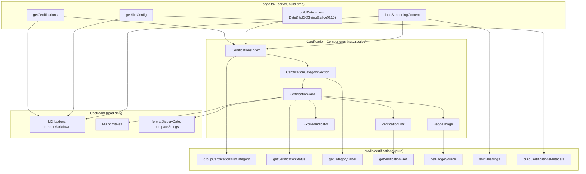

# Design Document

> **Spec:** M7 Certifications Module  
> **Document Status:** Draft  
> **Feature Name:** m7-certifications-module  
> **Last Updated:** 2026-10-20  
> **Lead Architect:** Angelo Andres  
> **Requirements Reference:** `requirements.md`  
> **Master Specifications:** `AGENTS.md` (Sections 3, 4.2, 5.1, 5.3, 6.1, 6.2), `PRD.md` (Certifications & Badges, P0), `design.md` (Sections 4.3, 6.3), `TRD.md` (static generation), `APP_FLOW.md` (Flow 3.0, Story 3.1, `SCR-04`), `implementation_plan.md` (Certifications tasks)  
> **Upstream Specs:** M1 (tokens, toolchain), M2 (schemas, loaders, `renderMarkdown`, `getSiteConfig`), M3 (UI primitives), M4 (shell, title template, static export), M5 (`formatDisplayDate`, `compareStrings`), M6 (pure-helper pattern, `demoteHeadings` precedent)

---

## Overview

### Purpose

Milestone 7 (M7) delivers the Certifications module for `personal-website-portfolio-v2`: the single static route `/certifications` (`SCR-04`), six presentational components in `src/components/certifications/`, and pure helpers in `src/lib/certifications/` that group, order, classify, label, validate, and describe certifications. All data comes from the M2 loaders. M7 composes M3 primitives and the M4 shell. It adds no token, primitive, layout change, dependency, or route other than `/certifications`.

### Scope

**In Scope:**
- `src/app/certifications/page.tsx` (async server component plus `metadata` export)
- Certification_Components: `CertificationsIndex`, `CertificationCategorySection`, `CertificationCard`, `VerificationLink`, `BadgeImage`, `ExpiredIndicator`
- Helpers: `groupCertificationsByCategory`, `getCertificationStatus`, `getCategoryLabel`, `getVerificationHref`, `getBadgeSource`, `shiftHeadings`, `loadSupportingContent`, `buildCertificationsMetadata`
- Vitest, React Testing Library, axe, and fast-check tests in `tests/certifications/`

**Out of Scope (Requirements 1.7, 13):**
- Blog routes (M8), JSON-LD, performance tuning, deployment (M9, M10)
- Certification detail routes, search, filtering (P1), client islands, `Suspense`, API routes, forms, analytics
- Any change to M1 to M6 files, `package.json`, lockfiles, `next.config.ts`, or `tsconfig.json`

### Design Principles

1. **Zero client JavaScript.** No file in M7 has `'use client'`, state, effects, or browser APIs. Certifications have no interactive state in P0.
2. **Pure helpers, impure edge.** Helpers take plain data and return plain data. The only clock read in M7 is one expression in `page.tsx`, and its result is passed down as an argument.
3. **Compose, do not redefine.** `Card`, `Tag`, `ExternalLink`, `EmptyState`, `MarkdownDoc`, `Container`, and `FOCUS_RING` come from M3. `Certification`, `CertificationFrontmatter`, `CertificationCategory`, and `IsoDateString` come from `@/types/content` and are never redeclared (Req 1.5).
4. **Defense in depth over M2.** M2 already rejects bad `verificationUrl` values and unpaired badge fields (`AGENTS.md` 5.3). The components re-check cheaply and omit the element rather than render something unsafe or inaccessible.
5. **Deterministic output.** Ties break on `slug` with `compareStrings`. Dates format through `formatDisplayDate` (UTC, fixed locale). Identical input and Build_Date yield identical HTML.
6. **Scope guarded.** Gaps in M1 to M6 are recorded and escalated, not patched (`AGENTS.md` 6.2, Req 15.7).

### Research Findings and Decisions

| Topic | Finding | Decision |
|-------|---------|----------|
| Build_Date source (Req 7.4, 7.5) | Helpers must not read the clock. Under `output: "export"` the page body runs once at build time, so any date computed in `page.tsx` is frozen into the HTML. | `page.tsx` computes `const buildDate = new Date().toISOString().slice(0, 10)` once, as an `IsoDateString` in UTC, and passes it to `CertificationsIndex`, which passes it to every card. This is the only clock read in M7. `getCertificationStatus(cert, buildDate)` stays pure. |
| Static-export consequence of Build_Date | The "Expired" label reflects the day of the last build, not the day of the visit. A credential that expires after the build still shows as active until the next build. | Accepted and documented. This is consistent with the static model (`TRD.md`). Content changes already trigger a rebuild. A scheduled rebuild is an M10 deployment concern and is not added here. Each card renders its dates, so a reader can judge validity regardless of the label. |
| Build_Date and time zone | `toISOString()` is always UTC. `expiresAt` equal to the Build_Date is `active` (Req 7.3). | Compare `YYYY-MM-DD` strings lexically: `expiresAt < buildDate` means expired. No `Date` is constructed in helpers (Req 7.4). If M2 allows a time component, `expiresAt.slice(0, 10)` is compared instead. The implementer confirms the `IsoDateString` shape in M2. |
| "Uncategorised" fallback (Req 4) | `category` is a required `CertificationCategory` in the M2 schema, so the fallback is unreachable for loaded content. | Defensive only. The grouping helper keeps unknown categories in a trailing group labelled "Uncategorised" instead of dropping them. The group key is the literal `'uncategorised'`. Tests reach it through a test-only cast. No page-level content ever triggers it. |
| Category_Label map (Req 5.5) | A `Record<CertificationCategory, string>` is exhaustive at compile time. Adding a union member breaks the build until a label exists. | `CATEGORY_LABELS` is `Record<CertificationCategory, string>`. `getCategoryLabel` returns the label, or `"Uncategorised"` for the fallback key. `CATEGORY_ORDER` is a `readonly CertificationCategory[]` in the `AGENTS.md` 4.2 order. A test asserts `CATEGORY_ORDER` has the same members as the `CATEGORY_LABELS` keys, so the two cannot drift. |
| Badge image element (Req 9) | `next/image` with the default loader fails under `output: "export"` unless `images.unoptimized` is `true`. No `next.config.ts` exists in the workspace yet, and M4 specifies image settings "compatible with static export" without naming the value. M7 may not edit root config. | Use a plain `` with explicit `width`, `height`, `alt`, `src`, and `decoding="async"`. It has no dependency on M4's final image setting, needs no loader, and the badges are small fixed-size assets, so optimization gains are minor. A one-line ESLint disable for `@next/next/no-img-element` carries the justification. If M4 ships `images.unoptimized: true`, a later change can swap in `next/image` without altering the contract. |
| Image loading strategy (Req 9.7) | Lazy loading an above-the-fold image delays it. Eager loading every badge wastes bandwidth. | The first card on the page (index 0 of the flattened render order) renders `loading="eager"`. All others render `loading="lazy"`. `CertificationsIndex` computes a `priority` flag from a running card index. |
| Badge dimensions (Req 9.4, 9.5) | Badge assets have varied intrinsic sizes. | Fixed `width={64}` and `height={64}` attributes reserve the box. The class list uses `h-16 w-16 max-w-full object-contain` from the spacing scale, so the box never exceeds the card at 375px. |
| Badge source rule (Req 9.6) | `AGENTS.md` 5.1 allows internal asset paths or absolute HTTPS URLs. | `getBadgeSource(cert)` returns `{ src, alt }` only when both fields are non-empty after trim and `src` begins with `/images/certifications/` or `https://`. Otherwise it returns `null` and no image or container renders. |
| Verification URL rule (Req 8.1, 8.6) | M2 requires absolute HTTPS. `javascript:` or `http:` must never become a link. | `getVerificationHref(cert)` returns the stored string unchanged when it begins with `https://` and parses with `new URL`. Otherwise it returns `null`. `href` equals the stored value (Req 8.1). No trimming, so a padded value is rejected rather than silently rewritten. |
| Unique link names (Req 8.2, 14.4) | A visible "Verify" text repeated per card is ambiguous to screen readers. Appending "(opens in a new tab)" to the name would break Req 8.2's exact name. | `aria-label="Verify {title} credential"`. The new-tab notice is a visually hidden `span` with an id `cert-{slug}-newtab`, linked with `aria-describedby` (Req 8.8). Slugs are unique per M2. Two certifications with identical titles would share a name. This is recorded as a content risk. A test over the content fixtures asserts title uniqueness, and the Content Owner resolves any clash. |
| Supporting content headings (Req 10.3) | The outline is `h1`, `h2` per category, `h3` per card, so content headings must be `h4` or lower. M6's `demoteHeadings` only fixes an `h1` by one level. That is not enough here. It lives in the M6 `projects` directory, and importing it would couple two modules. | Write a local helper `shiftHeadings(html, minLevel = 4)`. It finds the smallest heading level present, and if that level is below 4, adds the difference to every heading, capped at 6. Relative structure is preserved. Pure string logic, same style as M6, no cross-module import. |
| Markdown rendering location | `renderMarkdown` may be async. Components should stay synchronous and testable. | `page.tsx` awaits `loadSupportingContent(certifications)` and passes `contentHtml: Readonly<Record<string, string>>` keyed by slug. Entries exist only for non-empty bodies (Req 10.1, 10.2). Errors are rethrown with the slug (Req 10.5). |
| Card container | Req 6.1 puts the `h3` inside an M3 `Card`. | `CertificationCard` uses `Card` as a non-interactive container (no wrapping link), with `h-full` for equal row height (Req 11.4). The implementer confirms the M3 `Card` accepts `className` and non-link children. |
| Metadata | The M4 template renders "{title} \| {siteName}". Canonical must not be hardcoded (Req 12.6). | `buildCertificationsMetadata(siteUrl)` is a pure function. The canonical is `new URL('/certifications', siteUrl).href`. |
| Breakpoints | Req 11 uses 768px and 1024px. Tailwind defaults `md` and `lg` match. | Grid classes: `grid grid-cols-1 md:grid-cols-2 lg:grid-cols-3`. The implementer confirms M1 did not override the breakpoints. |
| Reduced motion (Req 14.6) | The simplest way to satisfy "no transition" is to add none. | M7 uses no `transition` or `animate` utilities. |

---

## Architecture

### Module Layout

```text
src/
├── app/certifications/
│   └── page.tsx                      # async server component + metadata
├── components/certifications/
│   ├── certifications-index.tsx      # CertificationsIndex
│   ├── certification-category-section.tsx
│   ├── certification-card.tsx
│   ├── verification-link.tsx
│   ├── badge-image.tsx
│   └── expired-indicator.tsx
└── lib/certifications/
    ├── category-order.ts             # CATEGORY_ORDER, UNCATEGORISED
    ├── category-label.ts             # CATEGORY_LABELS, getCategoryLabel
    ├── group-certifications.ts       # groupCertificationsByCategory
    ├── certification-status.ts       # getCertificationStatus
    ├── verification-href.ts          # getVerificationHref
    ├── badge-source.ts               # getBadgeSource
    ├── shift-headings.ts             # shiftHeadings
    ├── load-supporting-content.ts    # loadSupportingContent (calls renderMarkdown)
    └── certifications-metadata.ts    # buildCertificationsMetadata
tests/certifications/                 # one test file per source file
```

No `index.ts` barrel files are used; consumers import each file directly (AGENTS.md 7.2, consistent with M3-M6).

### Data Flow



### Page Heading Outline

`h1` "Certifications" (index) → `h2` per category section → `h3` per card title → `h4` or lower inside supporting content. No level is skipped (Req 5.6).

---

## Components and Interfaces

All components are plain function components with no directive. Props are `readonly`.

### Helpers

```typescript
// category-order.ts
export const CATEGORY_ORDER: readonly CertificationCategory[]; // cloud, ai, security, frontend, backend, data, devops, professional
export const UNCATEGORISED = 'uncategorised' as const;

// category-label.ts
export const CATEGORY_LABELS: Record<CertificationCategory, string>; // exhaustive
export type GroupKey = CertificationCategory | typeof UNCATEGORISED;
export function getCategoryLabel(key: GroupKey): string; // 'uncategorised' -> "Uncategorised"

// group-certifications.ts
export interface CertificationGroup {
  readonly category: GroupKey;
  readonly certifications: readonly Certification[]; // non-empty
}
export function groupCertificationsByCategory(
  certifications: readonly Certification[],
): readonly CertificationGroup[];
```

`groupCertificationsByCategory` copies the input, sorts a copy by Certification_Order (`displayOrder` ascending, then `compareStrings(slug)`), buckets by `category` (anything outside `CATEGORY_ORDER` goes to the `uncategorised` bucket), and emits non-empty buckets in `CATEGORY_ORDER` followed by `uncategorised` (Req 3, 4). It never mutates input and never reads the clock, locale, or time zone (Req 3.9, 3.10).

```typescript
// certification-status.ts
export type CertificationStatus = 'active' | 'expired';
export function getCertificationStatus(
  certification: Pick<Certification, 'expiresAt'>,
  buildDate: IsoDateString,
): CertificationStatus;
// expiresAt === null -> 'active'; expiresAt.slice(0,10) < buildDate -> 'expired'; else 'active'

// verification-href.ts
export function getVerificationHref(certification: Pick<Certification, 'verificationUrl'>): string | null;

// badge-source.ts
export interface BadgeSource { readonly src: string; readonly alt: string; }
export function getBadgeSource(
  certification: Pick<Certification, 'badgeImageUrl' | 'badgeImageAlt'>,
): BadgeSource | null;

// shift-headings.ts
export function shiftHeadings(html: string, minLevel?: number): string; // default 4

// load-supporting-content.ts
export function loadSupportingContent(
  certifications: readonly Certification[],
): Promise<Readonly<Record<string, string>>>; // keyed by slug, only non-empty bodies

// certifications-metadata.ts
export function buildCertificationsMetadata(siteUrl: string): Metadata;
```

`shiftHeadings` is pure string logic over the sanitized HTML from `renderMarkdown`. It matches `<h[1-6]` and `</h[1-6]>` tags, computes the minimum level, and rewrites tags by `delta = max(0, minLevel - minLevel_found)`, capping at 6. It adds and removes no element. Input with no heading tags is returned unchanged.

`loadSupportingContent` skips bodies that are empty after trim, calls `renderMarkdown(content)` for the rest, applies `shiftHeadings`, and on any thrown error rethrows `new Error('Failed to render certification content: ' + slug, { cause })` (Req 10.5).

`buildCertificationsMetadata` returns:

```typescript
{
  title: 'Certifications',
  description: 'Professional certifications and credentials earned across cloud, AI, security, and software engineering, with issuer verification links.', // 135 chars
  alternates: { canonical },
  openGraph: { title: 'Certifications', description, url: canonical, type: 'website' },
}
```

where `canonical = new URL('/certifications', siteUrl).href`. No JSON-LD (Req 12.5).

### Page

```typescript
// src/app/certifications/page.tsx (server, no 'use client')
export async function generateMetadata(): Promise<Metadata>; // buildCertificationsMetadata((await getSiteConfig()).siteUrl)
export default async function CertificationsPage(): Promise<JSX.Element>;
// const certifications = await getCertifications();
// const contentHtml = await loadSupportingContent(certifications);
// const buildDate = new Date().toISOString().slice(0, 10);
// return <CertificationsIndex certifications={certifications} contentHtml={contentHtml} buildDate={buildDate} />;
```

`generateMetadata` is used because `getSiteConfig` may be async (same approach as M6). If it is synchronous, a static `metadata` export with the same value is equivalent (Req 12.1 to 12.4). `page.tsx` renders no `header`, `footer`, or `main` (Req 1.4), and the `buildDate` expression appears nowhere else in M7.

### Components

```typescript
interface CertificationsIndexProps {
  readonly certifications: readonly Certification[];
  readonly contentHtml: Readonly<Record<string, string>>;
  readonly buildDate: IsoDateString;
}
// <Container><h1>Certifications</h1>
//   {groups.length === 0 ? <EmptyState .../> : groups.map(g => <CertificationCategorySection .../>)}
// </Container>
// Passes priority={true} to the first card only (Req 9.7).

interface CertificationCategorySectionProps {
  readonly group: CertificationGroup;
  readonly contentHtml: Readonly<Record<string, string>>;
  readonly buildDate: IsoDateString;
  readonly firstCardIndex: number; // 0 only for the first section
}
// <section aria-labelledby={`certifications-${group.category}-heading`}>
//   <h2 id=...>{getCategoryLabel(group.category)}</h2>
//   <ul className="grid grid-cols-1 md:grid-cols-2 lg:grid-cols-3 gap-... items-stretch">
//     <li><CertificationCard .../></li> ...
// </section>

interface CertificationCardProps {
  readonly certification: Certification;
  readonly buildDate: IsoDateString;
  readonly contentHtml?: string;
  readonly priority: boolean;
}
// <Card className="h-full"> optional BadgeImage, <h3>{title}</h3>, issuer, Tag(category label),
// <p>Issued <time dateTime={issuedAt}>{formatDisplayDate(issuedAt)}</time></p>,
// expiresAt !== null && <p>Expires <time .../></p>,
// credentialId.trim() !== '' && <p>Credential ID: {credentialId}</p>,
// status === 'expired' && <ExpiredIndicator />, <VerificationLink /> when href !== null,
// contentHtml && <MarkdownDoc html={contentHtml} />
// Long text uses break-words so nothing overflows at 375px (Req 11.6).

interface VerificationLinkProps { readonly title: string; readonly slug: string; readonly href: string; }
// <ExternalLink href={href} aria-label={`Verify ${title} credential`} aria-describedby={`cert-${slug}-newtab`}
//   className={FOCUS_RING + ' underline'} /> + <span id=... className="sr-only">Opens in a new tab</span>
// target="_blank" rel="noopener noreferrer" (the M3 ExternalLink sets these; the component test asserts them)

interface BadgeImageProps { readonly src: string; readonly alt: string; readonly priority: boolean; }
// eslint-disable-next-line @next/next/no-img-element -- static export; see Research Findings
// 

// ExpiredIndicator: <span> with a leading icon (aria-hidden), the visible text "Expired", and a border cue (Req 7.8)
```

The implementer confirms the exact M3 prop names for `Card`, `Tag`, `ExternalLink`, `EmptyState`, and `MarkdownDoc`. If `ExternalLink` does not forward `aria-label` or `aria-describedby`, stop and escalate, because M7 may not edit `src/components/ui/`. `CertificationCard` calls `getVerificationHref` and `getBadgeSource` itself, then passes only valid values to the child components. `VerificationLink` and `BadgeImage` also render `null` when given an invalid value, so the guard holds even if used directly.

---

## Data Models

M7 declares no content type. It imports `Certification` and `CertificationCategory` (see `AGENTS.md` 4.2).

```typescript
interface CertificationFrontmatter {
  title: string; slug: string; issuer: string;
  category: CertificationCategory;
  issuedAt: IsoDateString; expiresAt: IsoDateString | null;
  credentialId: string | null; verificationUrl: string | null;
  badgeImageUrl: string | null; badgeImageAlt: string | null;
  displayOrder: number;
}
interface Certification extends CertificationFrontmatter { content: string; }
```

M7-local types are limited to the helper shapes shown above:

| Type | Defined in | Notes |
|------|------------|-------|
| `GroupKey` | `category-label.ts` | `CertificationCategory \| 'uncategorised'` |
| `CertificationGroup` | `group-certifications.ts` | `{ category: GroupKey; certifications: readonly Certification[] }`, never empty |
| `CertificationStatus` | `certification-status.ts` | `'active' \| 'expired'` |
| `BadgeSource` | `badge-source.ts` | `{ src: string; alt: string }` |

Derived values and rules:

- **Category_Order:** `cloud`, `ai`, `security`, `frontend`, `backend`, `data`, `devops`, `professional`, then `uncategorised`.
- **Certification_Order:** `displayOrder` ascending, then `compareStrings(slug)`. A total order given unique slugs.
- **Category_Labels:** cloud "Cloud", ai "AI", security "Security", frontend "Frontend", backend "Backend", data "Data", devops "DevOps", professional "Professional". All distinct and non-empty (Req 5.5).
- **Flatten:** `flatten(groups) = groups.flatMap(g => g.certifications)`. Used by the idempotence property.
- **Heading ids:** `certifications-{groupKey}-heading`, unique because group keys are unique.

---

## Correctness Properties

*A property is a characteristic or behavior that should hold true across all valid executions of a system-essentially, a formal statement about what the system should do. Properties serve as the bridge between human-readable specifications and machine-verifiable correctness guarantees.*

### Reflection

Criteria 3.1, 3.4, and 3.5 all describe the same partition (every entry in exactly one group, matching its category) and are one property. Criterion 4.2 extends that partition to out-of-range categories, so it joins the same property through a generator that sometimes emits unknown categories. Criteria 3.2, 3.3, and 4.4 are one ordering property. Input-order independence (3.6) and idempotence (3.7) are kept separate because each catches different bugs (unstable sorting versus lossy regrouping). Immutability (3.9) is cheap and independent. Expiry classification (7.1 to 7.3) is one property. Per-field card rendering (6.x) is merged with the traceability rule (6.9). Badge and verification link rules each get one property, and link-name uniqueness (8.2, 14.4) joins the link property. Criteria about layout classes, `'use client'` absence, hardcoded values, build output, and bundle contents are static checks, not properties, and appear in the Testing Strategy. Criterion 2 (empty state) and Criterion 1.3 are examples.

### Property 1: Grouping is a partition with no loss

*For any* list of certifications, including entries whose category is outside the known union, the flattened output of `groupCertificationsByCategory` is a permutation of the input (same length, same members, none duplicated), every group is non-empty, every entry sits in the group matching its category, and entries with an out-of-range category sit in the single `uncategorised` group. An empty input yields an empty list.

**Validates: Requirements 3.1, 3.4, 3.5, 3.8, 4.2**

### Property 2: Groups and members are ordered

*For any* list of certifications with unique slugs, the groups appear in Category_Order with `uncategorised` last, and within each group the members are sorted by `displayOrder` ascending and then by `compareStrings` on `slug`.

**Validates: Requirements 3.2, 3.3, 4.4**

### Property 3: Grouping is independent of input order

*For any* list of certifications with unique slugs and any permutation of it, `groupCertificationsByCategory` returns deeply equal output.

**Validates: Requirements 3.6**

### Property 4: Grouping is idempotent under flatten

*For any* list of certifications with unique slugs, with `g = groupCertificationsByCategory(list)`, `groupCertificationsByCategory(flatten(g))` deeply equals `g`.

**Validates: Requirements 3.7**

### Property 5: Grouping does not mutate its input

*For any* list of certifications, calling `groupCertificationsByCategory` on a deeply frozen copy does not throw, and the input array and its elements are unchanged afterward.

**Validates: Requirements 3.9, 3.10**

### Property 6: Expiry classification matches date order

*For any* certification and any Build_Date, `getCertificationStatus` returns `expired` if and only if `expiresAt` is not `null` and `expiresAt` is earlier than the Build_Date. It returns `active` when `expiresAt` is `null` and when `expiresAt` equals the Build_Date.

**Validates: Requirements 7.1, 7.2, 7.3, 7.4**

### Property 7: Category labels are total and distinct

*For any* value of `CertificationCategory`, `getCategoryLabel` returns a non-empty string, no two categories share a label, and `CATEGORY_ORDER` contains exactly the members of the union.

**Validates: Requirements 5.5**

### Property 8: Card shows exactly the fields it was given

*For any* certification, the rendered card contains the title in an `h3`, the issuer, one `time` with `datetime` equal to `issuedAt` and text `formatDisplayDate(issuedAt)`, and the category label. An "Expires" `time` appears if and only if `expiresAt` is not `null`. The text "Credential ID: {value}" appears, with the stored value unchanged, if and only if `credentialId` is non-empty after trim. Every text node is either a fixed label or traceable to a prop value, so nothing is invented.

**Validates: Requirements 6.1, 6.2, 6.3, 6.4, 6.5, 6.6, 6.7, 6.8, 6.9, 14.7**

### Property 9: Expired indicator appears if and only if expired

*For any* certification and Build_Date, the rendered card contains the visible text "Expired" if and only if `getCertificationStatus` returns `expired`, and the indicator carries a non-color cue.

**Validates: Requirements 7.5, 7.6, 7.7, 7.8**

### Property 10: Verification link follows the HTTPS rule

*For any* certification, a verification link is rendered if and only if `verificationUrl` begins with `https://` and parses as a URL. When rendered it has `href` equal to the stored value, accessible name "Verify {title} credential", `target="_blank"`, and `rel` containing `noopener` and `noreferrer`. For any set of certifications with distinct titles, all link names on the page are distinct.

**Validates: Requirements 8.1, 8.2, 8.3, 8.5, 8.6, 8.8, 14.4**

### Property 11: Badge image follows the pair and source rule

*For any* certification, an `img` is rendered if and only if `badgeImageUrl` and `badgeImageAlt` are both non-empty after trim and the URL begins with `/images/certifications/` or `https://`. When rendered, `src` and `alt` equal the stored values, and `width` and `height` are present. Otherwise the card contains no `img` and no empty image container.

**Validates: Requirements 9.1, 9.2, 9.3, 9.4, 9.6**

### Property 12: Heading shift keeps supporting content below h3

*For any* HTML string made of headings of levels 1 to 6 with arbitrary attributes and text, `shiftHeadings` returns a string with no heading above `h4`, keeps opening and closing tags paired, and leaves the text, attributes, and relative level differences unchanged except where the cap at `h6` applies. When the input contains no heading above `h3`, the output equals the input.

**Validates: Requirements 10.3, 5.6**

### Property 13: Supporting content renders if and only if the body is non-empty

*For any* certification, `loadSupportingContent` returns an entry for its slug if and only if `content` is non-empty after trim, and the card renders a `MarkdownDoc` container if and only if an entry exists. If `renderMarkdown` throws, the rethrown error message contains the slug.

**Validates: Requirements 10.1, 10.2, 10.5**

### Property 14: Page structure is ordered, labelled, and level-correct

*For any* non-empty list of certifications and any Build_Date, the rendered page has exactly one `h1`, one `section` per group in helper order, each section's accessible name equals its `h2` text, each section holds one `li` per member in order, and the heading levels in document order never increase by more than one step. An empty list renders the `h1` and the `EmptyState` and no section or card.

**Validates: Requirements 1.3, 2.1, 2.2, 2.3, 5.1, 5.2, 5.3, 5.4, 5.6**

### Property 15: Metadata is derived from the site URL

*For any* valid absolute `siteUrl`, `buildCertificationsMetadata` returns title "Certifications", a description of 50 to 160 characters, a canonical equal to `new URL('/certifications', siteUrl).href` with no query string, and Open Graph `title`, `description`, `url`, and `type` consistent with those values.

**Validates: Requirements 12.1, 12.2, 12.3, 12.4, 12.6**

---

## Error Handling

| Situation | Behavior |
|-----------|----------|
| `getCertifications()` returns an empty list | `EmptyState` with a "certifications are being prepared" message and the `h1`. No placeholder entries (Req 2). |
| Category outside the known union | Entry goes to a trailing "Uncategorised" group. Never dropped (Req 4.2). Unreachable for M2-validated content. |
| `verificationUrl` is `null`, empty, `http://`, or unparsable | No link, no placeholder, no disabled action (Req 8.5, 8.6). |
| `badgeImageUrl` present, `badgeImageAlt` absent or empty | No image (Req 9.3). |
| Badge URL outside `/images/certifications/` and not `https://` | No image (Req 9.6). |
| `credentialId` null, empty, or whitespace | No credential line (Req 6.8). |
| `expiresAt` equals Build_Date | `active` (Req 7.3). |
| `renderMarkdown` throws for one certification | `loadSupportingContent` rethrows with the slug in the message. The build fails (Req 10.5). |
| Invalid `IsoDateString` reaching `formatDisplayDate` | The M5 formatter throws an `Error` naming the value. Not caught. Unreachable for validated content. |
| Heading-free supporting HTML | `shiftHeadings` returns it unchanged. It never throws. |
| Status is stale after build | By design, status is frozen at build time (see Research Findings). Dates remain visible on the card. |
| Two certifications share a title | Link names would collide. A fixture test over real content flags it for the Content Owner. |
| Missing `formatDisplayDate`, `compareStrings`, or M3 prop support | Implementation stops and escalates. M7 creates no substitutes outside its directories (Req 15.7). |
| `public/images/certifications/` asset missing | Out of M7's control. M7 adds no binary assets (Req 9.8). |

---

## Testing Strategy

### Approach

M7 uses both kinds of test. Unit and component tests cover concrete examples, edge cases, and integration points. Property tests cover the universal rules above. The helpers and the rule-driven components (card, link, badge, indicator, index) suit property testing because behavior varies with input. Layout classes, absence of `'use client'`, and build output do not vary with input and use static scans and examples instead.

### Property-Based Tests

- Library: `fast-check`, already installed by M1. M7 does not implement property testing from scratch.
- Each property is implemented by a single test with at least 100 runs (`{ numRuns: 100 }` or more).
- Each test carries a tag comment: `Feature: m7-certifications-module, Property {number}: {property text}`.
- Generators: `arbCertification` (all fields, unique slugs via `fc.uniqueArray`, category from the union or, with a flag, an arbitrary unknown string), `arbBuildDate`, `arbHeadingHtml`, `arbUrl` (https, http, empty, padded, `javascript:`).

**Mandatory (Req 15.2):** Property 1 (partition and no loss), Property 2 (order), Property 3 (input-order independence), Property 4 (idempotence), Property 6 (expiry classification). Properties 5 and 7 to 15 are also implemented as listed.

### Unit and Component Tests

| Test file | Coverage |
|-----------|----------|
| `group-certifications.test.ts` | Properties 1 to 5, deep-frozen input, trailing "Uncategorised" fixture (Req 4.1) |
| `certification-status.test.ts` | Property 6, plus one day before, equal, one day after, `null` |
| `category-label.test.ts` | Property 7, `CATEGORY_ORDER` equals label keys |
| `shift-headings.test.ts` | Property 12, no-heading input, `h1`-only input, cap at `h6` |
| `verification-href.test.ts`, `badge-source.test.ts` | Properties 10 and 11 at helper level, including `javascript:` and padded values |
| `certification-card.test.tsx` | Properties 8, 9, 11, 13 at component level, 120-character title and 60-character credential ID wrap check |
| `verification-link.test.tsx` | Property 10, `FOCUS_RING` classes, `aria-describedby` target exists |
| `badge-image.test.tsx` | Property 11, `loading` eager for priority and lazy otherwise, `width` and `height` set |
| `expired-indicator.test.tsx` | Text "Expired" and non-color cue |
| `certification-category-section.test.tsx` | Property 14 for one section, grid classes `grid-cols-1`, `md:grid-cols-2`, `lg:grid-cols-3` |
| `certifications-index.test.tsx` | Property 14, empty state, only the first card is eager |
| `page.test.tsx` | Populated and empty cases with mocked loaders (Req 15.4), `loadSupportingContent` failure includes slug (Property 13), `buildDate` passed identically to every card (Req 7.5) |
| `certifications-metadata.test.ts` | Property 15, no `application/ld+json` in the rendered page (Req 12.5) |
| `a11y.test.tsx` | Axe_Check with zero violations on populated, expired, minimal, and empty fixtures (Req 14.1) |

### Static Checks

- Scan `src/app/certifications/` and `src/components/certifications/` for `'use client'`, `useState`, `useEffect`, `window`, `fetch(`, and `dangerouslySetInnerHTML` (Req 1.2, 10.4, 13.2, 13.3).
- Scan the same directories for hex colors and arbitrary-value utilities (Req 11.7).
- Assert no `src/app/certifications/[slug]/` directory exists (Req 1.7).
- Assert `new Date(` appears only in `page.tsx` under M7 sources (Req 7.4).
- Scan M7 files for `any`, `!.`, and unjustified `as` (Req 15.5), and for file length under 300 lines (Req 15.6).
- Assert `git diff --stat` against the M6 base touches only `src/app/certifications/`, `src/components/certifications/`, `src/lib/certifications/`, `tests/certifications/`, and optionally `content/certifications/` and `public/images/certifications/` (Req 15.7).

### Quality Gates

`npm run lint`, `npm run typecheck`, `npm test`, and `npm run build` must all pass (Req 15.8). The build output must list `/certifications` as a static route, and the built HTML must contain every verification link and `img` with scripts ignored (Req 13.1, 13.4). `package.json` and the lockfile stay unchanged (Req 13.7).

### Not Covered Here

Contrast ratios, real keyboard traversal, and layout at 375px to 1440px need a real browser. They are verified manually and by M9 tooling. Full WCAG validation requires manual testing with assistive technologies and expert review.
