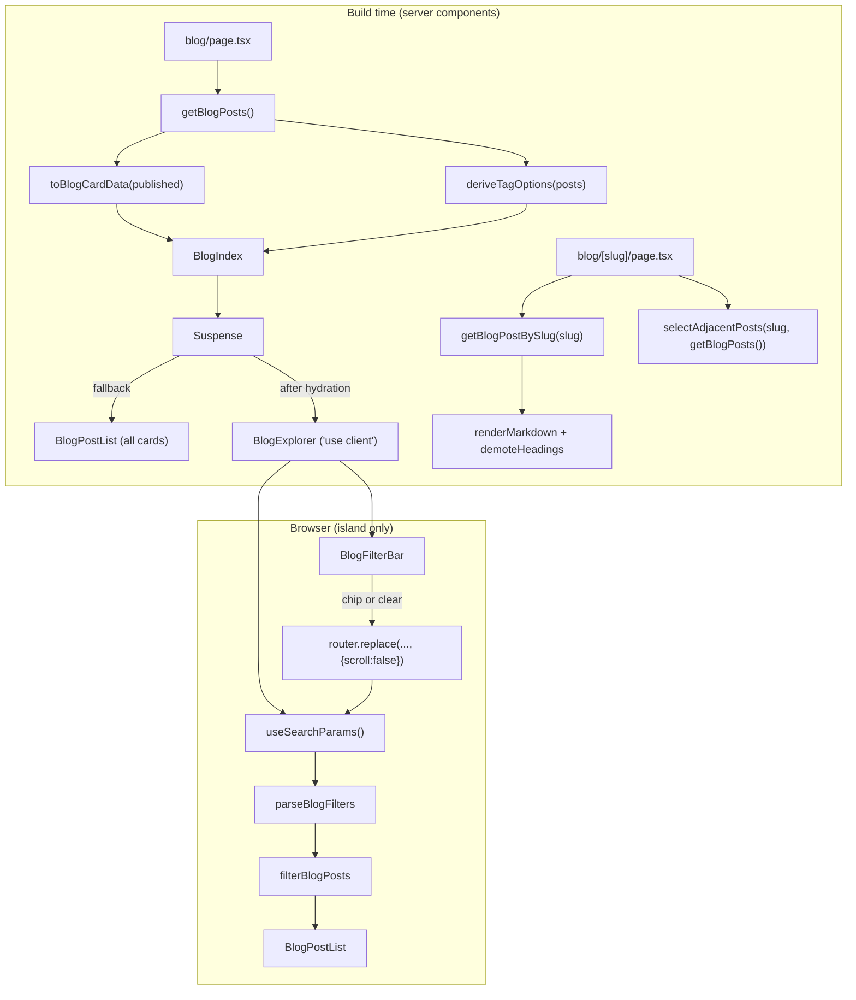

# Design Document

> **Spec:** M8 Blog / Participation Module  
> **Document Status:** Draft  
> **Feature Name:** m8-blog-participation-module  
> **Last Updated:** 2026-10-20  
> **Lead Architect:** Angelo Andres  
> **Requirements Reference:** `requirements.md`  
> **Master Specifications:** `AGENTS.md` (Sections 3, 4.2, 5.1, 5.4, 6, 7.2), `PRD.md` (Blog / Participation Log, P0), `design.md` (Sections 4.3, 4.4, 6.4), `TRD.md` (Section 3.3), `APP_FLOW.md` (Flow 4.0, Stories 4.x, `SCR-05`, `SCR-06`), `implementation_plan.md` (Blog tasks)  
> **Upstream Specs:** M1 (tokens, toolchain), M2 (schemas, loaders, `renderMarkdown`), M3 (UI primitives), M4 (shell, title template, `not-found`), M5 (`formatDisplayDate`, `compareStrings`), M6 (Projects pattern, `demoteHeadings` if exported)

---

## Overview

### Purpose

Milestone 8 (M8) delivers the Blog / Participation module for `personal-website-portfolio-v2`: the index route `/blog` (`SCR-05`), the detail route `/blog/[slug]` (`SCR-06`), ten components in `src/components/blog/`, one client island (`BlogExplorer`), and pure helpers in `src/lib/blog/` that sort posts, derive tag options, parse and serialize the `tag` URL parameter, filter posts, select adjacent posts, and build metadata. All data comes from the M2 loaders. M8 composes M3 primitives and the M4 shell and adds no token, primitive, layout change, dependency, or route other than `/blog` and `/blog/{slug}`.

M8 mirrors M6 (client island under `Suspense` with a static fallback, pure helpers, static detail route) with three differences: one filter dimension (a single tag) instead of two, a chronological adjacent-post navigation instead of related projects, and an optional event block.

### Scope

**In Scope:**
- `src/app/blog/page.tsx` (server component, `metadata` export)
- `src/app/blog/[slug]/page.tsx` (server component, `generateStaticParams`, `dynamicParams = false`, `generateMetadata`)
- Blog_Components: `BlogIndex`, `BlogExplorer` (client), `BlogFilterBar`, `BlogPostList`, `BlogPostCard`, `BlogBreadcrumb`, `BlogPostHeader`, `EventMetadata`, `PostBody`, `PostNavigation`
- Pure helpers: `tagKey`, `sortBlogPosts`, `deriveTagOptions`, `parseBlogFilters`, `serializeBlogFilters`, `mergeBlogFilterParams`, `filterBlogPosts`, `selectAdjacentPosts`, `toBlogCardData`, `formatResultCount`, `buildBlogIndexMetadata`, `buildBlogPostMetadata`, and a heading demotion helper (see Decision 3)
- Vitest, React Testing Library, axe, and fast-check tests in `tests/blog/`

**Out of Scope (Requirement 17):** JSON-LD including `Article` (M9), RSS or feed output, search, comments, pagination, performance tuning and deployment (M9, M10), dark mode, API routes, route handlers, server actions, forms, analytics, cookies, new dependencies, and any change to M1 to M7 modules, `package.json`, lockfiles, `next.config.ts`, or `tsconfig.json`.

### Design Principles

1. **One client island, and it is small.** `BlogExplorer` is the only module with `'use client'` and the only caller of `useSearchParams` (Req 8.3). Every other component has no directive.
2. **The URL is the single source of truth for the filter.** The Explorer derives `BlogFilters` from `useSearchParams()` on every render and writes with `router.replace`. It keeps no duplicate filter state.
3. **The static HTML is complete without JavaScript.** The `Suspense` fallback is the full unfiltered `BlogPostList` (Req 8.2).
4. **Logic is pure.** Helpers are functions over plain data with no React, Next.js, or DOM imports (Req 17.4). The metadata builders import the Next.js `Metadata` type only as `import type`.
5. **Compose, do not redefine.** `BlogPost`, `BlogPostFrontmatter`, and `EventType` come from the M2 types and are never redeclared (Req 1.5). M3 primitives are imported as is.
6. **Deterministic output.** Ordering ties break on `slug` with `compareStrings`. Dates format through the M5 `formatDisplayDate`. Identical input yields identical static HTML.
7. **Defense in depth for drafts.** The M2 loaders exclude drafts. Helpers and the list component drop drafts again (Decision 6).
8. **Scope guarded.** Gaps in M1 to M7 are recorded and escalated, not patched (`AGENTS.md` 6.2).

### Research Findings and Decisions

| Topic | Finding | Decision |
|-------|---------|----------|
| `useSearchParams` under static export | A client component calling `useSearchParams` in a statically rendered route needs a `Suspense` boundary or the build fails with a "missing Suspense boundary" error. With one, the fallback is prerendered and the real component renders after hydration. Source: [Next.js docs, `useSearchParams`](https://nextjs.org/docs/app/api-reference/functions/use-search-params). | `BlogIndex` wraps `BlogExplorer` in `Suspense` with the full static `BlogPostList` as fallback (Req 8.1, 8.2, 8.5). |
| Filter writes | `router.replace(url, { scroll: false })` does a client-side navigation without adding a history entry per click. | The Explorer calls `router.replace(BLOG_PATH + query, { scroll: false })`, where `BLOG_PATH = '/blog'` (Req 7.6). `usePathname` is not needed. |
| Metadata `openGraph` article | Next.js `Metadata.openGraph` with `type: 'article'` accepts `publishedTime`, `modifiedTime`, and `tags` and emits `article:published_time`, `article:modified_time`, and `article:tag` tags. Source: [Next.js docs, `generateMetadata`](https://nextjs.org/docs/app/api-reference/functions/generate-metadata). | `buildBlogPostMetadata` returns those keys; `modifiedTime` is omitted when `updatedAt` is `null` (Req 15.2 to 15.4). |
| `params` shape | In Next.js 15 route `params` is a `Promise`; in 14 it is a plain object. | The design writes `await params`, which works for both. The implementer confirms the pinned version from M1 and adjusts the type only. |
| Date ordering | `IsoDateString` values with a fixed format compare correctly as strings. | `sortBlogPosts` compares `publishedAt` with `compareStrings(b, a)`. If M2 allows mixed formats, escalate. |
| Focus after Clear | The Clear buttons disappear when the filter clears, and focus on a removed element falls back to `body`. | Same mechanism as M6: a ref flag set on click, plus a `useEffect` keyed on the parsed `tag` that focuses the first chip after the commit. The chip is found with `barRef.current?.querySelector('button[aria-pressed]')`, so no `ref` forwarding from `FilterChip` is needed (Req 7.8, 9.5). |

### Resolved Assumptions

**Decision 1: Previous and next direction.** Posts are ordered by Blog_Sort_Order, newest first, at indexes `0..n-1` among Published_Posts only. For the post at index `i`:
- `previous` is the post at `i + 1`, the next **older** post, or `null` when `i = n - 1` (oldest).
- `next` is the post at `i - 1`, the next **newer** post, or `null` when `i = 0` (newest).

Labels read as reading chronology: the "Previous post" link goes back in time, and the "Next post" link goes forward in time. The link text is the label followed by the post title, for example "Previous post: Talk title". Symmetry holds by construction: `next(previous(p)) = p` when both exist.

**Decision 2: Tag matching.** One function, `tagKey(name) = name.trim().toLowerCase()`, is used for deduplication, matching, parsing, and sorting. `toLowerCase()` is used, not `toLocaleLowerCase()`, so results do not depend on the system locale. The displayed spelling of a Tag_Option is its first occurrence in Blog_Sort_Order. Tags that are empty after trimming are ignored.

**Decision 3: Heading demotion reuse.** Decision rule, applied once at the start of implementation:
1. If `src/lib/projects/demote-headings.ts` exists and exports `demoteHeadings` as a pure `(html: string) => string` function with no React, Next.js, or DOM imports, then `PostBody` imports it from `@/lib/projects/demote-headings` read-only. M8 adds no helper and only a rendering test that exercises it.
2. Otherwise M8 creates `src/lib/blog/demote-headings.ts` exporting `demoteHeadings` with the same contract: if the HTML contains an `h1`, every heading level `n` becomes `min(n + 1, 6)`, and otherwise the input is returned unchanged. Heading text and non-heading content are preserved. It is implemented as a single pass over `<hN ...>` and `</hN>` tags of the sanitized HTML.

M8 never imports the M7 `shiftHeadings` helper. It belongs to the Certifications module, serves a different shape of content, and importing across sibling feature modules would couple M7 and M8. The import in case 1 targets a shared-style helper in M6 that Req 13.4 explicitly names. The choice is recorded in `task-notes.md`.

**Decision 4: `sortBlogPosts` tie-break.** `publishedAt` descending, then `slug` ascending with `compareStrings` from `@/lib/home/compare` (M5, read-only). It returns a new array, is a permutation of its input, and does not drop drafts (dropping is the job of the callers below).

**Decision 5: `BlogCardData` type.**

```ts
export type BlogCardData = Pick<
  BlogPost,
  'slug' | 'title' | 'summary' | 'publishedAt' | 'readingTimeMinutes' | 'eventType' | 'tags'
>;
```

It excludes `content` and `draft`, so neither can reach a client prop (Req 8.4).

**Decision 6: Draft defense in depth.** Layer 1 is the M2 loaders. Layer 2 is the helpers: `deriveTagOptions`, `filterBlogPosts`, and `selectAdjacentPosts` drop any item with `draft === true`. They are generic over `{ draft?: boolean }`, so they accept both `BlogPost` (draft present) and `BlogCardData` (draft absent). Layer 3 is the component boundary: `BlogPostList` accepts `BlogListItem = BlogCardData & { readonly draft?: boolean }` and skips items with `draft === true`. The page passes `BlogCardData`, which has no `draft` key, so in production layer 3 is a no-op; tests pass a draft item to prove it (Req 3.4, 17.3).

**Decision 7: Event_Block.** `EventMetadata` renders a `section` labelled by an `h2` "Event" containing a `dl`. It builds an array of present pairs (name, date, location) and renders nothing when the array is empty and `eventUrl` is absent. The "View event" `ExternalLink` is rendered in the same section after the `dl`. A field is present when it is non-null and, for strings, non-empty after trim. When no field is present the component returns `null`, so no heading or label is emitted (Req 12.5). The link renders only for a real URL; no `href="#"` or disabled placeholder is ever produced (Req 12.6). If only `eventUrl` is present, the section renders the heading and link without a `dl`.

**Decision 8: URL parameter and canonical.** The parameter name is the constant `TAG_PARAM = 'tag'`. It is the only parameter M8 reads or writes. The canonical URL of `/blog` never includes it (Req 15.6).

**Decision 9: Live region and result count.** `formatResultCount(1)` is `"1 post shown"`. Any other count `n` is `"{n} posts shown"`, including `0`. The `<p aria-live="polite">` is part of the Explorer's first render and its text is visible.

**Decision 10: Adjacency among Published_Posts only.** `selectAdjacentPosts` drops drafts first, then sorts, then locates the slug. If the slug is not found among Published_Posts it returns `{ previous: null, next: null }`. The detail page has already called `notFound()` for such slugs, so this is a total-function guard.

**Decision 11: No JSON-LD and no RSS.** No component emits `application/ld+json`, and no feed route exists. Both are enforced by grep checks (Req 15.9, 17.9).

**Decision 12: Empty filtered result.** Because `parseBlogFilters` only returns tags that exist in Tag_Options, and every option comes from at least one published post, the empty state is unreachable through the URL in production. It remains implemented per Req 9.1 and is tested by rendering the Explorer with a `tagOptions` prop that contains a tag no card has.

---

## Architecture

### Route and Rendering Flow



### Detail Page Order

`BlogBreadcrumb`, `BlogPostHeader`, summary paragraph, `EventMetadata` (omitted when empty), `PostBody`, `PostNavigation` (contains "Back to blog"). All sit inside the M4 `main#main-content`. The page renders no `header`, `footer`, or `main`.

### File Layout

No barrel files (`index.ts`) are created anywhere (`AGENTS.md` 7.2). Every import names the concrete file.

```text
src/
  app/
    blog/
      page.tsx                      # SCR-05, metadata export
      [slug]/
        page.tsx                    # SCR-06, generateStaticParams, dynamicParams, generateMetadata
  components/
    blog/
      blog-index.tsx
      blog-explorer.tsx             # 'use client' (only one)
      blog-filter-bar.tsx
      blog-post-list.tsx
      blog-post-card.tsx
      blog-breadcrumb.tsx
      blog-post-header.tsx
      event-metadata.tsx
      post-body.tsx
      post-navigation.tsx
  lib/
    blog/
      blog-types.ts                 # BlogCardData, BlogListItem, BlogFilters, TagOption, TAG_PARAM, BLOG_PATH
      tag-key.ts
      sort-blog-posts.ts
      derive-tag-options.ts
      blog-filter-params.ts         # parseBlogFilters, serializeBlogFilters, mergeBlogFilterParams
      filter-blog-posts.ts
      select-adjacent-posts.ts
      to-blog-card-data.ts
      format-result-count.ts
      blog-metadata.ts              # buildBlogIndexMetadata, buildBlogPostMetadata
      demote-headings.ts            # ONLY if Decision 3 case 2 applies
tests/
  blog/
    helpers/
      navigation-mock.ts            # store-backed next/navigation mock
      blog-fixtures.ts              # fixture posts and fast-check arbitraries
    *.test.ts / *.test.tsx          # one file per helper and per component, plus page tests
```

### Client Boundary

Only `blog-explorer.tsx` carries `'use client'`. `BlogFilterBar`, `BlogPostList`, and `BlogPostCard` have no directive; when the Explorer imports them they run on the client, and when `BlogIndex` imports `BlogPostList` for the fallback they run on the server. The detail route imports no client module (Req 8.6, 13.6). A `FilterChip` wrapper that needs its own directive is allowed only if the M3 `FilterChip` itself is not already a client component, and is recorded in `task-notes.md`.

---

## Components and Interfaces

### Helper Signatures

```ts
// blog-types.ts
export const BLOG_PATH = '/blog';
export const TAG_PARAM = 'tag';
export type BlogFilters = { readonly tag: string | null };
export type TagOption = string;                       // canonical display spelling
export type BlogCardData = Pick<BlogPost, 'slug' | 'title' | 'summary' | 'publishedAt'
  | 'readingTimeMinutes' | 'eventType' | 'tags'>;
export type BlogListItem = BlogCardData & { readonly draft?: boolean };

// tag-key.ts
export function tagKey(name: string): string;         // name.trim().toLowerCase()

// sort-blog-posts.ts
export function sortBlogPosts<T extends { slug: string; publishedAt: string }>(
  posts: ReadonlyArray<T>): T[];

// derive-tag-options.ts
export function deriveTagOptions(
  posts: ReadonlyArray<{ tags: ReadonlyArray<string>; slug: string; publishedAt: string; draft?: boolean }>,
): TagOption[];

// blog-filter-params.ts
type ParamsReader = { getAll(name: string): string[] };
export function parseBlogFilters(params: ParamsReader, options: ReadonlyArray<TagOption>): BlogFilters;
export function serializeBlogFilters(filters: BlogFilters): string;           // '' or 'tag=...'
export function mergeBlogFilterParams(currentQuery: string, filters: BlogFilters): string;

// filter-blog-posts.ts
export function filterBlogPosts<T extends { tags: ReadonlyArray<string>; draft?: boolean }>(
  posts: ReadonlyArray<T>, filters: BlogFilters): T[];

// select-adjacent-posts.ts
export function selectAdjacentPosts<T extends { slug: string; publishedAt: string; draft?: boolean }>(
  currentSlug: string, posts: ReadonlyArray<T>): { previous: T | null; next: T | null };

// to-blog-card-data.ts
export function toBlogCardData(post: BlogPost): BlogCardData;                 // explicit field pick

// format-result-count.ts
export function formatResultCount(count: number): string;

// blog-metadata.ts
export function buildBlogIndexMetadata(siteUrl: string): BlogMetadata;
export function buildBlogPostMetadata(post: BlogPost, siteUrl: string): BlogMetadata;
```

Behavior notes:
- `serializeBlogFilters(f)` is defined as `mergeBlogFilterParams('', f)`, so there is one encoding path. Values are encoded with `URLSearchParams`, so spaces and `&` survive the round trip (Req 4.5, 4.7).
- `mergeBlogFilterParams` replaces or removes only `tag` and keeps every other parameter in its original order (Req 4.6). Repeated `tag` entries are all replaced by a single one.
- `parseBlogFilters` takes `params.getAll(TAG_PARAM)[0]`, trims it, finds the option whose `tagKey` matches, and returns that option's canonical name; otherwise `{ tag: null }` (Req 4.2 to 4.4).
- `deriveTagOptions` drops drafts, walks posts in Blog_Sort_Order, keeps the first spelling per `tagKey`, ignores empty keys, then sorts by `tagKey` with `compareStrings` (Req 5.1).
- `filterBlogPosts` drops drafts, then keeps items whose `tags` contain a tag with the same `tagKey`; `tag: null` keeps all published items. It preserves input order (Req 6). It never inspects titles, summaries, event fields, or content.
- None of the helpers mutates its input; results are new arrays.

### Component Props

| Component | Props | Notes |
|-----------|-------|-------|
| `BlogIndex` | `posts: BlogCardData[]`, `tagOptions: TagOption[]` | Renders `h1` "Blog". Zero posts: `EmptyState` ("Posts are being prepared.") and no Suspense, no filter bar (Req 1.7). Otherwise `Suspense` with fallback `<BlogPostList posts={posts} />`. |
| `BlogExplorer` | `posts: BlogCardData[]`, `tagOptions: TagOption[]` | Client island. See below. |
| `BlogFilterBar` | `tagOptions`, `activeTag: string \| null`, `onSelectTag(tag: string \| null)`, `onClear()` | `div role="group" aria-label="Filter by tag"` with one `FilterChip` per option. Returns `null` when `tagOptions` is empty (Req 5.5). Shows a "Clear filters" `Button` only while `activeTag !== null`. |
| `BlogPostList` | `posts: ReadonlyArray<BlogListItem>` | `ul` of `li`, skipping `draft === true`. Responsive layout: one column at Mobile and Tablet, a width-capped layout at Desktop and Wide (Req 16.2). |
| `BlogPostCard` | `post: BlogCardData` | M3 `Card`; `h2` containing the single link to `/blog/{slug}`; summary; `time[datetime]` through `formatDisplayDate`; "{n} min read"; `EventTypeBadge`; `TagList` only when `tags` is non-empty. |
| `BlogBreadcrumb` | `title: string` | `nav aria-label="Breadcrumb"`: link "Blog" to `/blog`, then the title as text with `aria-current="page"`. |
| `BlogPostHeader` | `post: Pick<BlogPost, 'title' | 'publishedAt' | 'updatedAt' | 'readingTimeMinutes' | 'eventType' | 'tags'>` | One `h1`; `time` for `publishedAt`; "Updated {date}" `time` only when `updatedAt !== null`; reading time; badge; `TagList` only when non-empty. |
| `EventMetadata` | `eventName`, `eventDate`, `eventLocation`, `eventUrl` (each nullable or optional) | Decision 7. |
| `PostBody` | `html: string` | The page calls `renderMarkdown(post.content)` (awaiting it if async), then `PostBody` applies `demoteHeadings` and passes the result to `MarkdownDoc`. No re-sanitizing and no raw-HTML path (Req 13.5). |
| `PostNavigation` | `previous: BlogCardData \| null`, `next: BlogCardData \| null` | `nav aria-label="Post navigation"`; a "Previous post" link and a "Next post" link only when present, each with the title in the link text; "Back to blog" link to `/blog` always last. |

### BlogExplorer Behavior

```tsx
'use client';
const searchParams = useSearchParams();
const router = useRouter();
const filters = parseBlogFilters(searchParams, tagOptions);
const visible = filterBlogPosts(posts, filters);        // order preserved: posts arrive in Blog_Sort_Order

function setTag(tag: string | null) {
  const query = mergeBlogFilterParams(searchParams.toString(), { tag });
  router.replace(BLOG_PATH + (query ? `?${query}` : ''), { scroll: false });
}
// chip click: setTag(chipTag === filters.tag ? null : chipTag)
// clear: focusFirstChipRef.current = true; setTag(null)
// useEffect([filters.tag]): if (focusFirstChipRef.current) { focus first chip; reset the flag }
```

Render order: `BlogFilterBar` (when options exist), the live region `<p aria-live="polite">{formatResultCount(visible.length)}</p>`, then either the `EmptyState` (message "No posts match the selected tag." plus a "Clear filters" `Button` wired to the same `clear` handler) or `BlogPostList`. The Explorer's props are `BlogCardData[]` and `TagOption[]`, so `content` and `draft` never cross the client boundary.

### Page Modules

```ts
// src/app/blog/page.tsx
export const metadata = buildBlogIndexMetadata(getSiteConfig().siteUrl);
export default async function BlogPage() {
  const published = await getBlogPosts();                // loader is already draft-free
  const ordered = sortBlogPosts(published);              // defensive; loader sort is the same order
  return <BlogIndex posts={ordered.map(toBlogCardData)} tagOptions={deriveTagOptions(ordered)} />;
}

// src/app/blog/[slug]/page.tsx
export const dynamicParams = false;
export async function generateStaticParams() { return (await getBlogPosts()).map(({ slug }) => ({ slug })); }
export async function generateMetadata({ params }) {
  const { slug } = await params;
  const post = await getBlogPostBySlug(slug);
  if (post === null) notFound();
  return buildBlogPostMetadata(post, getSiteConfig().siteUrl);
}
export default async function BlogDetailPage({ params }) {
  const { slug } = await params;
  const post = await getBlogPostBySlug(slug);
  if (post === null) notFound();
  const { previous, next } = selectAdjacentPosts(slug, await getBlogPosts());
  /* compose: breadcrumb, header, summary, event, body, navigation */
}
```

If `getSiteConfig()` or the loaders are sync in M2, the `await` is dropped; the implementer confirms the signatures. `generateStaticParams` additionally filters `draft` defensively through `selectAdjacentPosts`-style `draft !== true` checks (Req 10.2).

### Reused M3, M4, and M5 Items

`Card`, `TagList`, `EventTypeBadge`, `FilterChip`, `ExternalLink`, `EmptyState`, `MarkdownDoc`, `Container`, `Button`, `FOCUS_RING` from `src/components/ui/`; `formatDisplayDate` from `@/lib/format-date`; `compareStrings` from `@/lib/home/compare`. The implementer confirms exact prop names for `FilterChip`, `EmptyState`, `EventTypeBadge`, and `ExternalLink` against M3 and adapts call sites only.

### Design System and Accessibility

- Semantic tokens only; no hex colors, arbitrary pixel sizes, shadows, or durations (Req 16.1).
- Chips wrap at Mobile with `flex-wrap`; interactive elements use the M3 minimum touch target utilities (Req 16.4, 16.5).
- Detail layout is one column at all Breakpoints; `PostBody` uses the M3 `MarkdownDoc` measure for line length (Req 16.3).
- Heading outline: `h1`, then card titles `h2` on the index; on the detail page `h1`, then `h2` "Event", then body headings `h2` and below, so there are no skipped levels (Req 16.7).
- Motion comes only from M3 helpers that honor Reduced_Motion (Req 16.8).
- Every `time` has a `datetime` attribute (Req 16.10).

---

## Data Models

### Source Types (M2, imported, not redeclared)

`BlogPost` is the parsed frontmatter plus `content`. The fields M8 uses:

| Field | Type | Used by |
|-------|------|---------|
| `slug` | `string` | route param, links, sort tie-break |
| `title` | `string` | card, header, breadcrumb, metadata |
| `summary` | `string` | card, detail summary, metadata description |
| `publishedAt` | `IsoDateString` | sort, `time`, Open Graph `publishedTime` |
| `updatedAt` | `IsoDateString \| null` | "Updated" text, Open Graph `modifiedTime` |
| `readingTimeMinutes` | `number` | "{n} min read" |
| `eventType` | `EventType` | `EventTypeBadge` |
| `eventName`, `eventDate`, `eventLocation`, `eventUrl` | nullable or optional | `EventMetadata` |
| `tags` | `string[]` | `TagList`, options, filtering, Open Graph tags |
| `draft` | `boolean` | exclusion only |
| `content` | `string` | `PostBody` only, never a client prop |

### M8 Types

| Type | Definition | Defined in |
|------|-----------|-----------|
| `BlogCardData` | `Pick<BlogPost, 'slug' \| 'title' \| 'summary' \| 'publishedAt' \| 'readingTimeMinutes' \| 'eventType' \| 'tags'>` | `blog-types.ts` |
| `BlogListItem` | `BlogCardData & { readonly draft?: boolean }` | `blog-types.ts` |
| `BlogFilters` | `{ readonly tag: string \| null }` | `blog-types.ts` |
| `TagOption` | `string` (canonical display spelling) | `blog-types.ts` |
| `BlogMetadata` | `Pick<Metadata, 'title' \| 'description' \| 'alternates' \| 'openGraph'>` | `blog-metadata.ts` (type import of `Metadata`) |

### Metadata Shapes

```ts
// buildBlogIndexMetadata(siteUrl)
{ title: 'Blog',
  description: INDEX_DESCRIPTION,                     // constant, 50 to 160 characters
  alternates: { canonical: new URL('/blog', siteUrl).href },
  openGraph: { title: 'Blog', description: INDEX_DESCRIPTION,
               url: new URL('/blog', siteUrl).href, type: 'website' } }

// buildBlogPostMetadata(post, siteUrl)
{ title: post.title,                                  // M4 template appends the site name
  description: post.summary,
  alternates: { canonical: url },                     // url = new URL(`/blog/${post.slug}`, siteUrl).href
  openGraph: { title: post.title, description: post.summary, url, type: 'article',
               publishedTime: post.publishedAt,
               ...(post.updatedAt !== null ? { modifiedTime: post.updatedAt } : {}),
               tags: [...post.tags] } }
```

`INDEX_DESCRIPTION` is "A participation log of conferences, meetups, and community events, with notes on what was learned and shared." The test asserts its length is within 50 to 160. Canonical URLs come from `new URL(path, siteUrl).href`, so they carry no query or hash (Req 15.6). `siteUrl` comes from `getSiteConfig()` in the page modules; the builders take it as a string so they stay pure and never hardcode a domain (Req 15.7).

### URL State

| Parameter | Values | Owner |
|-----------|--------|-------|
| `tag` | A Tag_Option name, matched by `tagKey` | `blog-filter-params.ts` |

Unrelated parameters are preserved by `mergeBlogFilterParams`.

---

## Correctness Properties

*A property is a characteristic or behavior that should hold true across all valid executions of a system-essentially, a formal statement about what the system should do. Properties serve as the bridge between human-readable specifications and machine-verifiable correctness guarantees.*

### Reflection

The prework produced about 25 testable criteria. Consolidation applied:
- Req 3.2 (ordering), 3.3 (permutation, idempotence) merge into one sort property.
- Req 6.1, 6.2, and 6.6 (unfiltered, tag match, no drafts) merge into one filter-correctness property checked against a model. Idempotence, monotonicity, and order preservation stay separate because each can fail independently of the model check.
- Req 3.6 (order after filtering) is subsumed by the filter order property.
- Req 4.2 to 4.4 merge into one parse property. Req 4.5 is covered by the round trip and by unit tests.
- Req 4.8, 5.6, 14.10, and the non-mutation clauses of 3.3 and 6.5 merge into one purity property that deep-freezes inputs for every helper.
- Req 14.1 to 14.4 split into exclusion and boundaries (one property) and symmetry (one property).
- Req 11 and 2 stay separate because they render different components with different optional fields.
- Req 9.2 is a small property over all counts and is kept because the wording has a singular special case.
- Req 13.1 to 13.3 and 13.7 are one demotion property. It runs against whichever `demoteHeadings` Decision 3 selects.
- UI interaction, route, build, and scope criteria are examples, smoke checks, or integration checks and are covered in the Testing Strategy.

### Property 1: Sorting orders by date then slug and preserves the elements

*For any* array of posts with `publishedAt` and `slug` fields, `sortBlogPosts` returns a new array that is a permutation of the input, ordered by `publishedAt` descending and, for equal `publishedAt`, by `slug` ascending under `compareStrings`; applying `sortBlogPosts` to its own result returns an equal array.

**Validates: Requirements 3.1, 3.2, 3.3**

### Property 2: Filtering returns exactly the published posts matching the tag

*For any* array of posts (including drafts and mixed-case tags) and any `BlogFilters`, `filterBlogPosts` returns exactly the posts with `draft !== true` that, when `tag` is non-null, have at least one tag whose `tagKey` equals the `tagKey` of the active tag, and all published posts when `tag` is `null`. The result does not depend on titles, summaries, event fields, or content.

**Validates: Requirements 6.1, 6.2, 6.5, 6.6, 3.5**

### Property 3: Filtering is idempotent

*For any* array of posts and any `BlogFilters`, applying `filterBlogPosts` to its own result with the same filters returns an equal result.

**Validates: Requirements 6.3**

### Property 4: Filtering is monotonic

*For any* array of posts and any non-null tag, every post in the result of `filterBlogPosts` with that tag is also in the result of `filterBlogPosts` in the unfiltered state.

**Validates: Requirements 6.4**

### Property 5: Filtering preserves input order

*For any* array of posts and any `BlogFilters`, the result of `filterBlogPosts` is a sub-sequence of the input: the elements keep their relative input order, and when the input is already in Blog_Sort_Order the result is too.

**Validates: Requirements 3.6, 6.5**

### Property 6: Tag options equal the case-insensitive tag set of published posts

*For any* array of posts, the case-insensitive set of `deriveTagOptions` results equals the case-insensitive set of tags across posts with `draft !== true`; the options contain no two entries with equal `tagKey`; the options are sorted by `tagKey` under `compareStrings`; and the result is empty when no published post has tags.

**Validates: Requirements 5.1, 5.2, 5.3, 5.4**

### Property 7: Filter URL round trip

*For any* list of tag options and any `BlogFilters` whose `tag` is `null` or one of those options, `parseBlogFilters` applied to the parameters serialized by `serializeBlogFilters` returns an equal `BlogFilters`; the serialized string contains `tag=` only when `tag` is non-null and is the empty string otherwise. This holds for tag names that contain spaces, `&`, `=`, `%`, `#`, and non-ASCII characters.

**Validates: Requirements 4.5, 4.7**

### Property 8: Parsing never yields a tag outside the options

*For any* list of tag options and any `tag` parameter values (arbitrary strings, differing case, surrounding whitespace, repeated parameter), `parseBlogFilters` returns either `{ tag: null }` or a tag that is exactly one of the options. When the first `tag` value matches an option by `tagKey`, the option's canonical spelling is returned; when it matches none, `null` is returned; later repeated values are ignored.

**Validates: Requirements 4.1, 4.2, 4.3, 4.4**

### Property 9: Merging replaces only the tag parameter

*For any* query string made of arbitrary unrelated parameters, optionally including `tag` entries, and any `BlogFilters`, `mergeBlogFilterParams` returns a query whose non-`tag` parameters equal the input's non-`tag` parameters in the same order, and which contains exactly one `tag` entry equal to the filter tag when non-null and none when `null`.

**Validates: Requirements 4.6, 7.8**

### Property 10: Adjacent posts exclude the current post and drafts, with null boundaries

*For any* array of posts with unique slugs and any published slug in it, `selectAdjacentPosts` returns `previous` as the published post immediately after the current one in Blog_Sort_Order (the next older) and `next` as the published post immediately before it (the next newer). Neither equals the current post, neither is a draft, `previous` is `null` exactly when the current post is the oldest published post, and `next` is `null` exactly when it is the newest.

**Validates: Requirements 14.1, 14.2, 14.3, 14.4**

### Property 11: Adjacency is symmetric

*For any* array of posts with unique slugs and any published post whose `previous` exists, the `next` of that `previous` is the original post; and for any published post whose `next` exists, the `previous` of that `next` is the original post.

**Validates: Requirements 14.4**

### Property 12: Helpers do not mutate their inputs

*For any* input accepted by `sortBlogPosts`, `deriveTagOptions`, `filterBlogPosts`, `selectAdjacentPosts`, `parseBlogFilters`, `serializeBlogFilters`, `mergeBlogFilterParams`, and `toBlogCardData`, calling the helper on a deeply frozen copy of the input does not throw and leaves the input deeply equal to its original value.

**Validates: Requirements 3.3, 4.8, 5.6, 6.5, 14.10**

### Property 13: Post cards render all required content

*For any* `BlogCardData`, rendering `BlogPostCard` yields one `h2` containing exactly one link to `/blog/{slug}` named by the title, the summary text, a `time` whose `datetime` equals `publishedAt` and whose text equals `formatDisplayDate(publishedAt)`, the text "{n} min read", the event type badge, and the tags in stored order when non-empty or no tag list when empty. The card contains exactly one `a` element and no content text.

**Validates: Requirements 2.1, 2.2, 2.3, 2.4, 2.5, 2.6, 2.7, 2.8, 2.9**

### Property 14: The list drops drafts and keeps order

*For any* array of list items in which some have `draft === true`, `BlogPostList` renders one `li` per non-draft item, in the given order, and no draft title appears in the output.

**Validates: Requirements 3.1, 3.4**

### Property 15: Post headers render dates and optional fields

*For any* post header data and any `TZ` setting, the header contains exactly one `h1` with the title; a `time` with `datetime` equal to `publishedAt`; "Updated {date}" in a `time` with `datetime` equal to `updatedAt` if and only if `updatedAt` is non-null; "{n} min read"; the badge; and a tag list if and only if `tags` is non-empty. The rendered dates are identical across `TZ` values.

**Validates: Requirements 11.1, 11.2, 11.3, 11.4, 11.5, 11.6, 11.7, 11.8**

### Property 16: The event block shows exactly the present fields

*For any* combination of `eventName`, `eventDate`, `eventLocation`, and `eventUrl` that are each present, `null`, or empty, `EventMetadata` renders one `dt`/`dd` pair per present name, date, and location, in that order, with the date in a `time` whose `datetime` equals `eventDate`; renders a "View event" external link with that URL if and only if `eventUrl` is present; renders no `href="#"` anchor; and renders nothing, including no heading, when all four fields are absent.

**Validates: Requirements 12.1, 12.2, 12.3, 12.4, 12.5, 12.6, 12.7**

### Property 17: Heading demotion

*For any* sanitized HTML containing headings of levels 1 to 6, `demoteHeadings` leaves the string unchanged when it has no `h1`; otherwise it changes every heading level `n` to `min(n + 1, 6)`, so the output has no `h1`, and the heading text and all non-heading content are preserved.

**Validates: Requirements 13.2, 13.3, 13.7**

### Property 18: Result count wording

*For any* non-negative integer `n`, `formatResultCount(n)` equals "1 post shown" when `n` is 1 and "{n} posts shown" otherwise.

**Validates: Requirements 9.2**

### Property 19: Post metadata mirrors the post

*For any* post and any `siteUrl`, `buildBlogPostMetadata` returns `title` equal to the post title, `description` equal to the summary, a canonical and Open Graph `url` equal to `new URL('/blog/{slug}', siteUrl).href`, Open Graph `type` equal to `article`, `publishedTime` equal to `publishedAt`, `tags` equal to the post tags, and `modifiedTime` equal to `updatedAt` if and only if `updatedAt` is non-null (otherwise the key is absent).

**Validates: Requirements 15.1, 15.2, 15.3, 15.4**

### Property 20: Index canonical has no query

*For any* `siteUrl`, `buildBlogIndexMetadata` returns title `Blog`, a description of 50 to 160 characters, and a canonical URL equal to `new URL('/blog', siteUrl).href` that contains neither `?` nor `#`, with the same value in Open Graph `url`.

**Validates: Requirements 15.5, 15.6, 15.7**

---

## Error Handling

| Condition | Handling |
|-----------|----------|
| Unknown or draft slug on `/blog/{slug}` | `getBlogPostBySlug` returns `null`; the page and `generateMetadata` call `notFound()` and the M4 `not-found` renders. With `dynamicParams = false` an unknown slug never reaches the page in the static export (Req 10.5, 15.8). |
| Zero posts | `BlogIndex` renders `EmptyState` and no filter bar or Explorer (Req 1.7). |
| Unknown, repeated, mis-cased, or empty `tag` URL value | `parseBlogFilters` returns `tag: null` or the canonical spelling; the page shows the unfiltered or matching list. No error is shown (Req 4.2 to 4.4). |
| Filter yields zero posts | The Explorer shows the `EmptyState` with "Clear filters" and the live region announces "0 posts shown" (Req 9.1, 9.2). Unreachable from a real URL (Decision 12). |
| Draft item reaches helpers or components | Dropped silently (Decision 6). |
| Post with no tags | Tag list omitted; the post still appears in the unfiltered list and contributes no option. |
| No event fields | `EventMetadata` returns `null` (Decision 7). |
| `updatedAt` is `null` | No "Updated" text and no `modifiedTime` key. |
| Invalid date string passed to `formatDisplayDate` | The M5 formatter throws an `Error` naming the value. The build fails, which is intended: M2 validation should have rejected the content. M8 adds no catch. |
| `SiteConfig` unreadable | `getSiteConfig()` throws; the build fails. No default domain is hardcoded (Req 15.7). |
| Missing upstream item (`formatDisplayDate`, `compareStrings`, a primitive, or a test tool) | Stop, record in `task-notes.md`, and escalate. M8 does not patch other modules or add a dependency (Req 17.8, 17.10). |
| Missing `Suspense` boundary | Prevented by design; the build check in the Testing Strategy catches a regression (Req 8.5). |

---

## Testing Strategy

### Approach

PBT applies to the pure helpers and to the deterministic render functions, which have clear input and output behavior over large input spaces. PBT does not apply to routing, build output, scope constraints, design token use, responsive layout, or router wiring; those use smoke checks, example tests, axe, and manual checks. Both kinds are required: example tests pin concrete behavior and edge cases, and property tests cover the input space.

### Randomized Tests (fast-check)

- **Library:** `fast-check` (already provided by the M1 toolchain; not implemented from scratch, and not added by M8).
- **Iterations:** at least 100 runs per property (`{ numRuns: 100 }` or higher).
- **One test per property:** each of Properties 1 to 20 is implemented by a single `fc.assert(fc.property(...))` test.
- **Tagging:** each test carries a comment in the form `// Feature: m8-blog-participation-module, Property {n}: {title}`.
- **Generators** live in `tests/blog/helpers/blog-fixtures.ts`: posts with unique and with colliding slugs, ISO dates drawn from a small pool to force ties, tags with mixed case, whitespace, and unicode, optional event fields, and drafts. `fc.string()` with unicode is used for tag names and `siteUrl` values drawn from valid origins.
- **Model checks:** Property 2 compares against a straightforward reference implementation written in the test (`posts.filter(...)`).

### Unit and Component Tests (`tests/blog/`)

| Area | Examples |
|------|---------|
| Helpers | One file per helper: mixed-case tags, repeated `tag` parameter, encoding of `&` and spaces, unrelated parameters kept, oldest and newest adjacency, ties on `publishedAt`, draft-only tag yields no chip |
| `BlogIndex` | Three-post render has one `h1` "Blog", bar, and three cards; empty array shows `EmptyState` and no chips (Req 1) |
| `BlogExplorer` | Chip click sets `aria-pressed` and calls `replace` with `{ scroll: false }`; second click on the active chip removes `tag`; Clear removes `tag`, keeps unrelated parameters, and focuses the first chip; empty state Clear does the same; live region present at first render with counts 0, 1, 3 (Req 7, 9) |
| `BlogFilterBar` | `group` labelled "Filter by tag"; no group for empty options; keyboard Tab, Enter, and Space; `FOCUS_RING` classes (Req 7) |
| `PostBody` | `#`, `##`, `###` render as `h2`, `h3`, `h4`; script tag in Markdown is absent (Req 13) |
| `PostNavigation`, `BlogBreadcrumb` | First, middle, and last post; "Previous post" is the older post and "Next post" is the newer post; `aria-current="page"` (Req 14) |
| Detail page | `generateStaticParams` slugs equal published slugs; `dynamicParams === false`; unknown and draft slugs call `notFound`; section order (Req 10) |
| Page metadata | `generateMetadata` for a known slug and for a draft slug (Req 15.8) |
| Axe_Check | Index (default, filtered, empty) and a detail fixture, zero violations (Req 16.6) |

### Store-Backed `next/navigation` Mock

`tests/blog/helpers/navigation-mock.ts` exports `useRouter`, `useSearchParams`, and the test controls `setSearchParams(query)`, `resetNavigation()`, and `replaceCalls`. It keeps the current `URLSearchParams` in a module-level store with a subscriber set. `useSearchParams` reads the store through `useSyncExternalStore`, so the component re-renders when it changes. `router.replace(url, options)` records `{ url, options }`, parses the query from `url`, writes it into the store, and notifies subscribers. A test file wires it with `vi.mock('next/navigation', async () => await import('./helpers/navigation-mock'))` and calls `resetNavigation()` in `beforeEach`. A store (not a static stub) is needed so the focus-after-Clear effect runs after the filter actually changes, and so a chip click produces the visible `aria-pressed` change. The mock lives in `tests/blog/` and does not edit M6 test files.

### Smoke and Build Checks

- `npm run lint`, `npm run typecheck`, `npm test`, and `npm run build` pass with zero errors (Req 17.6). The build emits one HTML file per published slug and none for drafts, and `/blog` HTML contains every published title (Req 8.2, 10.4).
- Grep checks: `'use client'` appears only in `blog-explorer.tsx` (Req 8.3); no `application/ld+json` or `@type` in `src/app/blog/` and `src/components/blog/` (Req 15.9); no hex colors, `px-[`, `shadow-[`, or `duration-[` in Blog_Components (Req 16.1); no `react`, `next`, or `document` import in `src/lib/blog/` other than `import type { Metadata }` (Req 17.4); no `any` or non-null assertions (Req 17.7); no `index.ts` under `src/components/blog/`, `src/lib/blog/`, or `tests/blog/`.
- Each Blog_Component file is under 300 lines (Req 17.5).
- `git diff --stat` against the M7 baseline touches only `src/app/blog/`, `src/components/blog/`, `src/lib/blog/`, `tests/blog/`, and `task-notes.md` for the spec; `package.json` and lockfiles are unchanged (Req 17.8, 17.10).

### Manual Checks

Layout at 375px, 768px, 1024px, and 1440px for overflow and touch targets (Req 16.2 to 16.5), and contrast of chip and badge states against the tokens (Req 16.9).
