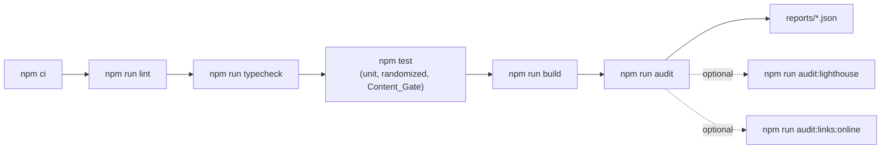
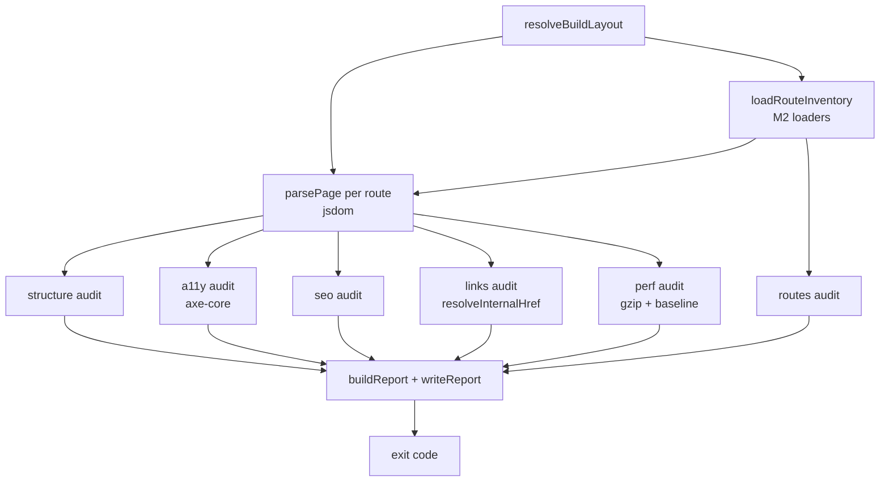

# Design Document

> **Spec:** M9 Quality, Accessibility & Performance  
> **Document Status:** Draft  
> **Feature Name:** m9-quality-accessibility-performance  
> **Last Updated:** 2026-10-20  
> **Lead Architect:** Angelo Andres  
> **Requirements Reference:** `requirements.md`  
> **Master Specifications:** `AGENTS.md` (Sections 4.2, 5, 6.1, 6.2, 7.2, 7.3), `PRD.md` (Success Metrics, Detailed Success Metrics, Dependencies), `TRD.md` (Sections 6.1, 6.4, 6.5, 8, 9), `design.md` (Sections 5.2, 6), `implementation_plan.md` (Phase 5, Tasks 5.1 and 5.2), `APP_FLOW.md` (route inventory)  
> **Upstream Specs:** M1 (toolchain, Vitest, jsdom), M2 (loaders, schemas), M4 (shell, metadata, `not-found`), M5 (homepage), M6 (project detail), M8 (blog detail)

---

## Overview

### Purpose

Milestone 9 (M9) is a verification layer, not a product module. It adds a set of offline command-line audits that read the statically built site (Build_Output) and the validated content, report findings as JSON, and exit non-zero when a Quality_Gate fails. It also adds three pure JSON-LD builders with a small server component (deferred from M4, M6, M7, M8), vitest suites for the audit logic and the content gates, a committed performance baseline, and five documents under `docs/quality/`.

The design keeps a hard split between **pure decision functions** (given parsed data, return findings; no file system, no network) and **thin I/O shells** (walk the build directory, parse HTML, write reports). Every Correctness Property in this document targets a pure function, so the properties run fast and need no build.

### Scope

**In Scope:**
- `scripts/audit/*.ts` (CLI entry points) and `scripts/audit/lib/*` (shared code, pure checkers, audit runners)
- `tests/audit/*` (vitest suites) and `tests/audit/fixtures/*` (static HTML fixtures)
- `src/lib/structured-data/*` (JSON-LD builders and serializer)
- `src/components/structured-data/json-ld.tsx` (server component) and its three one-line integrations
- `baselines/performance.json`, `reports/` (git-ignored)
- `docs/quality/verification-pipeline.md`, `manual-accessibility-checklist.md`, `manual-lighthouse-procedure.md`, `traceability-matrix.md`
- Approval requests for devDependencies, npm scripts, `.gitignore`, and the JSON-LD integration lines

**Out of Scope (Requirement 18):** Vercel project setup, `vercel.json`, security headers, monitoring, release tagging (M10); search, resume download, AI assistant, and any other P1 scaffolding; dark mode; analytics; API routes, route handlers, server actions; runtime dependencies; changes to `next.config.ts`, `tsconfig.json`, or CI; any change to M1 to M8 behavior other than the approved JSON-LD lines.

### Design Principles

1. **Read the artifact, not the source.** Audits read Build_Output and loader output only. They never import `src/components/` (Req 1.1).
2. **Pure core, thin shell.** Each rule is a pure function over plain data. File and HTML access sit in a small number of shell functions (Req 1.5, 1.6).
3. **Offline and deterministic.** No audit except `audit:links:online` touches the network. Findings are sorted by a total order, so two runs over the same input give identical reports apart from `generatedAt` (Req 1.4, 1.5).
4. **Report everything, then decide.** An audit collects all findings before it sets its exit code. `npm run audit` runs every audit to completion (Req 16.3).
5. **No quiet exemptions.** A rule can be skipped only through a named, reported mechanism (an approval switch or a documented jsdom limitation). A failing page is never made to pass by disabling a rule (Req 6.7).
6. **Approval-gated changes degrade gracefully.** All Approval_Items were Approved 2026-10-22; the fallbacks remain only as short historical notes (Req 10.7, 12.9).
7. **Strict TypeScript.** No `any`, no non-null assertions, no unjustified assertions. Parsed data crosses module boundaries as typed values.

### Research Findings and Decisions

| Topic | Finding | Decision |
|-------|---------|----------|
| Build_Output location | `TRD.md` Section 3 allows static export but does not require it ("Vercel can host the standard Next.js build without requiring `next export`"). M9 may not edit `next.config.ts` (Req 16.9). | Approved 2026-10-22 (decision 5b): M1's `next.config.ts` is a static export (`output: 'export'`, `out/`), so M9 assumes Build_Output = `out/`. The detection rule (Decision 1) stays as a safety net and fails with a clear message if no build exists. |
| Running TypeScript audit CLIs | Vitest depends on `vite-node`, which runs TypeScript and resolves the `@/` alias from a Vite config. | Run CLIs with `vite-node --config vitest.config.ts scripts/audit/<name>.ts`. No `tsx` and no runtime dependency (Decision 3). |
| HTML parsing | `jsdom` is already a devDependency (Vitest environment, M1) and is a full spec-compliant parser (parse5). axe-core needs a DOM window. | Use `jsdom` for both structural parsing and axe. One parser, no new parsing dependency (Decision 4). |
| axe in jsdom | jsdom has no layout engine, so layout-dependent rules (notably `color-contrast`) cannot give valid results. M4 and M3 made the same finding. | `color-contrast` is disabled in the automated audit, recorded in the report, and covered by the Manual_Checklist (Req 6.5, 7.2). |
| Bare-word tracking markers | Requirement 5.5 lists `segment` and `plausible` among markers. Next.js router code uses the word "segment" throughout, and blog text may mention any of these words. A bare substring scan would produce permanent false positives. | Match markers as hosts, URL paths, and call expressions in attributes, inline non-payload scripts, and JS/CSS files (Decision 7). |
| Not-found robots meta | Next.js App Router emits `noindex` for the not-found page. Requirement 8.6 says no P0_Route has `noindex`, and the Glossary counts the not-found page as a P0_Route. | The SEO_Audit applies the indexability rules (canonical, Open Graph, `noindex`) to every route **except** not-found, where it requires `title`, `viewport`, and expects `noindex`. This reads Req 8.3 to 8.6 as applying to indexable routes. Approved 2026-10-22 (decision 7b, Decision 8). |
| Vercel Hobby static limits | Vercel documents per-plan platform limits at [vercel.com/docs/limits](https://vercel.com/docs/limits) and Hobby usage rules at [vercel.com/docs/plans/hobby](https://vercel.com/docs/plans/hobby). The fetched pages did not expose the deployment size and file-count rows in a form I could read at design time. | **Not verified from the live page.** The total budget is set far below any limit I know of (25 MB), and a re-check of the two pages is a recorded task before the budget is frozen (Decision 5). |
| Lighthouse in CI-less setup | Lighthouse runs from Node (`lighthouse` package, `chrome-launcher`) against a local URL and needs a Chrome binary. | Serve Build_Output with a built-in `node:http` server on an ephemeral port. Gzip responses on the fly to approximate CDN compression. Pin both packages at approval time (Decision 6). |

### Resolved Numbers (deferred from requirements)

| Item | Value | Source or rationale |
|------|-------|---------------------|
| Build_Output directory | `out/` | Assumes `output: 'export'`; detection rule in Decision 1 |
| Per-chunk JS budget | **80 KB gzip** (81,920 bytes) per referenced JS file | Engineering judgment. `TRD.md` 6.1 says "minimize" and sets no number. The React DOM framework chunk is the largest expected file; 80 KB leaves room above it and fails if an app chunk bundles a large client library. Revisit after the first real build. |
| Per-route JS ceiling | **200 KB gzip** total JS per route, plus the 5% baseline rule | Engineering judgment from `TRD.md` 6.1 (initial JS "minimize", mobile LCP below 2.5 s). The baseline catches regressions; the ceiling stops the baseline from ratcheting upward unnoticed. |
| Per-route CSS ceiling | **40 KB gzip** total CSS per route | Same rationale as above |
| Per-image budget | **300 KB** raw bytes per image file in Build_Output | `AGENTS.md` 6.4 and `TRD.md` 6.1 require optimized, purposeful images but give no number. 300 KB suits a badge or screenshot at web size. |
| Total deploy budget | **25 MB** raw bytes for all files in Build_Output | Safety margin well under Hobby limits as I recall them; limits not re-verified (see Research table). Approved 2026-10-22 (decision 8b): keep 25 MB as a conservative, unverified budget with the dated re-check task. The portfolio-scale target in `TRD.md` 6.2 (25 projects, 50 certifications, 100 posts) fits easily. |
| Regression tolerance | **5%** over baseline, separately for JS and CSS per route | Req 11.3 |
| Lighthouse Accessibility | **>= 95** | `PRD.md` Detailed Success Metrics |
| Lighthouse Performance, Best Practices, SEO | **>= 90** each | Engineering judgment. `TRD.md` sets metric targets, not category scores. 90 is the Lighthouse "good" band. |
| Lighthouse metrics | LCP < 2500 ms, CLS < 0.1, FCP < 1800 ms, TBT < 200 ms | `TRD.md` 6.1 (INP < 200 ms is field data; TBT is the lab proxy) |
| Lighthouse runs | **5** runs per route, median per score and metric | Odd count gives a true median; five keeps total time reasonable |
| Link HEAD timeout | **10 000 ms** per request, 4 requests in flight, one request per host at a time | Keeps the run polite and bounded |
| Minimum content | Projects **>= 3** (all P0 with repository links), certifications **>= 1**, blog posts **>= 1** published | `PRD.md` Dependencies table: "launch with a minimum of 3 complete P0 projects". `PRD.md` Use Case 1 requires at least one published project. Minimums for certifications and blog are the smallest values that make their routes meaningful; the PRD sets no number. |
| Title length | 10 to 70 characters, measured on the final `<title>` text | Req 8.1 |
| Description length | 50 to 160 characters | Req 8.2 |
| Build duration flag | 180 seconds | `TRD.md` 6.1 (build time below 3 minutes) |

### Resolved Assumptions

**Decision 1: Build_Output detection.** `resolveBuildLayout()` picks the first match:
1. `AUDIT_BUILD_DIR` environment variable, if set (used by tests with fixture trees).
2. `out/` if it contains `index.html` (layout kind `export`).
3. `.next/server/app/` if it contains `index.html` and `.next/static/` exists (layout kind `next-prerender`). URL `/_next/static/*` maps to `.next/static/*`, and URLs under `/images`, `/files` map to `public/`.
4. Otherwise the audit exits with code 2 and the message "Build output not found. Run `npm run build` first." (Req 1.3).

The layout is a value `{ kind, roots }` where `roots` maps URL prefixes to directories. All later code asks the layout for files and never builds paths itself.

**Decision 2: Route to file mapping.** One pure function `routeFileCandidates(path)` returns candidates in order: `/` gives `index.html`; any other path `p` gives `p.html` then `p/index.html`; the not-found route (`/404`) gives `404.html` then `404/index.html`. The inverse `htmlFileToRoute(file)` strips `index.html` and `.html`. This accepts both `trailingSlash: false` and `trailingSlash: true` exports. The detected style (`flat` or `directory`) is stored on the layout and used to compute the expected canonical form.

**Decision 3: Running TypeScript without a new runtime dependency.** Scripts use `vite-node` from the existing Vitest installation:

```json
"audit:routes": "vite-node --config vitest.config.ts scripts/audit/routes.ts"
```

Arguments pass after `--` (for example `npm run audit:perf -- --update-baseline`). Approval item A1 (Approved 2026-10-22): confirm the `vite-node` bin is present after install. If npm does not hoist it, A1 becomes "add `vite-node` as a direct devDependency pinned to the version Vitest resolves". The `--config` flag gives the `@/` alias for the M2 loaders. Risk: if an M2 loader imports `server-only` or a Next.js-only module, `vite-node` fails; the fallback is a stub alias in a dedicated `scripts/audit/vite.config.ts` (new file, no root config edit).

**Decision 4: HTML parser and axe.** `jsdom` (existing devDependency) parses all pages. `axe-core` is a new devDependency (approval item A2, Approved 2026-10-22; pinned at implementation time). Pages are loaded with `new JSDOM(html, { url, runScripts: 'outside-only', pretendToBeVisual: true })`, so page scripts never run, and axe source is evaluated inside the window.

**Decision 5: Budgets are config constants.** `scripts/audit/lib/config.ts` holds every number above in one typed object. Tests import the same object, so a budget change is one edit and one review.

**Decision 6: Lighthouse toolchain.** Approval item A3 (Approved 2026-10-22) covers `lighthouse` and `chrome-launcher`, each with an exact pinned version chosen when the request is raised (run `npm view` at that time for the version, Node engine range, and last publish date, per `AGENTS.md` 6.2 and Req 12.8). A local Chrome or Chromium install is a prerequisite and is documented. The static server uses `node:http` and `node:zlib`, so there is no server dependency.

**Decision 7: Tracking and secret marker matching.** The scan covers: (a) attribute values on every element in P0 HTML (`src`, `href`, `action`, `content`, `data-*`); (b) inline `script` bodies, except `application/ld+json` blocks and Next.js flight payload scripts (bodies containing `__next_f`), because those carry page prose; (c) every `.js` and `.css` file. It does not scan text nodes or `.txt` payload files. Markers are two lists in config:
- *Host and path markers:* `googletagmanager.com`, `google-analytics.com`, `analytics.google.com`, `static.hotjar.com`, `hotjar.com`, `segment.com`, `segment.io`, `plausible.io`, `/_vercel/insights`, `/_vercel/speed-insights`, `connect.facebook.net`.
- *Call and identifier markers:* `gtag(`, `fbq(`, `window.dataLayer`, `_hjSettings`.

The bare words in Req 5.5 are therefore matched in their host forms. This interpretation is stated in the verification-pipeline document.

Secret scan (Req 5.7) runs over all text files in Build_Output and flags `.env*` file names plus these patterns: `-----BEGIN (RSA |EC |OPENSSH )?PRIVATE KEY-----`, `ghp_[A-Za-z0-9]{36}`, `github_pat_[A-Za-z0-9_]{22,}`, `AKIA[0-9A-Z]{16}`, `xox[baprs]-[A-Za-z0-9-]{10,}`, `sk_live_[A-Za-z0-9]{16,}`, `AIza[0-9A-Za-z_-]{35}`. The structural HTML rules do not use regular expressions; these text scans are not structural checks.

**Decision 8: Not-found page handling.** For the `/404` entry the SEO_Audit requires a non-empty title, a viewport meta, and a robots meta containing `noindex`. It skips canonical, Open Graph, uniqueness of description, and the `noindex` prohibition. Structural and axe audits cover it fully. The Lighthouse SEO category is reported for it but not gated, because a 404 status and `noindex` lower that score by design. Approved 2026-10-22 (decision 7b): requirements.md Req 8 and 5.5 are aligned with this design.

**Decision 9: Approval switches.** `scripts/audit/lib/config.ts` exports `APPROVALS = { jsonLdIntegration: true, lighthouseDependencies: true }`. Both are Approved 2026-10-22 (approvals A5, A3) and default to `true`. Historical note: when `jsonLdIntegration` is false, JSON-LD assertions are reported as `skipped: not approved` (Req 10.7). The Lighthouse runner does not read a flag. It checks that `lighthouse` and `chrome-launcher` can be imported and otherwise exits 2 with a pointer to the manual procedure (see Error Handling). The `lighthouseDependencies` flag only records approval status for the documentation.

**Decision 10: Exit codes.** `0` all gates pass (warnings and info allowed, skipped allowed). `1` at least one `error` finding. `2` environment or usage error (no build output, missing optional dependency, bad arguments). The aggregate `audit` exits `1` if any audit returned `1` and `2` if none returned `1` but any returned `2`.

---

## Architecture

### Directory Layout

```text
scripts/
  audit/
    routes.ts                  # CLI: audit:routes
    structure.ts               # CLI: audit:structure
    a11y.ts                    # CLI: audit:a11y
    seo.ts                     # CLI: audit:seo
    perf.ts                    # CLI: audit:perf
    links.ts                   # CLI: audit:links
    links-online.ts            # CLI: audit:links:online
    lighthouse.ts              # CLI: audit:lighthouse
    run-all.ts                 # CLI: audit
    lib/
      types.ts                 # AuditReport, Finding, Severity, Status, RouteEntry
      config.ts                # budgets, thresholds, markers, APPROVALS
      cli.ts                   # runCli(): args, exit codes, console summary
      report.ts                # buildReport, sortFindings, stableStringify, validateReport, writeReport
      build-layout.ts          # resolveBuildLayout, listFiles, readText, readBytes
      route-inventory.ts       # buildRouteInventory (pure), loadRouteInventory (I/O)
      route-files.ts           # routeFileCandidates, htmlFileToRoute
      html.ts                  # parsePage (jsdom), selectorFor, collectIds
      link-resolve.ts          # resolveInternalHref (pure)
      checks/
        headings.ts            # findHeadingOrderViolations
        accessible-name.ts     # computeAccessibleName
        uniqueness.ts          # findDuplicates
        metadata-ranges.ts     # checkLengthRange, expectedCanonical
        hygiene.ts             # checkExternalRel, scanMarkers
        budget.ts              # compareToBaseline, checkBudgets
        baseline.ts            # buildBaseline, serializeBaseline, diffBaselines
        external-links.ts      # buildExternalInventory, renderInventoryMarkdown
      routes-audit.ts          # runRoutesAudit
      structure-audit.ts       # runStructureAudit
      a11y-audit.ts            # runA11yAudit
      seo-audit.ts             # runSeoAudit
      perf-audit.ts            # runPerfAudit
      links-audit.ts           # runLinksAudit
      lighthouse-audit.ts      # runLighthouseAudit
      static-server.ts         # node:http server over Build_Output
tests/
  audit/
    *.test.ts                  # vitest suites for lib/* logic
    content/*.test.ts          # Content_Gate suites (Req 13, 14)
    fixtures/                  # static HTML trees used by audit tests
baselines/
  performance.json             # committed
reports/                       # git-ignored, written by audits
docs/quality/
  verification-pipeline.md
  manual-accessibility-checklist.md
  manual-lighthouse-procedure.md
  traceability-matrix.md
src/
  lib/structured-data/
    types.ts
    person.ts                  # buildPersonJsonLd
    article.ts                 # buildArticleJsonLd
    breadcrumb.ts              # buildBreadcrumbJsonLd
    serialize.ts               # serializeJsonLd
  components/structured-data/
    json-ld.tsx                # server component
```

There are no `index.ts` barrel files. Every import names its module (`AGENTS.md` 7.2). Component files stay under 300 lines.

### Verification Pipeline



### Audit Data Flow



### Execution Model

- Each CLI file is a few lines: import a `run*Audit` function, call `runCli(run)`. `runCli` parses arguments, resolves the layout, runs the audit, writes the report, prints one summary line, and sets `process.exitCode`.
- `run-all.ts` imports the same `run*Audit` functions and runs them in order inside one process, catching each failure so all audits complete (Req 16.3). It prints one line per audit: `routes  PASS  0 findings`.
- Page parsing is shared: the aggregate command parses each route once into a `ParsedPage` and passes it to every audit that needs it. Standalone CLIs parse on demand.
- All audits are `async` because they read files; none perform network I/O except `links-online.ts`.

### Approval Items (AGENTS.md 6.2)

| ID | Change | Purpose | Fallback if not granted |
|----|--------|---------|-------------------------|
| ID | Change | Purpose | Status (historical fallback) |
|----|--------|---------|------------------------------|
| A1 | `package.json` scripts `audit:*` and `audit`; confirm `vite-node` bin (or add it as a pinned devDependency) | Run TypeScript audits | Approved 2026-10-22 (approval A1). Historical fallback: `npx vite-node ...`. |
| A2 | devDependency `axe-core` (exact pin; `jsdom` already present) | A11y_Audit | Approved 2026-10-22 (approval A2). Historical fallback: `audit:a11y` exited 2 and was `skipped`. |
| A3 | devDependencies `lighthouse` and `chrome-launcher` (exact pins) | Lighthouse_Audit | Approved 2026-10-22 (approval A3). Manual procedure `docs/quality/manual-lighthouse-procedure.md` (Req 12.9) is kept as a supplement. |
| A4 | `.gitignore` adds `reports/` | Keep reports out of git | Approved 2026-10-22 (approval A4). |
| A5 | One import and one render line in each of `src/app/page.tsx`, `src/app/blog/[slug]/page.tsx`, `src/app/projects/[slug]/page.tsx` (Person on `/`, Article on blog detail, BreadcrumbList on project and blog detail) | JSON-LD in built pages | Approved 2026-10-22 (approval A5), limited to import and render lines. Historical fallback: `skipped: not approved` (Req 10.7). |
| A6 | `package.json` lockfile update from A1 to A3 | Reproducible installs | Approved 2026-10-22 (approval A6). |

Also approved 2026-10-22 (approval A2/A3 scope): devDependencies `axe-core`, `lighthouse`, `chrome-launcher`, plus `fast-check`, the axe test helper, and `user-event` from other specs. Exact versions are pinned at implementation time after documenting purpose and maintenance status (Req 12.8, 16.8). The version bump is not an M9 matter.

---

## Components and Interfaces

### Shared Types (`scripts/audit/lib/types.ts`)

```typescript
export type Severity = 'error' | 'warning' | 'info';
export type Status = 'pass' | 'fail' | 'skipped';

export interface Finding {
  readonly route: string;      // '/' | '/projects/x' | '/404' | '*' for site-wide | file path for non-route findings
  readonly rule: string;       // kebab-case rule id, e.g. 'heading-skip'
  readonly message: string;
  readonly severity: Severity;
  readonly selector?: string;
  readonly file?: string;
  readonly details?: Readonly<Record<string, string | number | boolean | null>>;
}

export interface AuditSummary {
  readonly routesChecked: number;
  readonly errors: number;
  readonly warnings: number;
  readonly infos: number;
  readonly skipped: readonly string[];   // e.g. 'jsonld: not approved'
}

export interface AuditReport<TData = null> {
  readonly audit: string;                // 'routes' | 'structure' | ...
  readonly generatedAt: string;          // ISO 8601, the only non-deterministic field
  readonly status: Status;
  readonly summary: AuditSummary;
  readonly findings: readonly Finding[];
  readonly data: TData;                  // audit-specific payload, null when unused
}

export type RouteKind =
  | 'home' | 'projects-index' | 'project-detail'
  | 'certifications' | 'blog-index' | 'blog-detail' | 'not-found';

export interface RouteEntry {
  readonly path: string;                 // '/', '/projects', '/projects/{slug}', '/404'
  readonly kind: RouteKind;
  readonly slug: string | null;
}
```

Status rule: `fail` if `summary.errors > 0`; `skipped` if the audit did not run its checks (missing optional dependency or full approval skip); otherwise `pass`. Warnings and infos never fail an audit.

### Report Helpers (`report.ts`)

- `compareFindings(a, b)`: total order by `route`, `rule`, `selector ?? ''`, `file ?? ''`, `message`, using `<` string comparison (code-unit order, locale independent).
- `sortFindings(list)`: returns a new array sorted with `compareFindings`.
- `buildReport({ audit, findings, routesChecked, skipped, data, now })`: sorts findings, counts severities, computes `status`, stamps `generatedAt` from the injected `now` string.
- `stableStringify(value)`: JSON with object keys sorted recursively and two-space indentation, plus a trailing newline. Arrays keep their order.
- `validateReport(value)`: returns `{ ok: true } | { ok: false, errors: string[] }` by checking the required fields, enum values, count consistency (`errors` equals the number of `error` findings, and so on), and that each finding has non-empty `route`, `rule`, `message` (Req 16.6).
- `writeReport(report, dir)`: creates `reports/` if absent and writes `reports/<audit>.json`.

### Build Layout (`build-layout.ts`)

```typescript
export interface BuildLayout {
  readonly kind: 'export' | 'next-prerender';
  readonly style: 'flat' | 'directory';          // from Decision 2
  readonly roots: ReadonlyArray<{ urlPrefix: string; dir: string }>;
}
export function resolveBuildLayout(env: NodeJS.ProcessEnv, cwd: string): Promise<BuildLayout | null>;
export function listFiles(layout: BuildLayout): Promise<readonly string[]>;   // URL-style paths, sorted
export function readBytes(layout: BuildLayout, urlPath: string): Promise<Uint8Array | null>;
```

`listFiles` returns sorted URL-style paths so every audit iterates in the same order (determinism). `style` is `directory` when at least one non-root route resolves only through `p/index.html`.

### Route Inventory (`route-inventory.ts`)

```typescript
export interface InventorySource {
  readonly projects: readonly { readonly slug: string }[];
  readonly posts: readonly { readonly slug: string; readonly draft: boolean }[];
}
export function buildRouteInventory(source: InventorySource): readonly RouteEntry[];
export function loadRouteInventory(): Promise<{ routes: readonly RouteEntry[]; draftSlugs: readonly string[] }>;
```

`buildRouteInventory` is pure. It returns: `/`, `/projects`, `/certifications`, `/blog`, one `/projects/{slug}` per project, one `/blog/{slug}` per post with `draft === false`, and `/404`. The result is sorted by `path` with code-unit order and contains no duplicates. `loadRouteInventory` calls `getProjects()` and `getBlogPosts()` from the M2 loaders and also reads draft slugs through the loader's validated frontmatter. Because `getBlogPosts()` already excludes drafts, the draft slug list comes from a second read that keeps drafts (the M2 file reader, read-only). If M2 exposes no such reader, `loadRouteInventory` lists `content/blog/*.mdx` file names, parses the frontmatter `draft` field with the M2 schema, and uses that. This is the only place where an audit touches raw content files.

### Routes Audit (`routes-audit.ts`) — Req 2

Algorithm:
1. Build the inventory and list all build files.
2. For each inventory route, find the first existing candidate from `routeFileCandidates`. If none exists, emit `route-missing` (error) with the route path.
3. For each draft slug `s`, if any candidate for `/blog/s` exists, emit `draft-published` (error).
4. Require `404.html` (or `404/index.html`); otherwise `not-found-missing`.
5. For each HTML file in the listing, skipping files whose first path segment starts with `_` (`_next`, `_not-found`) and `404.html`, compute `htmlFileToRoute`. If the route is not in the inventory, emit `route-unexpected` (error).
6. Emit `api-output` (error) if the listing contains any file under `/api/`, or if the source tree contains a `route.ts` or `route.js` under `src/app/` (file-name check only; no file is imported).
Content minimums are not checked here; they belong to the Content_Gate tests.

### Page Parsing (`html.ts`)

```typescript
export interface ParsedPage {
  readonly route: RouteEntry;
  readonly file: string;
  readonly html: string;
  readonly document: Document;     // jsdom
}
export function parsePage(route: RouteEntry, file: string, html: string): ParsedPage;
export function selectorFor(el: Element): string;
export function collectIds(document: Document): ReadonlySet<string>;
```

`selectorFor(el)` returns a stable path such as `html > body > main > section:nth-of-type(2) > a:nth-of-type(1)`, using the `#id` shortcut when the element has an id that is unique in the page. It depends only on document structure, so it is deterministic.

### Accessible Name (`checks/accessible-name.ts`)

`computeAccessibleName(el)` is a cheap pre-check, not a replacement for axe. In order it returns the first non-empty trimmed value of: `aria-label`; the text of elements referenced by `aria-labelledby`; the text content of the element with `aria-hidden="true"` descendants excluded; the `alt` of a descendant `img`; the text of a descendant `svg > title`; and the `title` attribute. Visually hidden text counts because it is in the DOM. An element with no result gets the empty string.

### Structure Audit (`structure-audit.ts`) — Req 3, 5, 10.6

Per page, in this order. Each rule has one id.

| Rule id | Check | Req |
|---------|-------|-----|
| `html-lang` | `html[lang]` non-empty | 3.2 |
| `h1-count` | exactly one `h1` | 3.2 |
| `main-count` | exactly one `main` | 3.2 |
| `landmark-missing` | `header`, `nav`, `main`, `footer` each present | 3.3 |
| `heading-skip` | `findHeadingOrderViolations(levels)` empty | 3.4 |
| `skip-link-first` | first focusable element in document order is an `a[href^="#"]` whose target id exists | 3.5 |
| `link-name` / `button-name` | `computeAccessibleName` non-empty for each `a[href]` and `button` | 3.6 |
| `img-alt` | `alt` attribute present; empty `alt` only with `role="presentation"` or `aria-hidden="true"` | 3.7 |
| `id-duplicate` | `findDuplicates(ids)` empty | 3.8 |
| `external-rel` | every `a[target="_blank"]` with an external href has `rel` tokens `noopener` and `noreferrer` | 5.1 |
| `external-http` | every external `a[href]` uses `https:` | 5.2 |
| `script-origin` | each `script[src]` starts with `/_next/`; each inline `script` is a JSON-LD block or a Next.js payload or bootstrap script (body starts with `self.__next` or `(self.__next`, or `type` is `application/json` for Next data) | 5.3 |
| `forbidden-element` | no `form`, `input`, `textarea`, `iframe`; no `script[src]` or resource `link` (rel in `stylesheet`, `preload`, `modulepreload`, `prefetch`, `preconnect`, `dns-prefetch`, `icon`) with an absolute URL on another origin | 5.4 |
| `tracking-marker` | `scanMarkers` over attributes and inline scripts (Decision 7) | 5.5 |
| `cookie-reference` | no `document.cookie` or `http-equiv="set-cookie"` in HTML or JS files | 5.6 |
| `secret-marker` | secret patterns and `.env*` names over the whole build | 5.7 |
| `jsonld-invalid` / `jsonld-type` | each JSON-LD block parses, has `@context` equal to `https://schema.org`, and its type set equals the route's expected types | 10.6 |

Expected JSON-LD types by route kind: `home` gives `Person`; `blog-detail` gives `Article` and `BreadcrumbList`; `project-detail` gives `BreadcrumbList`; other kinds give none (a block present on another route is reported as `jsonld-unexpected`). Approved 2026-10-22 (approval A5): the rules run by default. Historical fallback: when `APPROVALS.jsonLdIntegration` is false, the two JSON-LD rules are not run and `summary.skipped` contains `jsonld: not approved`.

Every finding carries the route, rule id, and `selectorFor(el)` for element rules (Req 3.9), or the file path and the matched marker for file rules (Req 5.8).

`findHeadingOrderViolations(levels: readonly number[]): readonly number[]` returns the indexes `i >= 1` where `levels[i] > levels[i - 1] + 1`. The first heading has no predecessor and is never a violation; `h1-count` covers a missing top heading.

`findDuplicates<T>(items: readonly T[]): readonly T[]` returns each value that occurs more than once, once per value, in first-seen order.

### Link Crawler (`link-resolve.ts`, `links-audit.ts`) — Req 4

```typescript
export type HrefResolution =
  | { readonly kind: 'ignore' }                                  // mailto:, tel:, external, javascript: not allowed
  | { readonly kind: 'placeholder' }                             // '' or '#'
  | { readonly kind: 'external'; readonly url: string }
  | { readonly kind: 'internal'; readonly path: string; readonly fragment: string | null }
  | { readonly kind: 'malformed'; readonly reason: string };

export function resolveInternalHref(
  href: string, sourcePath: string, siteOrigin: string | null,
): HrefResolution;
```

Rules, applied in order:
1. Trim the href. Empty or `#` gives `placeholder` (Req 4.4).
2. A scheme of `mailto:` or `tel:` gives `ignore`. Any other non-http scheme (for example `javascript:`) gives `malformed`.
3. Resolve with `new URL(href, 'http://audit.local' + sourcePath)`. A scheme-relative or absolute `http(s)` URL whose origin differs from both `audit.local` and `siteOrigin` gives `external`. Same origin as `siteOrigin` counts as internal (Req 4.1).
4. For internal results, drop the query string (`?tag=x` on `/blog` resolves to `/blog`, Req 4.5), percent-decode the pathname (a decode error gives `malformed`), and remove a trailing slash unless the path is `/`.
5. The fragment is percent-decoded; an empty fragment becomes `null`.

`links-audit.ts` then resolves the target:
- If the last path segment contains a dot, the target is the file at that exact URL path, and the file must exist in the listing.
- Otherwise the target is the first existing entry of `routeFileCandidates(path)`. A path that matches both `p.html` and `p/index.html` is fine.
- If the target is an HTML file and a fragment is present, the fragment must be in `collectIds(targetDocument)` or in `a[name]`; the values `top` and the empty string are always valid (HTML living standard).
- A link to the page itself with only a fragment (`#main`) resolves the target to the source page.

Findings: `link-broken` (reason: `no such file`, `fragment not found`, `malformed`), `link-placeholder`. Each finding has the source route and the href (Req 4.6). External URLs are never requested (Req 4.7).

### SEO Audit (`seo-audit.ts`) — Req 8

Per indexable route (all except `/404`, Decision 8):

1. `title`: non-empty, `checkLengthRange(len, 10, 70)`; duplicates across routes via `findDuplicates`.
2. `meta[name=description]`: non-empty, 50 to 160, unique across routes.
3. `link[rel=canonical]` equals `expectedCanonical(siteUrl, path, style)`.
4. `og:title`, `og:description`, `og:url`, `og:type`, `og:site_name` present and non-empty; `og:url` equals the canonical.
5. For `blog-detail`: `og:type` is `article`; `article:published_time` equals the post's `publishedAt`; `article:modified_time` is present if and only if `updatedAt` is non-null (and then equals it).
6. `meta[name=viewport]` present; no `meta[name=robots]` containing `noindex`.
7. Out-of-range values are reported with the measured length in `details.length` (Req 8.7).
8. If the `siteUrl` host is `example.com` or `example.vercel.app` (or a subdomain of `example.com`), emit `site-url-placeholder` as a `warning` with `details.releaseBlocker = true`. It does not fail the audit but is copied into the verification document's M10 checklist (Req 8.8).

`expectedCanonical(siteUrl, path, style)`: strip trailing slashes from `siteUrl`; for `/` return `base + '/'`; for any other path return `base + path` with a trailing `/` added only when `style === 'directory'`.

`checkLengthRange(length, min, max)` returns `'ok' | 'too-short' | 'too-long'`. Length counts UTF-16 code units of the trimmed string.

### A11y Audit (`a11y-audit.ts`) — Req 6

For each route in the inventory (including `/404`):
1. Load the page into a `JSDOM` with `runScripts: 'outside-only'`.
2. Evaluate `axe.source` in the window.
3. Run `axe.run(document, { runOnly: { type: 'tag', values: ['wcag2a','wcag2aa','wcag21a','wcag21aa'] }, rules: { 'color-contrast': { enabled: false } } })`.
4. Map each violation to a `Finding` (`rule` is the axe rule id, `severity` is `error`, `selector` is the first target of each node, `details.impact` and `details.helpUrl` set).
5. Map each `incomplete` result to a `warning` finding with `rule: 'axe-incomplete:<id>'`. They are never counted as passes (Req 6.4).
6. `data` holds `{ axeVersion, tags, disabledRules: ['color-contrast'], routes: [{ route, violations, incomplete }] }`.

`DISABLED_AXE_RULES` is a constant of rule ids with a written reason per entry (`color-contrast`: jsdom has no layout; manual check in the Manual_Checklist). Adding an entry requires a design change and is visible in every report (Req 6.5, 6.7). Any axe exception thrown for a route becomes an `error` finding `axe-run-failed`, not a silent skip.

### Performance Audit (`perf-audit.ts`, `checks/budget.ts`, `checks/baseline.ts`) — Req 11

Algorithm per run:
1. For each inventory route, parse the page and collect referenced assets: `script[src]`, `link[rel=stylesheet][href]`, `link[rel=modulepreload|preload][as=script][href]`. Resolve each URL path to a build file. A reference that does not resolve is an `asset-missing` error.
2. Deduplicate assets per route. `jsGzip(route)` and `cssGzip(route)` are the sums of `gzipSync(bytes, { level: 9 }).length`. Level 9 and the Node zlib version make the numbers stable for the same input.
3. Chunk budget: every referenced JS file with gzip size above 81,920 bytes gives `chunk-over-budget`.
4. Route ceilings: `jsGzip` above 204,800 or `cssGzip` above 40,960 bytes gives `route-over-ceiling`.
5. Baseline: compare with `baselines/performance.json` using `compareToBaseline` (below).
6. Images: for every file with an image extension (`.png .jpg .jpeg .webp .avif .gif .svg .ico`), a raw size above 307,200 bytes gives `image-over-budget`.
7. Image sizing: for every `img` in P0 HTML, require positive integer `width` and `height` attributes, or an inline `style` containing both `width` and `height`, or `aspect-ratio`; otherwise `img-unsized` (Req 11.8).
8. Fonts: any file with extension `.woff`, `.ttf`, `.otf`, or `.eot` gives `font-not-woff2`. For each referenced CSS file, scan `@font-face` blocks by brace counting; a block without `font-display: swap` or `optional` gives `font-display` (Req 11.9). Pairing a regex with a brace counter is acceptable here because this is CSS text, not HTML structure.
9. Total size: the sum of raw sizes of all files; above 26,214,400 bytes gives `total-over-budget` (Req 11.6). The total is also written into `data.totalBytes`.
10. Build duration: if `--build-seconds <n>` or `AUDIT_BUILD_SECONDS` is supplied, record it; above 180 gives a `build-slow` warning (Req 11.11).

```typescript
export interface RegressionResult {
  readonly exceeded: boolean;
  readonly pct: number | null;   // null when baseline is 0
}
export function compareToBaseline(current: number, baseline: number, tolerancePct: number): RegressionResult;
```

`compareToBaseline` computes `pct = (current - baseline) / baseline * 100` when `baseline > 0`, and `exceeded = pct > tolerancePct`. When `baseline === 0`, `pct` is `null` and `exceeded` is `current > 0`. Equal-to-tolerance (exactly 5%) passes.

**Baseline flow:**
- No baseline file: write one from the current numbers and add an `info` finding `baseline-created`. The audit passes unless a budget rule failed.
- Baseline present: compare per route and per kind. A route missing from the baseline gives `baseline-missing-route` (warning). A baseline route with no current build gives `baseline-stale-route` (warning).
- `--update-baseline`: refuses (exit 1, baseline untouched) if any budget or ceiling rule has an error; otherwise rewrites the file and prints `diffBaselines(old, new)` as `route  js: 41230 -> 41580 (+0.8%)` lines. This keeps the baseline from absorbing a budget violation.
- `serializeBaseline` uses `stableStringify` and omits timestamps, so rewriting an unchanged build produces a byte-identical file.

### External Link Inventory (`checks/external-links.ts`, `links-audit.ts`) — Req 15

`buildExternalInventory(pages)` collects every `a[href]` that resolves as `external` (http and https only), and returns entries `{ url, count, routes }` where `routes` is a sorted, de-duplicated list and `count` is the number of occurrences. Entries are sorted by `url` in code-unit order. A `http:` URL gives the finding `external-insecure-url` (error, Req 15.6). `renderInventoryMarkdown(entries)` returns a Markdown table `| URL | Count | Routes |`, with `|` escaped as `\|`. `audit:links` writes `reports/links.json` (with the inventory in `data`) and `reports/external-links.md`.

`links-online.ts` takes the same inventory and, for each URL, sends `fetch(url, { method: 'HEAD', redirect: 'manual', credentials: 'omit', signal: AbortSignal.timeout(10000) })` with no headers set, no body, and no cookies, at most 4 requests in flight and 1 per host. It reports status codes in `reports/links-online.json` (a timeout or network error is a `warning` finding with the error name). It does not retry or fall back to `GET`. It is excluded from `npm test`, CI, and `npm run audit` (Req 15.5). The library `fetch` is built into Node, so there is no dependency (Req 15.8).

### Lighthouse Audit (`lighthouse-audit.ts`, `static-server.ts`) — Req 12

1. Dynamic-import `lighthouse` and `chrome-launcher`. If either import fails, print the manual-procedure pointer and exit 2.
2. Start `static-server.ts` on port 0 over the layout. It serves `/x` from `x.html` or `x/index.html`, gzip-compresses text responses, and serves `404.html` with status 404 for unknown paths. The not-found route is requested at `/__audit-not-found`, which returns `404.html` with status 404.
3. Launch headless Chrome once. For each inventory route, run Lighthouse 5 times with default mobile emulation and simulated throttling, categories `performance`, `accessibility`, `best-practices`, `seo`.
4. Take the median of each category score and each of LCP, CLS, FCP, TBT.
5. Findings: `lh-accessibility` below 95; `lh-performance`, `lh-best-practices`, `lh-seo` below 90; `lh-lcp` at or above 2500; `lh-cls` at or above 0.1; `lh-fcp` at or above 1800; `lh-tbt` at or above 200. For `/404`, SEO is reported and not gated (Decision 8).
6. `data` holds `{ lighthouseVersion, chromeVersion, runs: 5, routes: [{ route, scores, metrics }] }`. TBT is labelled as the lab proxy for INP; the report states that INP below 200 ms comes from field data when available (Req 12.5).
7. The failing audit ids of each category are listed in `details` so a local-host artifact (for example `canonical` pointing to the production host) is visible rather than hidden.

`audit:lighthouse` is not part of `npm test` or `npm run audit` (Req 12.10, 16.2).

### JSON-LD Builders (`src/lib/structured-data/`) — Req 9

No React, Next.js, or DOM imports. Types come from the M2 contracts through `import type` and are narrowed with `Pick`:

```typescript
// types.ts
export type JsonLdValue = string | number | boolean | JsonLdObject | readonly JsonLdValue[];
export interface JsonLdObject { readonly [key: string]: JsonLdValue; }

// person.ts
export type PersonSource = Pick<SiteConfig, 'siteUrl' | 'socialLinks'> & {
  readonly profile: Pick<SiteProfile, 'name' | 'professionalTitle'>;
};
export function buildPersonJsonLd(site: PersonSource): JsonLdObject;
```

`buildPersonJsonLd` returns `{ '@context': 'https://schema.org', '@type': 'Person', name, jobTitle, url, sameAs }`. `url` is the normalized `siteUrl` (trailing slash removed except as part of the origin). `sameAs` is `socialLinks.map(l => l.url)` with empty strings removed, and the key is omitted if the result is empty.

```typescript
// article.ts
export type ArticleSource = Pick<BlogPost, 'title' | 'slug' | 'summary' | 'publishedAt' | 'updatedAt' | 'tags'>;
export function buildArticleJsonLd(post: ArticleSource, site: PersonSource): JsonLdObject;
```

Returns `@type: 'Article'` with `headline` (title), `description` (summary), `datePublished`, `author` (`{ '@type': 'Person', name, url }`), `url` (`siteUrl` + `/blog/` + slug), and `keywords` (tags joined by `, `, omitted when no tags). `dateModified` is present only when `updatedAt` is non-null and non-empty.

```typescript
// breadcrumb.ts
export interface BreadcrumbItem { readonly name: string; readonly path: string }   // path starts with '/'
export function buildBreadcrumbJsonLd(items: readonly BreadcrumbItem[], site: Pick<SiteConfig, 'siteUrl'>): JsonLdObject;
```

Returns `BreadcrumbList` with `itemListElement` entries `{ '@type': 'ListItem', position: i + 1, name, item: absoluteUrl }`. Entries with an empty `name` are dropped before positions are assigned, so positions stay contiguous from 1. Returns an object with an empty list if no item remains; the component renders nothing in that case.

Common rules: a value that is `null`, `undefined`, an empty string after trim, or an empty array is omitted and never replaced by a placeholder (Req 9.5). Inputs are read, never written (Req 9.8); arrays are copied with `map` or `filter`, never `sort` or `splice` in place.

```typescript
// serialize.ts
export function serializeJsonLd(value: JsonLdObject): string;
```

`serializeJsonLd` calls `JSON.stringify(value)` and replaces every `<` with `\u003c`, U+2028 with `\u2028`, and U+2029 with `\u2029` (the escapes are written as six-character sequences, so the output is plain ASCII for those characters). `JSON.parse` of the output equals the input because these escapes are valid JSON string escapes. `>` and `&` are left alone since `<` is the only character that can open `</script` and `<!--`.

### JSON-LD Component and Integration — Req 10

```tsx
// src/components/structured-data/json-ld.tsx  (server component, no 'use client')
import { serializeJsonLd } from '@/lib/structured-data/serialize';
import type { JsonLdObject } from '@/lib/structured-data/types';

export function JsonLd({ data }: { readonly data: JsonLdObject }) {
  return (
    <script
      type="application/ld+json"
      dangerouslySetInnerHTML={{ __html: serializeJsonLd(data) }}
    />
  );
}
```

`dangerouslySetInnerHTML` is safe here because `serializeJsonLd` escapes `<`. The component has no state, no effects, and adds no client JavaScript. The approved integration (A5) is limited to an import and one render line per page:

| Page | Added render | Source of data |
|------|--------------|----------------|
| `src/app/page.tsx` | `<JsonLd data={buildPersonJsonLd(site)} />` | `getSiteConfig()` already loaded by M5 |
| `src/app/blog/[slug]/page.tsx` | `Article` and `BreadcrumbList` blocks | `post` and `site` already loaded by M8 |
| `src/app/projects/[slug]/page.tsx` | `BreadcrumbList` block | `project` and `site` already loaded by M6 |

Breadcrumb items: blog detail `Home /`, `Blog /blog`, `{title} /blog/{slug}`; project detail `Home /`, `Projects /projects`, `{title} /projects/{slug}`. If a page does not already hold `site`, the implementer escalates instead of adding a second loader call with new markup.

### Content Gates (`tests/audit/content/`) — Req 13, 14

The M2 loaders read from `path.join(process.cwd(), 'content', ...)` at module load. Each gate test therefore creates a temp directory with `fs.mkdtemp`, writes the fixture tree, calls `vi.spyOn(process, 'cwd').mockReturnValue(tmp)`, runs `vi.resetModules()`, and imports the loader dynamically. It never writes under the real `content/` (Req 13.6).

- One invalid fixture per rule: `AGENTS.md` 5.1 rules 1 to 7 and 10, 5.2, 5.3, 5.4. A table-driven suite maps `{ rule, fixture, expectedField }`. Each expects a rejected validation whose error text contains the file path, the field name, the expected format, and the received value category (Req 13.2). If a validator accepts a fixture, the test failure message names the rule (Req 13.7).
- Draft exclusion, featured count above 3, and `mailto:` on a non-email channel are cases in the same suite (Req 13.3 to 13.5).
- Real-content completeness (Req 14) runs against real `content/` and `public/`: minimum counts from Resolved Numbers, `repositoryUrl` non-empty on every project, at most 3 `featured` with `displayOrder`, no placeholder marker (`EXAMPLE`, `example.com`, `TODO`, `TBD`, `lorem`, `XXXX`) in `credentialId` or `verificationUrl`, no `example.com` or `example.vercel.app` in content files outside fenced code blocks, and every `badgeImageUrl` or local image path resolving to a file under `public/`. Findings name the file and field (Req 14.7).
- The placeholder-host check applies to the real example files shipped by `AGENTS.md` 4.3; they must be replaced before launch. The test reports each occurrence, and the human decides what is a release blocker for M10.

### Documentation Deliverables — Req 7, 17, 18

- `manual-accessibility-checklist.md`: sections for keyboard traversal, visible focus, screen readers (NVDA with Firefox or Chrome, VoiceOver with Safari), 200% zoom and 320 CSS px reflow, `prefers-reduced-motion`, and contrast (4.5:1, 3:1). A table row per P0 route pattern with pass, fail, notes; header fields for tester, date, tool versions; breakpoints 375, 768, 1024, 1440 px; a statement that automation alone does not establish WCAG conformance.
- `manual-lighthouse-procedure.md`: steps for Chrome DevTools and PageSpeed Insights, a results table per route and per `TRD.md` 6.1 metric, and the thresholds from Resolved Numbers.
- `verification-pipeline.md`: the command order `npm ci`, `npm run lint`, `npm run typecheck`, `npm test`, `npm run build`, `npm run audit`; each script name with its gate, report path, and baseline procedure; the `TRD.md` Section 9 Definition of Done mapped to audits; a statement that deployment verification belongs to M10; the Approval_Item table with status; the Decision 7 interpretation of marker names; the Decision 8 not-found interpretation.
- `traceability-matrix.md`: one row per `PRD.md` success metric (Lighthouse accessibility 95+, automated WCAG 2.1 AA on all P0 pages, Core Web Vitals per `TRD.md` 6.1, P0 route availability 100%, content-only publishing, P0 repository links 100%, no analytics or personal data, plus the remaining PRD metrics marked `manual`), with the audit, the gate, and `automated`, `manual`, or `automated + manual`.

---

## Data Models

### Audit Script Names

| Script | Entry point | Included in `audit` | Report |
|--------|-------------|---------------------|--------|
| `audit:routes` | `scripts/audit/routes.ts` | yes | `reports/routes.json` |
| `audit:structure` | `scripts/audit/structure.ts` | yes | `reports/structure.json` |
| `audit:a11y` | `scripts/audit/a11y.ts` | yes | `reports/a11y.json` |
| `audit:seo` | `scripts/audit/seo.ts` | yes | `reports/seo.json` |
| `audit:perf` | `scripts/audit/perf.ts` | yes | `reports/perf.json` |
| `audit:links` | `scripts/audit/links.ts` | yes | `reports/links.json`, `reports/external-links.md` |
| `audit:links:online` | `scripts/audit/links-online.ts` | no | `reports/links-online.json` |
| `audit:lighthouse` | `scripts/audit/lighthouse.ts` | no | `reports/lighthouse.json` |
| `audit` | `scripts/audit/run-all.ts` | n/a | one report per included audit |

The `audit` script runs `routes`, `structure`, `a11y`, `seo`, `perf`, `links` in that order, without stopping at the first failure.

### Audit Report JSON

```json
{
  "audit": "structure",
  "data": null,
  "findings": [
    {
      "message": "Heading level jumps from h2 to h4.",
      "route": "/projects/example-project",
      "rule": "heading-skip",
      "selector": "html > body > main > article > h4",
      "severity": "error"
    }
  ],
  "generatedAt": "2026-10-20T09:30:00.000Z",
  "status": "fail",
  "summary": { "errors": 1, "infos": 0, "routesChecked": 9, "skipped": [], "warnings": 0 }
}
```

Keys are written in sorted order by `stableStringify`. `data` is `null` unless the audit defines a payload (`a11y`, `perf`, `links`, `lighthouse`).

### Performance Baseline (`baselines/performance.json`)

```json
{
  "schemaVersion": 1,
  "unit": "gzip-bytes",
  "tolerancePct": 5,
  "routes": {
    "/": { "css": 9120, "js": 118400 },
    "/blog": { "css": 9120, "js": 121050 }
  }
}
```

```typescript
export interface PerformanceBaseline {
  readonly schemaVersion: 1;
  readonly unit: 'gzip-bytes';
  readonly tolerancePct: number;
  readonly routes: Readonly<Record<string, { readonly js: number; readonly css: number }>>;
}
```

Invariants: route keys are sorted; values are non-negative integers; there is no timestamp, so equal builds produce byte-equal files. `schemaVersion` mismatch gives an exit 2 and a message to regenerate with `--update-baseline`.

### Config Object (`scripts/audit/lib/config.ts`)

```typescript
export const BUDGETS = {
  chunkJsGzipBytes: 81_920,
  routeJsGzipBytes: 204_800,
  routeCssGzipBytes: 40_960,
  imageBytes: 307_200,
  totalBytes: 26_214_400,
  regressionTolerancePct: 5,
  buildSeconds: 180,
} as const;

export const SEO_LIMITS = {
  title: { min: 10, max: 70 },
  description: { min: 50, max: 160 },
} as const;

export const LIGHTHOUSE = {
  runs: 5,
  minScores: { accessibility: 95, performance: 90, bestPractices: 90, seo: 90 },
  maxMetrics: { lcpMs: 2500, cls: 0.1, fcpMs: 1800, tbtMs: 200 },   // strict less-than
} as const;

export const LINKS_ONLINE = { timeoutMs: 10_000, concurrency: 4 } as const;

export const MIN_CONTENT = { projects: 3, certifications: 1, publishedPosts: 1 } as const;

export const APPROVALS = { jsonLdIntegration: true, lighthouseDependencies: true } as const;
```

`as const` is a literal-type declaration, not a type assertion on data. `APPROVALS` defaults to approved (2026-10-22); tests read the same object.

---

## Correctness Properties

*A property is a characteristic or behavior that should hold true across all valid executions of a system-essentially, a formal statement about what the system should do. Properties serve as the bridge between human-readable specifications and machine-verifiable correctness guarantees.*

### Reflection

The prework marked the following criteria as universal and testable: 1.5, 2.1 to 2.4, 2.6, 3.4, 3.8, 4.1 to 4.5, 5.1, 8.1 to 8.4, 8.7, 9.1 to 9.8, 11.2 to 11.7, 11.10, 15.1, 15.2, and 16.6. Redundancy was removed as follows:

- 2.1 and 2.4 are combined: the inventory property covers both included routes and excluded drafts.
- 2.2, 2.3, and 2.6 are combined into one property on the route/file mapping, because "every route has a file", "a missing file is reported", and "no extra route file" are all consequences of the mapping and its inverse being consistent.
- 4.1, 4.3, and 4.5 are combined into one resolution property; 4.4 stays separate because it asserts a different outcome kind.
- 3.8 (duplicate ids) and the uniqueness parts of 8.1 and 8.2 use the same function, so one duplicate-detection property covers all three.
- 8.1, 8.2, and 8.7 share one range checker, so one property covers them.
- 9.2, 9.3, and 9.4 are combined into one field-derivation property per builder family; 9.5 (omission) stays separate because it is a statement about absent inputs, not present ones.
- 11.2 and 11.3 are one comparator property. 11.4 and 11.5 are one idempotence property. 11.6, 11.7, and 11.10 are one budget-checker property.
- 16.6 (schema validity) and 1.5 (determinism) both act on `buildReport`, but they assert different things (shape and order-independence), so they remain two properties.
- Criteria that depend on concrete HTML fixtures (3.2, 3.3, 3.5 to 3.7, 5.2 to 5.8, 8.5, 8.6, 11.8, 11.9), external tools (6, 12), or document contents (7, 17, 18) are covered by example, integration, and smoke tests, not by randomized tests.

### Property 1: JSON-LD serialization round trip

*For any* JSON-LD object `x` (nested objects, arrays, strings including arbitrary Unicode, numbers, and booleans), `JSON.parse(serializeJsonLd(x))` is deeply equal to `x`.

**Validates: Requirements 9.7**

### Property 2: Serialized JSON-LD cannot close or open markup

*For any* JSON-LD object whose strings may contain `<`, `</script>`, `<!--`, U+2028, and U+2029, the string returned by `serializeJsonLd` contains no `<`, no U+2028, no U+2029, and therefore no `</script` substring (compared case-insensitively).

**Validates: Requirements 9.6**

### Property 3: Builders derive their required fields from the source

*For any* site configuration, blog post, and list of breadcrumb items with non-empty fields: `buildPersonJsonLd` returns `@type` `Person` with `name`, `jobTitle`, and `url` equal to the source values (with the `siteUrl` normalized), and `sameAs` equal to the social link URLs in order; `buildArticleJsonLd` returns `@type` `Article` with `headline`, `description`, `datePublished`, `author`, `url`, and `keywords` derived only from the post and site, and `dateModified` present if and only if `updatedAt` is non-null; `buildBreadcrumbJsonLd` returns one `ListItem` per input item with `position` values `1..n` in order and every `item` an absolute URL beginning with the normalized `siteUrl`.

**Validates: Requirements 9.2, 9.3, 9.4**

### Property 4: Builders omit null and empty values

*For any* site, post, and breadcrumb input in which any optional field is `null`, empty, or whitespace only, the output of the matching builder contains no key for that field, contains no placeholder string such as `"null"`, `"undefined"`, `"N/A"`, or `"TBD"`, and still satisfies the `@context` and `@type` requirements.

**Validates: Requirements 9.5**

### Property 5: Builders do not mutate their inputs

*For any* site, post, and breadcrumb input, a deep copy taken before calling any builder is deeply equal to the input after the call.

**Validates: Requirements 9.8**

### Property 6: Route inventory equals the content it was derived from

*For any* list of project slugs and list of blog posts with `draft` flags, `buildRouteInventory` returns exactly: `/`, `/projects`, `/certifications`, `/blog`, `/404`, one `/projects/{slug}` per project, and one `/blog/{slug}` per post with `draft === false`; no route for a draft post; no duplicate paths; and a result that is sorted by path and independent of the input order.

**Validates: Requirements 2.1, 2.4**

### Property 7: Route and file mapping is consistent and detects missing routes

*For any* route inventory, (a) `htmlFileToRoute(c)` equals the route for each candidate `c` of `routeFileCandidates(route)`; (b) when the file listing contains the first candidate of every route, the routes checker reports no `route-missing` and no `route-unexpected` finding; (c) removing every candidate of one route yields exactly one `route-missing` finding naming that route; and (d) adding an HTML file whose mapped route is outside the inventory (and not `/404` or a `_`-prefixed internal file) yields exactly one `route-unexpected` finding naming that route.

**Validates: Requirements 2.2, 2.3, 2.6**

### Property 8: Internal link resolution normalizes query, trailing slash, and fragment

*For any* internal path made of URL-safe segments, any query string, and any fragment, `resolveInternalHref` returns an `internal` result whose `path` equals the path with the query removed and the trailing slash removed (except for `/`), whose `fragment` equals the decoded fragment or `null` when empty, and whose `path` is identical with or without the query string and with or without a trailing slash. A root-relative link and an absolute link using the same origin as `siteOrigin` resolve to the same result. A link whose origin differs from `siteOrigin` resolves to `external`.

**Validates: Requirements 4.1, 4.3, 4.5**

### Property 9: Placeholder hrefs are detected regardless of padding

*For any* amount of leading and trailing whitespace around `""` or `"#"`, `resolveInternalHref` returns `placeholder`; and *for any* href with at least one other character after trimming, it never returns `placeholder`.

**Validates: Requirements 4.4**

### Property 10: Heading order violations are exactly the downward skips

*For any* sequence of heading levels in `1..6`, `findHeadingOrderViolations` returns exactly the indexes `i >= 1` for which `levels[i] > levels[i - 1] + 1`, in ascending order; and a sequence in which every step is at most one level deeper than the previous heading returns an empty list.

**Validates: Requirements 3.4**

### Property 11: Duplicate detection returns exactly the repeated values

*For any* list of strings, `findDuplicates` returns each value that occurs at least twice, exactly once per value, in order of first occurrence; the result is empty if and only if all values are distinct.

**Validates: Requirements 3.8, 8.1, 8.2**

### Property 12: Length range checker is consistent with its bounds

*For any* string and any bounds `min <= max`, `checkLengthRange` of the trimmed length returns `too-short` when the length is below `min`, `too-long` when it is above `max`, and `ok` otherwise; any report finding produced from a non-`ok` result carries the measured length in `details.length`.

**Validates: Requirements 8.1, 8.2, 8.7**

### Property 13: Expected canonical URL is the normalized site URL plus the route path

*For any* `siteUrl` with any number of trailing slashes and any route path, `expectedCanonical` returns the same value for every trailing-slash variant of `siteUrl`, begins with the normalized `siteUrl` without a duplicated slash, ends with the route path in `flat` style, and ends with the route path followed by one `/` in `directory` style (except that `/` stays `/`).

**Validates: Requirements 8.3**

### Property 14: External link rel check requires both tokens

*For any* `rel` attribute value built from a set of whitespace-separated tokens in any order and letter case, the external-link rel check passes if and only if the token set contains both `noopener` and `noreferrer`.

**Validates: Requirements 5.1**

### Property 15: Regression comparator matches the percentage rule

*For any* non-negative integers `current` and `baseline` and any tolerance `t >= 0`: when `baseline > 0`, `compareToBaseline` returns `exceeded` if and only if `(current - baseline) / baseline * 100 > t`, and returns `pct` equal to that quotient; when `baseline === 0`, it returns `pct` null and `exceeded` if and only if `current > 0`; and a `current` at or below `baseline` is never exceeded.

**Validates: Requirements 11.2, 11.3**

### Property 16: Budget checker flags exactly the values above budget

*For any* list of measured sizes with names and any positive budget, `checkBudgets` returns one finding for each entry whose size is strictly greater than the budget and none for entries at or below it, and the findings carry the entry name and measured size.

**Validates: Requirements 11.6, 11.7, 11.10**

### Property 17: Baseline update is idempotent and order independent

*For any* map of routes to `{ js, css }` measurements, `serializeBaseline(buildBaseline(m))` is byte-identical when `m` is built in any key insertion order; parsing it and rebuilding from the same measurements produces the same bytes; and `compareToBaseline` of the same measurements against that baseline reports no exceeded route.

**Validates: Requirements 11.4, 11.5**

### Property 18: External link inventory is complete, de-duplicated, and sorted

*For any* collection of pages, each with a list of hrefs, `buildExternalInventory` returns one entry per distinct external `http(s)` URL; each entry's `count` equals the number of occurrences across all pages; each entry's `routes` is the sorted, de-duplicated list of routes containing the URL; entries are sorted by URL in code-unit order; and shuffling the pages or the hrefs produces an identical result. Internal, `mailto:`, and `tel:` hrefs never appear.

**Validates: Requirements 15.1, 15.2**

### Property 19: Reports built from any findings are schema valid and self consistent

*For any* list of findings with non-empty `route`, `rule`, and `message`, the report returned by `buildReport` passes `validateReport`; `summary.errors`, `summary.warnings`, and `summary.infos` equal the counts of the matching severities; and `status` is `fail` if and only if `summary.errors > 0` (when the audit was not marked skipped).

**Validates: Requirements 16.6**

### Property 20: Report content is deterministic and independent of finding order

*For any* list of findings and any permutation of it, `buildReport` with the same `generatedAt` returns deep-equal reports, and `stableStringify` of the two reports is byte-identical; `stableStringify` output is also identical for objects with the same entries inserted in different key orders.

**Validates: Requirements 1.5**

---

## Error Handling

### Exit Codes and Failure Classes

| Class | Examples | Exit | Output |
|-------|----------|------|--------|
| Gate failure | One or more `error` findings | 1 | Report written; console line `FAIL  <n> errors` |
| Environment error | No Build_Output; unreadable file; baseline `schemaVersion` mismatch; bad CLI arguments | 2 | Message on stderr naming the cause and the fix; no report for missing build |
| Missing optional dependency | `axe-core`, `lighthouse`, or `chrome-launcher` not installed | 2 for the standalone CLI; `skipped` inside `audit` | Message pointing to the approval item and, for Lighthouse, to `docs/quality/manual-lighthouse-procedure.md` |
| Internal error | Unexpected exception in an audit | 2 | Stack trace to stderr; in `audit`, recorded as an `audit-crashed` error finding for that audit so the other audits still run |

The aggregate `audit` exits `1` if any audit returned `1`, otherwise `2` if any returned `2` for a non-skipped audit, otherwise `0`.

### Specific Cases

- **Build output missing (Req 1.3).** `resolveBuildLayout` returns `null`. The CLI prints "Build output not found. Run `npm run build` first." and exits 2. This applies to every audit that needs the build.
- **Build tooling mismatch.** Build_Output = `out/` (M1 is a static export, approved 2026-10-22). As a safety net, if a build ever produces no static tree, neither `out/` nor `.next/server/app/index.html` may exist in a usable form. The audit exits 2 with the detection list it tried. M9 does not edit `next.config.ts` (Req 16.9); it reports the mismatch to the human.
- **Stale or partial build.** The routes audit reports each missing route. The perf audit reports `asset-missing` for a referenced file that is not in the build. Neither guesses.
- **HTML that jsdom cannot parse.** jsdom is forgiving, so a parse "failure" shows up as a structural finding (for example `h1-count`) and not as a crash. A file that cannot be read gives an `unreadable-file` error with the path.
- **Malformed href.** A bad percent-escape or a `javascript:` scheme becomes a `link-broken` finding with reason `malformed`, not an exception.
- **Axe throws for a route.** The audit records `axe-run-failed` for that route and continues with the next one.
- **Baseline problems.** A missing baseline is created and reported (`info`). A corrupt baseline (invalid JSON, wrong schema) exits 2 and tells the developer to run with `--update-baseline`. `--update-baseline` refuses to run when budget errors exist, so a violation cannot be absorbed into the baseline.
- **Approval switches off.** JSON-LD assertions are listed under `summary.skipped` as `jsonld: not approved`. The report status stays `pass` if no errors exist, and `verification-pipeline.md` lists the approval as Approved 2026-10-22 (approval A5). Historical only: the switch now defaults to `true`.
- **Lighthouse variance.** The median of 5 runs reduces noise. A route that fails a metric by less than 5% of the threshold is still a failure; the report lists all five values per metric in `data` so a human can judge a flaky result before re-running.
- **Online link check problems.** A timeout, DNS error, or 4xx/5xx response is a `warning` finding with the status or error name. Nothing in this script can fail the pipeline because it is never part of it.
- **Content gate fixtures.** A fixture directory that cannot be created fails the test with the OS error. The `finally` block restores the `process.cwd` spy and removes the temp directory, so a failed test never leaves state behind.
- **Real content placeholders.** The shipped example content (`example.com`, `EXAMPLE-123`) fails Req 14 on purpose until replaced. This is a launch blocker for the content owner, not a defect in the gate.

---

## Testing Strategy

M9 is tooling and verification code. Its pure decision functions suit randomized testing, and its I/O shells and external-tool integrations suit example, integration, and smoke tests. Where a requirement describes document contents, build artifacts, or a third-party tool, no randomized test is written.

### Test Types

| Type | Targets | Location |
|------|---------|----------|
| Randomized tests (fast-check) | The 20 properties above | `tests/audit/*.property.test.ts` |
| Example tests | Structural rules, SEO rules, perf rules against HTML fixtures; routes checker against listing fixtures; build layout detection; CLI exit codes | `tests/audit/*.test.ts`, `tests/audit/fixtures/` |
| Content gates | Req 13 and 14 | `tests/audit/content/*.test.ts` |
| Integration tests | axe-core over fixture pages; static server over a fixture tree; online link script with `fetch` mocked | `tests/audit/*.integration.test.ts` |
| Smoke tests | Source hygiene (no `components/` imports, no `react`/`next` imports in `structured-data`, no `any`), doc files and headings, scripts present in `package.json`, `reports/` ignored | `tests/audit/*.smoke.test.ts` |
| Real-build audits | `npm run audit` against the real `out/` | Run in the verification pipeline, not in `npm test` |

`npm test` never runs Lighthouse, the online link check, or any audit that needs a real build (Req 12.10, 15.5). Audit tests use fixture trees, selected through `AUDIT_BUILD_DIR`.

### Randomized Tests (fast-check)

- Library: `fast-check`, already approved under M3 and reused in M4 to M8. No generator engine is written by hand.
- Each of Properties 1 to 20 is implemented by exactly one `fc.assert(fc.property(...))` test.
- Every test runs at least 100 iterations (`{ numRuns: 100 }` minimum; Properties 1, 2, 8, and 17 use 200).
- Each test carries a tag comment in this format: `// Feature: m9-quality-accessibility-performance, Property N: <title>`.
- Generators:
  - Slugs: `fc.stringMatching(/^[a-z0-9]+(-[a-z0-9]+)*$/)` with a length cap, unique via `fc.uniqueArray`.
  - JSON-LD values: a recursive `fc.letrec` over objects, arrays, `fc.string({ unit: 'binary' })` plus injected fragments `</script>`, `<!--`, U+2028, U+2029, numbers without `NaN` or infinities, and booleans. `undefined` is excluded because JSON cannot represent it.
  - Paths: arrays of URL-safe segments joined with `/`; queries and fragments from `fc.webQueryParameters()` and `fc.webFragments()`.
  - Heading sequences: `fc.array(fc.integer({ min: 1, max: 6 }))`.
  - `rel` values: `fc.subarray` of `['noopener','noreferrer','nofollow','external']`, shuffled, with random letter case.
  - Measurements: `fc.dictionary` of route paths to `{ js, css }` integers.
- Property 7 builds its file listing from `routeFileCandidates` of a generated inventory, so the generator and the mapping share one source of truth; the oracle is the inventory, not the function under test.
- Property 15 uses a floating-point oracle with the identity `current > baseline * (1 + t / 100)` only when the arithmetic is exact (integers and tolerance values that are multiples of 0.5), to avoid false failures from rounding.

### Example and Fixture Tests

- **Structure.** One fixture page per rule with a single defect (two `h1`, skipped heading, empty link, missing `alt`, duplicate id, `_blank` without `rel`, `gtag` string, third-party script, `form`). Each test asserts exactly one finding with the expected route, rule, and a selector (Req 3.9, 5.8). A clean fixture asserts zero findings. A benign fixture containing the word "segment" in a router-style script asserts zero `tracking-marker` findings (Decision 7).
- **Links.** A three-defect fixture (missing page, missing fragment target, `href="#"`) asserts three findings; `?tag=x` on `/blog` resolves to `/blog`; a `p.html` tree and a `p/index.html` tree both resolve (Decision 2).
- **SEO.** Fixtures with a duplicate title, a relative canonical, a missing `og:type`, an article without `article:published_time`, and a `noindex` page; the not-found fixture with `noindex` passes (Decision 8); a placeholder `siteUrl` produces a warning with `releaseBlocker` (Req 8.8).
- **Perf.** Fixture JS inflated by 10% fails with a reported percentage; an oversized image fails; an `img` without dimensions fails; a `.ttf` file fails; a `@font-face` without `font-display` fails; build duration 179 passes and 181 warns.
- **Baseline flow.** First run creates the file; second run passes; `--update-baseline` with a budget error refuses; `--update-baseline` on a clean build prints a diff and leaves an unchanged file byte-identical.
- **Routes.** Fixture listings for a complete tree, a missing project page, a draft slug present, no `404.html`, an `api/` entry.
- **Layout.** `resolveBuildLayout` over temp directories for each of the four detection outcomes.
- **Exit codes.** `runCli` with a stub audit returning each status asserts exit 0, 1, and 2; `run-all` asserts all audits run when the first fails.
- **Offline.** With `globalThis.fetch` replaced by a function that throws, every audit except `links-online` completes over a fixture tree (Req 1.4).

### Integration Tests

- **axe.** A clean fixture yields zero violations; a fixture with an unlabeled button yields a violation with the rule id `button-name` and a non-`fail`-masked status; the report lists `color-contrast` under disabled rules and lists `incomplete` entries (Req 6). Skipped with a clear message if `axe-core` is not installed.
- **Static server.** Serving a fixture tree: `/x` resolves to `x.html` and `x/index.html`, unknown paths return the 404 page with status 404, and text responses are gzipped.
- **Online links.** With `fetch` mocked, assert method `HEAD`, no `headers`, no `body`, `credentials: 'omit'`, an abort signal with the 10 000 ms timeout, and that no request is made for non-http URLs.
- **Lighthouse.** Not automated. The median and threshold evaluation helpers are covered by example tests; the full run is a manual step (approval A3 granted 2026-10-22).

### Content Gate Tests

Table-driven tests as described under Components and Interfaces. Each rule fixture asserts the four error components (path, field, expected format, received value category). The real-content tests assert the minimums from Resolved Numbers and report each file and field on failure. A `git status` check after the suite is part of manual verification (Req 13.6).

### Smoke Tests

- No file under `scripts/audit/` or `tests/audit/` imports from `src/components/` (Req 1.1).
- No file under `src/lib/structured-data/` imports `react`, `next`, or references `document` (Req 9.9).
- `package.json` defines the nine script names (Approved 2026-10-22, A1); `.gitignore` lists `reports/` (Approved 2026-10-22, A4).
- Each document under `docs/quality/` exists and contains the headings and route patterns required by Req 7, 17, and 18.
- No `app/api`, `route.ts`, `"use server"`, or analytics marker was added by M9 (Req 18.4).
- No `index.ts` barrel file exists under the new directories.

### Verification Commands

After implementation: `npm run lint`, `npm run typecheck`, `npm test`, `npm run build`, `npm run audit`, each with zero errors (Req 18.8, `AGENTS.md` 7.3). Before the budgets in Resolved Numbers are frozen, two tasks remain: re-check the two Vercel documentation pages for current Hobby deployment limits, and recalibrate the chunk and route budgets against the first real build.
