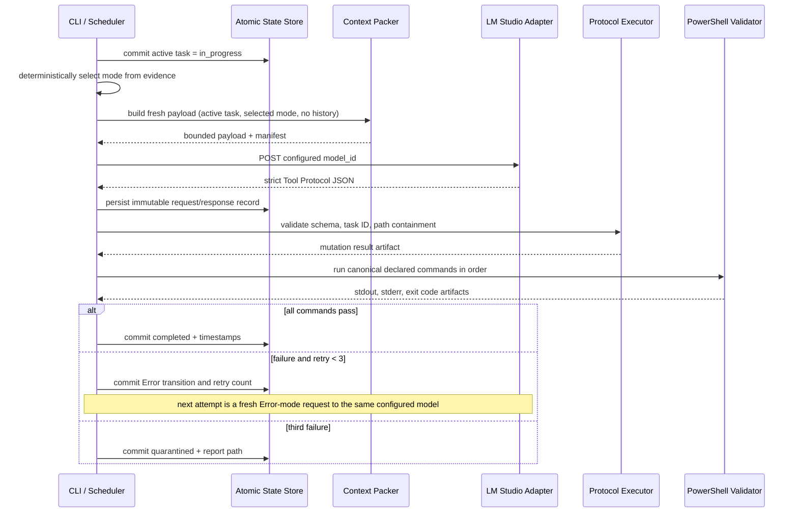

# Design Document: Stateless Turn Python Orchestrator Pipeline

## Overview

The Stateless Turn Python Orchestrator Pipeline is a local-first Python application that converts approved Markdown goal files into a durable, one-at-a-time coding queue. It lives under `local-ai/`, treats each LM Studio call as an isolated request, and permits only validated workspace-local tool operations and task-declared PowerShell validation commands.

The design targets an 8 GB VRAM machine and uses one configured model, `yuxinlu1/gemma-4-12B-agentic-fable5-composer2.5-v2-3.5x-tau2-GGUF`, for every task attempt. Python deterministically selects the Scaffold, Aligner, CoT-Task, or Error mode; the model does not select its own role or mode. Keeping the configured model active avoids repeated model-switching overhead across the backlog, including repeated load/unload waiting, associated PCIe traffic, and thermal cycles. This is a qualitative operational benefit, not a claim of a specific total time, traffic, energy, or temperature saving. Optional low-VRAM controls are capability-gated, benchmarked, and recorded; they are never claimed or enabled merely because they appear in configuration.

The orchestrator’s source of truth is its own workspace-local durable state. It does not mutate Git, create commits/tags/branches, contact remote endpoints other than the configured loopback LM Studio endpoint, or roll back partial source changes after an error. A permanent failure is quarantined with an actionable Markdown report and leaves the workspace intact.

## Scope and Constraints

- **Current discovery scope:** M1–M5 only, configured as enabled milestone ranges. This includes the verified populated M5 set, `.kiro/specs/m5-homepage-experience/goals/goal1.md` through `goal10.md`.
- **Future discovery scope:** M6–M10 are represented as disabled configuration entries. They are discovered only after an explicit configuration change, preventing premature milestone execution.
- **Execution granularity:** exactly one task may be `in_progress` for a workspace. A new task is not selected until the active task is completed or quarantined.
- **Fresh-turn rule:** every task-attempt HTTP request is a newly built payload containing immutable anchors and the active task only. The client sends no conversation history. Closing an HTTP request makes the request/response exchange fresh, but it does not by itself guarantee a KV-cache reset or clearing; the active runtime must be configured and its behavior verified for that cache guarantee.
- **External activity:** model inference is allowed only to a configured loopback LM Studio base URL. All other outbound URLs and network-capable shell commands are denied. Git mutations are always denied.
- **Failure behavior:** preserve partial changes; capture evidence locally; do not automatically retry beyond the defined three Error-mode requests.

## Configuration and Existing-Artifact Conflict Resolution

`local-ai/config/orchestrator.toml` is the sole runtime authority for the active workspace, storage paths, enabled milestones, model endpoint, and legacy instruction migration. No task-provided `cd` command, tracker location, or model setting can override it.

```toml
[workspace]
# Resolved once at startup; this repository is the active project root.
root = "C:/dev/andres-webapp-professional/personal-website-portfolio"
spec_root = ".kiro/specs"
local_storage = "local-ai"

[discovery]
enabled_milestones = [1, 2, 3, 4, 5]
future_milestones = [6, 7, 8, 9, 10]
goal_glob = "m{milestone}-*/goals/goal{goal}.md"
required_goal_numbers = [1, 2, 3, 4, 5, 6, 7, 8, 9, 10]

[legacy_instruction_migration]
# These exact leading `cd` preambles are parsed as a configured workspace alias,
# then removed. No other path rewrite is permitted.
accepted_root_aliases = [
  "C:/dev/andres-webapp-professional/personal-website-portfolio/personal-website-portfolio-v2"
]
# Goal prose may name this tracker, but scheduling state remains orchestrator-owned.
tracker_path = "local-ai/program-states/progress-tracker.md"
tracker_mode = "orchestrator-owned"

[lm_studio]
base_url = "http://127.0.0.1:1234/v1"
model_id = "yuxinlu1/gemma-4-12B-agentic-fable5-composer2.5-v2-3.5x-tau2-GGUF"
request_timeout_seconds = 120
allow_loopback_only = true

[context]
max_total_bytes = 120000
max_file_bytes = 24000
max_active_files = 8
rules_path = "local-ai/context/pipeline-rules.md"
architecture_path = "local-ai/context/architecture-schema.md"

[retry]
max_error_mode_requests = 3

[low_vram]
benchmark_enabled = false
requested_flash_attention = "auto"
requested_unified_kv = "auto"
requested_kv_cache_type = "Q4_0"
requested_kv_offload = "auto"
requested_gpu_offload_layers = "auto"
```

### Root and tracker policy

Existing M5 instructions name a nested `personal-website-portfolio-v2` project root, while the actual configured repository root is `personal-website-portfolio`. During Markdown parsing, a validation block may contain a leading `cd` only when it exactly matches a configured `accepted_root_alias`. The parser records both the raw block and a **canonical declared command** with that preamble removed. The canonical command is the command subsequently matched and run with `workspace.root` as its working directory. Any other absolute root, parent traversal, or unrecognized `cd` is rejected and quarantined rather than rewritten.

The design also resolves the existing progress-tracker conflict: `local-ai/program-states/progress-tracker.md` is an optional, orchestrator-owned projection of `run-state.json`; it is not a task-controlled source-of-truth and does not authorize the Git commit/tag commands found in legacy M5 task prose. If enabled, it is atomically regenerated by the state writer under `local-ai/`. Git commands remain denied regardless of their presence in a parsed task.

## Module Architecture

```text
local-ai/
├── config/
│   ├── orchestrator.toml                 # runtime authority
│   └── tool-protocol.schema.json         # strict action schema
├── context/
│   ├── pipeline-rules.md                 # static top anchor
│   └── architecture-schema.md            # static middle anchor
├── orchestrator/
│   ├── __main__.py                       # CLI: discover, run-once, resume, benchmark
│   ├── config.py                         # parse + validate immutable configuration
│   ├── models.py                         # typed domain records and JSON codecs
│   ├── discovery.py                      # milestone/goal enumeration and numeric ordering
│   ├── markdown_parser.py                # Goal Task parser and declared-command canonicalizer
│   ├── scheduler.py                      # durable single-task selector
│   ├── state_store.py                    # atomic state/artifact persistence
│   ├── mode_selector.py                  # Scaffold/Aligner/CoT-Task/Error classifier
│   ├── context_packer.py                 # bounded fresh payload construction
│   ├── lm_studio.py                      # loopback client, capabilities, stateless request telemetry
│   ├── protocol.py                       # strict JSON validation and tool dispatch
│   ├── workspace.py                      # containment, snapshots, safe file operations
│   ├── command_guard.py                  # declared-command matcher and denylist
│   ├── powershell.py                     # controlled PowerShell subprocess adapter
│   ├── validation.py                     # ordered validation execution
│   ├── telemetry.py                      # benchmark/request telemetry
│   ├── quarantine.py                     # Markdown reports
│   └── services.py                       # dependency composition / clock / process ports
├── program-states/
│   ├── run-state.json                    # durable schedule state
│   ├── run-state.json.bak                # previous valid atomic generation
│   └── progress-tracker.md               # optional derived human projection
├── requests/                              # immutable mode-driven request/response records by task/request ID
├── protocol-records/                      # proposed actions and execution results
├── validation/                            # stdout/stderr/metadata by task and attempt
├── telemetry/                             # NDJSON request and benchmark telemetry
├── quarantine/                            # malformed input and permanent-failure reports
└── tests/                                 # unit/property/integration tests
```

The CLI acquires a workspace-local lock (`program-states/run.lock`) before reading state. The lock payload contains process ID, start time, and workspace ID. A second process cannot run until the first releases the lock or a stale-lock recovery procedure has verified that the owning process is gone; recovery itself is recorded before work resumes.

### Component responsibilities

| Component | Responsibility | Safety boundary |
|---|---|---|
| `ConfigLoader` | Resolves canonical absolute paths; validates local-only endpoint and static limits. | Goal/task content cannot override config. |
| `GoalDiscovery` | Enumerates only enabled numeric milestone/goal coordinates and sorts them numerically. | Future milestones stay disabled. |
| `GoalMarkdownParser` | Produces typed tasks, canonical declared commands, hashes, and parse diagnostics. | Malformed source is never queued. |
| `Scheduler` | Persists selection before any model call; resumes active work first. | One `in_progress` task per workspace. |
| `ModeSelector` | Derives mode from filesystem/dependency/validation evidence. | Model cannot self-select a mode. |
| `ContextPacker` | Creates bounded three-bucket immutable request context. | No prior task messages or unrestricted repository dump. |
| `LmStudioAdapter` | Performs fresh, mode-driven requests to the configured model; queries capabilities and writes telemetry. | Loopback URL allowlist, configured model ID, and request timeouts. |
| `ProtocolValidator`/`WorkspaceToolExecutor` | Validates model action JSON and performs safe local edits. | Schema, task ID, action allowlist, real-path containment. |
| `CommandGuard`/`PowerShellRunner` | Executes only canonical task-declared validation. | Exact normalized match, denylist, workspace cwd. |
| `AtomicStateStore` | Stores all artifacts with atomic replace and schema checks. | Every artifact path is under `local-ai/`. |
| `QuarantineWriter` | Records unsafe inputs and terminal failures as Markdown. | Reporting never changes source workspace files. |

## Data Models and Interfaces

Python 3.12 dataclasses and `typing.Protocol` make policy boundaries explicit. JSON is validated before conversion into domain types.

```python
from dataclasses import dataclass, field
from enum import StrEnum
from pathlib import Path
from typing import Any, Literal, Protocol

class TaskStatus(StrEnum):
    QUEUED = "queued"
    IN_PROGRESS = "in_progress"
    COMPLETED = "completed"
    QUARANTINED = "quarantined"

class ExecutionMode(StrEnum):
    SCAFFOLD = "Scaffold"
    ALIGNER = "Aligner"
    COT_TASK = "CoT-Task"
    ERROR = "Error"

@dataclass(frozen=True, order=True)
class TaskId:
    milestone: int
    goal: int
    task: int

    def __str__(self) -> str:
        return f"M{self.milestone}.G{self.goal}.T{self.task}"

@dataclass(frozen=True)
class DeclaredCommand:
    raw_text: str
    canonical_text: str
    ordinal: int

@dataclass(frozen=True)
class GoalTask:
    id: TaskId
    source_path: str              # workspace-relative POSIX form
    source_hash: str
    heading: str
    objective: str
    acceptance_criteria: tuple[str, ...]
    prerequisites: tuple[str, ...]
    implementation_details: str
    validation_commands: tuple[DeclaredCommand, ...]
    active_target_hints: tuple[str, ...]

@dataclass(frozen=True)
class TaskQueueRecord:
    task: GoalTask
    ordinal: int

@dataclass
class TaskRunRecord:
    task_id: TaskId
    status: TaskStatus
    mode_history: list[ExecutionMode] = field(default_factory=list)
    error_mode_requests: int = 0
    started_at: str | None = None
    completed_at: str | None = None
    request_ids: list[str] = field(default_factory=list)
    validation_artifact_paths: list[str] = field(default_factory=list)
    changed_workspace_paths: list[str] = field(default_factory=list)
    quarantine_report_path: str | None = None

@dataclass
class RunState:
    schema_version: int
    workspace_id: str
    queue: list[TaskQueueRecord]
    task_records: dict[str, TaskRunRecord]
    active_task_id: str | None
    updated_at: str

@dataclass(frozen=True)
class ToolOperation:
    protocol_version: Literal["1.0"]
    task_id: str
    target_path: str
    action: Literal["mkdir", "write_file", "patch_file", "delete_file"]
    arguments: dict[str, Any]
    expected_result: str

@dataclass(frozen=True)
class ToolResult:
    task_id: str
    action: str
    resolved_path: str
    status: Literal["completed", "rejected", "failed"]
    timestamp: str
    error_details: str | None = None

class ModelClient(Protocol):
    def request(self, *, payload: dict[str, Any]) -> "ModelResponse": ...
    def capabilities(self) -> "RuntimeCapabilities": ...
    def verify_runtime_cache_policy(self) -> "CachePolicyVerification": ...

class StateStore(Protocol):
    def load(self) -> RunState: ...
    def commit(self, state: RunState) -> None: ...
    def write_json_artifact(self, relative_path: str, value: dict[str, Any]) -> str: ...

class CommandRunner(Protocol):
    def run_powershell(self, command: str, cwd: Path) -> "CommandResult": ...
```

`RunState` contains no free-form model context. Request payloads, model responses, protocol proposals/results, command output, telemetry, and quarantine reports are immutable, timestamped artifacts referenced by relative path. This keeps scheduling data small and makes interruption recovery auditable.

### Tool Protocol contract

The model response must contain exactly one JSON object, with no Markdown fences or explanatory text. The protocol schema requires all fields shown below, rejects unknown action names, and rejects unknown top-level properties.

```json
{
  "protocol_version": "1.0",
  "task_id": "M5.G1.T1",
  "target_path": "tests/fixtures/home-data.ts",
  "action": "write_file",
  "arguments": { "content": "..." },
  "expected_result": "A strongly typed fixture module exists."
}
```

Allowed actions are deliberately small:

- `mkdir`: create a missing workspace-relative directory.
- `write_file`: atomically replace one text file after containment and encoding checks.
- `patch_file`: apply a structured, unique-context patch to an existing text file.
- `delete_file`: disabled by default and enabled only by a dedicated explicit configuration switch; it is never inferred from model output.

The protocol executor enforces a maximum payload/file size and rejects binary paths, links that resolve outside the workspace, device paths, absolute paths, and any `..` traversal after normalization. Before and after each accepted mutation it records relative path, SHA-256 hash when readable, and outcome. It does not invoke a shell for tool operations.

## Discovery, Parsing, and Queue Construction

### Discovery algorithm

1. Resolve `workspace.root`, `spec_root`, and `local_storage` to canonical absolute paths. Fail initialization if local storage is not a descendant of the workspace.
2. For each enabled milestone number, enumerate matching `m{N}-*` directories under `.kiro/specs`.
3. For each configured goal number, inspect `goals/goal{N}.md`; only existing, non-whitespace files enter parsing.
4. Sort candidates by `(milestone_number, goal_number, canonical_relative_path)`, not filename text. Thus M5/G2 precedes M5/G10.
5. SHA-256 hash the complete source and parse headings of the form `### M5.G1.T1: ...` (allowing configured Markdown heading depth), objective, acceptance criteria, prerequisites, implementation details, and the validation block.
6. Parse and canonicalize every validation command. Persist successful source hashes and queue records atomically. Generate one quarantine report per invalid file/section and continue with unrelated valid inputs.
7. Detect duplicate IDs globally. Quarantine every task with that ID before queue selection.

The parser extracts the raw Markdown section exactly for reporting. It never guesses absent content or promotes a task with an empty objective, acceptance criteria list, or validation list. Future M6–M10 files are neither scanned nor treated as failures while disabled. Enabling a future milestone is a deliberate config update followed by discovery.

## Durable Scheduler and State Machine

The scheduler uses compare-and-commit transitions. State is written with a same-directory temporary file, file flush, atomic `replace`, then a retained previous generation. It validates the state schema and workspace identity on every load.

```mermaid
stateDiagram-v2
    [*] --> Initialize
    Initialize --> RefuseState: state missing/unreadable
    RefuseState --> [*]: quarantine state failure
    Initialize --> Resume: active task exists
    Initialize --> SelectQueued: no active task
    Resume --> Preflight
    SelectQueued --> PersistInProgress: choose first queued numeric task
    PersistInProgress --> Preflight: atomic state committed
    Preflight --> Scaffold: target absent
    Preflight --> Aligner: import/dependency/signature mismatch
    Preflight --> CoTTask: target healthy
    Scaffold --> Request: fresh single-model request
    Aligner --> Request: fresh single-model request
    CoTTask --> Request: fresh single-model request
    Request --> Execute: strict Tool Protocol JSON
    Execute --> Validate: valid tool result(s)
    Execute --> Quarantined: invalid protocol output
    Execute --> Resume: transport failure; retain in_progress
    Validate --> Completed: all declared commands exit 0
    Validate --> Error: command exit nonzero and retries < 3
    Error --> Request: fresh single-model Error request
    Validate --> Quarantined: command exit nonzero and retries = 3
    Completed --> SelectQueued
    Quarantined --> SelectQueued
```



Python selects `Scaffold`, `Aligner`, and `CoT-Task` from preflight evidence, and selects `Error` only after validation fails. Every task attempt has exactly one selected mode and produces exactly one request to the configured model; the same model returns the strict Tool Protocol JSON for all modes. `Scaffold` and `Aligner` include their observed condition, while `Error` includes the failed command result. Every transition updates `mode_history` before the outgoing request.

Transport failures are not permanent task quarantines: they retain the committed `in_progress` record, partial workspace changes, and a request-error artifact so a later `resume` uses the same active task. Invalid protocol output is quarantined because execution safety cannot be established.

## Stateless Context Packer and Single-Model Requests

### Bounded context

Each task attempt constructs one new, immutable HTTP payload with exactly three content buckets plus protocol instructions:

1. **System rules:** `pipeline-rules.md`, concise rules that require valid tool JSON and prohibit prose around it.
2. **Architecture schema:** `architecture-schema.md`, selected relevant interfaces and conventions.
3. **Active task scope:** parsed task fields, Python-selected mode and evidence, canonical declared validation commands, and a bounded set of active workspace files.

`ContextPacker` selects files only from task target hints, parsed import relationships, and mode diagnostics. It uses deterministic path ordering, per-file byte caps, a total byte cap, and explicit truncation markers. It never adds prior-task prompts, responses, validation logs, arbitrary repository files, or conversation history. The packer emits a manifest with included file paths, hashes, truncation status, payload byte count, configured model ID, and selected mode; the manifest is persisted beside the request record.

### Single-model request policy

`LmStudioAdapter` sends each request to the one configuration-owned `model_id` and accepts no task or model-output model-choice input. It uses that configured model throughout queue processing. Before requests begin, the adapter verifies that the active local runtime reports the configured model as available and records its capability report. Connection, timeout, and non-success responses are captured with configured model ID, endpoint class, status/error, task ID, mode, and timestamp. Request bodies and response artifacts receive unique IDs and are not reused.

A fresh HTTP request means the orchestrator creates a new payload and supplies no prior conversation history. It does not, by closing the request, promise that a serving runtime has cleared its KV cache. Any KV-cache reset/clearing requirement must be explicitly configured in the active runtime and verified from that runtime's capability/effective-configuration evidence before it is recorded as satisfied. The single configured model avoids repeated model load/unload waits, PCIe transfers, and thermal cycling caused by model switching across the backlog; actual end-to-end savings depend on runtime behavior and workload and must be measured rather than assumed.



## Low-VRAM Capability Gate and Telemetry

At initialization and before a benchmarked run, `LmStudioAdapter.capabilities()` records the runtime-reported support matrix. The configuration can request, but cannot force, these candidate settings:

- Flash Attention;
- unified KV-cache behavior;
- Q4_0 K/V cache candidate configuration;
- KV cache offload;
- GPU layer offload.

The configuration value `auto` means “apply only if the active runtime reports the named capability and accepted value.” `Q4_0` is a candidate cache type, not a fact about the runtime. For every setting the capability artifact records `supported`, `unsupported`, or `not-reported`; unsupported/not-reported settings retain LM Studio defaults and produce no activation command. The adapter validates the runtime’s returned effective configuration before marking a setting applied. Cache reset/clearing is separately recorded only when the active runtime exposes a supported configuration and verification result; an HTTP connection close is not evidence that a KV cache was reset.

For benchmarked requests only, the telemetry writer creates one append-only NDJSON record per request:

```json
{
  "task_id": "M5.G1.T1",
  "request_id": "req_...",
  "model_id": "yuxinlu1/gemma-4-12B-agentic-fable5-composer2.5-v2-3.5x-tau2-GGUF",
  "execution_mode": "CoT-Task",
  "timestamp": "2026-01-01T00:00:00Z",
  "elapsed_ms": 1250,
  "low_vram": {
    "flash_attention": "unsupported",
    "unified_kv": "applied",
    "kv_cache_type": "Q4_0",
    "kv_offload": "not-reported",
    "gpu_offload_layers": "default"
  },
  "reported_memory": { "vram_used_mb": 6200 }
}
```

Missing memory data is stored as absent/not-reported, never synthesized. Benchmark telemetry supports comparison of supported settings without claiming performance or memory savings in advance.

## Command Safety, Validation, and Retry Handling

### Command evaluation

The parser’s canonical declared commands are normalized by line-ending conversion, whitespace collapse outside quoted literals, and removal of only an exact configured legacy root preamble. The command guard compares the proposed command against one canonical declared command for the active task; no partial matching, interpolated command, or extra pipeline segment is allowed.

Before matching, tokens are checked against a denylist that blocks Git mutations (`commit`, `tag`, `branch`, `push`, `reset`, `clean`), remote Git operations, `curl`, `Invoke-WebRequest`, `Invoke-RestMethod`, package download/install commands, SSH, and other network-capable aliases. A task may be quarantined for an unexecutable declared validation command rather than weakened to permit it. Read-only `git diff` is not required by the pipeline and remains denied by default to keep command policy simple and deterministic.

Accepted commands run as a non-interactive PowerShell subprocess in `workspace.root`, with a minimal inherited environment, timeout, captured output, and no profile loading. Results are stored as JSON metadata plus separate UTF-8 stdout/stderr artifacts under `local-ai/validation/<task-id>/<attempt>/`.

### Retry policy

1. A normal mode-driven model response can lead to validation.
2. If any declared command fails, store all results, transition to `Error`, and include the exact nonzero exit code and bounded stderr excerpt in the next fresh Error-mode request context.
3. Increment `error_mode_requests` immediately before each Error-mode request. At most three such requests occur for the active task.
4. If validation later passes, commit `completed`, the validation paths, timestamp, and exact error-mode count.
5. If validation still fails after the third Error request, atomically commit `quarantined`; leave all changed workspace files in place; emit a Markdown report containing the task ID, mode history, commands, stdout, stderr, exit codes, retry count, changed paths, and recovery timestamp.

## Error Handling and Quarantine Reports

Errors are typed and handled at the nearest safe boundary:

| Error class | Outcome |
|---|---|
| Invalid config or storage outside workspace | Refuse startup; emit startup report only if storage containment can be safely established. |
| Malformed goal/task or duplicate task ID | Exclude affected source; write a parse/duplicate report; continue unrelated tasks. |
| Missing/corrupt Run State | Write state-failure report and refuse task execution until repaired/restored. |
| LM Studio connection, timeout, or non-success | Keep task `in_progress`, preserve source changes, persist request error; resume later. |
| Model output not strict protocol JSON | Keep changes, quarantine active task with response and parse error. |
| Protocol schema/action/path/security rejection | Do not execute action; persist rejection record; quarantine if task cannot safely continue. |
| Validation failure before retry limit | Persist output and transition to Error mode. |
| Validation failure after third Error request | Preserve changes; quarantine task with full recovery report. |

A report uses a stable Markdown template with provenance and redaction. It includes raw task/model material only as local evidence; values matching configured secrets/redaction patterns are replaced before storage. Each report links relative artifact paths rather than embedding unbounded logs.

```markdown
# Quarantine: M5.G1.T1

- **Category:** validation-permanent-failure
- **Source:** `.kiro/specs/m5-homepage-experience/goals/goal1.md`
- **Recorded:** `2026-01-01T00:00:00Z`
- **Recovery:** partial workspace changes preserved; task marked quarantined

## Mode history
`CoT-Task → Error → Error → Error`

## Validation evidence
| Attempt | Command | Exit | Stdout | Stderr |
|---|---|---:|---|---|

## Changed workspace paths
- `tests/fixtures/home-data.ts`
```

## Security Boundaries

1. **Workspace boundary:** all resolved file and artifact paths must be canonical descendants of the configured root; symlink resolution is checked before operation.
2. **Storage boundary:** state, request records, reports, telemetry, and output records are confined to `local-ai/` under the workspace.
3. **Model boundary:** models propose data only; they do not receive direct shell or filesystem authority. Strict JSON protocol validation precedes every mutation.
4. **Command boundary:** only parser-derived canonical validation commands for the active task can execute, from the configured root, after denylist validation.
5. **Network boundary:** LM Studio requests target only loopback `127.0.0.1`/`localhost` as configured; tool operations and validation commands cannot make outbound requests.
6. **Git boundary:** no automatic Git mutation occurs. The pipeline explicitly rejects commit, tag, branch, push, reset, clean, and analogous commands even if Markdown tasks request them.
7. **Configured-model boundary:** `model_id` comes only from validated configuration. Model output cannot choose a model, change a runtime model setting, or select its mode; Python selects the deterministic mode from observable evidence.
8. **Audit boundary:** every decision that rejects, mutates, executes, or transitions state is represented by a local artifact with timestamp and active task ID.

## Test Plan

Tests use pytest, Hypothesis for pure-logic properties, temporary workspaces, fake clock/process/model adapters, and a local LM Studio test double. No property test uses actual model inference or a real PowerShell process.

### Unit and example tests

- Parser fixtures: populated M5 `goal1`–`goal10`, malformed sections, duplicate IDs, canonical legacy-root `cd`, rejected unknown `cd`.
- Atomic state: select commits `in_progress` before fake model call; completion is committed only after zero-exit validation output is stored; corrupt state refuses execution.
- LM Studio adapter: configured-model routing for every mode-driven request; connection/timeout/non-success artifacts; capability and cache-policy verification normalization.
- PowerShell adapter: configured workspace cwd, declared command order, captured output metadata using a fake runner.
- Permanent failure: three Error-mode failures retain changed files and produce a complete Markdown report.
- Configuration: actual repository root supersedes the nested legacy instruction root; tracker projection remains `local-ai/program-states/progress-tracker.md`; disabled M6–M10 are absent from current discovery.

### Property tests

Run each property test for at least 100 generated examples. The property-test metadata format is:

`Feature: stateless-turn-python-orchestrator-pipeline, Property N: <property title>`

Use generators for numeric identifiers, Markdown sections, source roots, path traversal strings, symlink layouts, command whitespace/token variants, queue transitions, support matrices, and validation failure sequences. Use model/property fakes for all I/O.

### Integration and smoke tests

- A local, explicitly invoked smoke test queries the configured loopback LM Studio capability endpoint and verifies endpoint locality; it does not change runtime settings unless benchmark mode is explicitly enabled.
- A temporary-workspace integration test processes a small valid task through a fake single-model mode-driven response, a real protocol executor, and fake PowerShell validation.
- A manual benchmark workflow may run one configured task with supported low-VRAM values and inspect per-request telemetry. It does not compare settings or assert gains without collected measurements.

## Correctness Properties

*A property is a behavior that must hold across all valid executions. The following properties were derived after classifying every requirement criterion for property, example, edge-case, integration, or smoke testing. Redundant ordering, command-gate, mode-classification, retry, and low-VRAM criteria have been consolidated so each property provides distinct validation value.*

### Property 1: Eligible goal discovery and faithful parsing

For all configured enabled M1–M5 goal-file layouts and valid Goal Task Markdown sections, discovery returns every existing non-empty eligible file in numeric milestone/goal order and parsing produces queue records whose task identifier, objective, acceptance criteria, prerequisites, implementation details, and canonical declared validation commands faithfully represent the source; the stored content hash is stable for equal content and differs for changed content.

**Validates: Requirements 1.1, 1.2, 1.4, 2.1**

### Property 2: Invalid and duplicate task exclusion

For all malformed Goal Files/Goal Tasks missing one or more required fields, and for all duplicate task-ID pairs, the affected task records are excluded from the executable queue and a quarantine report identifies the source path(s), missing field or duplicate ID, timestamp, and raw source section.

**Validates: Requirements 1.3, 2.4**

### Property 3: Numeric queue ordering is independent of digit width

For all permutations of valid task coordinates, queue ordering is ascending by numeric milestone, numeric goal, and numeric task values rather than lexical text order, including coordinates such as 2 and 10.

**Validates: Requirements 2.1, 2.2, 2.3**

### Property 4: Single active task and restart priority

For all queue sizes and valid scheduler transition sequences, the durable run state contains at most one `in_progress` task, and after a restart an existing `in_progress` task is selected before every queued task.

**Validates: Requirements 3.2, 3.3**

### Property 5: Fresh model request isolation and routing

For all distinct active tasks and Python-selected execution modes, exactly one request per task attempt uses the one configured `model_id`. Each payload contains the active task, mode, validation block, bounded active-file context, and rules, and it contains no prior-task conversation or request messages. Fresh HTTP payload construction is distinguished from KV-cache clearing: cache reset/clearing is recorded as satisfied only when the active runtime’s configured and verified cache policy reports it.

**Validates: Requirements 4.1, 4.2, 4.3, 4.4**

### Property 6: Protocol validation and workspace confinement

For all proposed tool JSON documents and filesystem path inputs, an action is accepted only when it has the complete valid protocol shape and matching active task ID, and every accepted resolved target is a canonical descendant of the configured workspace; every completed result serializes its required audit fields.

**Validates: Requirements 5.1, 5.2, 5.3**

### Property 7: Invalid protocol safely preserves the task

For all model responses that are not valid Tool Protocol JSON, the orchestrator performs no unvalidated tool operation, retains the active task as `in_progress`, preserves existing workspace changes, and emits a report containing the response text and parse error.

**Validates: Requirements 5.4**

### Property 8: Command authorization excludes unsafe activity

For all declared commands, candidate commands, whitespace variants, and denylisted Git/network/action forms, execution is allowed if and only if the candidate exactly equals one normalized canonical declared command and contains no denied capability; every rejection produces a local audit record with task ID, rejected text, category, and timestamp.

**Validates: Requirements 6.1, 6.2, 6.3**

### Property 9: Observable preflight and validation evidence determines mode

For all preflight inspection results and validation failures, Python mode selection is deterministic and exhaustive: an absent target selects Scaffold, a dependency/import/signature mismatch selects Aligner, a healthy existing target selects CoT-Task, and every nonzero validation result selects Error with its exit code and stderr available to the next fresh same-model request context.

**Validates: Requirements 7.1, 7.2, 7.3, 7.4**

### Property 10: Ordered validation and bounded error recovery

For all active tasks with declared validation command sequences and any sequence of validation outcomes, declared commands execute in declaration order before completion, Error-mode requests to the configured model never exceed three, and a success on retry 1–3 records `completed` with the exact Error-mode request count.

**Validates: Requirements 8.1, 8.2, 8.3**

### Property 11: All local artifact paths remain workspace-scoped

For all configured workspace roots, artifact categories, task IDs, and permitted relative names, every derived Local AI Storage path is a canonical descendant of the workspace and no state, request record, protocol record, telemetry entry, validation output, or quarantine report targets an external path.

**Validates: Requirements 9.1**

### Property 12: Capability-gated low-VRAM application and telemetry

For all runtime capability matrices, requested optional low-VRAM settings, and benchmarked request sequences, only settings reported supported by the active runtime are applied, unsupported/not-reported settings retain defaults and are recorded as such, and each benchmarked request has exactly one telemetry record with task ID, model ID, mode, timestamp, elapsed time, effective supported settings, and available memory telemetry.

**Validates: Requirements 9.3, 9.4, 9.5**

### Property 13: Permanent validation failure preserves changes and evidence

For all tasks whose validation remains nonzero after three Error-mode requests, the task is quarantined without rolling back its changed workspace paths and its Markdown report contains task ID, mode history, validation commands, stdout, stderr, exit codes, retry count, changed paths, and recovery timestamp.

**Validates: Requirements 8.4**

## Requirements Traceability Summary

- Requirements 1–2 are satisfied by `discovery.py`, `markdown_parser.py`, numeric `TaskId`, queue persistence, and parser quarantine reports.
- Requirement 3 is satisfied by `scheduler.py`, `state_store.py`, workspace lock, and atomic records.
- Requirement 4 is satisfied by `context_packer.py`, `lm_studio.py`, the single configuration-owned `model_id`, Python mode selection, fresh request artifacts, and runtime cache-policy verification.
- Requirements 5–6 are satisfied by `protocol.py`, `workspace.py`, `command_guard.py`, and `powershell.py`.
- Requirements 7–8 are satisfied by `mode_selector.py`, `validation.py`, bounded retry transitions, and permanent-failure quarantine.
- Requirement 9 is satisfied by workspace-scoped artifact derivation, runtime capability gating, and append-only telemetry.

This design intentionally leaves implementation sequencing to `tasks.md`, the next workflow phase.
